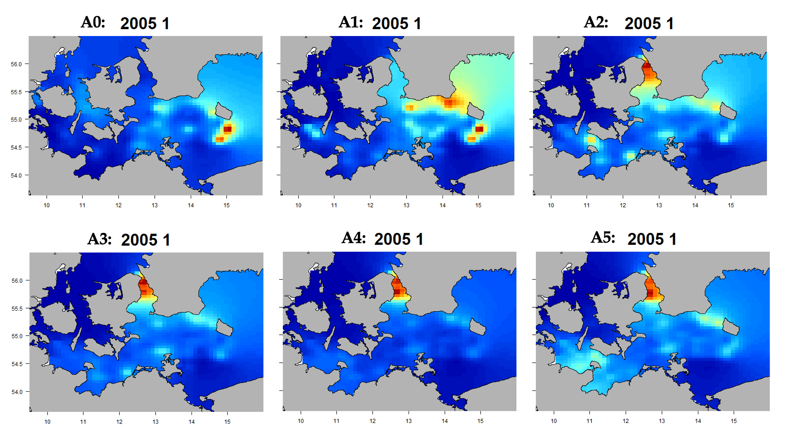
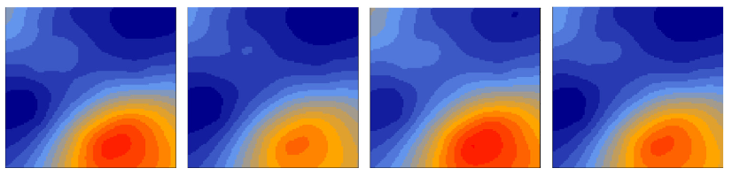
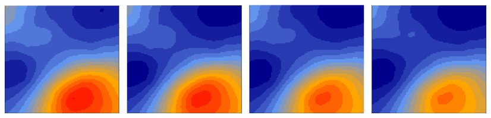
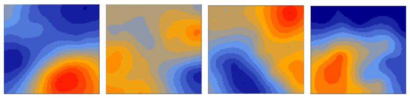

```{r xaringan-themer, include=FALSE, warning=FALSE}


#~~~~~~~~~~~~~~~~~~~~~~
# Default knitr iputs
#~~~~~~~~~~~~~~~~~~~~~~

source("../Scripts/Setup/setup_knitr.R")

#~~~~~~~~~~~~~~~~~~~~~~
# Slide customization
#~~~~~~~~~~~~~~~~~~~~~~
source("../Scripts/Setup/setup_slides.R")


```

class: title-slide
<div class="title-block">
  <h1>`r rmarkdown::metadata$title`</h1>
  <div class="date-text">`r rmarkdown::metadata$date`</div>
</div>

<div class="subtitle-block">
  <h2>`r rmarkdown::metadata$subtitle`</h2>
  <p class="author-name">`r rmarkdown::metadata$author`</p>
  <p class="author-email"><u>`r rmarkdown::metadata$institute`</u></p>
</div>


---
# PPGECO | ECL0072 | out. 2026

Processos ecológico são dinâmicos no espaço e no tempo


<br>

.small-text2[.center[**Dinâmica espaço-temporal do bacalhau (*Gadus morhua*)**]]


```{r, out.width="90%"}

```


---
# PPGECO | ECL0072 | out. 2026

**Distribuição persistente aleatória**

<br>


```{r, out.width="60%"}

```


---
# PPGECO | ECL0072 | out. 2026

**Distribuição persistente com tendência**

<br>


```{r, out.width="60%"}

```


---

# PPGECO | ECL0072 | out. 2026

**Distribuição oportunística**

<br>

```{r, out.width="60%"}

```


---
# PPGECO | ECL0072 | out. 2026

**Distribuição com progressão**

<br>

```{r, out.width="60%"}

```
