```{r xaringan-themer, include=FALSE, warning=FALSE}


#~~~~~~~~~~~~~~~~~~~~~~
# Default knitr iputs
#~~~~~~~~~~~~~~~~~~~~~~

source("../Scripts/Setup/setup_knitr.R")

#~~~~~~~~~~~~~~~~~~~~~~
# Slide customization
#~~~~~~~~~~~~~~~~~~~~~~
source("../Scripts/Setup/setup_slides.R")


```

class: title-slide
<div class="title-block">
  <h1>`r rmarkdown::metadata$title`</h1>
  <div class="date-text">`r rmarkdown::metadata$date`</div>
</div>

<div class="subtitle-block">
  <h2>`r rmarkdown::metadata$subtitle`</h2>
  <p class="author-name">`r rmarkdown::metadata$author`</p>
  <p class="author-email"><u>`r rmarkdown::metadata$institute`</u></p>
</div>


---
# PPGECO | ECL0072 | out. 2026


### Estrutura do curso | .small-text[<span style="color: #e07a5f;">Ementa</span>]

<br>

.small-text2[

.center[**SEMANA 1**]
<br>

- **19/10 -** Revisitando Modelos Lineares (LM)
- **20/10 -** Métodos de inferência estatística: frequentista vs. bayesiana
- **21/10 -** Modelagem bayesiana
- **22/10 -** Modelos Lineares Mistos (LMM)
- **23/10 -** Modelos Lineares/Aditivos Generalizados Mistos (GLMM/GAMM)

]


------

<br>

.small-text2[

.center[**SEMANA 2**]

<br>
- **26/10 -** Fundamentos em Estatística Espacial & GIS
- **27/10 -** Modelos Espaciais (via R-INLA)
- **28/10 -** Modelos Espaço-Temporais (via R-INLA)
- ~~**29/10 -** Dúvidas dos projetos (opcional: tutorial de elaboração de mapas no R)~~ [Feriado!]
- **30/10 -** Apresentação dos projetos

]


---
# PPGECO | ECL0072 | out. 2026


### Estrutura do curso | .small-text[<span style="color: #e07a5f;">Avaliação</span>]


Desenvolvimento de um projeto prático no qual se deverá explorar um banco de dados ecológico e  propor um modelo estatístico alinhado às abordagens estatísticas apresentadas ao longo da disciplina

- Grupo de **3 pessoas**, utilizando, preferencialmente dados próprios


<br>


.pull-left[

.center[**Relatório escrito**]

<div style="height: 7px;"></div>

.small-text2[
Entrega de resumo do projeto (máx. 2 páginas), contemplando os seguintes tópicos:

- Contexto 
- Objetivo(s) do estudo
- Hipótese(s) do estudo
- Descrição do conjunto de dados
- Abordagem estatística proposta

<br>

]


> .small-text2[<span style="color: #e07a5f;">**Entrega: 26/10 (segunda-feira)**</span>]


]


.pull-right[

.center[**Apresentação oral do projeto**]

<div style="height: 15px;"></div>

.small-text2[
- 10 min de apresentação
- 5-10 min de discussão com a turma
]


<br>
<br>
<br>
<br>
<br>
<br>
<br>


> .small-text2[<span style="color: #e07a5f;">**Apresentação: 30/10 (sexta-feira)**</span>]


]

---
# PPGECO | ECL0072 | out. 2026

### Filosofia do curso

<br>

### .center[Índice HBC]

<br>

--

```{r, out.width = "70%"}

```


---
# PPGECO | ECL0072 | out. 2026

### Uma jornada estatística

```{r, out.width = "80%"}
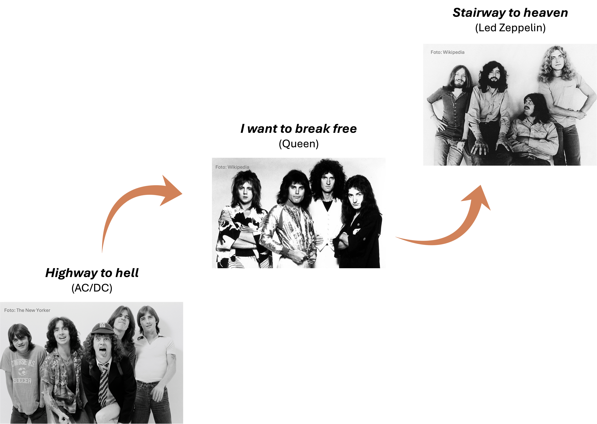
```


---
# PPGECO | ECL0072 | out. 2026


<br>
<br>


.pull-left[

<br>
<br>


```{r echo=FALSE, out.width ="75%", fig.cap="Edwards Demming (1900-1993)", fig.topcaption=F}

```
]


.pull-right[

<br>
<br>
<br>
<br>
<br>
<br>
<br>
<br>


> <font size="6"><center> <span style="color: #e07a5f;"> <b>Without data</b>, you're just another <b>person with an opinion</b></center></font></span> 


]

---
# PPGECO | ECL0072 | out. 2026

### Material do curso

Todo o curso foi construído usando apenas o R Markdown 
- Material pode ser acessado via


<br>
<br>

.center[.gray-box-big[

**https://github.com/mcruf/ECL0072-LVM**

]]

---

class: inverse, center, middle


## <span style="color: #6b705c;"> - Modelos Lineares - </span>

---
# PPGECO | ECL0072 | out. 2026
### A economia da natureza


<div style="height: 7px;"></div>

```{r echo=FALSE, out.width ="85%"}
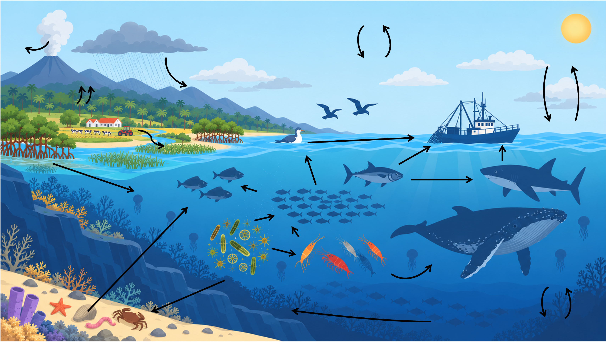
```


.footnote[.small-text2[Figura criada com IA]]


--

.center[.small-text2[**A matemática é a linguagem da natureza**]]


---
# PPGECO | ECL0072 | out. 2026
### O que é um modelo?


Um modelo descreve as mais diversas relações da natureza

<br>
<br>


$$ \huge y = f(x|\theta)$$
<br>
<br>
<br>


```{r echo=FALSE, out.width ="60%"}
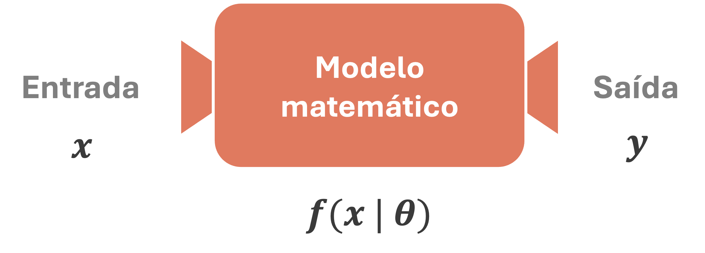
```

---
# PPGECO | ECL0072 | out. 2026
### O que é um modelo *estatístico*?

<br>

.gray-box-small[

$$\Large y ~~~~ = \underbrace{f(x|\theta)}_\text{Determinístico} + \underbrace{\varepsilon}_\text{Estocástico}$$
]


<br>


```{r echo=FALSE, out.width ="65%"}
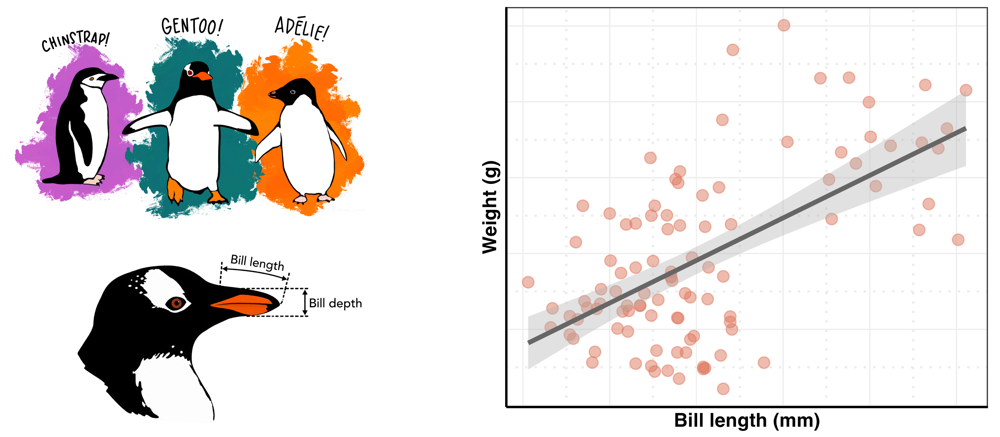
```

.footnote[.small-text2[Ilustrações (adaptadas): [Allison Horst](https://allisonhorst.github.io/palmerpenguins/)]]

---
# PPGECO | ECL0072 | out. 2026
### Tipos de relações


<br>
<br>

```{r echo=FALSE, out.width ="90%"}
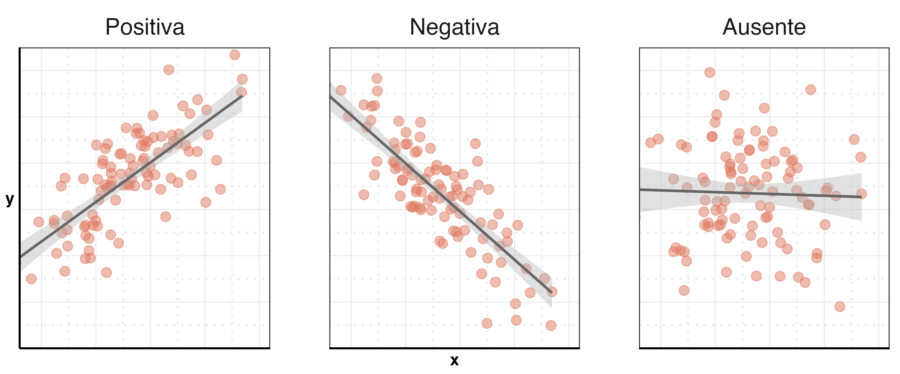
```


---
# PPGECO | ECL0072 | out. 2026
### Para que serve um modelo?

**| Descritivo **

Avaliar a relação entre variáveis

<br>

.center[.small-text[**Indicadores de mudanças climáticas ao longo do tempo**]]

<div style="height: 7px;"></div>


```{r echo=FALSE, out.width ="100%"}
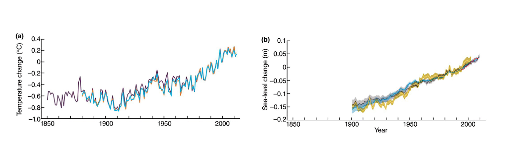
```


.footnote[.small-text2[Figura: Begon & Townsend (2021)]]

---
# PPGECO | ECL0072 | out. 2026
### Para que serve um modelo?

**| Inferência **


Avaliar e formar novas hipóteses

<div style="height: 7px;"></div>


.center[.small-text[**Relação produtividade *vs.* riqueza de espécies em comunidades de lagos**]]

<div style="height: 7px;"></div>


```{r echo=FALSE, out.width ="60%"}
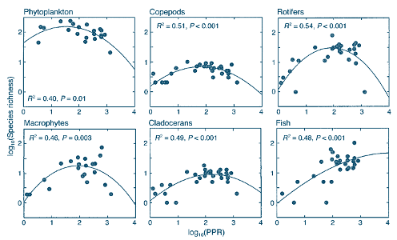
```


.footnote[.small-text2[Figura adaptada: [Dodson et al. (2000)](https://www.jstor.org/stable/177332)]]

---
# PPGECO | ECL0072 | out. 2026
### Para que serve um modelo?

**| Predição **


Realizar projeções (futuras ou passadas)

<br>

.center[.small-text[**Cenários climáticos e seus efeitos na pesca**]]

<div style="height: 7px;"></div>


.pull-left[

<div style="height: 10px;"></div>


```{r echo=FALSE, out.width ="90%"}
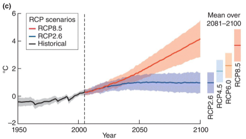
```


]


.pull-right[


```{r echo=FALSE, out.width ="100%"}
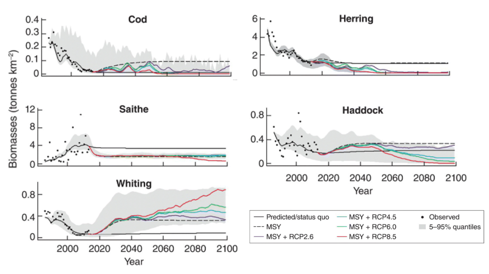
```


]


.footnote[.small-text2[Figuras: Begon & Townsend (2021); [Serpetti et al. (2017)](https://www.nature.com/articles/s41598-017-13220-7)]]


---
# PPGECO | ECL0072 | out. 2026
### Para que serve um modelo?


Modelos são uma descrição simplificada da natureza

<br>

```{r echo=FALSE, out.width ="50%"}
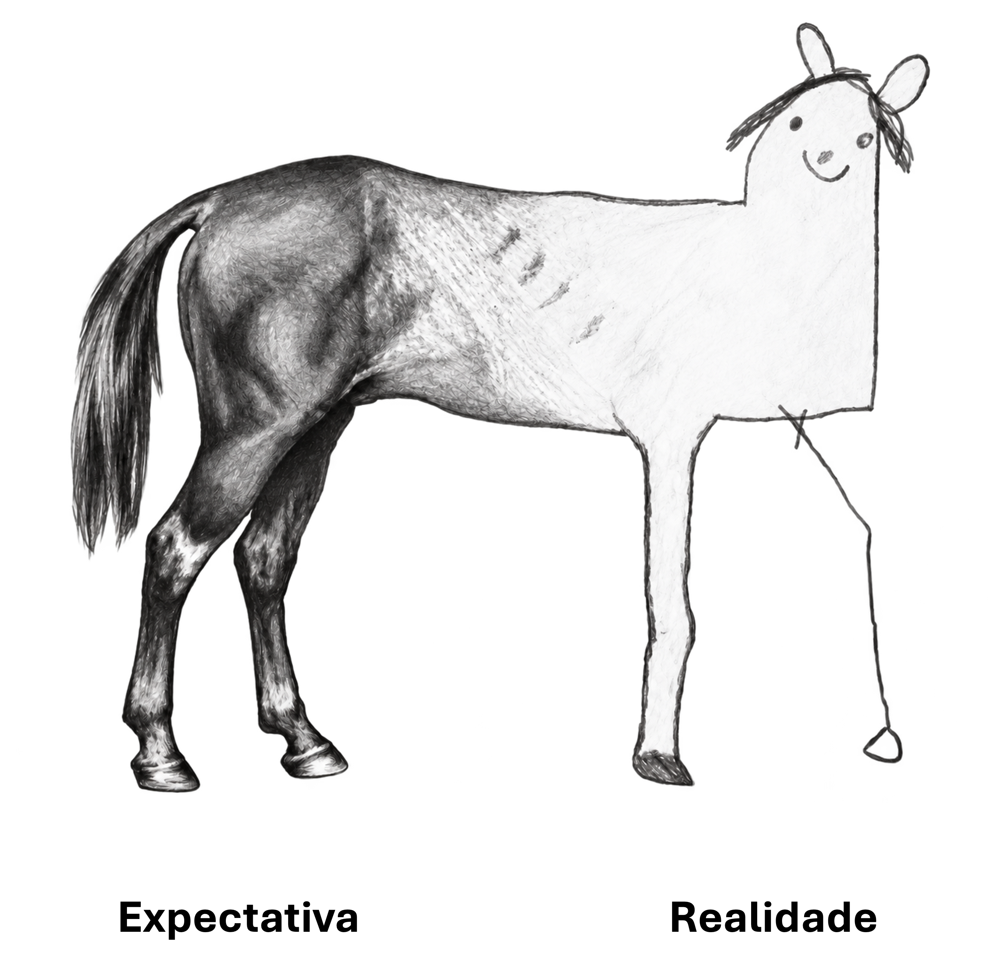
```


.footnote[.small-text2[Imagem: Reddit (adaptada)]]

---
# PPGECO | ECL0072 | out. 2026
### Para que serve um modelo?


.pull-left[

<br>
<br>


```{r echo=FALSE, out.width ="60%", fig.cap="George P. Box (1919-2013)", fig.topcaption=F}

```
]


.pull-right[

<br>
<br>
<br>
<br>
<br>
<br>
<br>
<br>


> <font size="6"><center> <span style="color: #e07a5f;"> Essentially, <b>all models are wrong</b>, but <b>some are useful</b></center></font></span> 


]

---
# PPGECO | ECL0072 | out. 2026

### Modelos lineares

Base para a maioria dos modelos mais complexos

<br>


```{r echo=FALSE, out.width ="55%"}
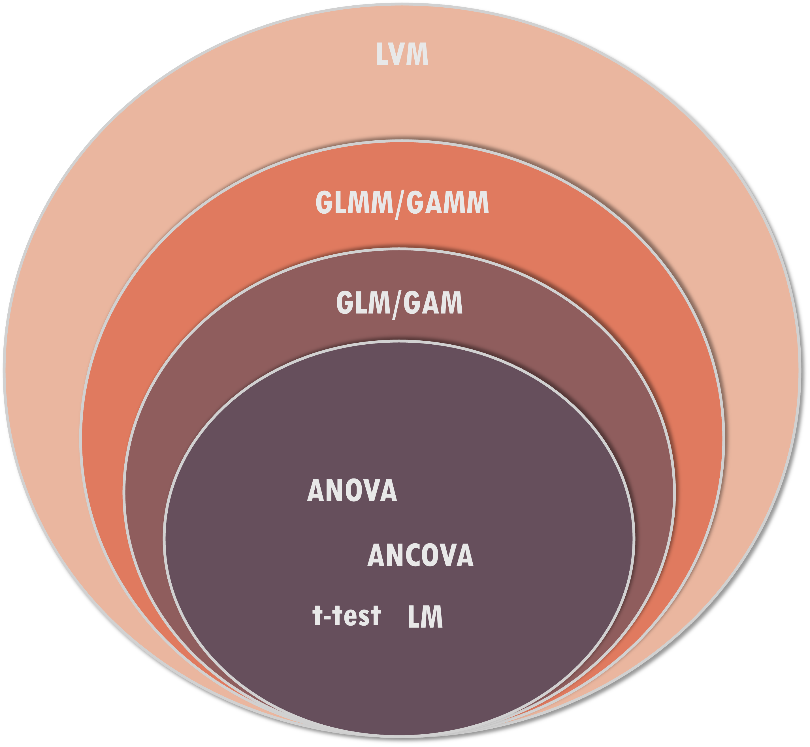
```


---
# PPGECO | ECL0072 | out. 2026

### Modelos lineares 

<br>
<br>
<br>
<br>

.pull-left[

.gray-box-big[
$$\large y \sim Normal (\color{#e07a5f}\mu, \color{#457b9d}\sigma)$$


$$\large \color{#e07a5f}{\mu(x)} = \beta_0 + \beta_1x$$
]

-----


$$\large y_i = \color{#e07a5f}{\mu_i} + \color{#457b9d}{\varepsilon_i}$$

$$\large \varepsilon_i \sim Normal(0, \sigma)$$


<br>


.small-text3[
- $\beta_0$ - intercepto
- $\beta_1$ - parâmetro (coeficiente, peso, ...)
- $x$ - covariável (variável independente, preditora, input, ... )
- $y$ - variável resposta (variável dependente, output, ...)
- $\varepsilon$ - resíduo (erro)
]

]


.pull-right[


```{r echo=FALSE, out.width ="90%"}
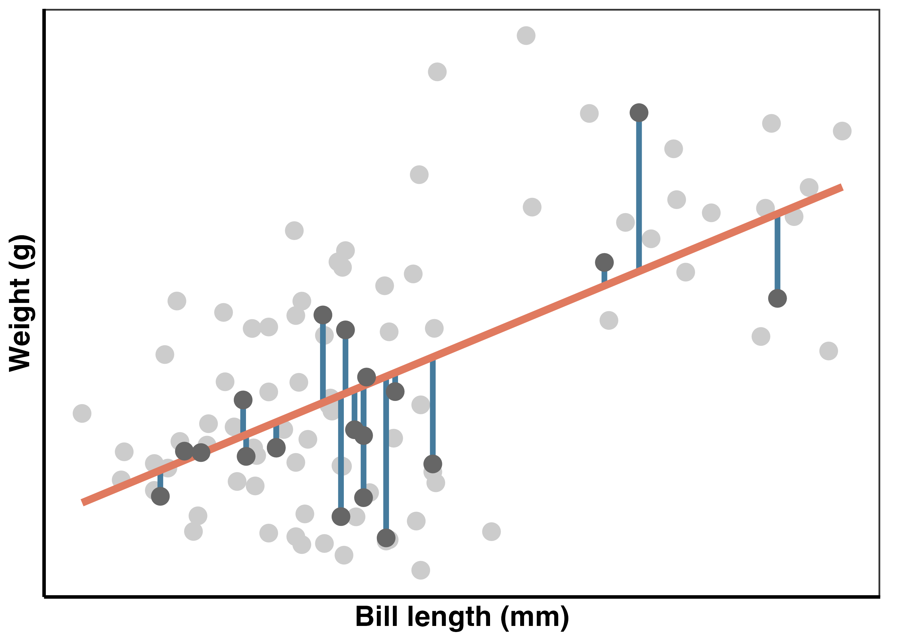
```

]

---
# PPGECO | ECL0072 | out. 2026

### Modelos lineares 


.pull-left[

<br>
<br>
<br>
<br>
<br>
<br>
<br>
<br>

.gray-box-big[
$$\LARGE y_i = \beta_0 + \beta_1{\color{#e07a5f}{x_i}} + \varepsilon_i$$
]

]


.pull-right[

<br>


```{r echo=FALSE, out.width ="65%", fig.align='center'}
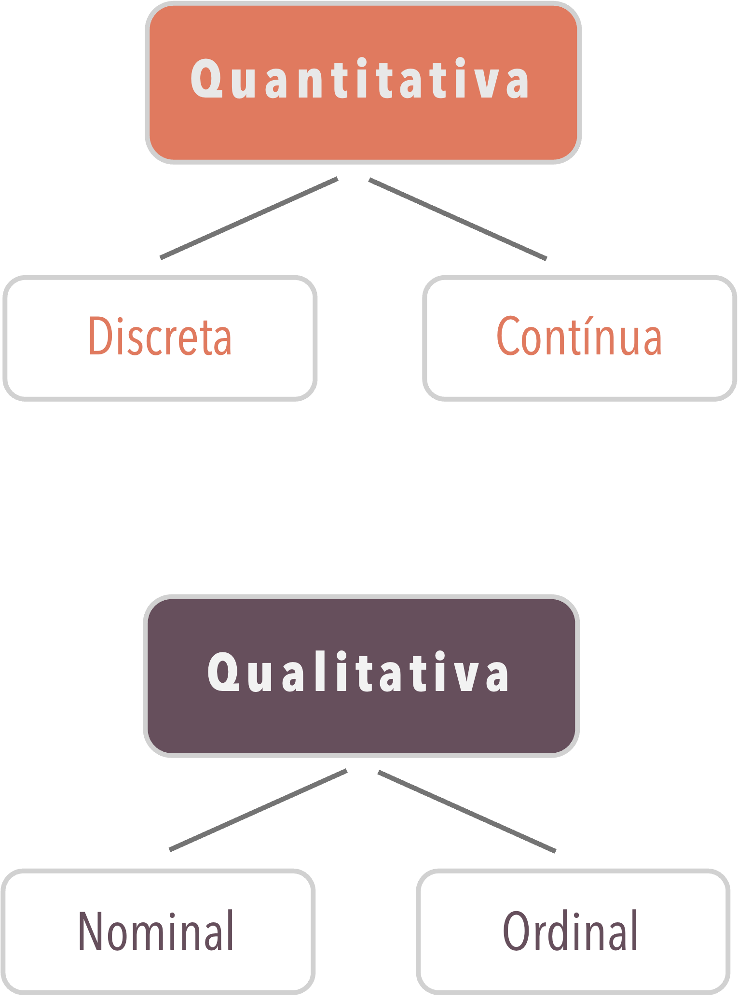
```

]

---
# PPGECO | ECL0072 | out. 2026

### Modelos lineares 


.pull-left[

<br>
<br>

```{r echo=FALSE, out.width ="65%", fig.align='center'}

```

]


.pull-right[

<br>


#### .center[<span style="color: #e07a5f;">LM </span>]

- Quando $x$ reúne apenas variáveis *quantitativas*

-------


#### .center[<span style="color: #e07a5f;">ANOVA </span>]

- Quando $x$ reúne apenas variáveis *qualitativas*

-------


#### .center[<span style="color: #e07a5f;">ANCOVA </span>]

- Quando $x$ reúne variáveis *quantitativas* e *qualitativas*


]

---
# PPGECO | ECL0072 | out. 2026

### Modelos lineares 

<br>
<br>


.pull-left[


.gray-box-big[

$$\Large y_i = \mu_i + \varepsilon_i$$


$$\Large \varepsilon_i = y_i - \mu_i $$

]

<br>


O resíduo representa a variabilidade de $y$ que não foi explicada pelo componente sistemático do modelo


Essa variabilidade pode refletir

- Diferenças biológicas entre indivíduos
- Variáveis não incluídos no modelo
- Erros de medição e amostragem
- Estocasticidade ambiental
- ...
  


]


.pull-right[

<br>
<br>

```{r echo=FALSE, out.width ="90%"}

```

]


---
# PPGECO | ECL0072 | out. 2026

### Modelos lineares 

O termo *linear* está relacionado na linearidade entre os parâmetros do modelo ($\theta = \{\beta_0, \beta_1 \}$) e não em relação às variáveis preditoras (jeitão do gráfico)


<br>
<br>

.pull-left[

$$y_i = \beta_0 + \beta_1x_i + \varepsilon_i$$ 

```{r echo=FALSE, out.width ="90%"}
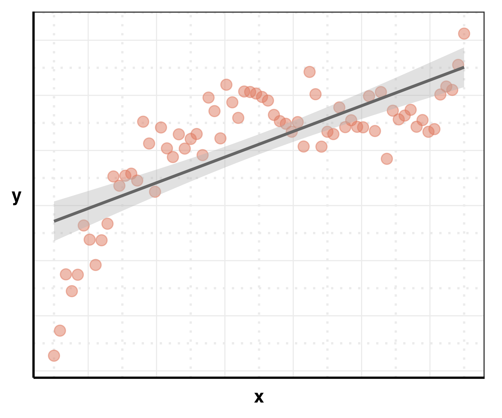
```

]


.pull-right[

$$y_i = \beta_0 + \beta_1 x_i + \beta_2 x_i^2 + \beta_3 x_i^3 + \varepsilon_i$$ 

```{r echo=FALSE, out.width ="90%"}
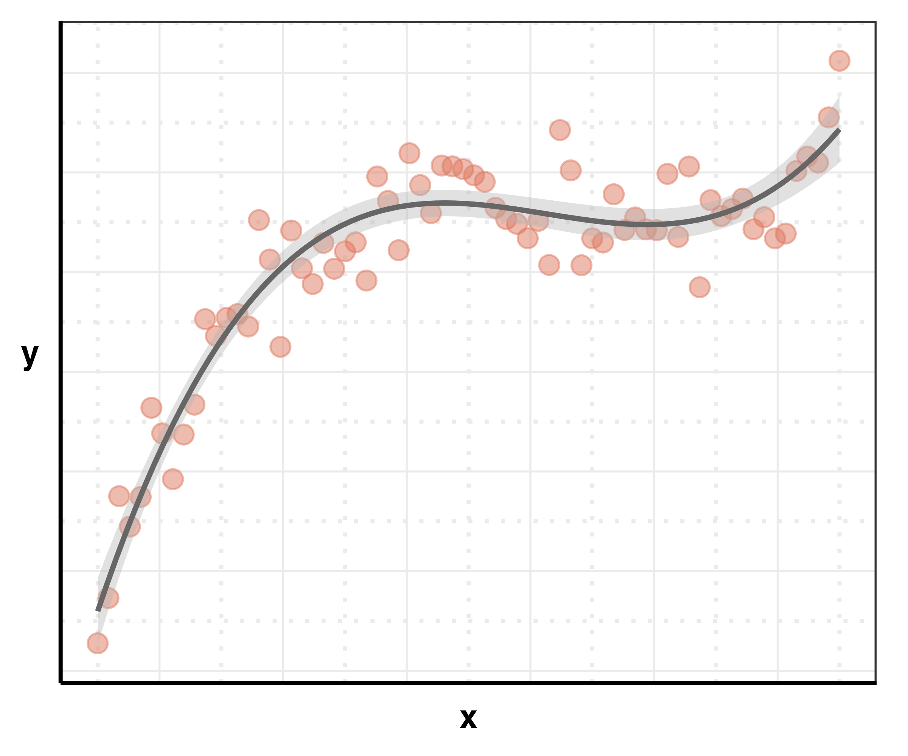
```

]

---
# PPGECO | ECL0072 | out. 2026

### Modelos lineares 

#### Quais equações são lineares?

<br>
<br>


.pull-left[
- $\Large y = \beta_0 + \beta_1 x + \beta_2 x^2 + \varepsilon$

<br>
<br>

- $\Large y = \beta_0 + \beta_1 \beta_2 x + \varepsilon$

<br>
<br>

- $\Large y = \beta_0 + \beta_1log(x_1) + \varepsilon$
]

--

.pull-right[

- $\large y = \beta_0 + \beta_1 x_1 + \beta_2 x_2 + \beta_3 x_1 x_2 + \epsilon$

<br>
<br>

- $\Large y = \beta_0 + e^{\beta_1x_1} + \varepsilon$

<br>
<br>

- $\Large y = \frac{1}{1 + e^{-(\beta_0 + \beta_1 x)}} + \varepsilon$

]


---
# PPGECO | ECL0072 | out. 2026

### Modelos lineares | .small-text[<span style="color: #e07a5f;">Um olhar matemático</span>]


Muitos modelos estatísticos podem ser expressos por meio de matrizes
- Facilita a implementação computacional 
- Permite utilizar ferramentas de álgebra linear na estimação dos parâmetros do modelo


<br>


$$\Large \mathbf{y} = \mathbf{X} \boldsymbol{\beta} + \boldsymbol{\varepsilon}$$

<br>

.small-text2[
- **y** - vetor da variável resposta ($n \times 1$)
- **X** - matriz de design; inclui os preditores e intercepto ($n \times p$)
- $\boldsymbol{\beta}$ - vetor dos parâmetros ($p \times 1$)
- $\boldsymbol{\varepsilon}$ - vetor dos resíduos ($n \times 1$)
]


<br>

--

.gray-box-big[

.small-text3[
.center[**Convenção de notação**]


**Escalar:** letra minúscula em itálico (ex.: $x_i, y_i, n$)

**Vetor:** letra minúscula em negrito (ex: $\mathbf{y}, \boldsymbol{\beta}, \boldsymbol{\varepsilon}$)

**Matriz:** letra maiúscula em negrito (ex: $\mathbf{X}, \mathbf{Z}, \mathbf{\Sigma}$)
</div>

]
]


---
# PPGECO | ECL0072 | out. 2026

### Modelos lineares | .small-text[<span style="color: #e07a5f;">Um olhar matemático</span>]


**| Exemplo prático**


.center[.small-text2[**Pinguins de Palmer**]]


.code-bg[
```{r, echo = T, eval=F}

## Importando os dados
dados <- readRDS("Dados/palmerpenguins_extended.rds")

```
]

<br>


```{r echo=FALSE, out.width ="50%", fig.align ='center'}
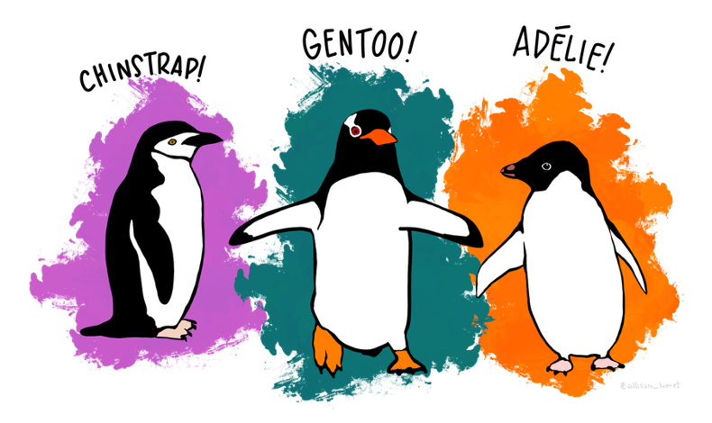
```


.footnote[.small-text2[Fonte: https://allisonhorst.github.io/palmerpenguins/]]

---
# PPGECO | ECL0072 | out. 2026

### Modelos lineares | .small-text[<span style="color: #e07a5f;">Um olhar matemático</span>]


<br>
<br>


.pull-left[


.gray-box-small[
$$\large Peso_i = \beta_0 + \beta_1Bico_i + \varepsilon_i$$
]

<br>

```{r echo=F, message=F, warning=F}

set.seed(123)


dados <- readRDS("../Dados/palmerpenguins_extended.rds")

dados %>%
  group_by(species) %>%
  sample_n(size = 2) %>%
  select(c("bill_length_mm","body_mass_g")) %>%
  kable(align = "ccc")  %>%
  kable_styling(font_size = 18, full_width = FALSE)

```


]

.pull-right[

<br>

```{r echo=FALSE, out.width ="90%"}
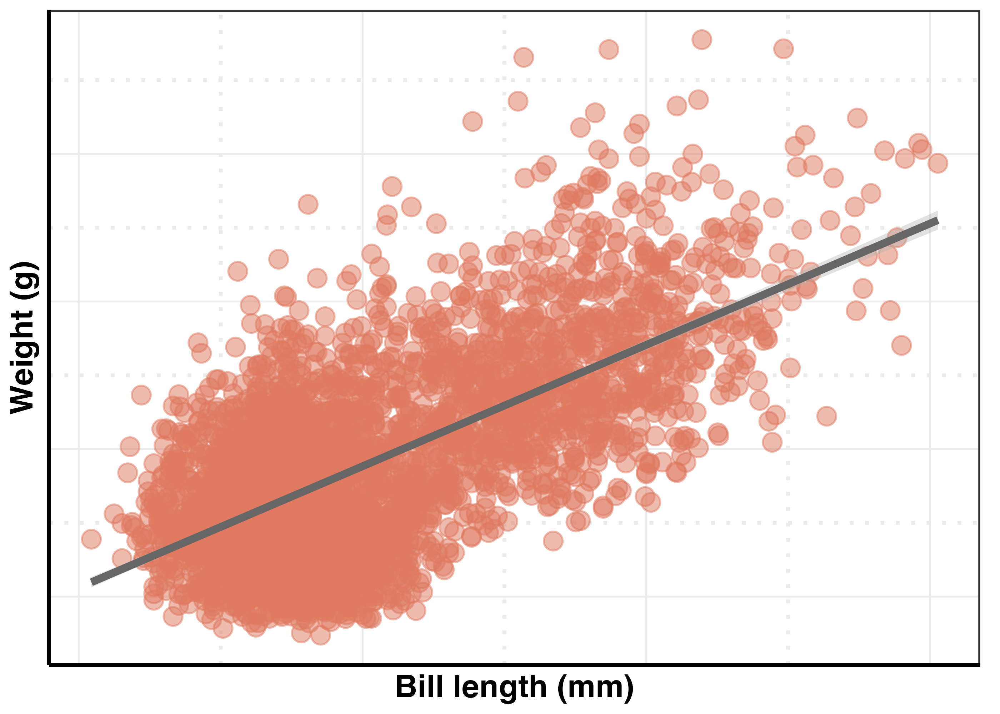
```


]


---
# PPGECO | ECL0072 | out. 2026

### Modelos lineares | .small-text[<span style="color: #e07a5f;">Um olhar matemático</span>]


<br>
<br>

$$\Large Peso_i = \beta_0 + \beta_1Bico_i + \varepsilon_i$$

<br>

.pull-left[

<br>
<br>


$$\Large \color{#e07a5f}{5330} = \beta_0 + \beta_1 \color{#e07a5f}{30.5} + \varepsilon_1 \\ \Large \color{#e07a5f}{5126} = \beta_0 + \beta_1 \color{#e07a5f}{58.3} + \varepsilon_2 \\ \Large \color{#e07a5f}{3392} = \beta_0 + \beta_1 \color{#e07a5f}{33.6} + \varepsilon_3 \\ ~~~\vdots ~~~~~~~~~~~\vdots ~~~~~~~~~~~\vdots ~~~~~~~~~~\vdots$$

]

--


.pull-right[


<br>

$$
\begin{bmatrix}
\large
5330 \\
\large 5126 \\
\large 3392 \\
\large 4194 \\
\large 7482 \\
\large 7306
\end{bmatrix}
=
\begin{bmatrix}
\large 1 & \large 30.5 \\
\large 1 & \large 58.3 \\
\large 1 & \large 33.6 \\
\large 1 & \large 27.6 \\
\large 1 & \large 57.2 \\
\large 1 & \large 75.0
\end{bmatrix}
\begin{bmatrix}
\large \beta_0 \\
\large \beta_1
\end{bmatrix}
+
\begin{bmatrix}
\large \varepsilon_1 \\
\large \varepsilon_2 \\
\large \varepsilon_3 \\
\large \varepsilon_4 \\
\large \varepsilon_5 \\
\large \varepsilon_6
\end{bmatrix}
$$

]


---
# PPGECO | ECL0072 | out. 2026

### Modelos lineares | .small-text[<span style="color: #e07a5f;">Um olhar matemático</span>]


No `R`, podemos usar a função .small-text[`model.matrix()`] para construir a matriz de design $\mathbf{X}$ 


<br>


.code-bg[

```{r, echo = T}

## Formula
form <- dados$body_mass_g~dados$bill_length_mm

## Design matrix
model.matrix(form)[1:10, ]


```

]

---

# PPGECO | ECL0072 | out. 2026

### Modelos lineares | .small-text[<span style="color: #e07a5f;">Um olhar matemático</span>]

**| ANOVA (um fator)**


<br>
<br>


.pull-left[

.gray-box-small[

$Peso_i = \beta_0 + \sum_{j=1}^{J-1} \beta_jEspecie_{i,j} + \varepsilon_{i,j}$

]

<br>

```{r echo=F, message=F, warning=F}
set.seed(123)


dados <- readRDS("../Dados/palmerpenguins_extended.rds")

dados %>%
  group_by(species) %>%
  sample_n(size = 2) %>%
  select(c("bill_length_mm","body_mass_g")) %>%
  kable(align = "ccc")  %>%
  kable_styling(font_size = 18, full_width = FALSE)

```

]


.pull-right[

<br>

```{r echo=FALSE, out.width ="90%"}
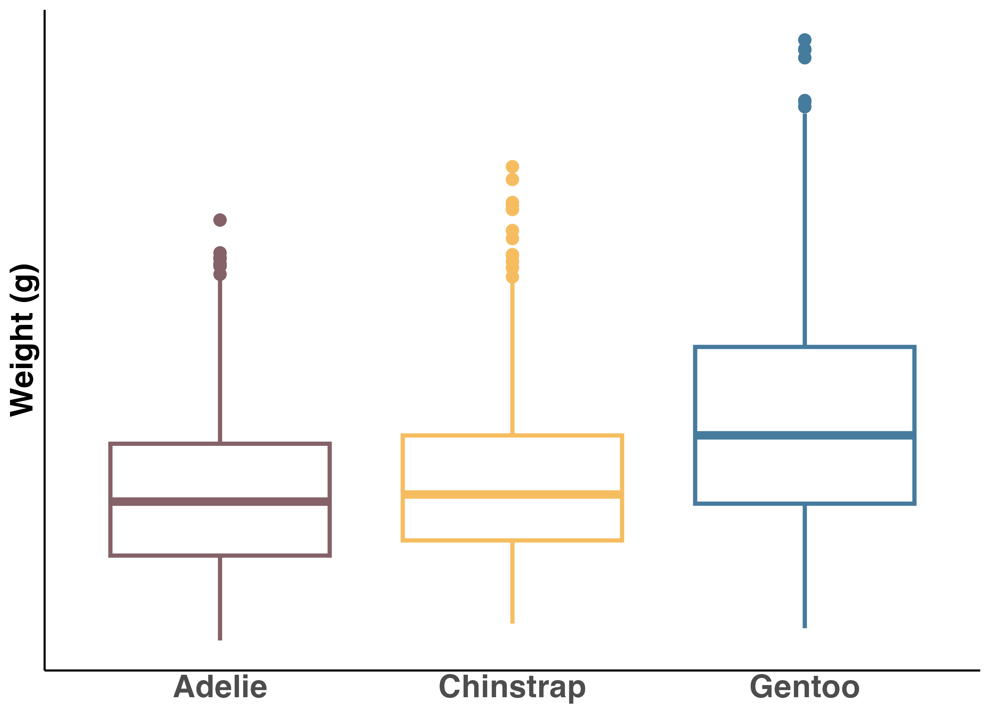
```


]

<br>

--


<div style="height: 7px;"></div>

> <span style="color: #e07a5f;">**ATENÇÃO: O primeiro nível do fator é sempre absorvido pelo intercepto] $\beta_0$ nível de referência)**</span>


---
# PPGECO | ECL0072 | out. 2026

### Modelos lineares | .small-text[<span style="color: #e07a5f;">Um olhar matemático</span>]

**| ANOVA (um fator)**

<br>
<br>

$$\large Peso_i = \beta_0 + \beta_1Chinstrap_i + \beta_2Gentoo_i + \varepsilon_{i,j}$$

<br>

.pull-left[

<br>
<br>


$$\Large \color{#e07a5f}{5330} = \beta_0 + (\beta_1 \cdot \color{#e07a5f}0) + (\beta_2 \cdot \color{#e07a5f}0) + \varepsilon_1 \\ \Large \color{#e07a5f}{3392} = \beta_0 + (\beta_1 \cdot \color{#e07a5f}1) + (\beta_2 \cdot \color{#e07a5f}0) + \varepsilon_3 \\ \Large \color{#e07a5f}{7482} = \beta_0 + (\beta_1 \cdot \color{#e07a5f}0) + (\beta_2 \cdot \color{#e07a5f}1) + \varepsilon_5 \\ ~~~\vdots ~~~~~~~~~~~\vdots ~~~~~~~~~~~\vdots ~~~~~~~~~~\vdots$$

]

--


.pull-right[


<br>

$$
\begin{bmatrix}
\large 5330 \\
\large 5126 \\
\large 3392 \\
\large 4194 \\
\large 7482 \\
\large 7306
\end{bmatrix}
=
\begin{bmatrix}
\large 1 & \large 0 & \large 0\\
\large 1 & \large 0 & \large 0\\
\large 1 & \large 1 & \large 0\\
\large 1 & \large 1 & \large 0\\
\large 1 & \large 0 & \large 1\\
\large 1 & \large 0 & \large 1
\end{bmatrix}
\cdot
\begin{bmatrix}
\large \beta_0 \\
\large \beta_1 \\
\large \beta_2
\end{bmatrix}
+
\begin{bmatrix}
\large \varepsilon_1 \\
\large \varepsilon_2 \\
\large \varepsilon_3 \\
\large \varepsilon_4 \\
\large \varepsilon_5 \\
\large \varepsilon_6
\end{bmatrix}
$$

]


---
# PPGECO | ECL0072 | out. 2026

### Modelos lineares | .small-text[<span style="color: #e07a5f;">Um olhar matemático</span>]

**| ANOVA**

<br>

.code-bg[

```{r, echo = T}

## Formula
form2 <- dados$body_mass_g~dados$species

## Design matrix
head(model.matrix(form2))
tail(model.matrix(form2))


```

]

---
# PPGECO | ECL0072 | out. 2026

### Modelos lineares | .small-text[<span style="color: #e07a5f;">Um olhar matemático</span>]

**| ANCOVA**

<br>
<br>

.pull-left[


.gray-box-small[

$Peso_i = \beta_0 + \beta_1Bico_i + \sum_{j=1}^{J-1} \beta_jEspecie_{i,j} + \varepsilon_{i}$

]

<br>

```{r echo=F, message=F, warning=F}
set.seed(123)


dados <- readRDS("../Dados/palmerpenguins_extended.rds")

dados %>%
  group_by(species) %>%
  sample_n(size = 2) %>%
  select(c("bill_length_mm","body_mass_g")) %>%
  kable(align = "ccc")  %>%
  kable_styling(font_size = 18, full_width = FALSE)

```

]


.pull-right[

<br>
<br>

```{r echo=FALSE, out.width ="90%"}
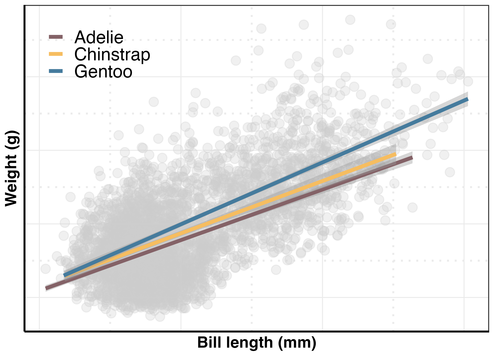
```


]

---
# PPGECO | ECL0072 | out. 2026

### Modelos lineares | .small-text[<span style="color: #e07a5f;">Um olhar matemático</span>]

**| ANCOVA**

<br>
<br>

$$\large Peso_i = \beta_0 + \beta_1Bico_i + \sum_{j=1}^{J-1} \beta_jEspecie_{i,j} + \varepsilon_{i}$$

<br>

.pull-left[

$$\color{#e07a5f}{5330} = \beta_0 + \beta_1\color{#e07a5f}{30.5} + (\beta_2 \cdot\color{#e07a5f}{0}) + (\beta_3 \cdot \color{#e07a5f}{0}) + \varepsilon_1 \\  \color{#e07a5f}{3392} = \beta_0 + \beta_1\color{#e07a5f}{33.6} + (\beta_2 \cdot\color{#e07a5f}{1}) + (\beta_3 \cdot \color{#e07a5f}{0}) + \varepsilon_3 \\  \color{#e07a5f}{7482} = \beta_0 + \beta_1\color{#e07a5f}{57.2} + (\beta_2 \cdot\color{#e07a5f}{0}) + (\beta_3 \cdot \color{#e07a5f}{1}) + \varepsilon_5 \\ ~~~\vdots ~~~~~~~~~~~\vdots ~~~~~~~~~~~\vdots ~~~~~~~~~~\vdots$$


]

--

.pull-right[

$$\begin{bmatrix}
5330 \\
5126 \\
3392 \\
4194 \\
7482 \\
7306
\end{bmatrix}
=
\begin{bmatrix}
1 & 30.5 & 0 & 0 \\
1 & 58.3 & 0 & 0 \\
1 & 33.6 & 1 & 0 \\
1 & 27.6 & 1 & 0 \\
1 & 57.2 & 0 & 1 \\
1 & 75.0 & 0 & 1
\end{bmatrix}
\begin{bmatrix}
\beta_0 \\
\beta_1 \\
\beta_2 \\
\beta_3
\end{bmatrix}
+
\begin{bmatrix}
\varepsilon_1 \\
\varepsilon_2 \\
\varepsilon_3 \\
\varepsilon_4 \\
\varepsilon_5 \\
\varepsilon_6
\end{bmatrix}$$

]

---
# PPGECO | ECL0072 | out. 2026

### Modelos lineares | .small-text[<span style="color: #e07a5f;">Um olhar matemático</span>]

**| ANCOVA**

<br>

.code-bg[

```{r, echo = T}

## Formula
form3 <- dados$body_mass_g ~ dados$bill_length_mm + dados$species

## Design matrix
head(model.matrix(form3))

```

]


---
# PPGECO | ECL0072 | out. 2026

### Modelos lineares | .small-text[<span style="color: #e07a5f;">Um olhar matemático</span>]

**| ANCOVA com interação**


<br>

.pull-left[


.gray-box-small[


$\small Peso_i =\beta_0 + \beta_1 Bico_i + \beta_2 Especie_{i,1} + \beta_3 Especie_{i,2}  + \beta_4 Bico_i\,Especie_{i,1} + \beta_5 Bico_i\,Especie_{i,2} + \varepsilon_i$

]

<br>
<br>


```{r echo=F, message=F, warning=F}
set.seed(123)


dados <- readRDS("../Dados/palmerpenguins_extended.rds")

dados %>%
  group_by(species) %>%
  sample_n(size = 2) %>%
  select(c("bill_length_mm","body_mass_g")) %>%
  kable(align = "ccc")  %>%
  kable_styling(font_size = 18, full_width = FALSE)

```

]


.pull-right[

<br>
<br>
<br>
<br>

```{r echo=FALSE, out.width ="90%"}

```


]

---
# PPGECO | ECL0072 | out. 2026

### Modelos lineares | .small-text[<span style="color: #e07a5f;">Um olhar matemático</span>]

**| ANCOVA com interação**

<br>
<br>

$$Peso_i =\beta_0 + \beta_1 Bico_i + \beta_2 Chinastrap_{i} + \beta_3 Gentoo_{i} + \beta_4 Bico_i\,Chinastrap_{i} + \beta_5 Bico_i\,Gentoo_{i} + \varepsilon_i$$

<br>


$$\begin{bmatrix}
\large 5330\\
\large 5126\\
\large 3392\\
\large 4194\\
\large 7482\\
\large 7306
\end{bmatrix}
=
\begin{bmatrix}
\large 1 & \large 30.5 & \large 0 & \large 0 & \large 0 & \large 0\\
\large 1 & \large 58.3 & \large 0 & \large 0 & \large 0 & \large 0\\
\large 1 & \large 33.6 & \large 1 & \large 0 & \large 33.6 & \large 0\\
\large 1 & \large 27.6 & \large 1 & \large 0 & \large 27.6 & \large 0\\
\large 1 & \large 57.2 & \large 0 & \large 1 & \large 0 & \large 57.2\\
\large 1 & \large 75.0 & \large 0 & \large 1 & \large 0 & \large 75.0
\end{bmatrix}
\begin{bmatrix}
\large \beta_0\\
\large \beta_1\\
\large \beta_2\\
\large \beta_3\\
\large \beta_4\\
\large \beta_5
\end{bmatrix}
+
\begin{bmatrix}
\large \varepsilon_1\\
\large \varepsilon_2\\
\large \varepsilon_3\\
\large \varepsilon_4\\
\large \varepsilon_5\\
\large \varepsilon_6
\end{bmatrix}$$

---

# PPGECO | ECL0072 | out. 2026

### Modelos lineares | .small-text[<span style="color: #e07a5f;">Pressupostos</span>]


Todo modelo estatístico é baseado em um conjunto de pressupostos

--

<br>
- **Representatividade**
  - As amostras são representativas da população
  - *Garbage in, garbage out*

--

<br>

- **Aditividade & Linearidade**
  - O modelo é aditivo e linear na relação de seus parâmetros

--

<br>

- **Resíduos**
  - Independentes 
  - Homocedásticos (variância constante)*
  - Normalidade*


.footnote[*Apenas aplicável para modelos lineares!]
---
# PPGECO | ECL0072 | out. 2026

### Estudo dirigido

.small-text3[

**Livros**

- **Cap. 01** - Faraway (2014). Linear Models With R, 2nd Ed.

- **Caps. 06, 07 & 11** - Gelman et al. (2020). Regression and Other Stories.

- **Cap. 01** - Hobbs & Hooten (2007). Bayesian Models - A Statistical Primer for Ecologists.

- **Cap. 06** - Kery (2007). Introduction to WinBUGS for Ecologists - A Bayesian Approach to Regression, ANOVA, Mixed Models and Related Analysis.


----

**Artigos**

- Davis & Kay (2023). [Writing statistical methods for ecologists](https://esajournals.onlinelibrary.wiley.com/doi/10.1002/ecs2.4539)

- Powers & Hampton (2019). [Open science, reproducibility, and transparency in ecology](https://esajournals.onlinelibrary.wiley.com/doi/10.1002/eap.1822)

- Touchon & McCoy (2016).[The mismatch between current statistical practice and doctoral training in ecology](https://esajournals.onlinelibrary.wiley.com/doi/10.1002/ecs2.1394)

- Tredennick et al. (2021). [A practical guide to selecting models for exploration, inference, and prediction in ecology](https://esajournals.onlinelibrary.wiley.com/doi/10.1002/ecy.3336)

- Zuur et al. (2010). [A protocol for data exploration to avoid common statistical problems. Methods in ecology and evolution](https://doi.org/10.1111/j.2041-210X.2009.00001.x)

- Zuur & Ieno (2016). [A protocol for conducting and presenting results of regression-type analyses](https://besjournals.onlinelibrary.wiley.com/doi/10.1111/2041-210X.12577)

]

---

class:center, middle
# PPGECO | ECL0072 | out. 2026


## A matemática foi inventada ou descoberta?
