```{r xaringan-themer, include=FALSE, warning=FALSE}


#~~~~~~~~~~~~~~~~~~~~~~
# Default knitr iputs
#~~~~~~~~~~~~~~~~~~~~~~

source("../Scripts/Setup/setup_knitr.R")

#~~~~~~~~~~~~~~~~~~~~~~
# Slide customization
#~~~~~~~~~~~~~~~~~~~~~~
source("../Scripts/Setup/setup_slides.R")


```

class: title-slide
<div class="title-block">
  <h1>`r rmarkdown::metadata$title`</h1>
  <div class="date-text">`r rmarkdown::metadata$date`</div>
</div>

<div class="subtitle-block">
  <h2>`r rmarkdown::metadata$subtitle`</h2>
  <p class="author-name">`r rmarkdown::metadata$author`</p>
  <p class="author-email"><u>`r rmarkdown::metadata$institute`</u></p>
</div>


---
# PPGECO | ECL0072 | out. 2026

<br>

### Agenda


---
# PPGECO | ECL0072 | out. 2026

### Como estimamos (inferimos) as relações na natureza?

<br>


```{r echo=FALSE, fig.align ='center', out.width ="80%"}
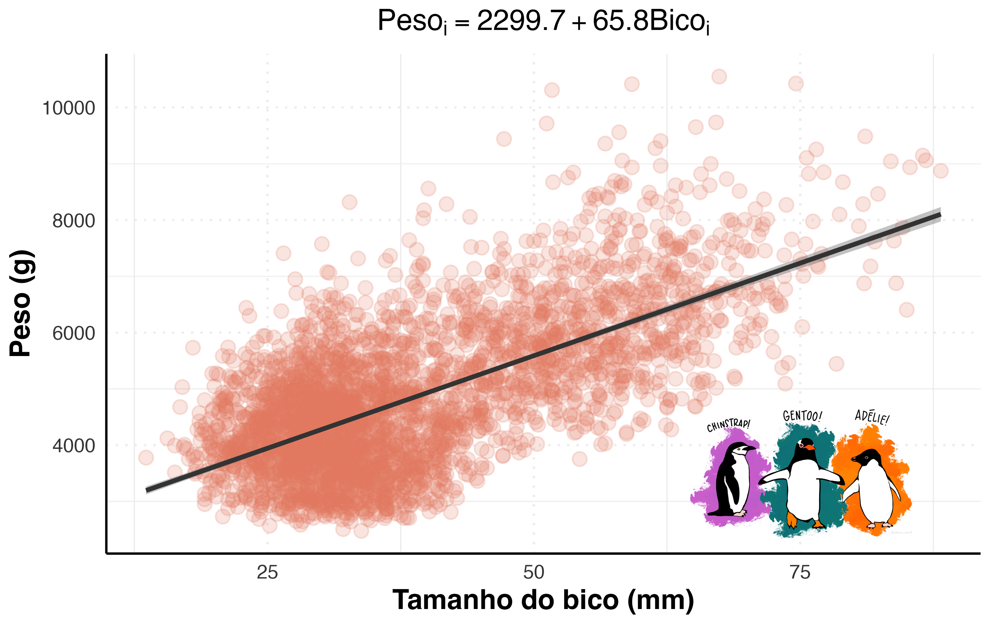
```


---
# PPGECO | ECL0072 | out. 2026

### Como estimamos (inferimos) as relações na natureza?

<br>

- **1. Definir o modelo que descreve o sistema em estudo**
  - Distribuição de probabilidade para $y$
  - Estrutura das relações 

--

<br>

- **2. Identificar possíveis valores para os parâmetros desconhecidos do modelo** ($\mathbf{\theta}$)

--

<br>

- **3. Avaliar a incerteza dos parâmetros estimados**


---

# PPGECO | ECL0072 | out. 2026

### Como estimamos (inferimos) as relações na natureza?


**Como lidar diante da *incerteza*?**


--

A única descrição satisfatória da incerteza é a *probabilidade* ([Lindley](https://www.ime.usp.br/~abe/lista/pdfbgYmxDKGzI.pdf))


--

<br>

.pull-left[


.center[**Escola Bayesiana**]


```{r echo=FALSE, fig.align ='center', out.width ="80%"}
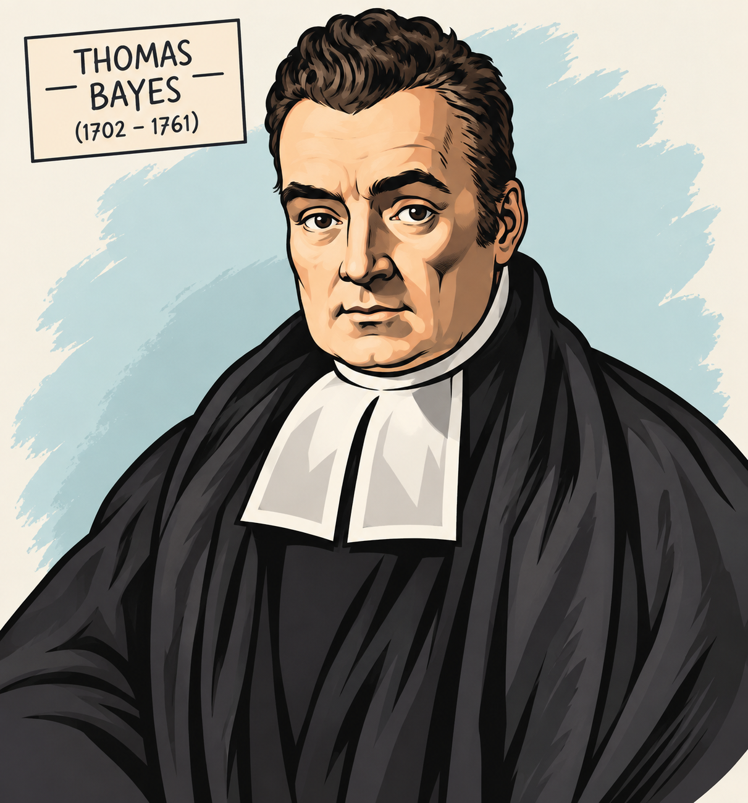
```

]


.pull-right[


.center[**Escola Frequentista**]


```{r echo=FALSE, fig.align ='center', out.width ="80%"}
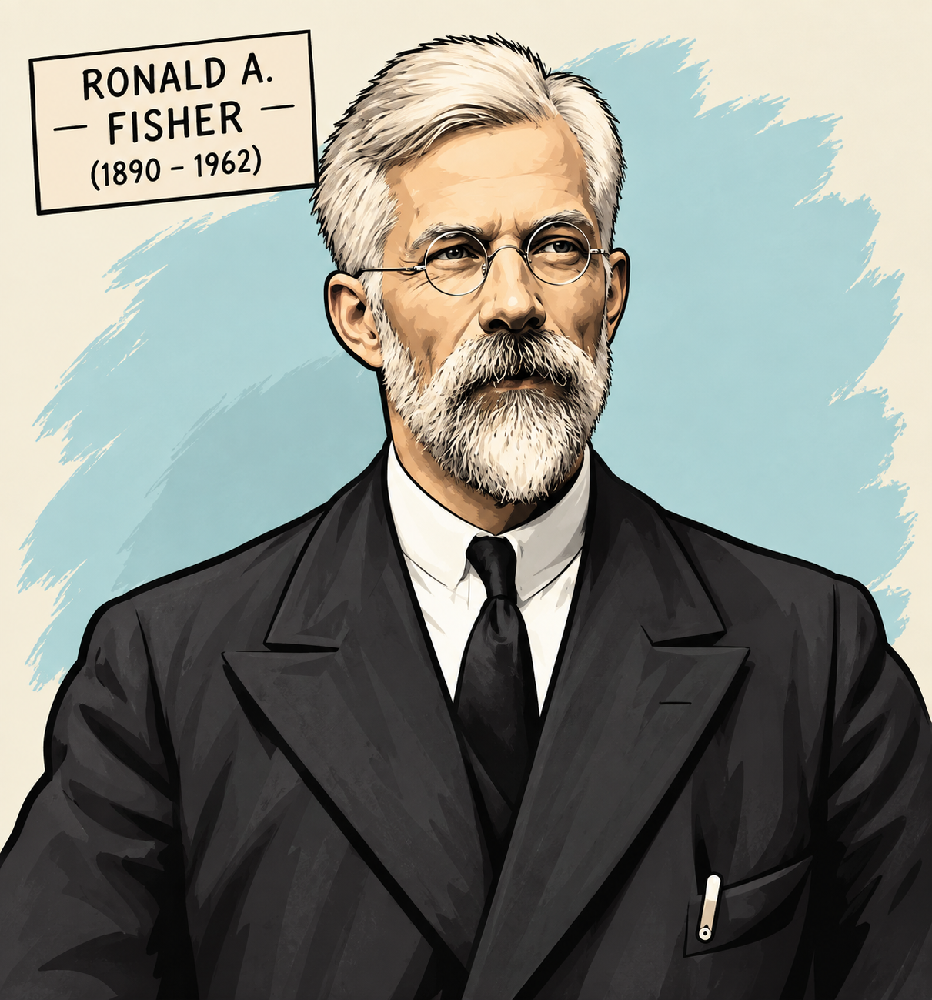
```


]

---

# PPGECO | ECL0072 | out. 2026

### O método científico


.pull-left[

<br>


```{r echo=FALSE, fig.align ='center', out.width ="80%", fig.cap="Richard Feynmann (1918-1988)"}

```

]

.pull-right[

<br>
<br>

> <font size="5"><center> <span style="color: #e07a5f;"> *Science is a process for learning about nature in which competing ideas about how the world works are measured against observations* </center></font></span> 


<br>

------

<br>

- **Descrição:** incompleta e imperfeita
- **Observações:** imprecisas e incertas
- **Estatística:** ferramenta para contrastar ideias (hipóteses) e observações

]

---
# PPGECO | ECL0072 | out. 2026

### O método científico


.pull-left[


<br>


```{r echo=FALSE, fig.align ='center', out.width ="80%", fig.cap="Karl Popper (1902-1994)"}

```


]


.pull-right[

Revolucionou a filosofia da Ciência no séc. XX

]

---
# PPGECO | ECL0072 | out. 2026

### O método científico


.pull-left[


<br>


```{r echo=FALSE, fig.align ='center', out.width ="80%", fig.cap="Karl Popper (1902-1994)"}

```


]


.pull-right[

Revolucionou a filosofia da Ciência no séc. XX

<div style="height: 7px;"></div>

.gray-box[**Uma hipótese não pode ser provada, apenas desprovada!**]

<br>

]

---
# PPGECO | ECL0072 | out. 2026

### O método científico


.pull-left[


<br>


```{r echo=FALSE, fig.align ='center', out.width ="80%", fig.cap="Karl Popper (1902-1994)"}

```


]


.pull-right[

Revolucionou a filosofia da Ciência no séc. XX

<div style="height: 7px;"></div>

.gray-box[**Uma hipótese não pode ser provada, apenas desprovada!**]

<div style="height: 7px;"></div>


------


A essência do método Popperiano consiste em contrastar uma hipótese repetidamente com experimentos alternativos

]

---

# PPGECO | ECL0072 | out. 2026

### O método científico


.pull-left[


<br>


```{r echo=FALSE, fig.align ='center', out.width ="80%", fig.cap="Karl Popper (1902-1994)"}

```


]


.pull-right[

Revolucionou a filosofia da Ciência no séc. XX

<div style="height: 7px;"></div>

.gray-box[**Uma hipótese não pode ser provada, apenas desprovada!**]

<div style="height: 7px;"></div>


------


A essência do método Popperiano consiste em contrastar uma hipótese repetidamente com experimentos alternativos


- Caso a hipótese se mantém ao longo dos experimentos, esta passa a adquirir um grau de *confiança* e é assumida como verdadeira 

]

---

# PPGECO | ECL0072 | out. 2026

### O método científico


.pull-left[


<br>


```{r echo=FALSE, fig.align ='center', out.width ="80%", fig.cap="Karl Popper (1902-1994)"}

```


]


.pull-right[

Revolucionou a filosofia da Ciência no séc. XX

<div style="height: 7px;"></div>

.gray-box[**Uma hipótese não pode ser provada, apenas desprovada!**]

<div style="height: 7px;"></div>


------


A essência do método Popperiano consiste em contrastar uma hipótese repetidamente com experimentos alternativos


- Caso a hipótese se mantém ao longo dos experimentos, esta passa a adquirir um grau de *confiança* e é assumida como verdadeira 


.center[

.salmon-box[

.small-text2[

**Cuidado!** 

A hipótese não é validada!


]
]

]

]

---
# PPGECO | ECL0072 | out. 2026

### O método científico


Na visão de Popper,  hipóteses devem ser rejeitadas (falseadas), porque o método dedutivo é o caminho do conhecimento mais seguro 
- Método *hipotético-dedutivo*


<div style="height: 7px;"></div>


--

.pull-left[

.center[**H<sub>0</sub>: Todos os cisnes são brancos**]

```{r echo=FALSE,  out.width = "60%"}

```


]

--

.pull-right[

.center[**H<sub>0</sub> -> falsa**]

```{r echo=FALSE, out.width = "60%"}

```


]

---
# PPGECO | ECL0072 | out. 2026

### O método científico

As raízes da estatística clássica (frequentista) estão associadas aos conceitos de *teste de hipótese* e *p-valor*
- Forte influência da filosofia Popperiana e dos problemas práticos que emergiram da Biologia (e.g., Biometria)

<div style="height: 3px;"></div>


```{r echo=FALSE, fig.align ='center', out.width ="85%"}
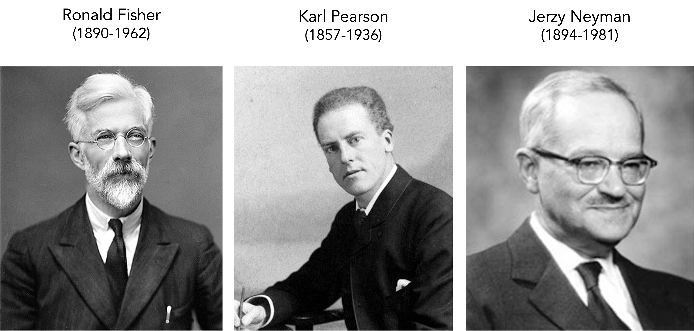
```

---
# PPGECO | ECL0072 | out. 2026

### O método científico  | .small-text[<span style="color: #e07a5f;">Teste de hipótese (nula)</span>]

O teste de hipótese parte do pressuposto de que a hipótese nula ($H_0$) é *verdadeira*

--

.small-text2[**Exemplo**]

.small-text2[

Qual o efeito da temperatura sobre a abundância de uma espécie?

- $H_0: ~ \beta = 0$ (sem efeito de temperatura)
- $H_1: ~ \beta \neq 0$ (com efeito de temperatura)

]

--

----


.pull-left[

<br>

```{r echo=FALSE, fig.align ='center', out.width ="100%"}
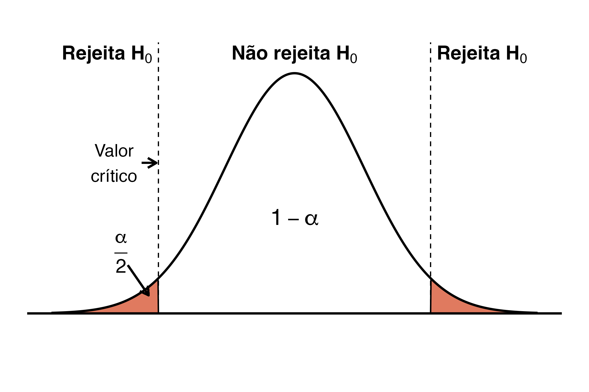
```
]


.pull-right[

<div style="height: 9px;"></div>

.small-text2[


Assumindo $H_0$ como verdadeira, avalia-se a probabilidade de obter um resultado tão ou mais extremo quanto o observado nos dados

- Se $p \leq 0.05:$ rejeita-se $H_0$
- Se $p > 0.05:$ deixa de rejeitar $H_0$

----


.small-text2[**Cuidado!**

- Em nenhum momento as hipóteses são efetivamente *validadas*

- O p-valor reflete uma probabilidade condicional $p(dados|H_0)$

]
]
]


---
# PPGECO | ECL0072 | out. 2026

### O método científico  | .small-text[<span style="color: #e07a5f;">Teste de hipótese (nula)</span>]


**Mito da intensidade da significância da relação**


.code-bg[
```{r, eval=T, echo=F}

# Definindo semente para reprodutibilidade dos asteriscos
set.seed(42)
n <- 150

# Simulação das covariáveis
temp   <- rnorm(n, mean = 20, sd = 3)   # Variável 1
sal    <- rnorm(n, mean = 35, sd = 2)   # Variável 2
prof   <- rnorm(n, mean = 100, sd = 15) # Variável 3

# Construindo a variável resposta com diferentes níveis de ruído/efeito
# temp  -> Efeito gigante e muito preciso (p < 0.001 -> ***)
# sal   -> Efeito moderado (0.001 <= p < 0.01 -> **)
# prof  -> Efeito pequeno em escala, mas presente (0.01 <= p < 0.05 -> *)
riqueza <- 50 + (3.5 * temp) + (1.2 * sal) + (0.04 * prof) + rnorm(n, mean = 0, sd = 8)

mod <- lm(riqueza ~ temp + sal + prof)

```

]


.code-bg[
.small-code[
```{r, echo=T, eval=T}
summary(mod)
```
]
]

<div style="height: 7px;"></div>

--

O número de asteriscos no sumário estatístico do modelo **não** mede a força nem o nível de significância do efeito


.small-text2[

- Reforça a evidência estatística contra $H_0$

- Quando $p > 0.05$: os dados não fornecem evidências suficientes para rejeitar $H_0$

- **Cuidado:** significância estatística $\neq$ significância biológica


]


---
# PPGECO | ECL0072 | out. 2026

### O método científico  | .small-text[<span style="color: #e07a5f;">Teste de hipótese (nula)</span>]

<br>


```{r echo=FALSE, fig.align ='center', out.width ="50%"}
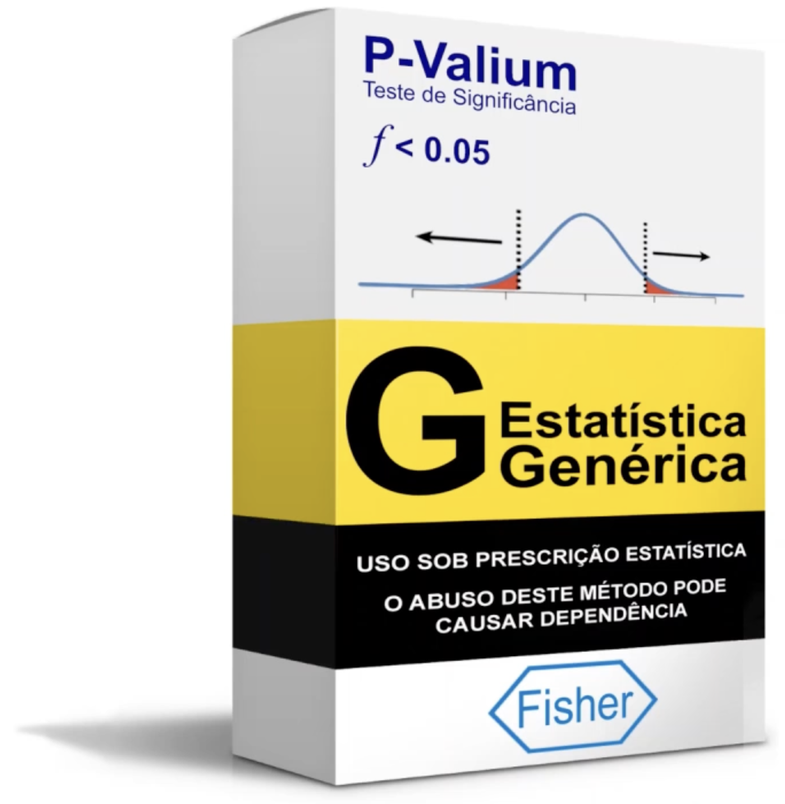
```


.footnote[Figura: [Prof. Thiago Rangel](https://estat.bio.br/bayes6.html)]


---

# PPGECO | ECL0072 | out. 2026

### O método científico  | .small-text[<span style="color: #e07a5f;">Teste de hipótese (nula)</span>]

O intervalo de confiança (IC%) quantifica a incerteza associada à estimativa do parâmetro diante do nível de significância estabelecido

<br>

.pull-left[

```{r echo=FALSE, fig.align ='center', out.width ="90%"}
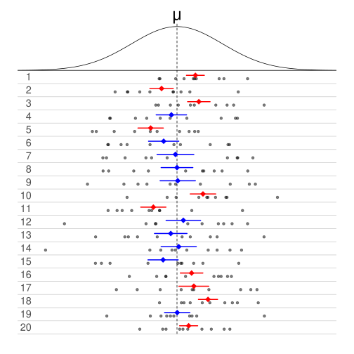
```

]


.pull-right[

.small-text2[
.center[**Interpretação**]

Se repetíssemos o mesmo estudo milhares de vezes, aproximadamente 95% dos intervalos de confiança *conteriam* o verdadeiro parâmetro

- O parâmetro é *fixo* (i.e.,pré-determinado na natureza)
]

----


<div style="height: 7px;"></div>

.gray-box[
.small-text2[

.center[**O que o IC não é?**]

Não representa a probabilidade do valor do parâmetro estar contido no intervalo indicado


  ] 

]

]

.footnote[.small-text2[Figura: [Wikipedia](https://en.wikipedia.org/wiki/Confidence_interval)]]
---
# PPGECO | ECL0072 | out. 2026
### O método científico  | .small-text[<span style="color: #e07a5f;">Teste de hipótese (nula)</span>]

**Exemplo:**

<div style="height: 7px;"></div>


```{r echo=FALSE, fig.align ='center', out.width ="70%"}
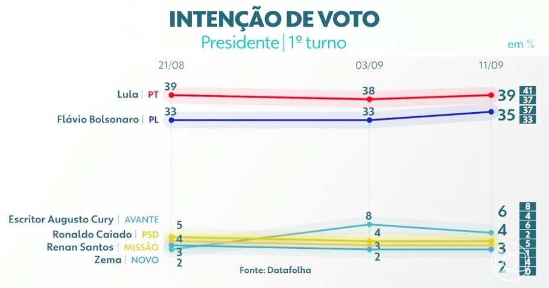
```

<div style="height: 5px;"></div>


.small-text2[Se repetirmos a intenção de votos, espera-se que a estimativa caia no intervalo estimado]


.footnote[.small-text2[Fonte: [Globo](https://g1.globo.com/jornal-nacional/noticia/2026/09/11/datafolha-divulga-nova-pesquisa-de-intencao-de-voto-para-presidente-veja-os-numeros.ghtml)]]


--

.small-text2[
- ou seja, a margem de erro diz respeito a incerteza associada ao *processo amostral* (e não ao *observador*)]


---
# PPGECO | ECL0072 | out. 2026
### O método científico  | .small-text[<span style="color: #e07a5f;">Teste de hipótese (nula)</span>]


O teste de hipótese é uma versão clássica do argumento *reductio ad absurdum* (redução ao absurdo)
- i.e., comparar os dados com uma situação improvável (i.e, $H_0$)


<br>
<br>
<br>


--

.pull-left[

```{r echo=FALSE, fig.align ='center', out.width ="100%", fig.cap="Ronald Fisher (1890-1962)"}
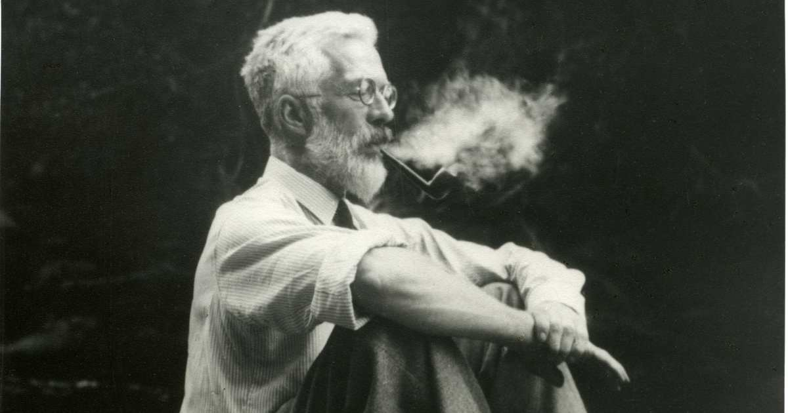
```


]

.pull-right[


> <font size="5"><center> <span style="color: #e07a5f;"> *...the only populations that can be referred to in a test of significance have no objective reality, being exclusively the product of the statistician's imaginations* </center></font></span> 


]


---
# PPGECO | ECL0072 | out. 2026
### O método científico  | .small-text[<span style="color: #e07a5f;">Teste de hipótese (nula)</span>]


A falsificação de hipóteses é uma estratégia frágil na prática científica

--

<div style="height: 7px;"></div>


**1. Hipóteses não são modelos**


<br>
<br>

.pull-left[

```{r echo=FALSE, fig.align ='center', out.width ="100%"}
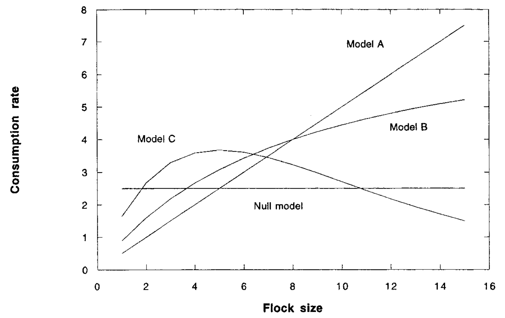
```

]


.footnote[Figura: Hilborn & Mangel (1993)]

---

# PPGECO | ECL0072 | out. 2026
### O método científico  | .small-text[<span style="color: #e07a5f;">Teste de hipótese (nula)</span>]


A falsificação de hipóteses é uma estratégia frágil na prática científica


<div style="height: 7px;"></div>


**2. Medidas importam**


A maioria dos problemas enfrentados pelos cientistas não se enquadram em uma lógica discreta (todos cisnes são brancos)

--

<br>

- Hipóteses são, em sua maioria, quantitativas (i.e., hipóteses contínuas) e possuem limites pouco definidos
  - $H_0:$ 80% dos cisnes são brancos
  - $H_0:$ Cisnes pretos são raros

--

<br>

- As observações (dados) estão sujeitas a erros, particularmente àquelas tangendo as fronteiras do conhecimento científico


---

# PPGECO | ECL0072 | out. 2026
### A natureza sob o olhar bayesiano  

A inferência bayesiana é a realocação da *credibilidade* diante de *possibilidades*


---
# PPGECO | ECL0072 | out. 2026
### A natureza sob o olhar bayesiano  


O cérebro é uma maquina preditiva em constante atualização

<br>


.pull-left[

```{r echo=FALSE, fig.align ='center', out.width ="60%"}
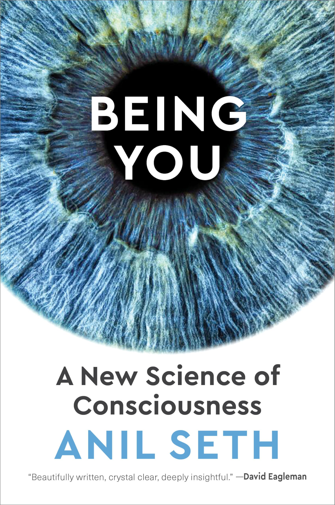
```

]


.pull-right[

```{r echo=FALSE, fig.align ='center', out.width ="60%"}
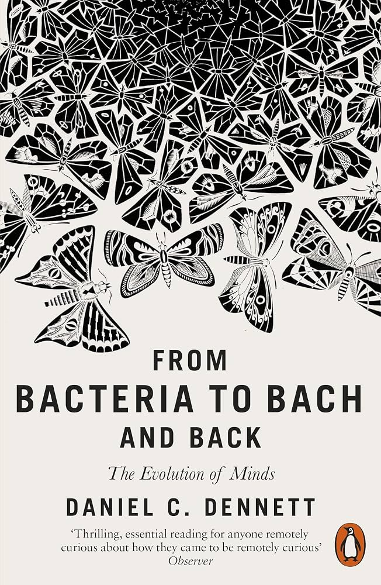
```


]


---
# PPGECO | ECL0072 | out. 2026
### A natureza sob o olhar bayesiano  


.pull-left[
<br>
<br>
<br>

```{r echo=FALSE, fig.align ='center', out.width ="80%", fig.cap="Thomas Bayes (1701-1761)"}
knitr::include_graphics("../Figuras/Thomas_Bayes.jpg")
```

]

.pull-right[

<br>

.center[**Teorema de Bayes**]

<div style="height: 7px;"></div>


.gray-box-small[

$$\Large p(\color{#e07a5f}{\theta} ~ | ~ y) = \frac{p(y~ | ~\color{#e07a5f}{\theta}) \cdot p(\color{#e07a5f}{\theta})}{p(y)}$$


]

<br>

.small-text2[

$\small p(\theta | y) ~ -$ Distribuição posterior


$\small p(\theta) ~ -$ Distribuição à priori
- Crença sobre o parâmetro populacional *antes* de observar os dados


$\small p(y | \theta) ~ -$ Função de verossimilhança
- 


$\small p(y) ~ -$ Constante de normalização
- Garante que a distribuição posterior seja probabilística $\int_\theta p(\theta|y) = 1$

]
]


---
# PPGECO | ECL0072 | out. 2026
### A natureza sob o olhar bayesiano  


<div style="height: 5px;"></div>

$$\underbrace{p(\theta ~ | ~ y)}_\text{Posterior} ~ \propto ~ \underbrace{p(y~ | ~\theta)}_\text{Dados} \cdot \underbrace{p(\theta)}_\text{Priori}$$

```{r echo=FALSE, out.width ="85%", fig.align = 'left'}
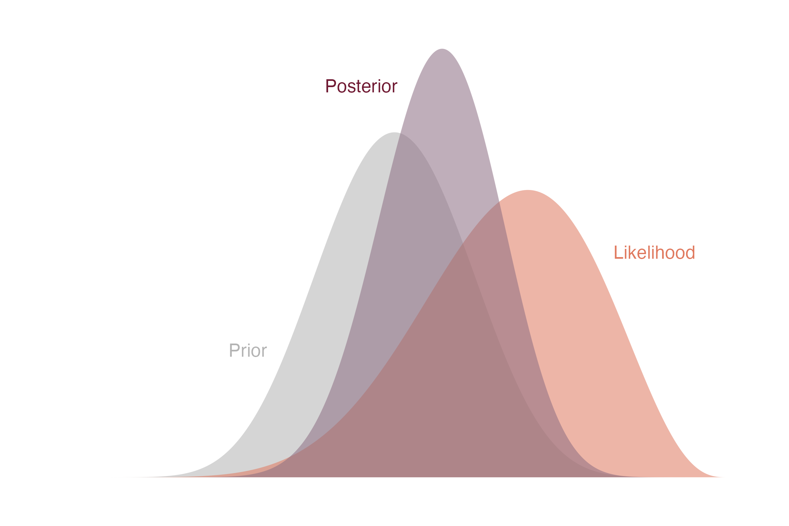

```


---
# PPGECO | ECL0072 | out. 2026

### A natureza sob o olhar bayesiano  


As prioris podem ter diferentes níveis de *informatividade*

- a informação pode estar ao longo de um *continuum* que vai da incerteza completa à certeza relativa

--

----

**Exemplo**


Qual a detectabilidade do *Coleodactylus natalensis* no Parque das Dunas?

<div style="height: 7px;"></div>


.pull-left[
```{r echo=FALSE, out.width ="85%", fig.align = 'left'}


```
]

.pull-right[

.small-text2[

.center[**Dados**]

Uma saída de campo com 10 quadrantes
- 4/10 detecções

-----

.center[**Modelo**]

**parte determinística:** detecção média $\theta$

**parte estocástica:** $y ~ \sim Binomial(N, \theta)$

A incerteza está no parâmetro $\theta$

]

]


.footnote[.small-text2[Foto: [UFRN](https://ufrn.br/en/press/features-and-knowledge/30696/a-luta-pela-)]]


---
# PPGECO | ECL0072 | out. 2026

### A natureza sob o olhar bayesiano  


As prioris podem ter diferentes níveis de *informatividade*

- a informação pode estar ao longo de um *continuum* que vai da incerteza completa à certeza relativa
  


----

**Priori difusa**

Reflete um elevado grau de incerteza sobre o parâmetro ($\theta$)
- A distribuição não inclui nenhum tipo de informação sobre o parâmetro
- distribuição uniforme $\theta \sim \text{uniform}(0,1) = \text{beta}(1,1)$

--


.pull-left[

```{r echo=FALSE, out.width ="90%", fig.align = 'left'}
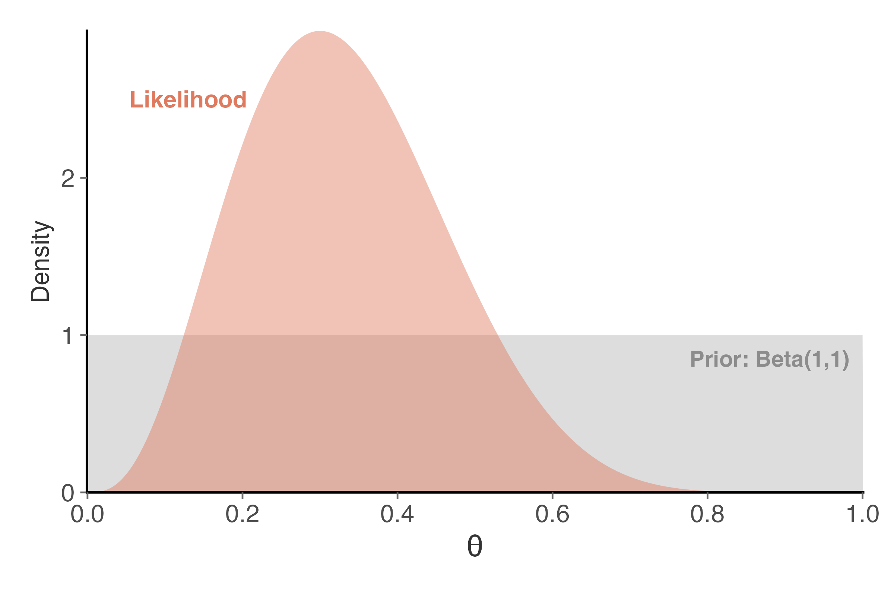

```

]


--

.pull-right[


```{r echo=FALSE, out.width ="90%", fig.align = 'left'}
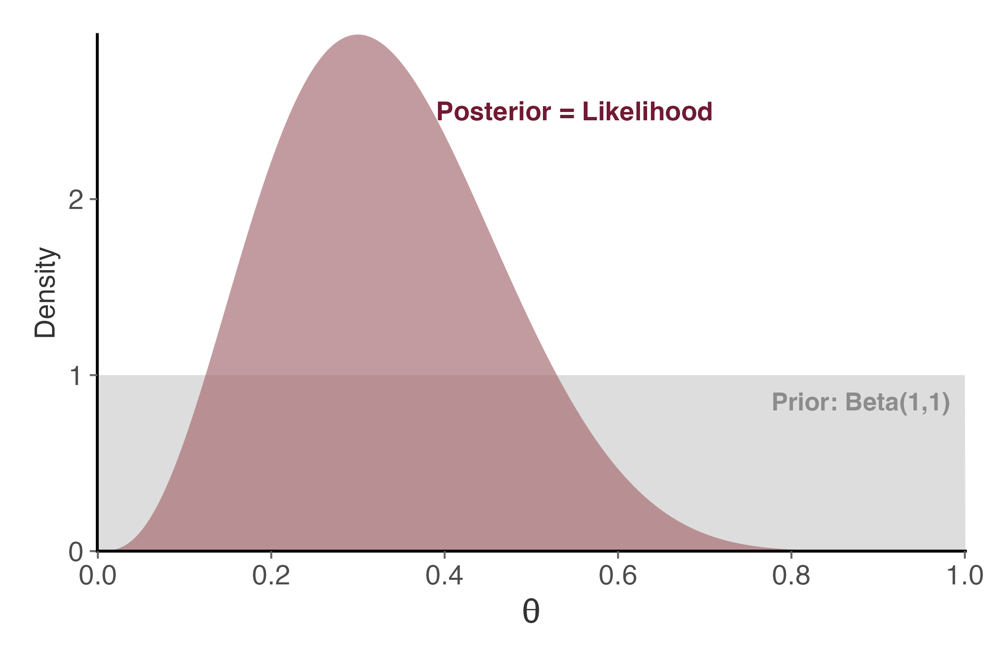

```

]


---
Priors can have different levels of informativeness; the infomration reflected in a prior distribution can be anywhere on a continuum from complete uncertainty to relative certainty. Although priors can fall anywhere along this continuum, there are three main classifications of priors that are used in the literature to categorize the degree of (un)certainty surroudning the population parameter value
- informative
- weakly informative
- diffuse
  


---

**Exemplo**

Qual a probabilidade de detectar 


$$\underbrace{p(\theta ~ | ~ y)}_\text{Posterior} ~ \propto ~ \underbrace{p(y~ | ~\theta)}_\text{Dados} \cdot \underbrace{p(\theta)}_\text{Priori}$$
---


```{r echo=FALSE, fig.align ='center', out.width ="85%"}
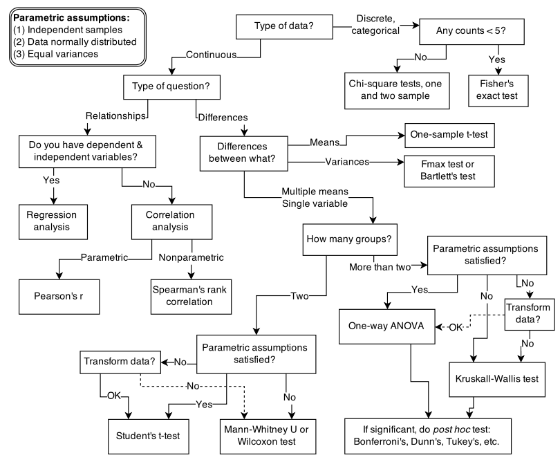

```


---


**MCMC**

https://chi-feng.github.io/mcmc-demo/app.html?algorithm=RandomWalkMH&target=standard

---


- Bayesian workflow - https://arxiv.org/pdf/2011.01808 (Gelman - 2020)


https://educacao.uol.com.br/disciplinas/filosofia/filosofia-da-ciencia-karl-popper-falseabilidade-e-limites-da-ciencia.htm