```{r xaringan-themer, include=FALSE, warning=FALSE}


#~~~~~~~~~~~~~~~~~~~~~~
# Default knitr iputs
#~~~~~~~~~~~~~~~~~~~~~~

source("../Scripts/Setup/setup_knitr.R")

#~~~~~~~~~~~~~~~~~~~~~~
# Slide customization
#~~~~~~~~~~~~~~~~~~~~~~
source("../Scripts/Setup/setup_slides.R")


```

class: title-slide
<div class="title-block">
  <h1>`r rmarkdown::metadata$title`</h1>
  <div class="date-text">`r rmarkdown::metadata$date`</div>
</div>

<div class="subtitle-block">
  <h2>`r rmarkdown::metadata$subtitle`</h2>
  <p class="author-name">`r rmarkdown::metadata$author`</p>
  <p class="author-email"><u>`r rmarkdown::metadata$institute`</u></p>
</div>


---
# PPGECO | ECL0072 | out. 2026

<br>

### Agenda


---
# PPGECO | ECL0072 | out. 2026

### Como estimamos (inferimos) as relações na natureza?

<br>


```{r echo=FALSE, fig.align ='center', out.width ="80%"}
knitr::include_graphics("../Figuras/LM_pinguins2.png")
```


---
# PPGECO | ECL0072 | out. 2026

### Como estimamos (inferimos) as relações na natureza?

<br>

- **1. Definir o modelo que descreve o sistema em estudo**
  - Distribuição de probabilidade para $y$
  - Estrutura das relações 

--

<br>

- **2. Identificar possíveis valores para os parâmetros desconhecidos do modelo** ($\mathbf{\theta}$)

--

<br>

- **3. Avaliar a incerteza dos parâmetros estimados**


---

# PPGECO | ECL0072 | out. 2026

### Como estimamos (inferimos) as relações na natureza?


**Como lidar diante da *incerteza*?**


--

A única descrição satisfatória da incerteza é a *probabilidade* ([Lindley](https://www.ime.usp.br/~abe/lista/pdfbgYmxDKGzI.pdf))


--

<br>

.pull-left[


.center[**Escola Bayesiana**]


```{r echo=FALSE, fig.align ='center', out.width ="80%"}
knitr::include_graphics("../Figuras/TB_portrait.png")
```

]


.pull-right[


.center[**Escola Frequentista**]


```{r echo=FALSE, fig.align ='center', out.width ="80%"}
knitr::include_graphics("../Figuras/RF_portrait.png")
```


]

---

# PPGECO | ECL0072 | out. 2026

### O método científico


.pull-left[

<br>


```{r echo=FALSE, fig.align ='center', out.width ="80%", fig.cap="Richard Feynmann (1918-1988)"}
knitr::include_graphics("../Figuras/R-Feynmann.png")
```

]

.pull-right[

<br>
<br>

> <font size="5"><center> <span style="color: #e07a5f;"> *Science is a process for learning about nature in which competing ideas about how the world works are measured against observations* </center></font></span> 


<br>

------

<br>

- **Descrição:** incompleta e imperfeita
- **Observações:** imprecisas e incertas
- **Estatística:** ferramenta para contrastar ideias (hipóteses) e observações

]

---
# PPGECO | ECL0072 | out. 2026

### O método científico


.pull-left[


<br>


```{r echo=FALSE, fig.align ='center', out.width ="80%", fig.cap="Karl Popper (1902-1994)"}
knitr::include_graphics("../Figuras/Karl-Popper.jpg")
```


]


.pull-right[

Revolucionou a filosofia da Ciência no séc. XX

]

---
# PPGECO | ECL0072 | out. 2026

### O método científico


.pull-left[


<br>


```{r echo=FALSE, fig.align ='center', out.width ="80%", fig.cap="Karl Popper (1902-1994)"}
knitr::include_graphics("../Figuras/Karl-Popper.jpg")
```


]


.pull-right[

Revolucionou a filosofia da Ciência no séc. XX

<div style="height: 7px;"></div>

.gray-box[**Uma hipótese não pode ser provada, apenas desprovada!**]

<br>

]

---
# PPGECO | ECL0072 | out. 2026

### O método científico


.pull-left[


<br>


```{r echo=FALSE, fig.align ='center', out.width ="80%", fig.cap="Karl Popper (1902-1994)"}
knitr::include_graphics("../Figuras/Karl-Popper.jpg")
```


]


.pull-right[

Revolucionou a filosofia da Ciência no séc. XX

<div style="height: 7px;"></div>

.gray-box[**Uma hipótese não pode ser provada, apenas desprovada!**]

<div style="height: 7px;"></div>


------


A essência do método Popperiano consiste em contrastar uma hipótese repetidamente com experimentos alternativos

]

---

# PPGECO | ECL0072 | out. 2026

### O método científico


.pull-left[


<br>


```{r echo=FALSE, fig.align ='center', out.width ="80%", fig.cap="Karl Popper (1902-1994)"}
knitr::include_graphics("../Figuras/Karl-Popper.jpg")
```


]


.pull-right[

Revolucionou a filosofia da Ciência no séc. XX

<div style="height: 7px;"></div>

.gray-box[**Uma hipótese não pode ser provada, apenas desprovada!**]

<div style="height: 7px;"></div>


------


A essência do método Popperiano consiste em contrastar uma hipótese repetidamente com experimentos alternativos


- Caso a hipótese se mantém ao longo dos experimentos, esta passa a adquirir um grau de *confiança* e é assumida como verdadeira 

]

---

# PPGECO | ECL0072 | out. 2026

### O método científico


.pull-left[


<br>


```{r echo=FALSE, fig.align ='center', out.width ="80%", fig.cap="Karl Popper (1902-1994)"}
knitr::include_graphics("../Figuras/Karl-Popper.jpg")
```


]


.pull-right[

Revolucionou a filosofia da Ciência no séc. XX

<div style="height: 7px;"></div>

.gray-box[**Uma hipótese não pode ser provada, apenas desprovada!**]

<div style="height: 7px;"></div>


------


A essência do método Popperiano consiste em contrastar uma hipótese repetidamente com experimentos alternativos


- Caso a hipótese se mantém ao longo dos experimentos, esta passa a adquirir um grau de *confiança* e é assumida como verdadeira 


.center[

.salmon-box[

.small-text2[

**Cuidado!** 

A hipótese não é validada!


]
]

]

]

---
# PPGECO | ECL0072 | out. 2026

### O método científico


Na visão de Popper,  hipóteses devem ser rejeitadas (falseadas), porque o método dedutivo é o caminho do conhecimento mais seguro 
- Método *hipotético-dedutivo*


<div style="height: 7px;"></div>


--

.pull-left[

.center[**H<sub>0</sub>: Todos os cisnes são brancos**]

```{r echo=FALSE,  out.width = "60%"}
knitr::include_graphics("../Figuras/white_swans.png")
```


]

--

.pull-right[

.center[**H<sub>0</sub> -> falsa**]

```{r echo=FALSE, out.width = "60%"}
knitr::include_graphics("../Figuras/black_sawn.png")
```


]

---
# PPGECO | ECL0072 | out. 2026

### A natureza sob olhar frequentista

As raízes da estatística clássica (frequentista) estão associadas aos conceitos de *teste de hipótese* e *p-valor*
- Forte influência da filosofia Popperiana e dos problemas práticos que emergiram da Biologia (e.g., Biometria)

<div style="height: 3px;"></div>


```{r echo=FALSE, fig.align ='center', out.width ="85%"}
knitr::include_graphics("../Figuras/Fisher-Pearson-Neyman.png")
```

---
# PPGECO | ECL0072 | out. 2026

### A natureza sob olhar frequentista

Na visão *frequentista*, a probabilidade é definida em termos de frequências relativas de um evento


$$\large p(E) = \lim_{n\to\infty}\frac{x}{n}$$

--

```{r echo=FALSE, fig.align ='center', out.width ="65%"}
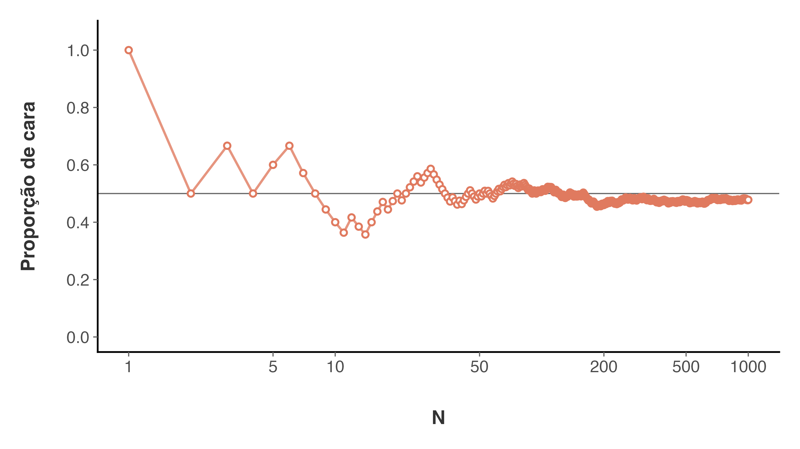
```


--

Assume que o valor do parâmetro ($\theta$) é *fixo* e o que varia são os dados


---
# PPGECO | ECL0072 | out. 2026

### A natureza sob olhar frequentista  | .small-text[<span style="color: #e07a5f;">Teste de hipótese (nula)</span>]

O teste de hipótese parte do pressuposto de que a hipótese nula ($H_0$) é *verdadeira*

--

.small-text2[**Exemplo**]

.small-text2[

Qual o efeito da temperatura sobre a riqueza de espécies?

- $H_0: ~ \beta = 0$ (sem efeito de temperatura)
- $H_1: ~ \beta \neq 0$ (com efeito de temperatura)

]

--

----


.pull-left[

<br>

```{r echo=FALSE, fig.align ='center', out.width ="100%"}
knitr::include_graphics("../Figuras/NHST.png")
```
]


.pull-right[

<div style="height: 9px;"></div>

.small-text2[


Assumindo $H_0$ como verdadeira, avalia-se a probabilidade de obter um resultado tão ou mais extremo quanto o observado nos dados

- Se $p \leq 0.05:$ rejeita-se $H_0$
- Se $p > 0.05:$ deixa de rejeitar $H_0$

----


.small-text2[**Cuidado!**

- Em nenhum momento as hipóteses são efetivamente *validadas*

- O p-valor reflete uma probabilidade condicional $p(dados|H_0)$

]
]
]


---
# PPGECO | ECL0072 | out. 2026

### A natureza sob olhar frequentista  | .small-text[<span style="color: #e07a5f;">Teste de hipótese (nula)</span>]


**Mito da intensidade da significância da relação**

<br>


.pull-left[

```{r echo=FALSE, fig.align ='center', out.width ="50%"}
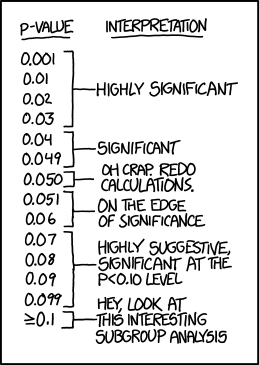
```

]


.pull-right[

.code-bg[
```{r, eval=T, echo=F}

# Definindo semente para reprodutibilidade dos asteriscos
set.seed(42)
n <- 150

# Simulação das covariáveis
temp   <- rnorm(n, mean = 20, sd = 3)   # Variável 1
sal    <- rnorm(n, mean = 35, sd = 2)   # Variável 2
prof   <- rnorm(n, mean = 100, sd = 15) # Variável 3

# Construindo a variável resposta com diferentes níveis de ruído/efeito
# temp  -> Efeito gigante e muito preciso (p < 0.001 -> ***)
# sal   -> Efeito moderado (0.001 <= p < 0.01 -> **)
# prof  -> Efeito pequeno em escala, mas presente (0.01 <= p < 0.05 -> *)
riqueza <- 50 + (3.5 * temp) + (1.2 * sal) + (0.04 * prof) + rnorm(n, mean = 0, sd = 8)

mod <- lm(riqueza ~ temp + sal + prof)

```

]


.code-bg[

.small-code[
```{r, echo=T, eval=T}
summary(mod)
```

]
]
]


.footnote[.small-text2[Fonte: [explainxkcd](https://www.explainxkcd.com/wiki/index.php/1478:_P-Values)]]


--

<div style="height: 10px;"></div>


.small-text[

O número de asteriscos no sumário estatístico do modelo **não** mede a força nem o nível de significância do efeito


- Reforça a evidência estatística contra $H_0$

- Quando $p > 0.05$: os dados não fornecem evidências suficientes para rejeitar $H_0$

- **Cuidado:** significância estatística $\neq$ significância biológica


]


---
# PPGECO | ECL0072 | out. 2026

### A natureza sob olhar frequentista  | .small-text[<span style="color: #e07a5f;">Teste de hipótese (nula)</span>]

<br>


```{r echo=FALSE, fig.align ='center', out.width ="50%"}
knitr::include_graphics("../Figuras/p-valium.png")
```


.footnote[Figura: [Prof. Thiago Rangel](https://estat.bio.br/)]


---

# PPGECO | ECL0072 | out. 2026

### A natureza sob olhar frequentista | .small-text[<span style="color: #e07a5f;">Teste de hipótese (nula)</span>]

O intervalo de confiança (IC%) quantifica a incerteza associada à estimativa do parâmetro diante do nível de significância estabelecido

<br>

.pull-left[

```{r echo=FALSE, fig.align ='center', out.width ="90%"}
knitr::include_graphics("../Figuras/frequentist_95CI.svg")
```

]


.pull-right[

.small-text2[
.center[**Interpretação**]

Se repetíssemos o mesmo estudo milhares de vezes, aproximadamente 95% dos intervalos de confiança *conteriam* o verdadeiro parâmetro

- O parâmetro é *fixo* (i.e.,pré-determinado na natureza)
]

----


<div style="height: 7px;"></div>

.gray-box[
.small-text2[

.center[**O que o IC não é?**]

Não representa a probabilidade do valor do parâmetro estar contido no intervalo indicado


  ] 

]

]

.footnote[.small-text2[Figura: [Wikipedia](https://en.wikipedia.org/wiki/Confidence_interval)]]

---
# PPGECO | ECL0072 | out. 2026
### A natureza sob olhar frequentista  | .small-text[<span style="color: #e07a5f;">Teste de hipótese (nula)</span>]

**Exemplo:**

<div style="height: 7px;"></div>


```{r echo=FALSE, fig.align ='center', out.width ="70%"}
knitr::include_graphics("../Figuras/Intencao_de_voto.jpg")
```

<div style="height: 5px;"></div>


.small-text2[Se repetirmos a intenção de votos, espera-se que a estimativa caia no intervalo estimado]


.footnote[.small-text2[Fonte: [Globo](https://g1.globo.com/jornal-nacional/noticia/2026/09/11/datafolha-divulga-nova-pesquisa-de-intencao-de-voto-para-presidente-veja-os-numeros.ghtml)]]


--

.small-text2[
- ou seja, a margem de erro diz respeito a incerteza associada ao *processo amostral* (e não ao *observador*)]


---
# PPGECO | ECL0072 | out. 2026
### A natureza sob olhar frequentista | .small-text[<span style="color: #e07a5f;">Teste de hipótese (nula)</span>]


O teste de hipótese é uma versão clássica do argumento *reductio ad absurdum* (redução ao absurdo)
- i.e., comparar os dados com uma situação improvável (i.e, $H_0$)


<br>
<br>
<br>


--

.pull-left[

```{r echo=FALSE, fig.align ='center', out.width ="100%", fig.cap="Ronald Fisher (1890-1962)"}
knitr::include_graphics("../Figuras/Ronald-Fisher.jpg")
```


]

.pull-right[


> <font size="5"><center> <span style="color: #e07a5f;"> *...the only populations that can be referred to in a test of significance have no objective reality, being exclusively the product of the statistician's imaginations* </center></font></span> 


]


---
# PPGECO | ECL0072 | out. 2026
### A natureza sob olhar frequentista  | .small-text[<span style="color: #e07a5f;">Teste de hipótese (nula)</span>]


A falsificação de hipóteses é uma estratégia frágil na prática científica

--

<div style="height: 7px;"></div>


**1. Hipóteses não são modelos**


<br>
<br>

.pull-left[

```{r echo=FALSE, fig.align ='center', out.width ="100%"}
knitr::include_graphics("../Figuras/Hilborn_figure.png")
```

]


.footnote[Figura: Hilborn & Mangel (1993)]

---

# PPGECO | ECL0072 | out. 2026
### A natureza sob olhar frequentista  | .small-text[<span style="color: #e07a5f;">Teste de hipótese (nula)</span>]


A falsificação de hipóteses é uma estratégia frágil na prática científica


<div style="height: 7px;"></div>


**2. Medidas importam**


A maioria dos problemas enfrentados pelos cientistas não se enquadram em uma lógica discreta (todos cisnes são brancos)

--

<br>

- Hipóteses são, em sua maioria, quantitativas (i.e., hipóteses contínuas) e possuem limites pouco definidos
  - $H_0:$ 80% dos cisnes são brancos
  - $H_0:$ Cisnes pretos são raros

--

<br>

- As observações (dados) estão sujeitas a erros, particularmente aquelas tangendo as fronteiras do conhecimento científico


---

# PPGECO | ECL0072 | out. 2026
### A natureza sob o olhar bayesiano  

No contexto bayesiano, a probabilidade é interpretada como o grau de (in)certeza sobre um evento (ou parâmetro) diante do conhecimento disponível

- Assume que os dados são fixos e o parâmetro é aleatório


---

# PPGECO | ECL0072 | out. 2026
### A natureza sob o olhar bayesiano  


**Exemplo: mortalidade de peixes em uma lagoa**

O que poderia ter causado a mortalidade dos peixes?

--

1. contaminação química?

--

2. doença?

--

3. hipoxia?

--

4. pesca ilegal (explosiva)?


--

```{r echo=FALSE, fig.align = 'left', out.width ="25%"}
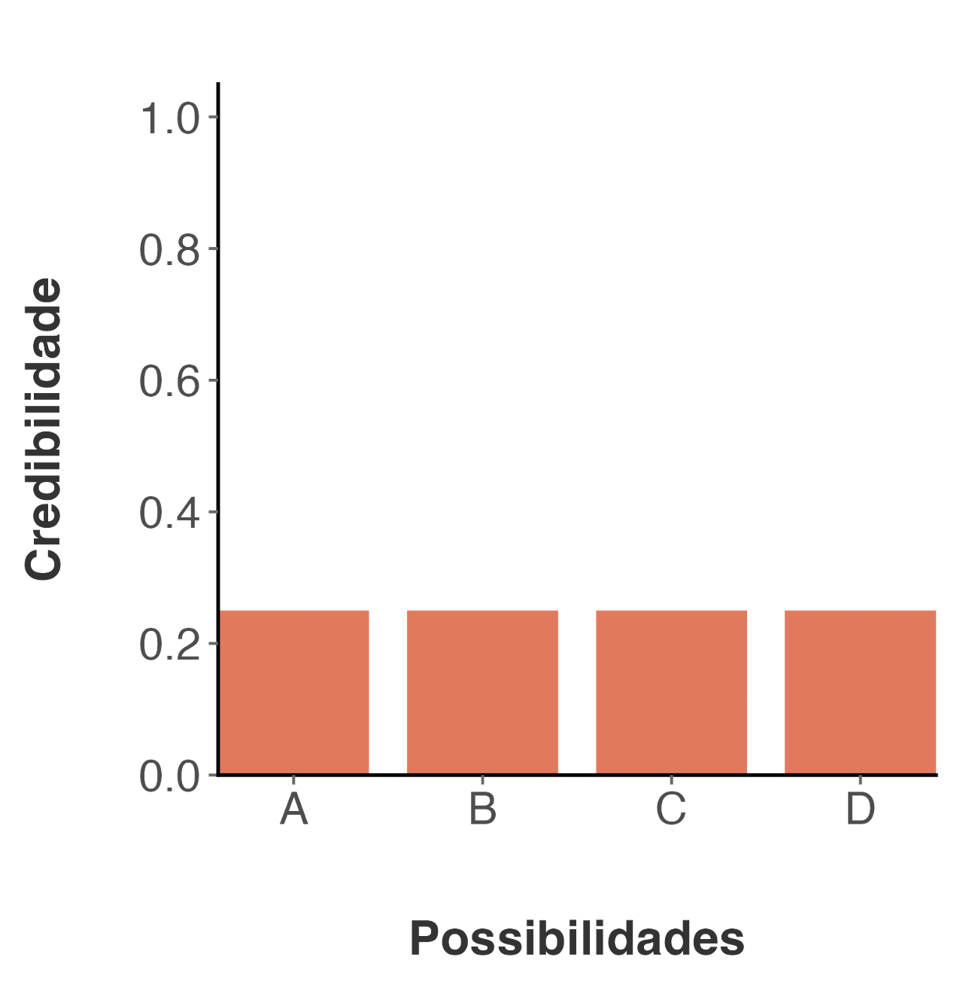
```


---

# PPGECO | ECL0072 | out. 2026
### A natureza sob o olhar bayesiano  


**Exemplo: mortalidade de peixes em uma lagoa**

O que poderia ter causado a mortalidade dos peixes?


1. contaminação química?

2. doença?

3. hipoxia?

4. pesca ilegal (explosiva)?


```{r echo=FALSE, fig.align ='left', out.width ="54%"}
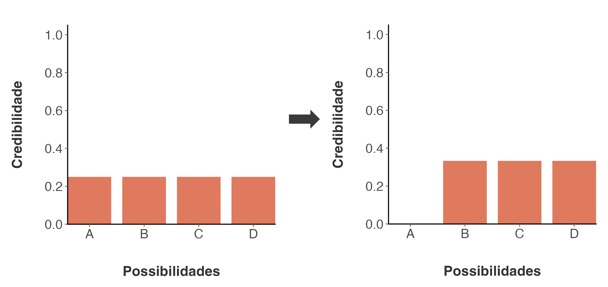
```

---

# PPGECO | ECL0072 | out. 2026
### A natureza sob o olhar bayesiano  


**Exemplo: mortalidade de peixes em uma lagoa**

O que poderia ter causado a mortalidade dos peixes?


1. contaminação química?

2. doença?

3. hipoxia?

4. pesca ilegal (explosiva)?


```{r echo=FALSE, fig.align ='left', out.width ="83%"}
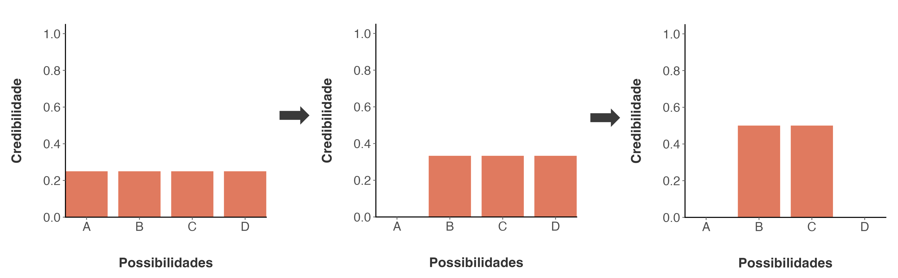
```

---

# PPGECO | ECL0072 | out. 2026
### A natureza sob o olhar bayesiano  


**Exemplo: mortalidade de peixes em uma lagoa**

O que poderia ter causado a mortalidade dos peixes?


1. contaminação química?

2. doença?

3. hipoxia?

4. pesca ilegal (explosiva)?


```{r echo=FALSE, fig.align ='left'}
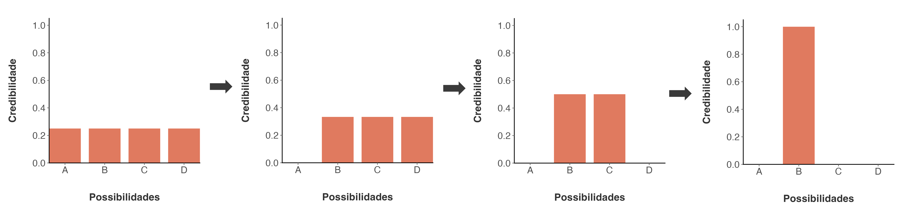
```

<div style="height: 20px;"></div>

--

.center[ .gray-box-small[ A inferência bayesiana é a realocação da *credibilidade* diante de *possibilidades*]
]


---
# PPGECO | ECL0072 | out. 2026
### A natureza sob o olhar bayesiano  


O cérebro é uma maquina preditiva em constante atualização

<br>


.pull-left[

```{r echo=FALSE, fig.align ='right', out.width ="60%"}
knitr::include_graphics("../Figuras/Anil_Seth_book.jpg")
```

]


.pull-right[

```{r echo=FALSE, fig.align ='left', out.width ="60%"}
knitr::include_graphics("../Figuras/Daniel_Dennett_book.jpg")
```


]


---
# PPGECO | ECL0072 | out. 2026
### A natureza sob o olhar bayesiano  

Na perspectiva bayesiana, todo processo de inferência estatística é realizado mediante o Teorema de Bayes

- i.e., a probabilidade de uma hipótese é atualizada à medida que novas evidências (dados) são observadas


.pull-left[

<br>

```{r echo=FALSE, fig.align ='center', out.width ="70%", fig.cap="Thomas Bayes (1701-1761)"}
knitr::include_graphics("../Figuras/Thomas_Bayes.jpg")
```

]

.pull-right[


<br>
<br>


.center[**Teorema de Bayes**]

<div style="height: 7px;"></div>


.gray-box-small[

$$\large p(\color{#e07a5f}{\theta} ~ | ~ y) = \frac{p(y~ | ~\color{#e07a5f}{\theta}) \cdot p(\color{#e07a5f}{\theta})}{p(y)}$$

]


]


---
# PPGECO | ECL0072 | out. 2026
### A natureza sob o olhar bayesiano  


<div style="height: 5px;"></div>


.pull-left[

<div style="height: 7px;"></div>


.gray-box-small[

$$\large p(\color{#e07a5f}{\theta} ~ | ~ y) = \frac{p(y~ | ~\color{#e07a5f}{\theta}) \cdot p(\color{#e07a5f}{\theta})}{p(y)}$$

]


<div style="height: 20px;"></div>


.small-text[

$~~~ \small\mathbf{p(\theta | y):}$ **Distribuição posterior**
- Conhecimento atualizado sobre o parâmetro após observar os dados


$~~~ \small \mathbf{p(\theta):}$ **Distribuição a priori**
- Crença sobre o parâmetro populacional *antes* de observar os dados


$~~~ \small \mathbf{p(y | \theta):}$ **Função de verossimilhança**
- Representa a evidência fornecida pelos dados sobre o parâmetro


$~~~ \small \mathbf{p(y):}$ **Constante de normalização**
- Garante que a distribuição posterior seja probabilística $\int_\theta p(\theta|y) = 1$

]


]


<div style="height: 20px;"></div>

.pull-right[


$$\large \underbrace{p(\theta ~ | ~ y)}_\text{Posterior} ~ \propto ~ \underbrace{p(y~ | ~\theta)}_\text{Dados} \cdot \underbrace{p(\theta)}_\text{Priori}$$


<div style="height: 20px;"></div>

```{r echo=FALSE, out.width ="100%", fig.align = 'left'}
knitr::include_graphics("../Figuras/prior_lik_post_densities.png")

```


]

---
# PPGECO | ECL0072 | out. 2026

### A natureza sob o olhar bayesiano  

<br>


```{r echo=FALSE, out.width ="60%", fig.align = 'center'}


```


---
# PPGECO | ECL0072 | out. 2026

### A natureza sob o olhar bayesiano  


As prioris podem ter diferentes níveis de *informatividade*

- a informação pode estar ao longo de um *continuum* que vai da incerteza completa à certeza relativa

--

----

**Exemplo**


Qual a detectabilidade do *Coleodactylus natalensis* no Parque das Dunas?

<div style="height: 7px;"></div>


.pull-left[
```{r echo=FALSE, out.width ="85%", fig.align = 'left'}
knitr::include_graphics("../Figuras/Coleodactylus_natalensis.jpg")

```
]

.pull-right[

.small-text2[

.center[**Dados**]

Uma saída de campo com 10 quadrantes
- 3/10 detecções

-----

.center[**Modelo**]

**parte determinística:** detecção média $\theta$

**parte estocástica:** $y ~ \sim Binomial(N, \theta)$

A incerteza está no parâmetro $\theta$

]

]


.footnote[.small-text2[Foto: [UFRN](https://ufrn.br/en/press/features-and-knowledge/30696/a-luta-pela-)]]


---
# PPGECO | ECL0072 | out. 2026

### A natureza sob o olhar bayesiano  


***Priori difusa***

Reflete um elevado grau de incerteza sobre o parâmetro ($\theta$)
- A priori não inclui nenhum tipo de informação sobre o parâmetro
  - Distribuição uniforme $\theta \sim \text{beta}(1,1) = \text{uniform}(0,1)$

--

<br>

.pull-left[

```{r echo=FALSE, out.width ="90%", fig.align = 'left'}
knitr::include_graphics("../Figuras/diffuse_prior_likelihood.png")

```

]


--

.pull-right[


```{r echo=FALSE, out.width ="90%", fig.align = 'left'}
knitr::include_graphics("../Figuras/diffuse_prior_likelihood_posterior.png")

```

]

---
# PPGECO | ECL0072 | out. 2026

### A natureza sob o olhar bayesiano  


***Priori vagamente informativa***

Representa um conhecimento prévio sobre o parâmetro, porém ainda associado a um grau moderado de incerteza
- Distribuição beta $\theta \sim  \text{beta}(2,2)$
  - Desfavorece os extremos ($\theta = 0$; $\theta = 1$)


--


<br>

.pull-left[

```{r echo=FALSE, out.width ="90%", fig.align = 'left'}
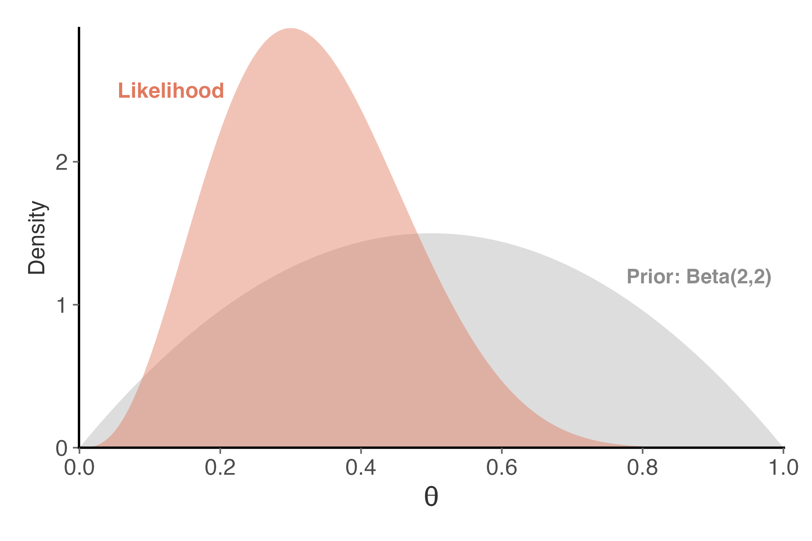

```

]


--


.pull-right[

```{r echo=FALSE, out.width ="90%", fig.align = 'left'}
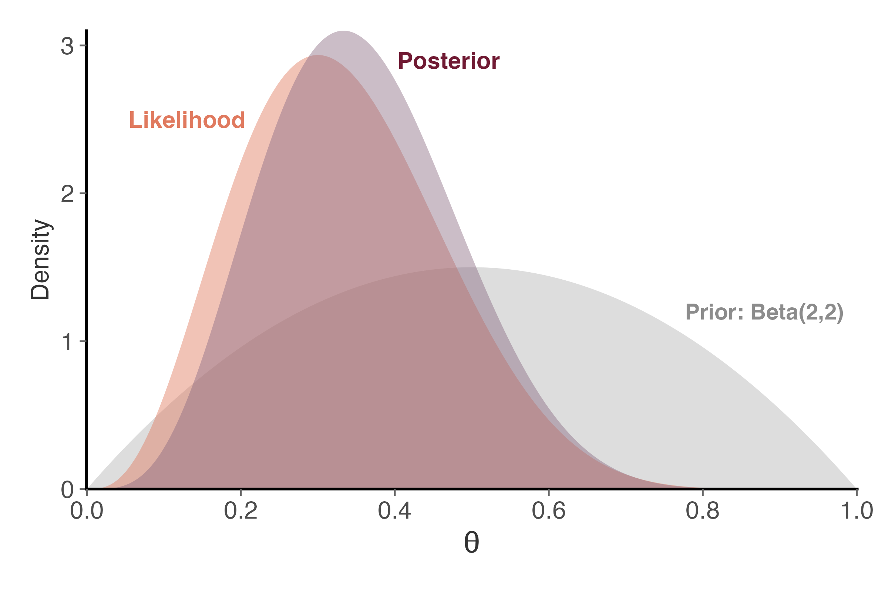

```

]

---
# PPGECO | ECL0072 | out. 2026

### A natureza sob o olhar bayesiano  


***Priori informativa***

Reflete um alto grau de conhecimento (certeza) sobre o parâmetro
- Associado à variâncias ($\sigma^2$) muito pequenas
- Opinião de especialista: comum 7/10 detecções (com. Jaqueiuto)
  - Distribuição beta $\theta \sim  \text{beta}(7,3)$


--

<br>

.pull-left[

```{r echo=FALSE, out.width ="90%", fig.align = 'left'}
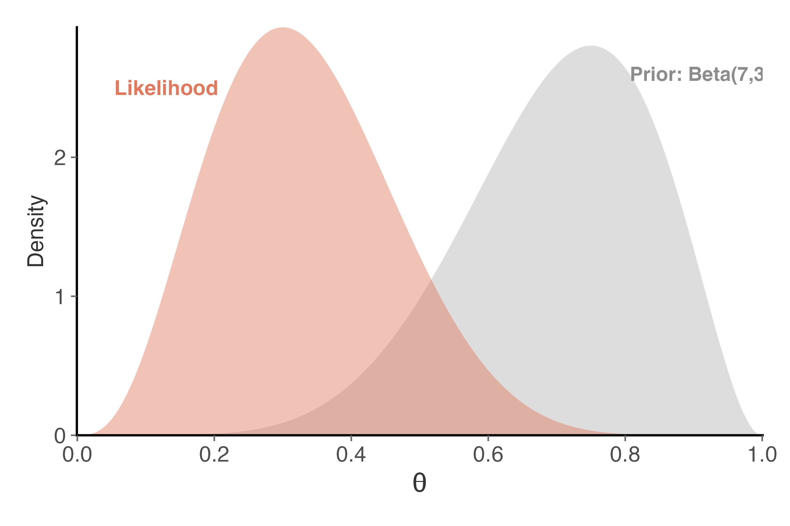

```

]


--


.pull-right[

```{r echo=FALSE, out.width ="90%", fig.align = 'left'}
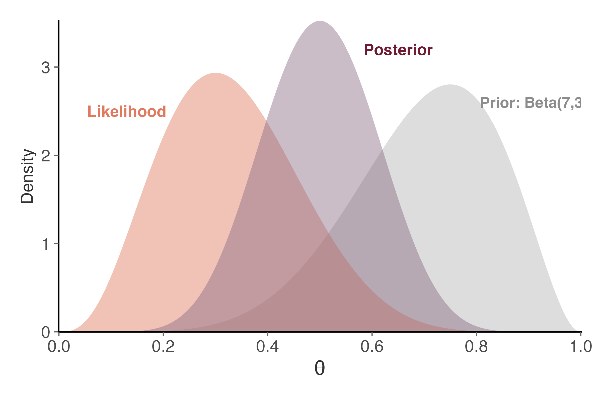

```

]


---
# PPGECO | ECL0072 | out. 2026

### A natureza sob o olhar bayesiano  


As prioris exercem maior impacto em dados pequenos
- muito cuidado com a escolha da priori!

<br>

```{r echo=FALSE, out.width ="100%", fig.align = 'center'}
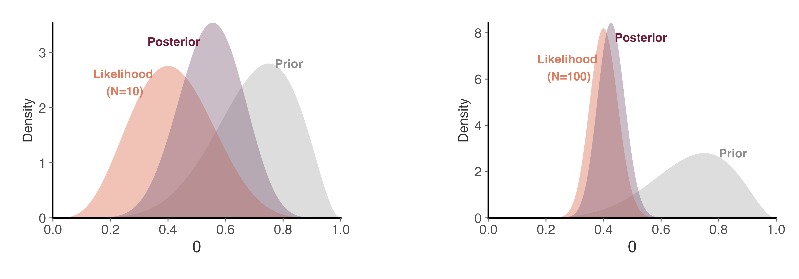

```

---
# PPGECO | ECL0072 | out. 2026

### Métodos de inferência

Como estimamos os valores para os parâmetros desconhecidos do modelo?

<br>
<br>
<br>


.pull-left[

```{r echo=FALSE, fig.align ='center', out.width ="100%"}
knitr::include_graphics("../Figuras/LM_pinguins2.png")
```

]

.pull-right[

<br>
<br>


- Método dos momentos
- <span style="color: #e07a5f;">Método dos mínimos quadrados </span>
- <span style="color: #e07a5f;">Método de máxima verossimilhança </span>
- <span style="color: #e07a5f;">Método bayesiano </span>

]

---
# PPGECO | ECL0072 | out. 2026

### Métodos de inferência | .small-text[<span style="color: #e07a5f;">Mínimos Quadrados (OLS) </span>]

<br>
<br>


.pull-left[

<br>

```{r echo=FALSE, fig.align ='right', out.width ="100%"}
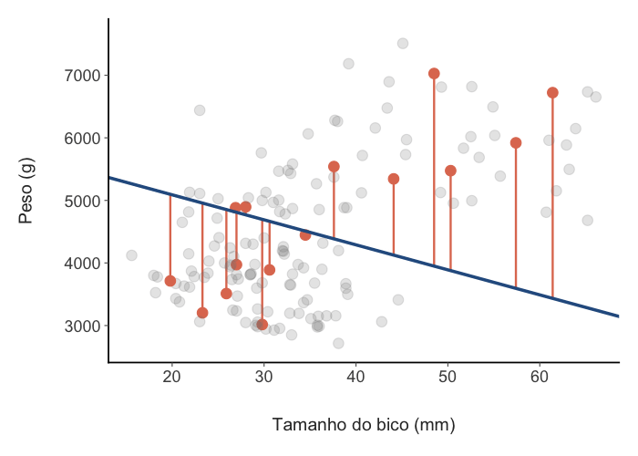
```

]

.pull-right[

<br>
<br>


$$\large y_i = f(x_i | \theta) + \varepsilon_i$$
$$\large \varepsilon_i = y_i - f(x_i|\theta)$$


]


.footnote[OLS - *Ordinary Least Squares*]

---
# PPGECO | ECL0072 | out. 2026

### Métodos de inferência | .small-text[<span style="color: #e07a5f;">Mínimos Quadrados (OLS) </span>]

<br>
<br>


.pull-left[

<br>

```{r echo=FALSE, fig.align ='right', out.width ="100%"}

```

]

.pull-right[

<br>
<br>


$$\large y_i = f(x_i | \theta) + \varepsilon_i$$
$$\large \varepsilon_i = y_i - f(x_i|\theta)$$


<div style="height: 10px;"></div>


-----

.center[.small-text2[**Qual linha se ajusta melhor aos dados?**]]


]

.footnote[OLS - *Ordinary Least Squares*]

---
# PPGECO | ECL0072 | out. 2026

### Métodos de inferência | .small-text[<span style="color: #e07a5f;">Mínimos Quadrados (OLS) </span>]

<br>
<br>


.pull-left[

<br>

```{r echo=FALSE, fig.align ='right', out.width ="100%"}

```

]

.pull-right[

<br>
<br>


$$\large y_i = f(x_i | \theta) + \varepsilon_i$$
$$\large \varepsilon_i = y_i - f(x_i|\theta)$$


<div style="height: 10px;"></div>


-----

.center[.small-text2[**Qual linha se ajusta melhor aos dados?**]]

<br>

.gray-box-small[
$$\large \text{SQR} = min \sum_{i=1}^{n} (y_i - f(x_i|\theta))^2$$

]

]

.footnote[OLS - *Ordinary Least Squares*]


---
# PPGECO | ECL0072 | out. 2026

### Métodos de inferência | .small-text[<span style="color: #e07a5f;">Mínimos Quadrados (OLS) </span>]


<br>


$$\large \text{SQR} = \underbrace{min \sum_{i=1}^{n} (y_i - f(x_i|\theta))^2}_
{\text{Diferenciar a função em relação a }\ \theta}$$

<br>

--

Possui solução analítica

<br>

$$\large \hat{\beta_0} = (X^TX)^{-1}X^Ty ~~\color{gray}{(= \overline{y} - \widehat{\beta_1}~\overline{x})}$$


<br>

$$\large \hat{\beta_1} = X(X^TX)^{-1}X^Ty ~~\color{gray}{(= r \frac{\sigma_y}{\sigma_x})}$$


.footnote[r = coeficiente de correlação;  σ = desvio padrão]


---
# PPGECO | ECL0072 | out. 2026

### Métodos de inferência | .small-text[<span style="color: #e07a5f;">Máxima Verossimilhança (ML) </span>]


.pull-left[

<br>
<br>

```{r echo=FALSE, out.width ="66%", fig.align ='center', fig.cap="Ronald A. Fisher (1890-1962)", fig.topcaption=F}
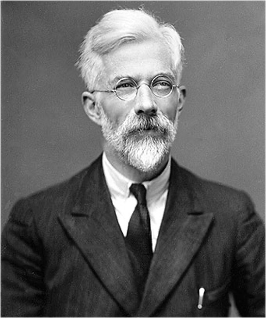
```


]


.pull-right[


<br>
<br>
<br>
<br>
<br>
<br>

Formalizou a teoria de máxima verossimilhança 
- Estatística frequentista
  - Teste de hipótese, ANOVA, ...


]


.footnote[ML - *Maximum Likelihood*]

---
# PPGECO | ECL0072 | out. 2026

### Métodos de inferência | .small-text[<span style="color: #e07a5f;">Máxima Verossimilhança (ML) </span>]


**Entendendo o método:**


Os dados (i.e, $Y$) surgem de um processo aleatório
- podem ser descritos por um modelo probabilístico


--

<div style="height: 7px;"></div>

$$\large Y \sim N(\mu, \sigma^2)$$

<div style="height: 7px;"></div>


```{r echo=FALSE, fig.align ='center', out.width ="55%"}
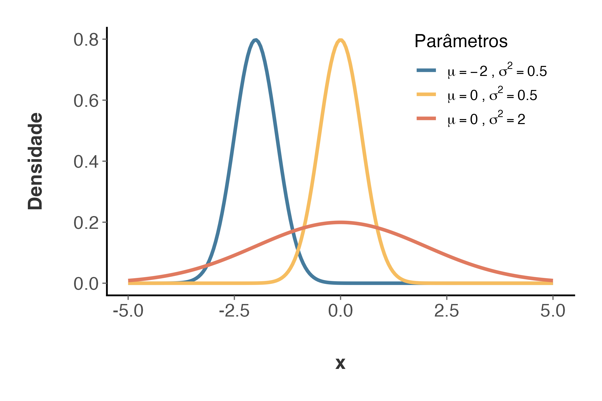

```


---
# PPGECO | ECL0072 | out. 2026

### Métodos de inferência | .small-text[<span style="color: #e07a5f;">Máxima Verossimilhança (ML) </span>]

**Entendendo o método:**

Dado o modelo probabilístico, deseja-se encontrar os valores dos parâmetros ($\theta$) que mais provavelmente geraram os dados observados
- Confrontando os dados com a distribuição de probabilidade


```{r echo=FALSE, out.width ="75%", fig.align ='center'}
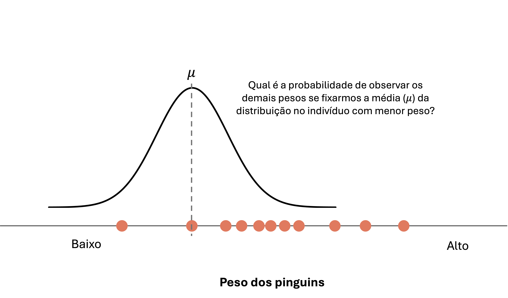
```


---
# PPGECO | ECL0072 | out. 2026

### Métodos de inferência | .small-text[<span style="color: #e07a5f;">Máxima Verossimilhança (ML) </span>]

**Entendendo o método:**

Dado o modelo probabilístico, deseja-se encontrar os valores dos parâmetros ($\theta$) que mais provavelmente geraram os dados observados
- Confrontando os dados com a distribuição de probabilidade


```{r echo=FALSE, out.width ="65%", fig.align ='center'}
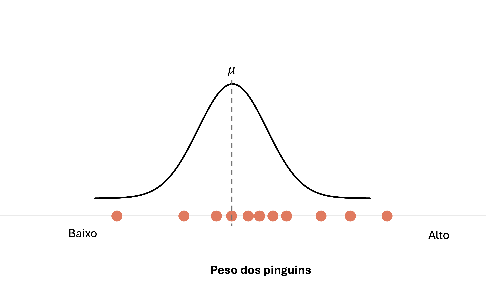
```

---

# PPGECO | ECL0072 | out. 2026

### Métodos de inferência | .small-text[<span style="color: #e07a5f;">Máxima Verossimilhança (ML) </span>]

**Entendendo o método:**

Dado o modelo probabilístico, deseja-se encontrar os valores dos parâmetros ($\theta$) que mais provavelmente geraram os dados observados
- Confrontando os dados com a distribuição de probabilidade


```{r echo=FALSE, out.width ="65%", fig.align ='center'}
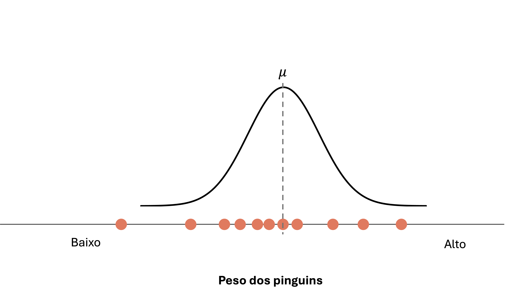
```


---
# PPGECO | ECL0072 | out. 2026

### Métodos de inferência | .small-text[<span style="color: #e07a5f;">Máxima Verossimilhança (ML) </span>]

**Entendendo o método:**

Dado o modelo probabilístico, deseja-se encontrar os valores dos parâmetros ($\theta$) que mais provavelmente geraram os dados observados
- Confrontando os dados com a distribuição de probabilidade


```{r echo=FALSE, out.width ="65%", fig.align ='center'}
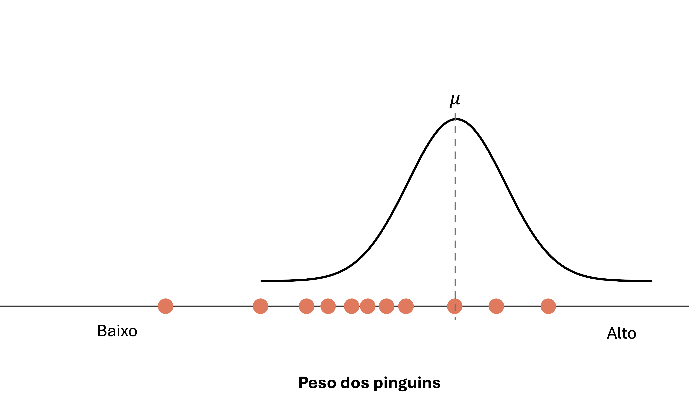
```


---

# PPGECO | ECL0072 | out. 2026

### Métodos de inferência | .small-text[<span style="color: #e07a5f;">Máxima Verossimilhança (ML) </span>]

**Entendendo o método:**


```{r echo=FALSE, out.width ="90%", fig.align ='center'}
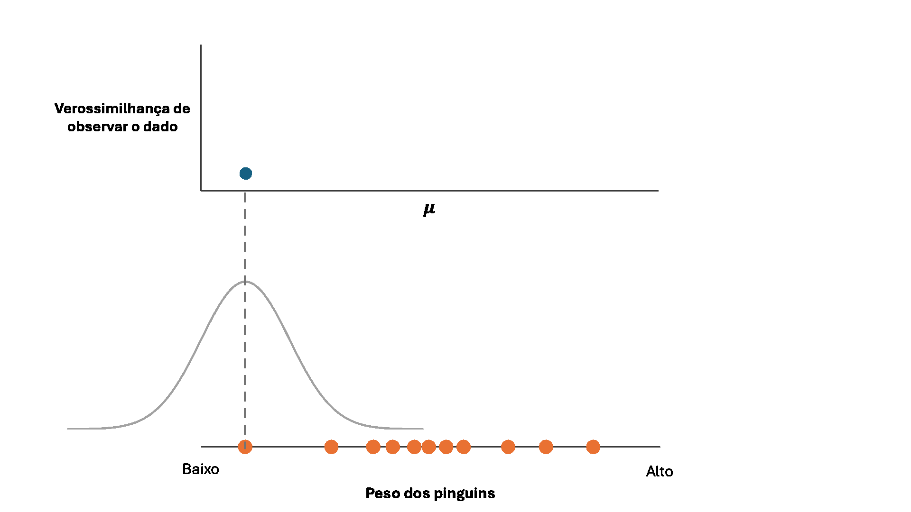
```

---
# PPGECO | ECL0072 | out. 2026

### Métodos de inferência | .small-text[<span style="color: #e07a5f;">Máxima Verossimilhança (ML) </span>]

**Entendendo o método:**

.pull-left[

<br>
<br>
<br>

```{r echo=FALSE, out.width ="100%", fig.align ='center'}
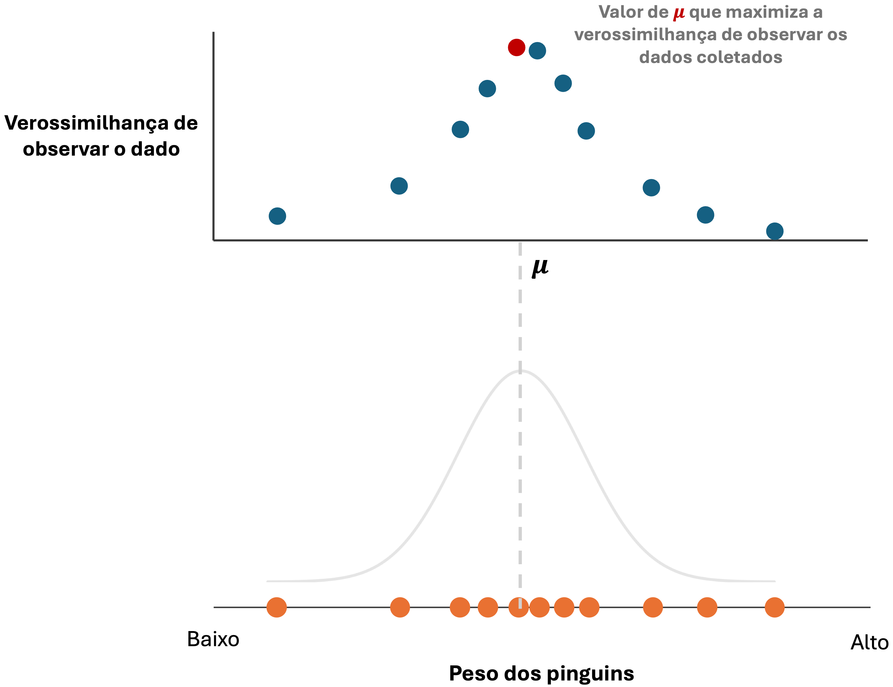
```
]
.pull-right[

<br>
<br>
<br>
<br>
<br>
<br>
<br>
<br>

$$\large \hat{\theta} := argmax ~ L(\theta)$$
]
---
# PPGECO | ECL0072 | out. 2026

### Métodos de inferência | .small-text[<span style="color: #e07a5f;">Máxima Verossimilhança (ML) </span>]

**Entendendo o método:**


Como a distribuição Normal é descrita por dois parâmetros ($\mu,\sigma^2$), é preciso achar o máximo da função de verossimilhança *simultaneamente* para ambos os parâmetros

<br>

.pull-left[

```{r echo=FALSE, out.width ="100%", fig.align ='center'}

```
]

.pull-right[

```{r echo=FALSE, out.width ="100%", fig.align ='left'}
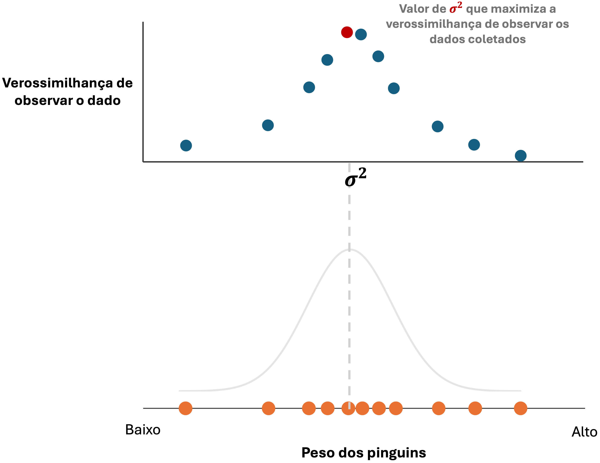
```
]


---
# PPGECO | ECL0072 | out. 2026

### Métodos de inferência | .small-text[<span style="color: #e07a5f;">Máxima Verossimilhança (ML) </span>]

**Entendendo o método:**


<div style="height: 7px;"></div>


```{r, echo=F, message=F, warning=F}

set.seed(1)
y <- rnorm(1000, mean = 5, sd = 2)

# Common grid
mu_seq    <- seq(4.75,  5.15,  length.out = 100)
sigma_seq <- seq(1.95, 2.25, length.out = 100)

# Common log-likelihood function
loglik_normal <- function(mu, sigma, y) {
  if (sigma <= 0) return(NA_real_)
  sum(dnorm(y, mean = mu, sd = sigma, log = TRUE))
}

# Grid for contour
grid <- expand.grid(mu = mu_seq, sigma = sigma_seq)
grid$loglik <- mapply(loglik_normal, grid$mu, grid$sigma, MoreArgs = list(y = y))
grid$lik <- exp(grid$loglik - max(grid$loglik, na.rm = TRUE))

mu_hat    <- mean(y)
sigma_hat <- sqrt(mean((y - mu_hat)^2))
nll_hat   <- -loglik_normal(mu_hat, sigma_hat, y) # neg LL for 3D

```


.pull-left[

<br>

```{r, echo=F, message=F, warning=F,  out.width="100%", fig.height=6}
library(ggplot2)
library(viridis)

grid$nll <- -grid$loglik

ggplot(grid, aes(mu, sigma, z = nll))+
  geom_contour_filled(bins = 15,aes(fill=after_stat(level_mid)))+
  scale_fill_viridis_c(option="F", direction = -1,
                       guide = guide_colorbar(
                         title.position = "top", 
                         title.hjust = 0.5,
                         barwidth = unit(5, "cm"), 
                         barheight = unit(0.4, "cm"))) +
  geom_vline(xintercept = mu_hat, color = "black", size = .5) +
  geom_hline(yintercept = sigma_hat, color = "black", size = .5) +
  geom_point(aes(x=4.976704, y = 2.068797), size = 2) +
  labs(x = expression(mu), y = expression(sigma^2), fill = "Neg. log-likelihood") +
  theme_bw(base_size = 13) +
  coord_cartesian(expand = c(0,0)) +
  theme(plot.background   = element_rect(fill = "transparent", color = NA),
        panel.background  = element_rect(fill = "transparent", color = NA),
        axis.text         = element_text(color = "gray30", size = 12),
        axis.title.x = element_text(color = "gray20", size = 16, face = "bold", margin = margin(t = 25)),
        axis.title.y = element_text(color = "gray20", size = 16, face = "bold", margin = margin(r = 20)),
        axis.ticks        = element_line(color = "gray40", size = 0.4),
        legend.position = "bottom",
        legend.box = "horizontal",
        legend.background = element_rect(fill = "transparent", colour = NA),
        legend.box.background = element_rect(fill = "transparent", colour = NA),
        legend.title = element_text(hjust = 0.5, face = 'bold', size = 10),
        legend.text = element_text(size = 9),
        plot.margin       = margin(15, 15, 15, 15))


```

]


.pull-right[

<br>
<br>

```{r,echo=F, message=F, warning=F, out.width="100%", fig.height=7}
library(plotly)

Z <- outer(mu_seq, sigma_seq, Vectorize(function(m, s) -loglik_normal(m, s, y)))


cols <- viridis(10, option = "F")


plot_ly(
  x = ~mu_seq, y = ~sigma_seq, z = ~t(Z),
  height = 300 # Força a altura exata do container para casar com a coluna
) |>
  add_surface(
    showscale = FALSE, 
    opacity = 0.8, 
    colorscale = setNames(cols, seq(0, 1, length.out = length(cols))),
    reversescale = FALSE
  ) |>
  add_markers(
    x = mu_hat, y = sigma_hat, z = nll_hat,
    marker = list(size = 7, symbol = "circle", opacity = 1, color = "black"),
    showlegend = FALSE
  ) |>
  layout(
    autosize = TRUE,
    margin = list(t = 0, b = 0, l = 0, r = 0, pad = 0),
    scene = list(
      xaxis = list(title = "mu"),
      yaxis = list(title = "sigma"),
      zaxis = list(title = "Neg. log lik"),
      # Expande a caixa 3D para preencher as laterais
      aspectmode = "manual",
      aspectratio = list(x = 0.6, y = 0.6, z = 0.6),
      # Aproxima a câmera (valores menores aproximam o zoom)
      camera = list(
        eye = list(x = 0.8, y = 0.8, z = 0.8)
      )
    )
  )
```
]


---
# PPGECO | ECL0072 | out. 2026

### Métodos de inferência | .small-text[<span style="color: #e07a5f;">Máxima Verossimilhança (ML) </span>]

**Traduzindo para o matematiquês**

<br>

$$\large L(\theta \mid y_1, \dots, y_n) = \prod_{i=1}^{n} f(y_i \mid \theta)$$
--

$$\large L(\theta \mid y_1, \dots, y_n) = f(y_1 \mid \theta) \cdot f(y_2 \mid \theta) \cdot f(y_3 \mid \theta) \cdots f(y_n \mid \theta)$$
<br>

--


**Quando** $\bf{n >>}$
- limitação computacional
    - truque matemático: aplicar o log!
    
--

$$\large \log L(\theta\mid y_1,\dots,y_n)
=\sum_{i=1}^n \log f(y_i\mid \theta)$$


- Tornando o produto em somatório implica em:
    - Estabilidade numérica e maior facilidade na diferenciação da função
    - O máximo da função torna-se o mínimo, i.e., $\hat{\theta} := argmin ~ L(\theta)$


---

```{r echo=FALSE, fig.align ='center', out.width ="85%"}
knitr::include_graphics("../Figuras/Frequentist_workflow.png")

```


---


**MCMC**

https://chi-feng.github.io/mcmc-demo/app.html?algorithm=RandomWalkMH&target=standard

---


- Bayesian workflow - https://arxiv.org/pdf/2011.01808 (Gelman - 2020)


https://educacao.uol.com.br/disciplinas/filosofia/filosofia-da-ciencia-karl-popper-falseabilidade-e-limites-da-ciencia.htm