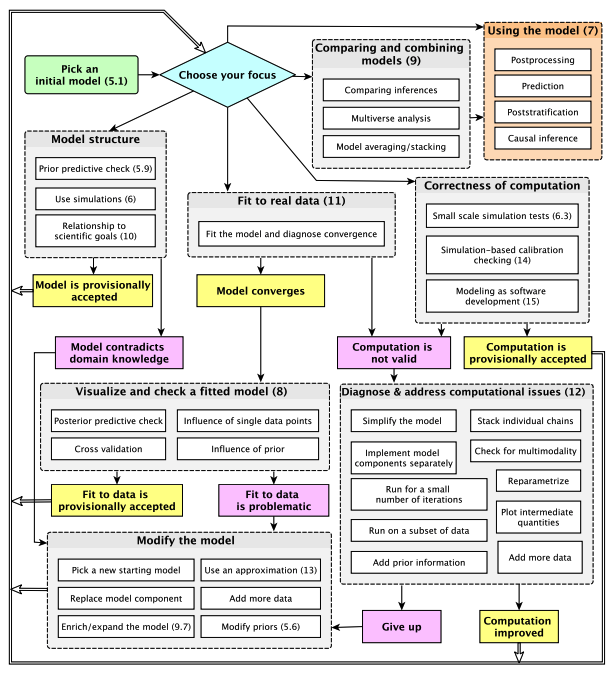
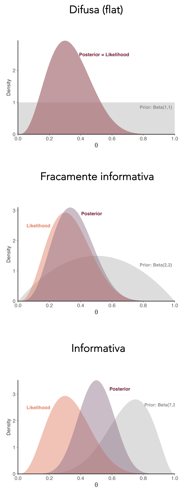
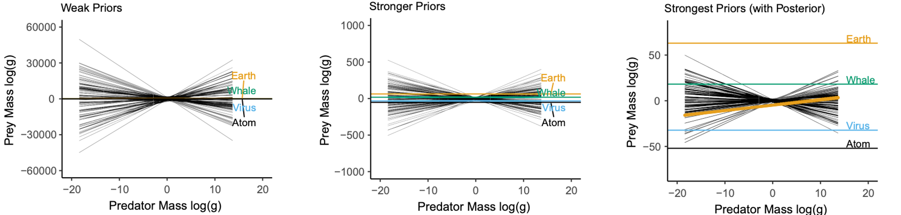
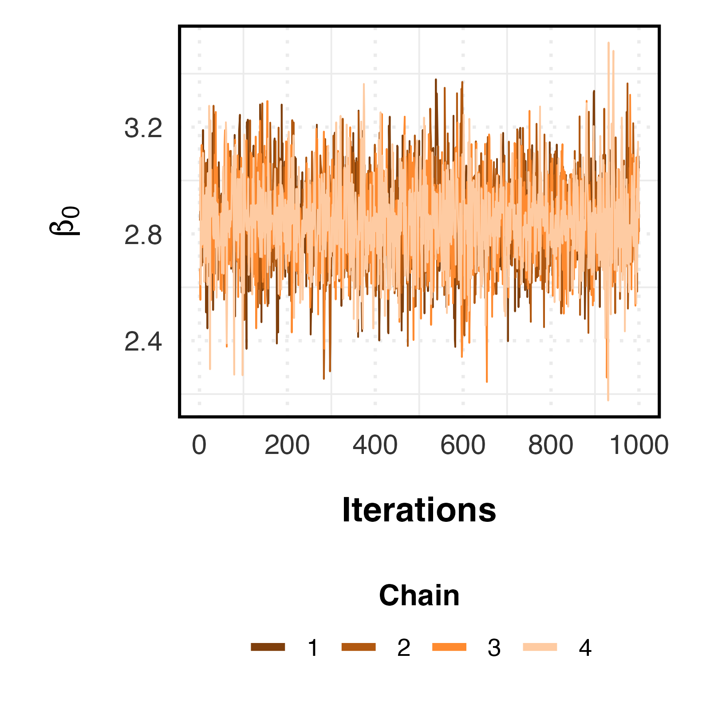

```{r xaringan-themer, include=FALSE, warning=FALSE}


#~~~~~~~~~~~~~~~~~~~~~~
# Default knitr iputs
#~~~~~~~~~~~~~~~~~~~~~~

source("../Scripts/Setup/setup_knitr.R")

#~~~~~~~~~~~~~~~~~~~~~~
# Slide customization
#~~~~~~~~~~~~~~~~~~~~~~
source("../Scripts/Setup/setup_slides.R")


```

class: title-slide
<div class="title-block">
  <h1>`r rmarkdown::metadata$title`</h1>
  <div class="date-text">`r rmarkdown::metadata$date`</div>
</div>

<div class="subtitle-block">
  <h2>`r rmarkdown::metadata$subtitle`</h2>
  <p class="author-name">`r rmarkdown::metadata$author`</p>
  <p class="author-email"><u>`r rmarkdown::metadata$institute`</u></p>
</div>


---
# PPGECO | ECL0072 | out. 2026

### Modelagem Bayesiana


.pull-left[
```{r echo=FALSE, fig.align ='center', out.width ="100%"}

```
]


.pull-right[

.center[**Workflow versão de bolso**]

.small-text[


<br>

1. Propor modelo inicial
  - Dados (verossimilhança)
  - Priori (conhecimento prévio)

2. Avaliar a compatibilidade da priori
  - *Prior predictive check*

3. Ajustar o modelo
  - *brms*, *stan*, *INLA*, ...

4. Avaliar a convergência das cadeias 
  - *Traceplots*
  - $\widehat{R}$

5. Avaliar qualidade do ajuste do modelo
  - *Posterior predictive check*

6. Modificar o modelo (se necessário)
  - Priori
  - Verossimilhança

7. Comparar modelos & realizar inferências

]


]


.footnote[Figura: [Gelman et al. (2026)](https://users.aalto.fi/~ave/Bayesian-Workflow.pdf)]


---

# PPGECO | ECL0072 | out. 2026

### Modelagem Bayesiana | .small-text[<span style="color: #e07a5f;">Propor modelo incial </span>]

Sob o prisma Bayesiano, tudo são probabilidades

<br>

$$\large \underbrace{p(\theta ~ | ~ y)}_\text{Posterior} ~ \propto ~ \underbrace{p(y~ | ~\theta)}_\text{Dados} \cdot \underbrace{p(\theta)}_\text{Priori}$$


<div style="height: 20px;"></div>

```{r echo=FALSE, out.width ="55%"}
knitr::include_graphics("../Figuras/prior_lik_post_densities.png")

```

---

# PPGECO | ECL0072 | out. 2026

### Modelagem Bayesiana | .small-text[<span style="color: #e07a5f;">Propor modelo incial </span>]


Ao definir um modelo bayesiano, temos que escolher uma distribuição de probabilidade que melhor descreve os dados (verossimilhança) e os parâmetros (priors)

<br>

.pull-left[

.center[**Variáveis contínuas**]

<div style="height: 7px;"></div>


- Normal (Gaussiana)
- Student-t
- Gama
- Exponencial
- Beta
- ....
 
]

.pull-right[
 
.center[**Variáveis discretas**]

<div style="height: 7px;"></div>


- Poisson
- Binomial Negativa
- Binomial
- Uniforme
- ....

]


<br>
<br>

- https://probabilityplayground.com/

- https://distribution-explorer.github.io/

- https://ben18785.shinyapps.io/distribution-zoo/

---
# PPGECO | ECL0072 | out. 2026

### Modelagem Bayesiana | .small-text[<span style="color: #e07a5f;">Escolha das prioris </span>]

**Como definir as prioris na prática?**


.pull-left[

<div style="height: 7px;"></div>

.small-text[

As prioris descrevem os valores considerados plausíveis para os parâmetros do modelo antes de utilizar os dados atuais para estimá-los
- Dependem do modelo, da escala dos parâmetros e do contexto do estudo
- Não existe uma priori universalmente "correta"

<br>


**Ponto de vista tradicional:** 
- Estudos prévios
- Meta-análises
- Opinião de especialistas

<div style="height: 4px;"></div>

------

<div style="height: 4px;"></div>

**Ponto de vista moderno:**
- Domínio sobre o sistema ecológico 
  - Valores biologicamente plausíveis
  - Escala/magnitude compatível com os dados
- Regularização (evitar valores extremos)


  ]
]


.pull-right[

```{r echo=FALSE, out.width ="42%"}


```

]

---
# PPGECO | ECL0072 | out. 2026

<br>
<br>
<br>
<br>
<br>
<br>
<br>
<br>
<br>
<br>
<br>


.center[**A escolha das prioris é subjetiva?**]

---
# PPGECO | ECL0072 | out. 2026
### Modelagem Bayesiana | .small-text[<span style="color: #e07a5f;">Escolha das prioris </span>]

<br>

- Toda prática científica nunca é 100% objetiva
  - Escolha das distribuições de probabilidade (dados/prioris)
  - Nível de significância a 5% (abordagem frequentista)

<br>

--

- Normalmente possuímos algum grau de crença sobre o processo ecológico sob investigação
  - O uso de prioris difusas também pode ser considerado como uma escolha objetiva 


<br>

--

<br>

- Em modelos mais complexos (e.g., hierárquicos), o uso de prioris muitas vezes é necessário para estabilizar as estimações dos parâmetros


---
# PPGECO | ECL0072 | out. 2026

### Modelagem Bayesiana | .small-text[<span style="color: #e07a5f;">Compatibilidade da priori</span>]

Quando na dúvida sobre as prioris, realizar um teste de sensibilidade
- testar diferentes prioris e avaliar seu efeito sobre a distribuição posterior


As práticas mais recentes de modelagem bayesiana incluem o *prior predictive check* no seu *workflow* habitual
- permite verificar se as prioris fazem sentido
  - Gerar predições usando os parâmetros da priori 
  - Comparar a escala dos valores preditos vs. observados (plausível?)

<div style="height: 7px;"></div>


```{r echo=FALSE, out.width ="90%"}


```

.footnote[Figura: [Wesner & Pomeranz (2021)](https://esajournals.onlinelibrary.wiley.com/doi/full/10.1002/ecs2.3739)]

---
# PPGECO | ECL0072 | out. 2026

### Modelagem Bayesiana | .small-text[<span style="color: #e07a5f;">Convergência das cadeias </span>]

<br>

O MCMC produz sequências de valores para os parâmetros

$$\theta^{(1)},\theta^{(2)},\theta^{(3)},\ldots,\theta^{(N)}$$

Na prática, definimos diferentes cadeias para explorarem a distribuição posterior
- quando as cadeias convergem, i.e., exploram a mesma região, podemos assumir que as amostras de $\theta$ representam adequadamente a distribuição posterior

--

<br>

**Como saber se as cadeias convergiram**

- **Traceplot** $\rightarrow$ as cadeias apresentam boa mistura? (Visual)

- $\mathbf{\widehat{R}}$ $\rightarrow$ as diferentes cadeias convergiram para a mesma distribuição? (quantitativo)

- **ESS** $\rightarrow$ quantas amostras efetivamente independentes temos? (quantitativo)

---
# PPGECO | ECL0072 | out. 2026

### Modelagem Bayesiana | .small-text[<span style="color: #e07a5f;">Convergência das cadeias </span>]

**Traceplot**

<br>

.pull-left[

<br>

- Cada cadeia deve parecer como um ruído aleatório, sem tendências, e com comportamento semelhante entre as diferentes cadeias


- Todas as cadeias devem variar em torno de uma média que se mantém constante ao longo das iterações


- Insepcção visual: gráfico semelhante a uma lagarta de fogo

]


.pull-right[

```{r echo=FALSE, out.width ="85%"}


```


]

---
# PPGECO | ECL0072 | out. 2026

### Modelagem Bayesiana | .small-text[<span style="color: #e07a5f;">Convergência das cadeias </span>]


.pull-left[

$\mathbf{\widehat{R}}$

.small-text[
- Compara a variação de $\theta$ dentro e entre as cadeias
- Valores devem ser < 1.1
]
]

.pull-right[

**Effective sample size (ESS)**

.small-text[
- Avalia a quantidade efetiva de informação presente nas amostras
  - Considera a autocorrelação entre as amostras e expressa essa informação em termos de um número equivalente de amostras independentes
]
]


----

```{r, echo = F, eval=T, warning=F, message=F}
#~~~~~~~~~~~~~~~~~~~~~~~~
# Carregando os pacotes
#~~~~~~~~~~~~~~~~~~~~~~~~
library(dplyr) # Manipulação de dados
library(brms) # Modelos Bayesianos
library(bayesplot) # Visualização dos resultados Bayesianos (extra)
library(ggplot2) # Visualização dos dados/resultados
library(GGally) # Gráfico de multicolinearidade
library(patchwork) # Visualização de dados (figuras com +1 painel)

mod <- readRDS("../Anonimo/modelo_bayesiano.rds")
```


.code-bg[

.small-code[
```{r, echo=T, eval=T}
summary(mod)

```
]
]


---
https://paulbuerkner.com/software/brms-book/brms-book.pdf
https://bookdown.org/content/8ba612b7-90f2-4ebc-b329-0159008e2340/07.html
