```{r xaringan-themer, include=FALSE, warning=FALSE}


#~~~~~~~~~~~~~~~~~~~~~~
# Default knitr iputs
#~~~~~~~~~~~~~~~~~~~~~~

source("../Scripts/Setup/setup_knitr.R")

#~~~~~~~~~~~~~~~~~~~~~~
# Slide customization
#~~~~~~~~~~~~~~~~~~~~~~
source("../Scripts/Setup/setup_slides.R")


```

class: title-slide
<div class="title-block">
  <h1>`r rmarkdown::metadata$title`</h1>
  <div class="date-text">`r rmarkdown::metadata$date`</div>
</div>

<div class="subtitle-block">
  <h2>`r rmarkdown::metadata$subtitle`</h2>
  <p class="author-name">`r rmarkdown::metadata$author`</p>
  <p class="author-email"><u>`r rmarkdown::metadata$institute`</u></p>
</div>


---
# PPGECO | ECL0072 | out. 2026

### Ruido vs. sinal em dados ecológicos


<br>
<br>
<br>


```{r, out.width ="80%", fig.asp = 0.4}


iccat <- readRDS("~/OneDrive/Arbeit/Supervision/ICCAT/Dados/iccat_updated_aug26.rds")


iccat %>%
    mutate(MonthYear = zoo::as.yearmon(Date)) %>%
    mutate(CPUE = (Xiphias_gladius/Nhooks)*1000) %>%
    group_by(MonthYear) %>%
    summarise(avg_cpue = mean(CPUE)) %>%
    ggplot(aes(x=MonthYear, y= avg_cpue)) +
    geom_line(col = '#e07a5f', size = 0.6) + 
    geom_point(col = '#e07a5f', size = 0.8, shape = 1) +
    geom_smooth(method = 'gam', fill = 'gray70', col = "gray40") +
    labs(x = "Anos",y = "CPUE (N/1000 anzóis)") +
    theme_void() +
    my_theme


```


---
# PPGECO | ECL0072 | out. 2026

### Dados ecológicos são estruturados

Processos ecológicos atuam em múltiplas escalas: 

- **Espacial**

<br>


```{r, out.width ="70%",  fig.asp = 0.8}
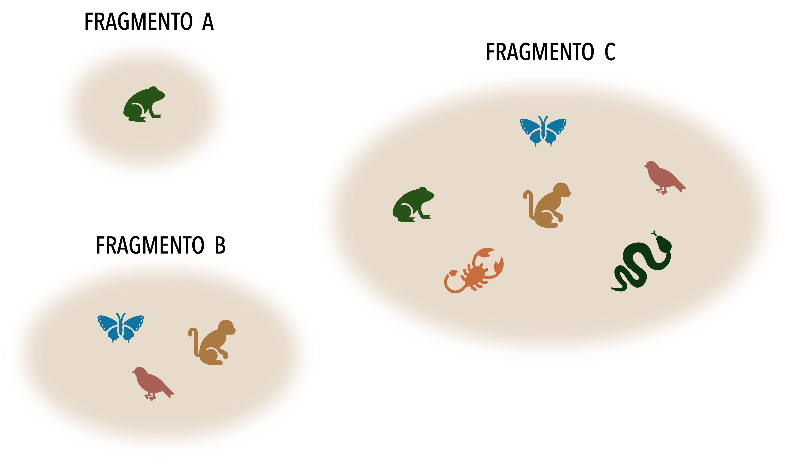
```

---
# PPGECO | ECL0072 | out. 2026

### Dados ecológicos são estruturados

Processos ecológicos atuam em múltiplas escalas: 

- **Temporal**

<br>
<br>

```{r, out.width ="90%"}
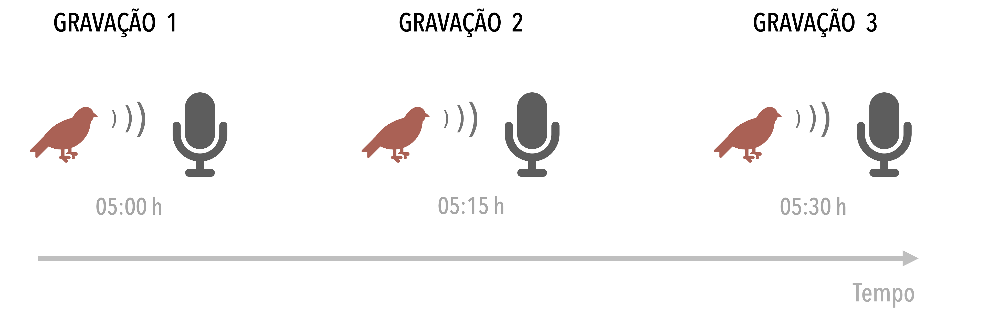
```

---

# PPGECO | ECL0072 | out. 2026

### Dados ecológicos são estruturados

Processos ecológicos atuam em múltiplas escalas: 

- **Espaço-Temporal**

<br>


```{r, out.width ="90%"}
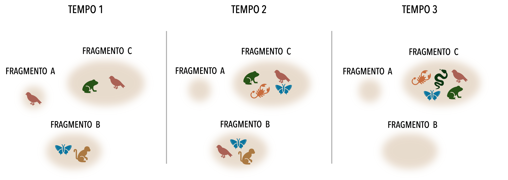
```

---

# PPGECO | ECL0072 | out. 2026

### Dados ecológicos são estruturados

Processos ecológicos atuam em múltiplas escalas: 

- **Taxonômica (genética)**

<br>
<br>
<br>


```{r, out.width ="85%"}
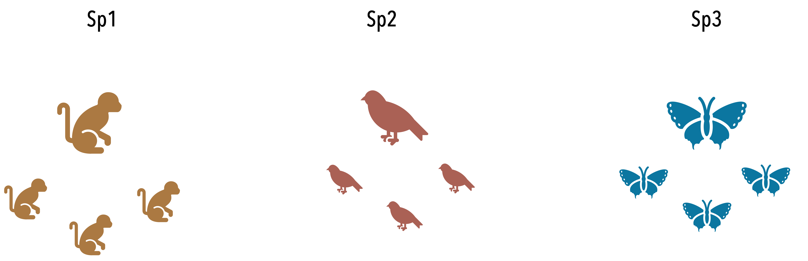
```


---
# PPGECO | ECL0072 | out. 2026

### Dados ecológicos são estruturados


Um dado é *estruturado* quando as observações ($y_i$) estão organizadas em grupos/níveis hierárquicos ($k$)

- cada grupo de observações ($y_{ik}$) campartilha diversas características que geram dependência entre elas


```{r, out.width ="60%"}
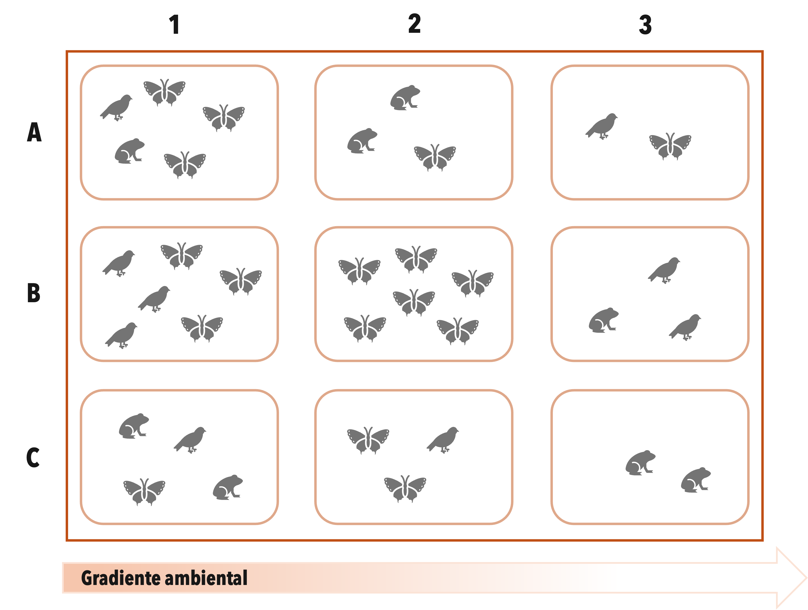

```


---
# PPGECO | ECL0072 | out. 2026
### Dados ecológicos são estruturados

Essas estruturações violam o principal pressuposto dos modelos lineares (generalizados)<sup>1</sup> 

- *Independência*


<br>

$$\Large y_i = \beta_0 + \beta x_i + \varepsilon_i \\ \varepsilon_i \overset{\text{iid}}{\sim}  N(0,\sigma^2)$$


<br>

.footnote[
<sup>1</sup> e suas versões aditivas (GLM/GAM)
]

--


<br>

.small-text2[

**Pressupostos de um LM:**

- **Linearidade:** tendência de $y$ é descrita por um modelo linear

- **Normalidade:** resíduos $\varepsilon_i$ seguem uma distribuição normal

- **Homocedasticidade:** variância residual é constante ao longo de $x$

- **Independência:** resíduos não são correlacionados
  ]
  


---
class:center, middle
# PPGECO | ECL0072 | out. 2026


## Como solucionar a violação da independência? 

---
class: center, middle
# PPGECO | ECL0072 | out. 2026


## Como solucionar a violação da independência? 

### - Particionado a variância -

---
# PPGECO | ECL0072 | out. 2026
### Estudo de caso | .small-text[<span style="color: #e07a5f;">Monitoramento da ictiofauna recifal</span>]

<br>

.pull-left[

<br>

```{r, out.width ="90%", fig.align='right'}
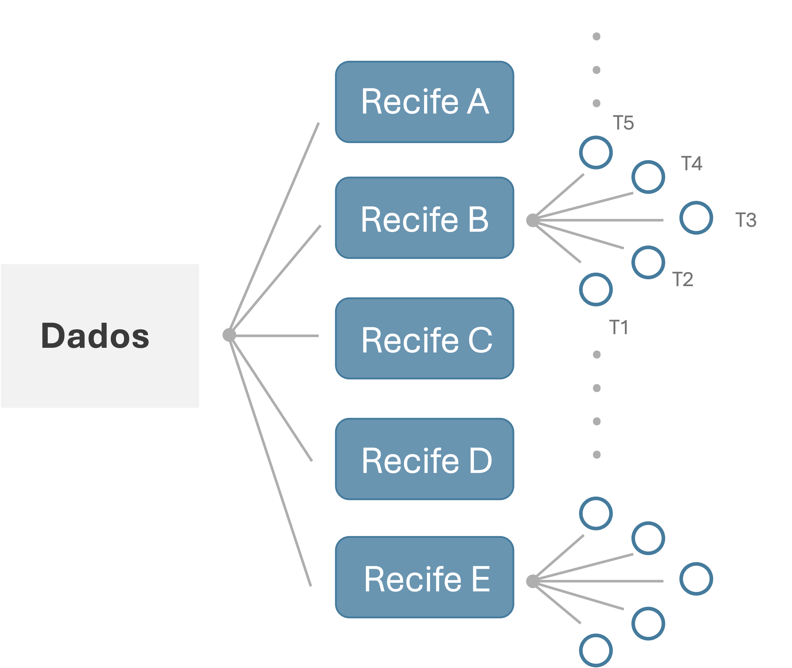

```
]

.pull-right[

<br>

.small-text2[

.center[**Escala espaço-temporal:**] 

amostragens mensais de diferentes recifes (n=5) ao longo de 3 anos


-----

.center[**Unidade amostral:**]

transecto (esforço constante)

-------

.center[**Pseudo-réplicas:**]

5 tansectos / recife / mês

-------

.center[**Efeito do mergulhador:**]

amostragens realizdas por 3 mergulhadores
]

]

---
# PPGECO | ECL0072 | out. 2026
### Estudo de caso | .small-text[<span style="color: #e07a5f;">Monitoramento da ictiofauna recifal</span>]

.code-bg[
```{r, eval = F, echo=T}
df <- readRDS("/Dados/reef_biomass.rds")
```
]


<br>
<br>

```{r,eval =T, echo =F, cache=FALSE}

## Read data
df <- readRDS("../Dados/reef_biomass.rds")

```

```{r}

library(kableExtra)


head(df, 10) %>%
  kable(format = "html", align = "c", booktabs = TRUE) %>%
  kable_styling(font_size = 16) %>%
  row_spec(0:10, extra_css = "background-color: white;") %>%
  row_spec(0, extra_css = "border-bottom: 2px solid #333333; background-color: white;") 


```


.left[.footnote[Cada linha representa uma amostra]]


---
# PPGECO | ECL0072 | out. 2026
### Estudo de caso | .small-text[<span style="color: #e07a5f;">Monitoramento da ictiofauna recifal</span>]

<br>


.center[**Os recifes diferem quanto a sua produtividade?**]

<br>

```{r, out.width="70%", fig.asp = 0.6}

df$recife <- as.factor(df$recife)
levels(df$recife) <- c("A","B", "C", "D", "E")

df %>%
    #filter(recife %in% c("A", "B", "C")) %>%
    ggplot(aes(x = recife, y = biomassa_kg_m2)) +
    geom_jitter(aes(col = recife), size = 4, alpha = 0.5) +
    geom_boxplot(size = 1, alpha = 0.3) +
    labs(x = "Recifes",y = "Biomassa (Kg/m2)") +
    scale_color_manual(values = c("#846267", "#588157","#e07a5f", "#457b9d", "#f6bd60")) +
    theme_minimal(base_size = 14) +
    my_theme +
    theme(axis.text.x = element_text(colour = "grey20",  margin = margin(t = 25)),
        axis.text.y = element_text(colour = "grey20", margin = margin(r = 20)))

```


---
# PPGECO | ECL0072 | out. 2026

### Abordando a (in)dependência | .small-text[<span style="color: #e07a5f;">Agregando os dados</span>]


Parte da variabilidade dos dados pode ser reduzida, agregando as observações ente os grupos (espaciais, temporais, taxonômicos, unidade amostral,...)

- No exemplo, réplicas de transectos em cada recife


<br>

.pull-left[

```{r, fig.asp = 0.8, out.width="90%"}

df %>%
    ggplot(aes(x = recife, y = biomassa_kg_m2)) +
    geom_jitter(aes(col = recife), size = 4, alpha = 0.5, width = 0.2) +
    
    # 1. Point for the MEDIAN (e.g., solid black diamond)
    stat_summary(
        fun = median,
        geom = "point",
        shape = 18,        # Diamond
        size = 5,
        color = "black"
    ) +
    
    # 2. Point for the AVERAGE / MEAN (e.g., red circle with black border)
    stat_summary(
        fun = median,
        fun.min = median,
        fun.max = median,
        geom = "crossbar",
        width = 0.3,
        color = "black",
        linewidth = 0.8
    ) +
    
    labs(x = "Recifes", y = "Biomassa (Kg/m2)") +
    scale_color_manual(values = c("#846267", "#588157", "#e07a5f", "#457b9d", "#f6bd60")) +
    theme_minimal(base_size = 14) +
    theme( axis.text.x = element_text(margin = margin(t = 25)),
           axis.text.y = element_text(margin = margin(r = 25))) +
    my_theme

# df %>%
#     #filter(recife %in% c("A", "B", "C")) %>%
#     ggplot(aes(x = recife, y = biomassa_kg)) +
#     geom_jitter(aes(col = recife), size = 4, alpha = 0.5) +
#     geom_boxplot(size = 1, alpha = 0.3) +
#     labs(x = "Grupo",y = "X") +
#     scale_color_manual(values = c("#846267", "#588157","#e07a5f", "#457b9d", "#f6bd60")) +
#     theme_minimal(base_size = 14) +
#     my_theme
```


]


.pull-right[

.small-text2[


<div style="height: 7px;"></div>


Útil em algumas poucas situações, porém:


- Mascara a variabilidade natural dos dados (informação!) 


- Reduz o número de observações (logo, poder estatístico)


- Falácia ecológica
  - Inferir relações individuais a partir de dados agregados

  ]
]


---
# PPGECO | ECL0072 | out. 2026

### Abordando a (in)dependência | .small-text[<span style="color: #e07a5f;">Modelo linear</span>]

#### Considerando os recifes (grupo) como *efeito fixo* <sup>1</sup>


.pull-left[

.gray-box-big[ 
$$\large y_{ij} = a_j + \varepsilon_{ij}$$
$$\varepsilon_{ij} \overset{\text{iid}}{\sim}  N(0,\sigma^2), ~~i = 1,...,N$$
]

<div style="height: 7px;"></div>

.small-text[
onde:
- $\mathbf{a_j}$: efeito do grupo $j$ ($j = 1,...,K=5$)
  - efeito fixo
  
- $\mathbf{\varepsilon_{ij}}$: erro residual
]

----

<div style="height: 7px;"></div>

.small-text[
- Cada grupo possui seu próprio intercepto $a_1 ...a_K$ (i.e., média)

- Não há compartilhamento de informação entre grupos (*no pooling*)
  - Observações independentes dentro de cada grupo

  ]

]


.pull-right[


.center[
.code-bg[
```{r, echo=T, eval=F}

lm(biomassa_kg_m2 ~ recife, data = df)

```
]
]


```{r, out.width="90%", fig.asp = 0.8}

## Adjust model (ANOVA)
mod1 <- lm(biomassa_kg_m2 ~ recife, data = df)

## Get average by group
group_preds <- emmeans(mod1, ~ recife) %>%
               as.data.frame() %>%
               transmute(recife,
                estimate = emmean,
                ymin = estimate - sigma(mod1),
                ymax = estimate + sigma(mod1))


## Go for the plot
ggplot() +
    geom_jitter(data = df, aes(x = recife,y = biomassa_kg_m2, col = recife),size = 4,alpha = .3, width = .15) +
    
    geom_pointrange(data = group_preds, aes(x = recife, y = estimate, ymin = ymin, ymax = ymax),
                    colour = "gray10",linewidth = 1) +
    scale_color_manual(values = c("#846267", "#588157","#e07a5f", "#457b9d", "#f6bd60")) +
    labs(x = "Recifes",y = "Biomassa (Kg/m2)") +
    theme_minimal(base_size = 14) +
    my_theme


# peixes %>%
#   ggplot(aes(x = recife, y = comprimento_cm)) +
#   geom_jitter(col = 'gray80', size = 4, alpha = 0.3, width = 0.15) +
#   stat_summary(aes(col = recife),
#                fun.data = mean_sdl,        # Calculates Mean ± 1 SD
#                fun.args = list(mult = 1),  # Set multiplier to 1 SD (default is 2 SD)
#                geom = "pointrange", 
#                size = 1,
#                linewidth = 2) +
#   #geom_boxplot(size = 1, alpha = 0.3) +
#   labs(x = "Grupo",y = "X") +
#   scale_color_manual(values = c("#846267", "#588157","#e07a5f", "#457b9d", "#f6bd60")) +
#   theme_minimal(base_size = 14) +
#   my_theme

```


]

.right[.footnote[<sup>1</sup> Equivalente a ANOVA]]

---
# PPGECO | ECL0072 | out. 2026

### Abordando a (in)dependência | .small-text[<span style="color: #e07a5f;">Modelo linear</span>]

#### Considerando os recifes (grupo) como *efeito aleatório*


.pull-left[

.gray-box-big[ 
$\large y_{ij} = \underbrace{\mu_a + \delta_j}_{a_j} + \varepsilon_{ij}$

$$\delta_j \sim N(0, \sigma^2_a)\\
\varepsilon_{ij} \sim N(0, \sigma^2)$$

]

<div style="height: 7px;"></div>


.small-text[
onde:

- $\mathbf\mu_a:$ média global 

- $\mathbf\varepsilon_{ij}:$ erro residual 

- $\delta_j:$ efeito aleatório do grupo
  - descreve os desvios de cada grupo em relação a média global

]

-----

<div style="height: 7px;"></div>


.small-text[

- Grupos compartilham parcialmente informação (*partial pooling*)
  - Observações são dependentes dentro de cada grupo

  ]


]

.pull-right[

.center[
.code-bg[
```{r, echo=T, eval=F}

f(biomassa_kg_m2 ~ 1 + (1|recife), data = df)

```
]
]

```{r, out.width="90%", fig.asp = 0.8}

## Adjust LMM
mod <- lmer(biomassa_kg_m2 ~ 1 + (1 | recife), data = df)


## Extract fixed-effect coefficients (overall mean)
mu_a_est <- tidy(mod, effects = "fixed") %>%
            transmute(recife = "mu_a",
                      estimate = estimate,
                      ymin = estimate - std.error,
                      ymax = estimate + std.error)


## Extract random effects
group_preds <- augment(mod) %>%
               group_by(recife) %>%
               summarise(estimate = mean(.fitted), # Média predita pelo modelo para o grupo
                         ymin = estimate - sigma(mod),# Usando o desvio-padrão do efeito aleatório ou erro residual do modelo
                         ymax = estimate + sigma(mod))


## Merge both info
model_estimates <- bind_rows(mu_a_est, group_preds)

## Go for the plot
recife_levels <- unique(as.character(df$recife))
all_levels <- c("mu_a", recife_levels)

ggplot() +
    geom_jitter(data = df, aes(x = factor(recife, levels = all_levels), y = biomassa_kg_m2, col = recife), size = 4, alpha = 0.3, width = 0.15) +
    geom_pointrange(data = model_estimates, aes(x = factor(recife, levels = all_levels),y = estimate,ymin = ymin,ymax = ymax), color = c(2,1,1,1,1,1), size = 1, linewidth = 1 ) +
    scale_x_discrete(limits = all_levels,labels = parse(text = c("mu[a]", recife_levels))) +
    labs(x = "Recifes",y = "Biomassa (Kg/m2)") +
    scale_color_manual(values = c("#846267", "#588157","#e07a5f", "#457b9d", "#f6bd60")) +
    theme_minimal(base_size = 14) +
    my_theme


```


]

---
# PPGECO | ECL0072 | out. 2026

### Modelo Linear Misto

Modelos mistos incorporam simultaneamente efeitos fixos e aleatórios em sua estrutura

<br>


$$\Large
Y =
\underset{
\substack{
\rule{3.8cm}{0.3pt}\\[0.8em]
{\text{Efeito fixo}}
}
}{\color{#81b29a}{X\beta}}
+
\underset{
\substack{
\rule{3.8cm}{0.3pt}\\[1em]
{\text{Efeito aleatório}}
}
}{\color{#e07a5f}{Zb}}
+
\varepsilon$$

<br>


```{r, out.width ="85%"}
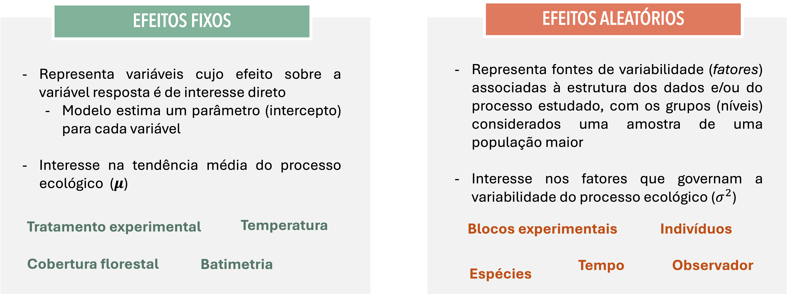
```


---
# PPGECO | ECL0072 | out. 2026
### Modelo Linear Misto

Modelos mistos são conhecidos por muitos nomes:

- Modelos de efeitos aleatórios (*random effect models*)
- Modelos multiníveis (*multilevel models*)
- Modelos hierárquicos (*hierarchical models*)


Na prática, tratar um efeito como *aleatório* significa modelar os efeitos dos diferentes grupos como provenientes de uma distribuição de probabilidade 
  - Descreve a variabilidade entre os grupos

<br>


$$\large y_i = \beta_0 + \beta x_i + \alpha_{j[i]} + \varepsilon_i$$

$$\large \alpha_j \sim N(0, \sigma_\alpha^2)$$


$$\large \varepsilon_i \sim N(0, \sigma^2)$$

--

<br>

.center[
.gray-box[ Isso torna um LMM automaticamente um modelo Bayesiano?]

]

---
# PPGECO | ECL0072 | out. 2026

### Modelo Linear Misto 

Parâmetro vs. hiperparâmetros


$$\large y_i = \beta_0 + \beta x_i + \alpha_{j[i]} + \varepsilon_i$$

$$\large \alpha_j \sim N(0, \sigma_\alpha^2)$$

$$\large \varepsilon_i \sim N(0, \sigma^2)$$

<br>


.pull-left[

**Parâmetros**

- Descrevem o processo gerador dos dados (i.e., as observações)
  - ${\beta_0, \beta, \alpha_j, \sigma^2}$

]


.pull-right[

**Hiperparâmetros**

- Descrevem como os parâmetros variam
  - ${\sigma_{\alpha}^2}$


]


---

# PPGECO | ECL0072 | out. 2026

### Modelo Linear Misto

A estrutura hierárquica força o compartilhamento de informações entre a população e os grupos
- *shrinkage*

<br>

```{r, out.width ="60%", fig.asp = 0.7}
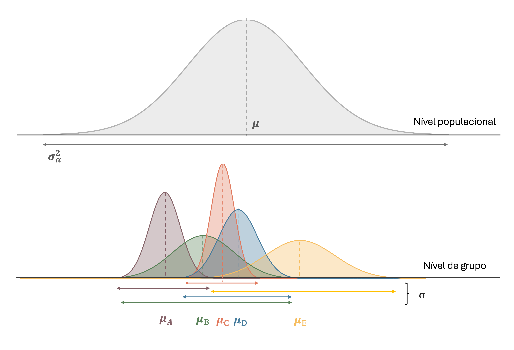
```


---
# PPGECO | ECL0072 | out. 2026

### Modelo Linear Misto


A flexibilidade dos modelos mistos está na sua abordagem para o parâmetro $\sigma^2$

<div style="height: 7px;"></div>


.center[**Decomposição da variância:**]

.center[
.gray-box-big[
$$\sigma^2_{Total} = \sigma^2_{dentro} + \sigma^2_{entre}$$]
]

<div style="height: 30px;"></div>

.pull-left[

```{r, out.width ="85%", fig.align='right'}
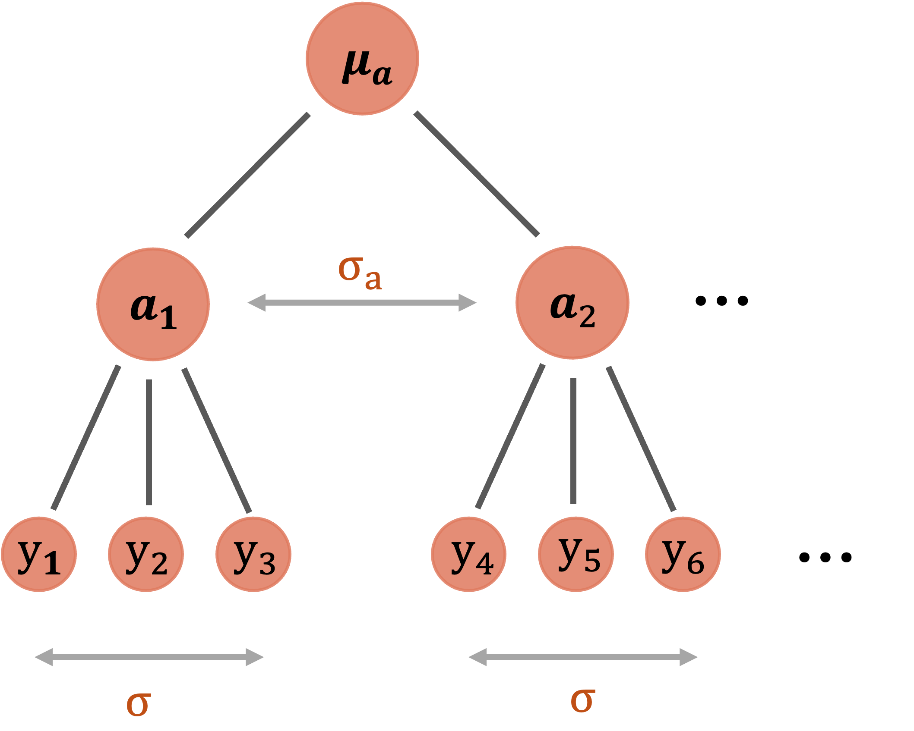
```

]

.pull-right[

<br>

.small-text[
**Variância dentro do grupo** ($\sigma^2$)

Explica o desvio de cada observação em relação à média do grupo em que ocorre (i.e., erro residual)
]

<div style="height: 7px;"></div>

----

.small-text[
**Variância entre grupos** ($\sigma_a^2$)

Explica o desvio do grupo em relação à média geral
]

]


---
# PPGECO | ECL0072 | out. 2026

### Modelo Linear Misto

O cerne dos modelos mistos está na estruturação de $\sigma_a^2$

- i.e., como descrever a dependência entre observações pertencentes ao mesmo grupo
  - Definir uma matriz de variância-covarância ($\mathbf \Sigma$) 

<br>
<br>
<br>
<br>

--

.center[

.gray-box[ 

**Para compreender melhor os modelos lineares mistos, é necessário interpretá-los sob a lente matemática**
]
]


---
# PPGECO | ECL0072 | out. 2026

### Modelo Linear Misto | .small-text[<span style="color: #e07a5f;">Um mergulho na matemática</span>]

**Modelo linear**

Considere a biomassa de peixes $y$ no *i-ésimo* transecto, descrita em função da temperatura $x_i = SST$

<div style="height: 10px;"></div>


.pull-left[

.code-bg[
```{r, echo=T, eval=F}

f(biomassa_kg_m2 ~ 1 + sst, data = df)

```
]


```{r, fig.asp = 0.9, out.width="90%"}

df %>%
    ggplot(aes(x = sst, y = biomassa_kg_m2)) +
    #geom_point(size = 4, alpha = 0.8, col = "gray70") +
    #geom_smooth(method = 'lm', se = TRUE,  fill = '#e07a5f', col = "#e07a5f", size = 2) +
    geom_point(size = 4, alpha = 0.6, col = "#e07a5f") +
    geom_smooth(method = 'lm', se = TRUE,  fill = 'gray80', col = "gray40", size = 2) +
    labs(x = "SST (°C)",y = "Biomassa (Kg/m2)") +
    theme_minimal(base_size = 14) +
    my_theme

```

]


.pull-right[

<br>
<br>
<br>


.gray-box-big[
$$\large y = {X\beta} + \varepsilon$$

$$\large \varepsilon \sim  \text{MVN}(0, \sigma^2I)$$

----


$$\Large y_i = \beta_0 + \beta_1x_i + \varepsilon_i$$
]


]


---
# PPGECO | ECL0072 | out. 2026

### Modelo Linear Misto | .small-text[<span style="color: #e07a5f;">Um mergulho na matemática</span>]

**Modelo linear**

<div style="height: 15px;"></div>


.center[**Representação matricial**]

<br>
<br>

$$\large \underbrace{\begin{bmatrix} y_1 \\ y_2 \\ y_3 \\ \vdots \\ y_n \end{bmatrix}}_{\mathbf{y}} = \underbrace{\begin{bmatrix} 1 & x_1 \\ 1 & x_2 \\ 1 & x_3 \\ \vdots & \vdots \\ 1 & x_n \end{bmatrix}}_{\mathbf{X}} \underbrace{\begin{bmatrix} \beta_0 \\ \beta_1 \end{bmatrix}}_{\boldsymbol{\beta}} + \underbrace{\begin{bmatrix} \varepsilon_1 \\ \varepsilon_2 \\ \varepsilon_3 \\ \vdots \\ \varepsilon_n \end{bmatrix}}_{\boldsymbol{\varepsilon}}$$ 

---
# PPGECO | ECL0072 | out. 2026

### Modelo Linear Misto | .small-text[<span style="color: #e07a5f;">Um mergulho na matemática</span>]


**Modelo linear**

A variância de um vetor $\varepsilon = (\varepsilon_1, \varepsilon_2, \varepsilon_3, ..., \varepsilon_n)$ é uma matriz:

<br>

$$
\text{Var}(\varepsilon)
= \Sigma =
\begin{bmatrix}
\sigma^2 & \text{Cov}(\varepsilon_1, \varepsilon_2) & \text{Cov}(\varepsilon_1, \varepsilon_2) & \cdots & \text{Cov}(\varepsilon_1, \varepsilon_n)\\
\text{Cov}(\varepsilon_2, \varepsilon_1) & \sigma^2  &  \text{Cov}(\varepsilon_2, \varepsilon_3) & \cdots & \text{Cov}(\varepsilon_2, \varepsilon_n)\\
\text{Cov}(\varepsilon_3, \varepsilon_1)  & \text{Cov}(\varepsilon_3, \varepsilon_2) & \sigma^2  & \cdots & \text{Cov}(\varepsilon_3, \varepsilon_n)\\
\vdots & \vdots & \vdots & \ddots & \vdots\\
\text{Cov}(\varepsilon_n, \varepsilon_1) & \text{Cov}(\varepsilon_n, \varepsilon_2) & \text{Cov}(\varepsilon_n, \varepsilon_3) & \cdots & \sigma^2  
\end{bmatrix}
$$ 
<br>
<br>

.small-text[
- **Elementos da diagonal principal:** variância (constante)

- **Demais elementos:** co-variância
]


---
# PPGECO | ECL0072 | out. 2026

### Modelo Linear Misto | .small-text[<span style="color: #e07a5f;">Um mergulho na matemática</span>]


**Modelo linear**

Dado que o modelo pressupõe *independência* entre as observações, isso emplica em:


$$\large \text{Cov}(\varepsilon_i, \varepsilon_j) = 0 ~~~~~~~ (i \neq j)$$
<br>

--

Portanto:

$$
\large
\Sigma
=
\begin{bmatrix}
\sigma^2 & 0 & 0 & \cdots & 0\\
0 & \sigma^2  &  0 & \cdots & 0\\
0 & 0 & \sigma^2  & \cdots & 0\\
\vdots & \vdots & \vdots & \ddots & \vdots\\
0 & 0 & 0 & \cdots & \sigma^2  
\end{bmatrix}
$$ 


---
# PPGECO | ECL0072 | out. 2026

### Modelo Linear Misto | .small-text[<span style="color: #e07a5f;">Um mergulho na matemática</span>]


**Modelo linear**

Além disso, o pressuposto de *homocedasticidade* implica em $\sigma^2 = \text{cte.}$

Logo:

<br>


.pull-left[

$$
\large
\Sigma
=
\sigma^2
\underbrace{
\begin{bmatrix}
1 & 0 & 0 & \cdots & 0\\
0 & 1  &  0 & \cdots & 0\\
0 & 0 & 1  & \cdots & 0\\
\vdots & \vdots & \vdots & \ddots & \vdots\\
0 & 0 & 0 & \cdots & 1  
\end{bmatrix}
}_\text{Mariz identidade}
$$ 
]

<br>

.pull-right[
$$
\Large
\Sigma
=
\sigma^2 I_n
$$
<br>

.gray-box-small[

.center[
A matriz $\Sigma$ possui dimensão $n \times n$
]
]


]

---
### Modelo Linear Misto | .small-text[<span style="color: #e07a5f;">Um mergulho na matemática</span>]


**Modelo linear misto**


Os efeitos aleatórios podem ser a nível do intercepto e/ou inclinação da reta

<br>

.pull-left[

.center[.small-text2[**Intercepto aleatório**]]

```{r, out.width="100%", fig.asp = 0.8}


###############################################################################
## Common colour palette
###############################################################################

reef_cols <- c(
  "A"   = "#846267",
  "B"   = "#588157",
  "C"   = "#e07a5f",
  "D"   = "#457b9d",
  "E"   = "#f6bd60",
  "Média geral" = "black"
)


###############################################################################
## Model 1 : Random intercept
###############################################################################

m_ri <- lmer(
  biomassa_kg_m2 ~ sst + (1 | recife),
  data = df
)

## Prediction grid
newdat <- expand.grid(
  sst = seq(min(df$sst),
            max(df$sst),
            length.out = 100),
  recife = levels(df$recife)
)

## Reef-specific predictions
newdat$pred_group <- predict(
  m_ri,
  newdata = newdat,
  re.form = NULL
)

## Population prediction
newdat$pred_pop <- predict(
  m_ri,
  newdata = newdat,
  re.form = NA
)

## Population line
pop_line <- newdat %>%
  distinct(sst, pred_pop) %>%
  mutate(recife = "Média geral")

###############################################################################
## Plot 1
###############################################################################

ggplot(df, aes(sst, biomassa_kg_m2)) +
    geom_point(aes(colour = recife), alpha = .30, size = 4) +
    geom_line(data = newdat, aes(x = sst, y = pred_group, colour = recife), linewidth = 1.3) +
    geom_line(data = pop_line, aes(x = sst, y = pred_pop, colour = recife), linewidth = 1.5, linetype = "dashed") +
    scale_color_manual(
        name = "Recifes",
        values = reef_cols,
        breaks = names(reef_cols)
    ) +
    labs(
        x = "SST (°C)",
        y = "Biomassa (kg)"
    ) +
    guides(
        colour = guide_legend(
            override.aes = list(size = 3, alpha = 1) # Makes points in legend bigger & non-transparent
        )
    ) +
    my_theme +
    theme(
        legend.position = "inside",
        legend.position.inside = c(0.12, 0.81), # Adjust X and Y between 0 and 1
        legend.background = element_rect(fill = "white", color = "gray80", linewidth = 0.3), legend.title = element_text(size = 14, face = "bold"), # Legend title size
        legend.text = element_text(size = 12))
    

```

]

.pull-right[

.center[.small-text2[**Intercepto & inclinação aleatórios**]]

```{r, out.width="100%", fig.asp=0.8}
###############################################################################
## Model 2 : Random intercept + slope
###############################################################################

m_rs <- lmer(
  biomassa_kg_m2 ~ sst + (sst | recife),
  data = df
)

## Prediction grid
newdat2 <- expand.grid(
  sst = seq(min(df$sst),
            max(df$sst),
            length.out = 100),
  recife = levels(df$recife)
)

## Reef-specific predictions
newdat2$pred_group <- predict(
  m_rs,
  newdata = newdat2,
  re.form = NULL
)

## Population prediction
newdat2$pred_pop <- predict(
  m_rs,
  newdata = newdat2,
  re.form = NA
)

## Population line
pop_line2 <- newdat2 %>%
  distinct(sst, pred_pop) %>%
  mutate(recife = "Média geral")


###############################################################################
## Plot 2
###############################################################################

ggplot(df, aes(sst, biomassa_kg_m2)) +
  geom_point(aes(colour = recife), alpha = .3, size = 4) +
  geom_line(data = newdat2, aes(x = sst, y = pred_group, colour = recife), linewidth = 1.3) +
  geom_line(data = pop_line2, aes(x = sst, y = pred_pop, colour = recife), linewidth = 1.5, linetype = "dashed") +
  scale_color_manual(
    name = "Recifes",
    values = reef_cols,
    breaks = names(reef_cols)
  ) +
  labs(
    x = "SST (°C)",
    y = "Biomassa (kg)"
  ) +
  my_theme +
    theme(
        legend.position = "inside",
        legend.position.inside = c(0.12, 0.81), # Adjust X and Y between 0 and 1
        legend.background = element_rect(fill = "white", color = "gray80", linewidth = 0.3), legend.title = element_text(size = 14, face = "bold"), # Legend title size
        legend.text = element_text(size = 12))
    


```

]


---
# PPGECO | ECL0072 | out. 2026

### Modelo Linear Misto | .small-text[<span style="color: #e07a5f;">Um mergulho na matemática</span>]


**Modelo linear misto - intercepto aleatório**

Agora, considere que a biomassa de peixes $(y)$ no *i-ésimo* transecto também varia em função do recife em que foi amostrada $(j = {1, 2, ..., K=5})$ 

<div style="height: 15px;"></div>


.pull-left[

.code-bg[
```{r, echo=T, eval=F}
f(biomassa_kg_m2 ~ 1 + (1 | recife), data = df)
```

]

```{r, fig.asp = 0.9, out.width="90%"}

df %>%
    ggplot(aes(x = recife, y = biomassa_kg_m2)) +
    geom_jitter(aes(col = recife), size = 4, alpha = 0.5) +
    geom_boxplot(size = 1, alpha = 0.3) +
    labs(x = "Recifes",y = "Biomassa (Kg/m2)") +
    scale_color_manual(values = c("#846267", "#588157","#e07a5f", "#457b9d", "#f6bd60")) +
    theme_minimal(base_size = 14) +
    my_theme +
    theme(axis.text.x = element_text(colour = "grey20",  margin = margin(t = 25)),
        axis.text.y = element_text(colour = "grey20", margin = margin(r = 20)))

```


]


.pull-right[

<br>

.gray-box-small[

$$\Large y = X\beta + Zb + \varepsilon$$


$$\large b \sim  \text{MVN}(0, \sigma_a^2I)$$

$$\large \varepsilon \sim  \text{MVN}(0, \sigma^2I)$$


----


$$\Large y_{ij} = \beta_0 + \beta_1x_{ij} + b_j + \varepsilon_{ij}$$

]


.small-text[

Lembrando que:

- $\sigma_a^2$: variância entre grupos
- $\sigma^2$: variância dentro do grupo
]

]


---
# PPGECO | ECL0072 | out. 2026
### Modelo Linear Misto | .small-text[<span style="color: #e07a5f;">Um mergulho na matemática</span>]


**Modelo linear misto - intercepto aleatório**

<div style="height: 15px;"></div>


.center[**Representação matricial**]

<br>
<br>

$$\large \underbrace{\begin{bmatrix} y_1 \\ y_2 \\ y_3 \\ \vdots \\ y_n \end{bmatrix}}_{\mathbf{y}} = \underbrace{\begin{bmatrix} 1 & x_1 \\ 1 & x_2 \\ 1 & x_3 \\ \vdots & \vdots \\ 1 & x_n \end{bmatrix}}_{\mathbf{X}} \underbrace{\begin{bmatrix} \beta_0 \\ \beta_1 \end{bmatrix}}_{\boldsymbol{\beta}} + \color{#e07a5f}{\underbrace{\begin{bmatrix} 1 & 0 & 0 & 0 & 0\\ 1 & 0 & 0 & 0 & 0\\ 0 & 1 & 0 & 0 & 0\\ \vdots & \vdots & \vdots & \vdots & \vdots \\ 0 & 0 & 0 & 0 & 1 \end{bmatrix}}_{\mathbf{Z}}} \color{#e07a5f}{\underbrace{\begin{bmatrix} b_a \\ b_b \\ b_c \\ b_d \\ b_e \end{bmatrix}}_{\mathbf{b}}} + \underbrace{\begin{bmatrix} \varepsilon_1 \\ \varepsilon_2 \\ \varepsilon_3 \\ \vdots \\ \varepsilon_n \end{bmatrix}}_{\boldsymbol{\varepsilon}}$$ 

<br>

.small-text2[ A matriz ] $Z$ .small-text2[(indicadora) associa cada observação ao seu efeito aleatório correspondente] ($b_j$)
- Há um total de $k$ colunas

.footnote[k = número de grupos; no exemplo, k = 5 (recifes)]

---
# PPGECO | ECL0072 | out. 2026
### Modelo Linear Misto | .small-text[<span style="color: #e07a5f;">Um mergulho na matemática</span>]

**Modelo linear misto - intercepto aleatório**


As premissas para constução da matriz de variância-covariância para $b$ são as mesmas de $\varepsilon$


<br>
<br>


.pull-left[

$$
\large
\text{Var}(b)
= \Sigma_a =
\begin{bmatrix}
\sigma_a^2 & 0 & 0 & 0 & 0\\
0 & \sigma_a^2  &  0 & 0 & 0\\
0 & 0 & \sigma_a^2 & 0 & 0\\
0 & 0 & 0 & \sigma_a^2 & 0\\
0 & 0 & 0 & 0 & \sigma_a^2
\end{bmatrix}
$$ 
]

.pull-right[


$$\Large \Sigma_a = \sigma_a^2 I_k$$
.gray-box[

A matriz $\Sigma_a$ possui dimensão $k \times k$

  ]

]


---
# PPGECO | ECL0072 | out. 2026
### Modelo Linear Misto | .small-text[<span style="color: #e07a5f;">Um mergulho na matemática</span>]

**Modelo linear misto - intercepto aleatório**

É a diferença na construção das matrizes de variância-covariância que garante, efetivamente, a decomposição das variâncias:


<br>

.pull-left[

.center[**Variância dentro do grupo**]


$$
\large
\Sigma
=
\begin{bmatrix}
\sigma^2 & 0 & 0 & \cdots & 0\\
0 & \sigma^2  &  0 & \cdots & 0\\
0 & 0 & \sigma^2  & \cdots & 0\\
\vdots & \vdots & \vdots & \ddots & \vdots\\
0 & 0 & 0 & \cdots & \sigma^2  
\end{bmatrix}
$$ 

]


.pull-right[

.center[**Variância entre grupos**]

$$
\large
\Sigma_a
=
\begin{bmatrix}
\sigma_a^2 & 0 & 0 & 0 & 0\\
0 & \sigma_a^2  &  0 & 0 & 0\\
0 & 0 & \sigma_a^2 & 0 & 0\\
0 & 0 & 0 & \sigma_a^2 & 0\\
0 & 0 & 0 & 0 & \sigma_a^2
\end{bmatrix}
$$ 


]


---
# PPGECO | ECL0072 | out. 2026
### Modelo Linear Misto | .small-text[<span style="color: #e07a5f;">Um mergulho na matemática</span>]

**Modelo linear misto - intercepto aleatório**

Como 

$$\large \sigma^2_{Total} = \sigma^2_{dentro} + \sigma^2_{entre}$$

temos:


$$\large V = \underbrace{\Sigma}_\text{dentro} + \underbrace{Z \times \Sigma_a \times Z'}_\text{entre}$$

portanto:


$$
\large
V
=
\underbrace{
\begin{bmatrix}
V_a & 0 & 0 & 0 & 0\\
0 & V_b  &  0 & 0 & 0\\
0 & 0 & V_c & 0 & 0\\
0 & 0 & 0 & V_d & 0\\
0 & 0 & 0 & 0 & V_e
\end{bmatrix}
}_{\text{n} \times \text{n}}
$$ 

---
# PPGECO | ECL0072 | out. 2026
### Modelo Linear Misto | .small-text[<span style="color: #e07a5f;">Um mergulho na matemática</span>]

**Modelo linear misto - intercepto aleatório**


A matriz $\mathbf{V}$ representa a matriz de variância-covariância de todo o conjunto de dados (i.e., matriz marginal)

- Os elementos na digaonal ($\mathbf{V}_j$) representam as matrizes de variância-covariância para cada grupo $j$ e são estruturados conforme

<br>

$$
\large
\mathbf{V} =
\begin{bmatrix}
\sigma_a^2 + \sigma^2 & \sigma_a^2 & \sigma_a^2 & \cdots & \sigma_a^2 \\
\sigma_a^2 & \sigma_a^2 + \sigma^2 & \sigma_a^2 & \cdots & \sigma_a^2 \\
\sigma_a^2 & \sigma_a^2 & \sigma_a^2 + \sigma^2 & \cdots & \sigma_a^2 \\
\vdots & \vdots & \vdots & \ddots & \vdots \\
\sigma_a^2 & \sigma_a^2 & \sigma_a^2 & \cdots & \sigma_a^2 + \sigma^2
\end{bmatrix}
$$ 

<br>

  - A covariância entre duas observações dentro do mesmo grupo é $\sigma_a^2$
  - A variância entre grupos é $\sigma_a^2 + \sigma^2$

---
# PPGECO | ECL0072 | out. 2026
### Modelo Linear Misto | .small-text[<span style="color: #e07a5f;">Um mergulho na matemática</span>]

**Modelo linear misto - intercepto aleatório**

A estrutura da matriz $\mathbf{V}_j$ implica que observações pertencentes ao mesmo grupo estão correlacionados entre si (correlação intra-classe)


<br>
.center[**Correlação induzida**]

<br>

.center[
.gray-box-big[

$$\large \text{Corr}(y_{ij}, y_{kj}) = \frac{\sigma_a^2}{\sigma_a^2 + \sigma^2}$$
  ]
]

<br>

--

.small-text2[

Modelos mistos representam, portanto, uma escolha natural para acomodar a dependência entre observações
- A correlação induzida pelo efeito aleatório é uma correlação *não estruturada* 
    - Todas as observações dentro do mesmo grupo compartilham exatamente a mesma correlação
    - A distância geográfica, temporal ou hierárquica entre os pontos dentro do grupo não altera a força dessa correlação
    
]

---
# PPGECO | ECL0072 | out. 2026
### Modelo Linear Misto | .small-text[<span style="color: #e07a5f;">Um mergulho na matemática</span>]


**Modelo linear misto - intercepto & inclinação aleatórios**

.small-text2[
O modelo anterior é também conhecido por modelo linear misto com intercepto aleatório
- Assume que os grupos possuem médias distintas (desvios no intercepto), mas reagem com a mesma intensidade à covariável (inclinação constante)

<div style="height: 05px;"></div>

- Em muitos casos, o efeito da covariável raramente é homogêneo entre todos os grupos
  - O modelo misto de intercepto e inclinação aleatórios permite que cada grupo tenha sua própria média e sua própria taxa de variação


]

.pull-left[

```{r, out.width="85%", fig.asp=0.8}
ggplot(df, aes(sst, biomassa_kg_m2)) +
  geom_point(aes(colour = recife), alpha = .30, size = 4) +
  geom_line(data = newdat, aes(x = sst, y = pred_group, colour = recife), linewidth = 1.3) +
  geom_line(data = pop_line, aes(x = sst, y = pred_pop, colour = recife), linewidth = 1.5, linetype = "dashed") +
  scale_color_manual(
    name = "Recifes",
    values = reef_cols,
    breaks = names(reef_cols)
  ) +
  labs(
    x = "SST (°C)",
    y = "Biomassa (kg)"
  ) +
  guides(
    colour = guide_legend(
      override.aes = list(size = 3, alpha = 1) # Makes points in legend bigger & non-transparent
    )
  ) +
  my_theme +
  theme(
    legend.position = "inside",
    legend.position.inside = c(0.12, 0.81), # Adjust X and Y between 0 and 1
    legend.background = element_rect(fill = "white", color = "gray80", linewidth = 0.3), legend.title = element_text(size = 14, face = "bold"), # Legend title size
    legend.text = element_text(size = 12))

```
]

.pull-right[

```{r, out.width="85%", fig.asp=0.8}

ggplot(df, aes(sst, biomassa_kg_m2)) +
    geom_point(aes(colour = recife), alpha = .3, size = 4) +
    geom_line(data = newdat2, aes(x = sst, y = pred_group, colour = recife), linewidth = 1.3) +
    geom_line(data = pop_line2, aes(x = sst, y = pred_pop, colour = recife), linewidth = 1.5, linetype = "dashed") +
    scale_color_manual(
      name = "Recifes",
      values = reef_cols,
      breaks = names(reef_cols)
    ) +
    labs(
      x = "SST (°C)",
      y = "Biomassa (kg)"
    ) +
    my_theme +
    theme(
      legend.position = "inside",
      legend.position.inside = c(0.12, 0.81), # Adjust X and Y between 0 and 1
      legend.background = element_rect(fill = "white", color = "gray80", linewidth = 0.3), legend.title = element_text(size = 14, face = "bold"), # Legend title size
      legend.text = element_text(size = 12))


```
]
  
---
# PPGECO | ECL0072 | out. 2026
### Modelo Linear Misto | .small-text[<span style="color: #e07a5f;">Um mergulho na matemática</span>]


**Modelo linear misto - intercepto & inclinação aleatórios**

.small-text2[Podemos flexibilizar o modelo de modo a capturar como o efeito da covariável (sst) sobre a biomassa de peixes] ($y$) .small-text2[varia de acordo com cada recife] ($j = 1, 2, \dots, K=5$)

<div style="height: 15px;"></div>

.pull-left[

<br>

.gray-box[
$$\large \mathbf{y} = \mathbf{X}\boldsymbol{\beta} + \mathbf{Z}\mathbf{b} + \boldsymbol{\varepsilon}$$

$$\large \mathbf{b} \sim \text{MVN}\left(\mathbf{0}, \boldsymbol{\Sigma}_a\right)$$

$$\large \boldsymbol{\varepsilon} \sim \text{MVN}\left(\mathbf{0}, \sigma^2 \mathbf{I}\right)$$

---

$$\large y_{ij} = \beta_0 + \beta_1x_{ij} + b_{0j} + b_{1j}x_{ij}+ \varepsilon_{ij}$$


]


.small-text[

Onde:

- $b_{0j}$: desvio do intercepto do recife $j$ em relação ao intercepto populacional $\beta_0$
- $b_{1j}$: desvio da inclinação do recife $j$ em relação à inclinação populacional $\beta_1$
]


]


.pull-right[

.code-bg[
```{r, echo=T, eval=F}
f(biomassa_kg_m2 ~ 1 + sst + (1 + sst | recife), data = df)
```
]


```{r, fig.asp = 0.9, out.width="85%"}

df %>%
    ggplot(aes(x = sst, y = biomassa_kg_m2)) +
    #geom_point(col = '#d5bdaf', size = 4, alpha = 0.4) +
    geom_point(col = 'gray80', size = 4, alpha = 0.4) +
    geom_smooth(aes(col = recife, fill = recife),method = 'lm',size = 1, alpha = 0.3) +
    labs(x = "Recifes",y = "Biomassa (Kg/m2)") +
    scale_color_manual(values = c("#846267", "#588157","#e07a5f", "#457b9d", "#f6bd60")) +
    scale_fill_manual(values = c("#846267", "#588157","#e07a5f", "#457b9d", "#f6bd60")) +
    theme_minimal(base_size = 14) +
    my_theme +
    theme(axis.text.x = element_text(colour = "grey20",  margin = margin(t = 25)),
          axis.text.y = element_text(colour = "grey20", margin = margin(r = 20)))

```


]


---
# PPGECO | ECL0072 | out. 2026
### Modelo Linear Misto | .small-text[<span style="color: #e07a5f;">Um mergulho na matemática</span>]

**Modelo linear misto - intercepto & inclinação aleatórios**

<div style="height: 15px;"></div>


.center[**Representação matricial**]


$$\underbrace{\begin{bmatrix} y_1 \\ y_2 \\ y_3 \\ y_4 \\ y_5 \\ \vdots \\ y_n \end{bmatrix}}_{\mathbf{y}} = \underbrace{\begin{bmatrix} 1 & x_1 \\ 1 & x_2 \\ 1 & x_3 \\ 1 & x_4 \\ 1 & x_5 \\ \vdots & \vdots \\ 1 & x_n \end{bmatrix}}_{\mathbf{X}} \underbrace{\begin{bmatrix} \beta_0 \\ \beta_1 \end{bmatrix}}_{\boldsymbol{\beta}} + \color{#e07a5f}{\underbrace{\begin{bmatrix} 1 & x_1 & 0 & 0 & 0 & 0 & 0 & 0 & 0 & 0 \\ 1 & x_2 & 0 & 0 & 0 & 0 & 0 & 0 & 0 & 0 \\ 0 & 0 & 1 & x_3 & 0 & 0 & 0 & 0 & 0 & 0 \\ 0 & 0 & 1 & x_4 & 0 & 0 & 0 & 0 & 0 & 0 \\ 0 & 0 & 0 & 0 & 1 & x_5 & 0 & 0 & 0 & 0 \\ \vdots & \vdots & \vdots & \vdots & \vdots & \vdots & \vdots & \vdots & \vdots & \vdots \\ 0 & 0 & 0 & 0 & 0 & 0 & 0 & 0 & 1 & x_n \end{bmatrix}}_{\mathbf{Z}}} \color{#e07a5f}{\underbrace{\begin{bmatrix} b_{0A} \\ b_{1A} \\ b_{0B} \\ b_{1B} \\ b_{0C} \\ b_{1C} \\ b_{0D} \\ b_{1D} \\ b_{0E} \\ b_{1E} \end{bmatrix}}_{\mathbf{b}}} + \underbrace{\begin{bmatrix} \varepsilon_1 \\ \varepsilon_2 \\ \varepsilon_3 \\ \varepsilon_4 \\ \varepsilon_5 \\ \vdots \\ \varepsilon_n \end{bmatrix}}_{\boldsymbol{\varepsilon}}$$


.small-text2[

A matriz $Z$ possui agora o dobro de colunas

- Cada grupo está associado a 2 colunas: uma coluna referente ao intercepto ($1$s) e uma coluna com os valores da covariável $x_i$ (inclinação)
]

---
# PPGECO | ECL0072 | out. 2026
### Modelo Linear Misto | .small-text[<span style="color: #e07a5f;">Um mergulho na matemática</span>]

**Modelo linear misto - intercepto & inclinação aleatórios**

<div style="height: 15px;"></div>

Para um determinado recife $j$, o vetor de efeitos aleatórios é composto por 2 parâmetros
- $\mathbf{b}_a = [ b_{0j}, b_{1j} ]$ (intercepto e inclinação do recife)

  - Assim, para cada recife pode-se descrever a matriz de variância-covarância conforme:

$$\large \boldsymbol{\Sigma}_a = \text{Var}\begin{bmatrix} b_{0j} \\ b_{1j} \end{bmatrix} = \begin{bmatrix} \sigma_{b0}^2 & \sigma_{b0,b1} \\ \sigma_{b0,b1} & \sigma_{b1}^2 \end{bmatrix}$$

<br>

.pull-left[

.small-text2[

Onde:
- $\sigma_{b0}^2$: variância dos desvios de intercepto entre recifes
- $\sigma_{b1}^2$: variância dos desvios de inclinação entre recifes
- $\sigma_{b0,b1}$: covariância entre o desvio de intercepto e o de inclinação de um mesmo recife

]

]

.pull-right[


.gray-box-small[
.center[ **Correlação induzida** ]

$$\rho = \frac{\sigma_{b0, b1}}{\sigma_{b0} \cdot \sigma_{b1}}$$

]

]

---
# PPGECO | ECL0072 | out. 2026
### Modelo Linear Misto | .small-text[<span style="color: #e07a5f;">Um mergulho na matemática</span>]

**Modelo linear misto - intercepto & inclinação aleatórios**

<div style="height: 15px;"></div>


Visualizando toda a matriz de variância-covariância:


<br>

$$\boldsymbol{\Sigma}_a=\text{Var}(\mathbf b)=
\begin{pmatrix}\sigma_{b_0}^2 & \sigma_{b_0b_{1}} & 0 & 0 & 0 & 0 & 0 & 0 & 0 & 0\\
\sigma_{b_0b_{1}} & \sigma_{b_1}^2 & 0 & 0 & 0 & 0 & 0 & 0 & 0 & 0\\
0 & 0 & \sigma_{b_0}^2 & \sigma_{b_0b_{1}} & 0 & 0 & 0 & 0 & 0 & 0\\
0 & 0 & \sigma_{b_0b_{1}} & \sigma_{b_1}^2 & 0 & 0 & 0 & 0 & 0 & 0\\
0 & 0 & 0 & 0 & \sigma_{b_0}^2 & \sigma_{b_0b_{1}} & 0 & 0 & 0 & 0\\
0 & 0 & 0 & 0 & \sigma_{b_0b_{1}} & \sigma_{b_1}^2 & 0 & 0 & 0 & 0\\
0 & 0 & 0 & 0 & 0 & 0 & \sigma_{b_0}^2 & \sigma_{b_0b_{1}} & 0 & 0\\
0 & 0 & 0 & 0 & 0 & 0 & \sigma_{b_0b_{1}} & \sigma_{b_1}^2 & 0 & 0\\
0 & 0 & 0 & 0 & 0 & 0 & 0 & 0 & \sigma_{b_0}^2 & \sigma_{b_0b_{1}}\\
0 & 0 & 0 & 0 & 0 & 0 & 0 & 0 & \sigma_{b_0b_{1}} & \sigma_{b_1}^2 \end{pmatrix}$$

---
# PPGECO | ECL0072 | out. 2026
### Modelo Linear Misto | .small-text[<span style="color: #e07a5f;">Um mergulho na matemática</span>]

**Modelo linear misto - intercepto & inclinação aleatórios**

A variância marginal $V$ é dada por:

<br>

$$\large V = \underbrace{\Sigma}_\text{dentro} + \underbrace{Z \times \Sigma_a \times Z'}_\text{entre}$$

<br>


.pull-left[

portanto:

<br>


- $\text{Var}(y_{ij}) = \sigma_{b_0}^2 + 2x_{ij}\sigma_{b_0b_{1}} + x_{ij}^2\sigma_{b_1}^2 + \sigma^2$


- $\text{Cov}(y_{ij}, y_{ik}) = \sigma_{b_0}^2 + (x_{ij} + x_{ik})\sigma_{b_0b_{1}} + x_{ij}x_{ik}\sigma_{b_1}^2$

]


.pull-right[

<br>

> .small-text2[<span style="color: #e07a5f;">**A variância e a covariância marginais da variável-resposta dependem tanto da variância e covariância dos efeitos aleatórios quanto da covariável**</span>]
]


---
# PPGECO | ECL0072 | out. 2026
### Modelo Linear Misto | .small-text[<span style="color: #e07a5f;">Um mergulho na matemática</span>]


A variabilidade entre grupos (recifes) é incorporada na incerteza da média populacional
- Inferência mais realista: evita o Erro Tipo I


```{r}
###############################################################################
## 1. Ajuste dos Modelos
###############################################################################

# Modelo 1: Regressão Linear Simples (Sem efeitos aleatórios)
m_lm <- lm(biomassa_kg_m2 ~ sst, data = df)

# Modelo 2: Modelo Misto com Intercepto e Inclinação Aleatórios por Recife
m_rs <- lmer(biomassa_kg_m2 ~ sst + (sst | recife), data = df)


###############################################################################
## 2. Predições e Intervalos de Confiança para o Grid
###############################################################################

newdat <- data.frame(sst = seq(min(df$sst, na.rm = TRUE), max(df$sst, na.rm = TRUE), length.out = 100))


# --- Predição Modelo Simples (lm) ---
pred_lm <- predict(m_lm, newdata = newdat, interval = "confidence")
newdat$fit_lm <- pred_lm[, "fit"]
newdat$lwr_lm <- pred_lm[, "lwr"]
newdat$upr_lm <- pred_lm[, "upr"]

# --- Predição Modelo Misto (lmer - Nível Populacional / Efeito Fixo) ---
# Usando a variância dos efeitos fixos para estimar o IC do nível populacional
pred_matrix <- model.matrix(~ sst, data = newdat)
newdat$fit_mixed <- pred_matrix %*% fixef(m_rs)

# Erro padrão considerando os efeitos fixos do lmer
se_mixed <- sqrt(diag(pred_matrix %*% vcov(m_rs) %*% t(pred_matrix)))
newdat$lwr_mixed <- newdat$fit_mixed - 1.96 * se_mixed
newdat$upr_mixed <- newdat$fit_mixed + 1.96 * se_mixed

```


.pull-left[

```{r, out.width="90%", fig.asp=0.75}

# --- Gráfico 1: Modelo Simples ---
ggplot(df, aes(x = sst, y = biomassa_kg_m2)) +
    geom_point(size = 4, alpha = 0.3, col = "#e07a5f") +

  geom_ribbon(data = newdat, aes(y = fit_lm, ymin = lwr_lm, ymax = upr_lm), fill = "gray70", alpha = 0.5) +
  geom_line(data = newdat, aes(y = fit_lm), color = "gray40",  linewidth = 1.2) +
  labs(x = "SST (°C)", y = "Biomassa (Kg/m2)", title = "biomassa ~ sst + recife") +
  theme_minimal(base_size = 14) +
  my_theme
```


<div style="height: 15px;"></div>

.small-text[

Assume que todas as observações são independentes
- Superestima o tamanho amostral efetivo ($N$), resultando em um erro padrão erroneamente pequeno (IC estreito)
]

]

.pull-right[

```{r, out.width="90%", fig.asp=0.75}

ggplot(df, aes(x = sst, y = biomassa_kg_m2)) +
  geom_point(size = 4, alpha = 0.3, col = "#e07a5f") +
  geom_ribbon(data = newdat, aes(y = fit_mixed, ymin = lwr_mixed, ymax = upr_mixed), fill = "gray70", alpha = 0.5) +
  geom_line(data = newdat, aes(y = fit_mixed), color = "gray40", linewidth = 1.2) +
  labs(x = "SST (°C)", y = "Biomassa (Kg/m2)", title = "biomassa ~ sst + (sst|recife)",) +
  theme_minimal(base_size = 14) +
  my_theme

```


<div style="height: 15px;"></div>

.small-text[

Considera grupos de informação
- Avalia a variabilidade entre recifes, propagando essa variação para a margem de erro da média geral (IC amplo -> mais realista)

]

]


---
### Modelo Linear Misto | .small-text[<span style="color: #e07a5f;">Estrutura dos efeitos aleatórios</span>]

A estruturação dos efeitos aleatórios depende não só das hipóteses, como também do desenho amostral

<br>

.center[ **Desenho amostral aninhado** ]

```{r, out.width = "50%"}
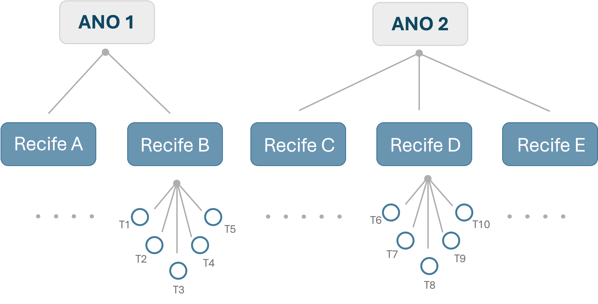
```

<div style="height: 20px;"></div>


.small-text2[

Fatores não se cruzam
  - Observações de um nível inferior pertencem exclusivamente a uma única unidade do nível superior 
    - $\text{transectos} \subset \text{recifes} \subset \text{ano}$


]


---
### Modelo Linear Misto | .small-text[<span style="color: #e07a5f;">Estrutura dos efeitos aleatórios</span>]


$$\text{biomassa}_{ijk} = \mu + \gamma_k + \delta_{j(k)} + \epsilon_{ijk}$$


```{r, out.width = "50%"}
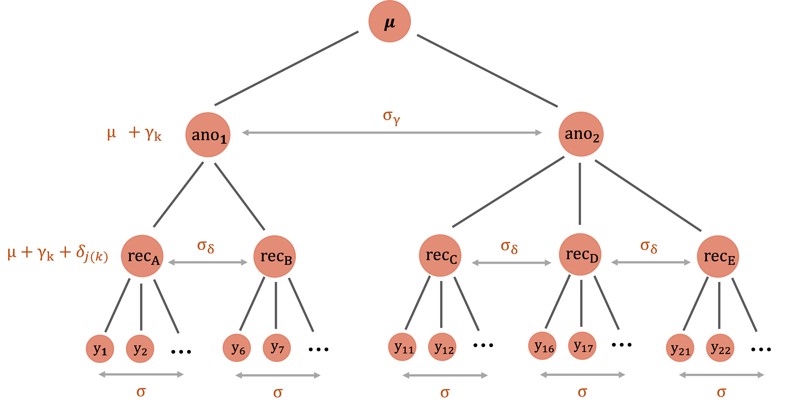
```


----

$$\sigma^2_{Total} = \sigma^2_{Ano} + \sigma^2_{Recife:Ano} + \sigma^2_{residual}$$


.small-text3[


- **Variância anual ($\sigma^2_{\gamma}$):** representa o quanto a biomassa média varia entre os anos

- **Variância entre recifes do mesmo ano ($\sigma^2_{\delta}$):** representa o quanto a biomassa média varia entre recifes pertencentes ao mesmo ano

- **Variância residual ($\sigma^2$):** representa a variação entre os transectos individuais ($y_1, y_2, \dots$) coletados no mesmo recife

]

.code-bg[
.small-code[
```{r, eval=F, echo=T}
f(biomassa_kg_m2 ~ 1 + (1 | ano/recife))
```
]
]

.code-bg[
.small-code[
```{r, eval=F, echo=T}

f(biomassa_kg_m2 ~ 1 + (1 | ano) + (1 | ano:recife))

```
]
]

---
### Modelo Linear Misto | .small-text[<span style="color: #e07a5f;">Estrutura dos efeitos aleatórios</span>]


.center[**Desenho amostral cruzado**]

<br>


```{r, out.width = "50%"}
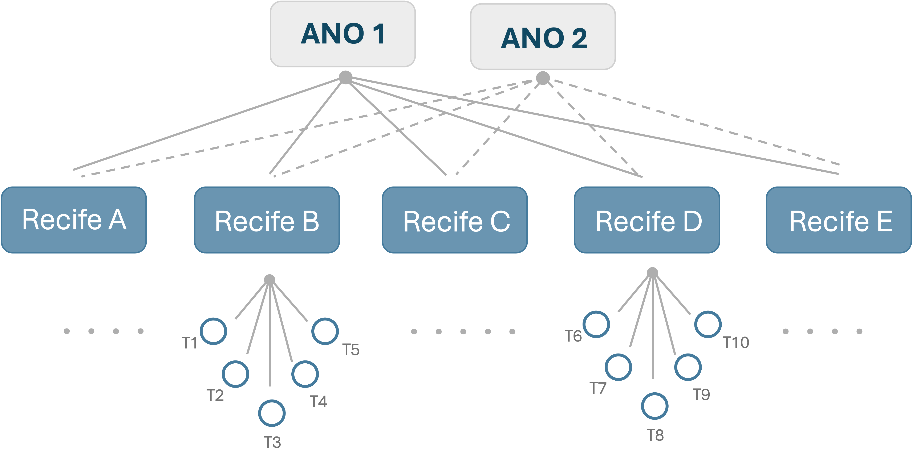
```

<div style="height: 20px;"></div>


.small-text2[

Fatores se cruzam
  - Os mesmos níveis de um fator ocorrem em diferentes níveis do outro fator
    - Ex.: os mesmos recifes são amostrados em anos distintos

  - O desenho amostral permite separar as diferentes fontes de variação
    - variação espacial: diferenças entre recifes
    - variação temporal: diferenças entre anos

]

---

# PPGECO | ECL0072 | out. 2026
### Modelo Linear Misto  | .small-text[<span style="color: #e07a5f;">Estrutura dos efeitos aleatórios</span>]

$$\text{biomassa}_{ijk} = \mu + \gamma_k + \delta_j + \epsilon_{ijk}$$


```{r, out.width = "40%"}
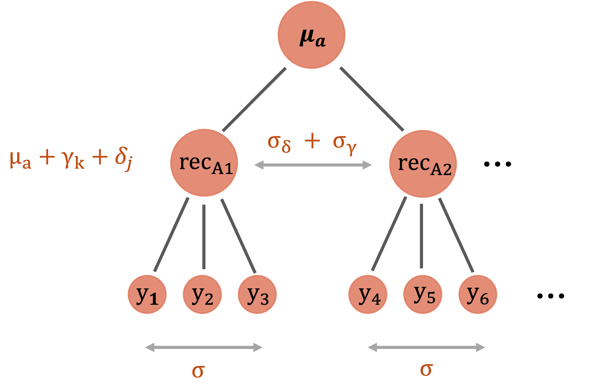
```


----

$$\sigma^2_{Total} = \sigma^2_{Ano} + \sigma^2_{Recife} + \sigma^2_{residual}$$


.small-text[


- **Variância anual ($\sigma_{\gamma}$):** avalia o quanto a biomassa média varia de um ano para o outro (efeito temporal global)

- **Variância entre recifes ($\sigma_{\delta}$):** avalia a variação intrínseca entre os recifes ao longo de todo o estudo, independentemente do ano

- **Variância residual ($\sigma$):** representa a variação não explicada entre os transectos individuais ($y_1, y_2, \dots$) para uma mesma combinação de recife e ano

]

.code-bg[
```{r, eval=F, echo=T}
f(biomassa_kg_m2 ~ 1 + (1 | ano) + (1 | recife))
```
]


---

# PPGECO | ECL0072 | out. 2026
### Modelo Linear Misto  | .small-text[<span style="color: #e07a5f;">Estrutura dos efeitos aleatórios</span>]


Qual estrutura escolher?


```{r, out.width = "40%"}
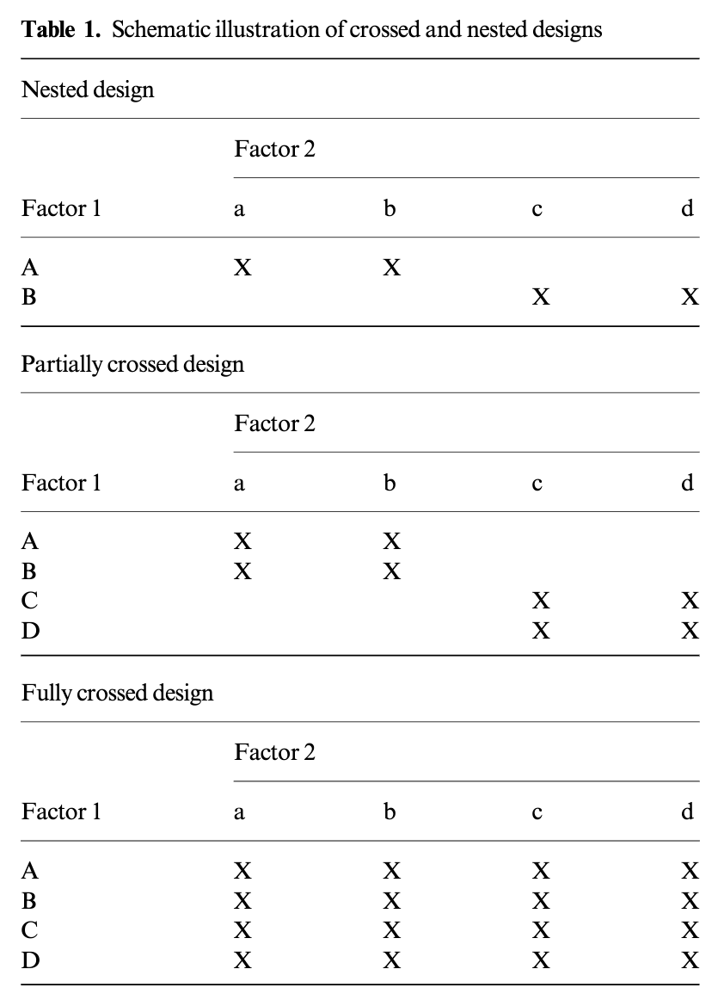
```


.footnote[.small-text2[Figura: [Schielzeth & Nakagawa (2013)](https://besjournals.onlinelibrary.wiley.com/doi/epdf/10.1111/j.2041-210x.2012.00251.x)]]


---
# PPGECO | ECL0072 | out. 2026
### Modelo Linear Misto | .small-text[<span style="color: #e07a5f;">Inferência</span>]

A abordagem *frequentista* para estimação dos parâmetros de modelos mistos exige algumas cautelas:

- Dado o conjunto de parâmetros $\large \theta = \{ \beta_0, \beta, \sigma^2, \sigma_{\alpha}^2 \}$<sup>1</sup>, objetiva-se $\hat{\theta} := argmin ~ L(\theta)$

<br>
  
.pull-left[

```{r, out.width = "85%"}


# 1. Simulação dos dados
#set.seed(123)
y <- rnorm(1000, mean = 5, sd = 2)

# Grid de parâmetros
mu_seq    <- seq(4.75,  5.25,  length.out = 200)
sigma_seq <- seq(1.85, 2.25, length.out = 200)

# Função de log-verossimilhança
loglik_normal <- function(mu, sigma, y) {
  if (sigma <= 0) return(NA_real_)
  sum(dnorm(y, mean = mu, sd = sigma, log = TRUE))
}

# Construção do Grid de Verossimilhança
grid <- expand.grid(mu = mu_seq, sigma = sigma_seq)
grid$loglik <- mapply(loglik_normal, grid$mu, grid$sigma, MoreArgs = list(y = y))
grid$lik <- exp(grid$loglik - max(grid$loglik, na.rm = TRUE))

# Estimadores de Máxima Verossimilhança (MLE)
mu_hat    <- mean(y)
sigma_hat <- sqrt(mean((y - mu_hat)^2))

# 2. Amostragem do grid proporcional à verossimilhança (para gerar a densidade de hexágonos)
idx_samples <- sample(seq_len(nrow(grid)), size = 15000, replace = TRUE, prob = grid$lik)
df_sim <- grid[idx_samples, c("mu", "sigma")]

# 3. Definição da sua paleta de cores personalizada
minha_paleta <- c( "#457b9d", "#846267", "#e07a5f","#f6bd60")

# 4. Gráfico Base (Hexbin + Ponto MLE)
p <- ggplot(df_sim, aes(x = mu, y = sigma)) +
  geom_hex(bins = 35) +
  geom_point(alpha = 0) + # Compatibilidade técnica com o ggMarginal
  # geom_point(data = data.frame(mu = mu_hat, sigma = sigma_hat), 
  #            aes(x = mu, y = sigma), color = "red", size = 3, shape = 4, stroke = 1.5) + # Ponto indicando o MLE (X vermelho)
  # geom_vline(xintercept = mu_hat, color = "white", size = .4) +
  # geom_hline(yintercept = sigma_hat, color = "white", size = .4) +
  scale_fill_gradientn(colors = minha_paleta) +
  labs(x = expression(mu), y = expression(sigma)) +
  theme_classic(base_size = 14) +
  theme(legend.position = "none",
    axis.line = element_line(color = "#333333"),
    axis.ticks = element_line(color = "#333333"))

# 5. Adição dos histogramas marginais (perfis de verossimilhança)
p_final <- ggMarginal(
  p, 
  type = "histogram", 
  fill = "#d5bdaf", # 
  color = "white",
  linewidth = 1,
  xparams = list(bins = 35, size = 1.2),
  yparams = list(bins = 35, size = 1.2)
)

p_final


```

]


.pull-right[

.small-text2[

No estimador de máxima verossimilhança, todos os parâmetros são estimados conjuntamente
- **Problema:** estimativas enviesadas para os parâmetros de variância ($\sigma^2, \sigma_{\alpha}^2$)


<br>

$$\hat{\sigma}_{MLE}^2 = \frac{\sum_{i=1}^{n} (y_i - \hat{\mu_i})^2}{\color{#e07a5f}{n}}$$
<br>

$$\hat{\sigma}_{OLS}^2 = \frac{\sum_{i=1}^{n} (y_i - \hat{\mu_i})^2}{\color{#e07a5f}{n-p}}$$


  ]
]

.footnote[
<sup>1</sup> Considerando um modelo com intercepto aleatório
]

---
# PPGECO | ECL0072 | out. 2026
### Modelo Linear Misto | .small-text[<span style="color: #e07a5f;">Inferência</span>]

A abordagem *frequentista* para estimação dos parâmetros de modelos mistos exige algumas cautelas:

- Dado o conjunto de parâmetros $\large \theta = \{ \beta_0, \beta, \sigma^2, \sigma_{\alpha}^2 \}$<sup>1</sup>, objetiva-se $\hat{\theta} := argmax ~ L(\theta)$

<br>
  
.pull-left[

```{r, out.width = "85%"}
p_final
```

]

.pull-right[

.small-text2[

No estimador de máxima verossimilhança, todos os parâmetros são estimados conjuntamente
- **Problema:** estimativas enviesadas para os parâmetros de variância ($\sigma^2, \sigma_{\alpha}^2$)


<br>

.gray-box-small[
**Consequências**

Erros padrões subestimados
- ICs muito estreitos
  - Aumento do erro tipo I 

]


  ]
]


.footnote[
<sup>1</sup> Considerando um modelo com intercepto aleatório
]

---
# PPGECO | ECL0072 | out. 2026
### Modelo Linear Misto | .small-text[<span style="color: #e07a5f;">Inferência</span>]

Uma forma de contornar esse problema consiste em aplicar a verossimilhança restrita (REML<sup>1</sup>)

- Separa previamente os efeitos fixos ($\beta_0, \beta$) e efeitos aleatórios ($\sigma^2, \sigma^2_\alpha$) e estima separadamente cada conjunto de parâmetros

<br>

Para isolar os efeitos fixos ($\boldsymbol{\beta}$), o REML multiplica a matriz de design ($\mathbf{X}$) por uma matriz ortogonal ($\mathbf{A}$), tal que $\mathbf{A}^T\mathbf{X} = 0$


<br>

$$\mathbf{Y} = \mathbf{X}\boldsymbol{\beta} + \mathbf{Z}\mathbf{b} + \boldsymbol{\varepsilon}$$

$$\mathbf{\color{#e07a5f}{A^{'}}}\mathbf{Y} = \mathbf{\color{#e07a5f}{A^{'}}}(\mathbf{X}\boldsymbol{\beta} + \mathbf{Z}\mathbf{b} + \boldsymbol{\varepsilon})$$

$$\mathbf{\color{#e07a5f}{A^{'}}}\mathbf{Y} = \underbrace{\mathbf{\color{#e07a5f}{A}}^{'}\mathbf{X}}_{= \mathbf{0}}\boldsymbol{\beta} + \mathbf{\color{#e07a5f}{A^{'}}}\mathbf{Z}\mathbf{b} + \mathbf{\color{#e07a5f}{A^{'}}}\boldsymbol{\varepsilon}$$

$$\mathbf{\color{#e07a5f}{A^{'}}}\mathbf{Y} = \mathbf{\color{#e07a5f}{A^{'}}}\mathbf{Z}\mathbf{b} + \mathbf{\color{#e07a5f}{A^{'}}}\boldsymbol{\varepsilon}$$

.footnote[
<sup>1</sup> *Restricted Maximum Likelihood*; aplicável apenas no contexto de modelos lineares (mistos)
]

---
# PPGECO | ECL0072 | out. 2026
### Modelo Linear Misto | .small-text[<span style="color: #e07a5f;">Inferência</span>]


Uma vez eliminada a dependência dos efeitos fixos na função de verossimilhança, tem-se a etapa de estimação:

<br>

**1º Passo | Estimação das variâncias (REML):**
- O método REML opera sobre os dados transformados ($\mathbf{A}^T\mathbf{Y} = \mathbf{A}^T\mathbf{Z}\mathbf{b} + \mathbf{A}^T\boldsymbol{\varepsilon}$)
- Estima-se a matriz de covariância $\hat{\mathbf{V}}$ sem a interferência dos efeitos fixos (logo, não enviesado)

<div style="height: 20px;"></div>


----

<div style="height: 20px;"></div>


**2º Passo | Estimação dos efeitos fixos (GLS):**
- Dado a matriz $\hat{\mathbf{V}}$, aplica-se a solução do mínimos quadrados generalizados (GLS) para estimar o vetor $\boldsymbol{\beta}$
  
.center[$$\hat{\boldsymbol{\beta}} = (\mathbf{X}^T \hat{\mathbf{V}}^{-1} \mathbf{X})^{-1} \mathbf{X}^T \hat{\mathbf{V}}^{-1} \mathbf{Y}$$]

---
# PPGECO | ECL0072 | out. 2026
### Modelo Linear Misto | .small-text[<span style="color: #e07a5f;">Inferência</span>]


<br>

.gray-box-small[**ATENÇÃO:** 

Diante do estimador REML, não se pode comparar modelos com diferentes estruturas de efeitos fixos (via AIC, teste de razão de verossimilhança (LRT), ...).
- A matriz ortogonal $\mathbf{A}$ é construída em função da matriz de design $\mathbf{X}$ ($\mathbf{A}^T\mathbf{X} = \mathbf{0}$)
- Ao alterar os efeitos fixos (logo, $\mathbf{X}$), altera-se também a matriz $\mathbf{A}$
- Portanto, o vetor de dados transformados $\mathbf{A}^T\mathbf{Y}$ torna-se diferente entre os modelos uma vez que isso resulta em funcões de verossimilhanças distintas.

]

---

# PPGECO | ECL0072 | out. 2026

### Modelo Linear Misto | .small-text[<span style="color: #e07a5f;">Inferência</span>]

**LMMs como modelos hierárquicos Bayesianos**


Na abordagem Bayesiana, todos os parâmetros do modelo são representados via distribuições de probabilidade, incluindo os dos efeitos aleatórios


<br>


.pull-left[

<br>

.center[

$$\large y_{ij} \sim N(\mu_{ij}, ~\sigma^2)$$
]

<div style="height: 7px;"></div>


.center[
$$\large \mu_{ij} = \beta_0 + \beta_1x_{ij} + \alpha_j$$
]

<div style="height: 7px;"></div>

.center[
$$\large \alpha_j \sim N(0,~ \sigma_\alpha^2)$$
]


<div style="height: 7px;"></div>

.center[
$$\large \beta_0,\beta_1,\sigma,\sigma_\alpha \sim P(\theta)$$
]

]


.pull-right[

.center[**Vantagens**]

<div style="height: 7px;"></div>


.small-text2[

**1 | Representação completa da incerteza**

Distribuições posteriores para efeitos fixos, efeitos aleatórios e componentes de variância

<div style="height: 7px;"></div>

-----

<div style="height: 7px;"></div>

**2 | Regularização através das prioris**

Componentes de variância podem ser difíceis de estimar quando há poucos grupos ou pouca informação em cada grupo
- definir uma priori regularizadora sobre esses parâemtros


]

]


---

# PPGECO | ECL0072 | out. 2026
### Modelo Linear Misto 

**Quando usar modelos mistos?**

<div style="height: 7px;"></div>


--


.small-text2[
- **Dados agrupados/hierárquicos:** observações pertencem a grupos ou unidades amostrais, gerando dependência entre observações do mesmo grupo

]

<div style="height: 7px;"></div>


--

.small-text2[
- **Medidas repetidas:** múltiplas observações são feitas na mesma unidade experimental, indivíduo ou local, ao longo do tempo ou em diferentes condições
]

<div style="height: 7px;"></div>


--

.small-text2[
- **Dados desbalanceados:** grupos apresentam diferentes números de observações
]

<div style="height: 7px;"></div>


--

.small-text2[
- **Generalização populacional:** quando o objetivo é inferir para uma população de grupos/unidades além daqueles especificamente amostrados
  - Ex.: inferir sobre todos os recifes, e não apenas comparar os recifes amostrados
]

<div style="height: 7px;"></div>

--

.small-text2[
- **Interesse na variabilidade:** quando é importante quantificar a variação entre grupos ou permitir que o efeito de uma variável varie entre grupos, além de estimar o efeito médio
]

<div style="height: 7px;"></div>

--

.small-text2[
- **Dados com sobredispersão:** quando a variabilidade dos dados é maior do que a esperada pelo modelo  (comum em dados de contagens contagens ou proporções)
  - A inclusão de um efeito aleatório no nível da observação (*observation-level random effect* - OLRE) absorve a variação extra não explicada
]

---

# PPGECO | ECL0072 | out. 2026

### Estudo dirigido


.small-text3[

**Livros**

- **Cap. 10** - Bolker (2009). Ecological Models and Data in R.

- **Cap. 13** - Bolker (2015). Linear and generalized linear mixed models. In Fox et al (Eds.), Ecological Statistics: Contemporary theory and application.


- **Caps. 10-12** - Faraway (2016). Extending the Linear Model with R, 2. ed.


- **Caps. 12** - Kéry (2010). Introduction to WinBUGS for ecologists.


- **Cap. 15** - Gelman et al. (2013). Bayesian Data Analysis, 3. ed.


- **Caps. 4-5** - Zuur et al. (2009). Mixed effects models and extensions in ecology with R.


- **Cap. 6** - Hobbs & Hooten (2007). Bayesian Models - A Statistical Primer for Ecologists.


----

**Artigos**


- Bolker et al. (2009). [Generalized linear mixed models: a practical guide for ecology and evolution.](10.1016/j.tree.2008.10.008)


- Harrison et al. (2018). [A brief introduction to mixed effects modelling and multi-model inference in ecology.](https://peerj.com/articles/4794/)


- Krzywinski et al (2014). [Nested designs.](https://www.nature.com/articles/nmeth.3137)


- Marshall (2024). [Principles of experimental design for ecology and evolution.](https://onlinelibrary.wiley.com/doi/10.1111/ele.14400)


- Schielzeth & Nakagawa (2013). [Nested by design: model fitting and interpretation in a mixed model era.](https://besjournals.onlinelibrary.wiley.com/doi/10.1111/j.2041-210x.2012.00251.x)


- Silk et al. (2020). [Perils and pitfalls of mixed-effects regression models in biology](https://peerj.com/articles/9522/#)


]

