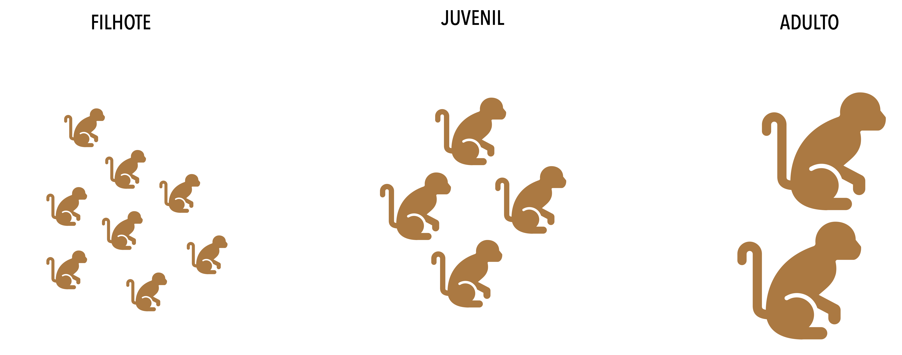

```{r xaringan-themer, include=FALSE, warning=FALSE}

#~~~~~~~~~~~~~~~~~
# Load packages
#~~~~~~~~~~~~~~~~~
library(xaringan)
library(xaringanthemer)
library(kableExtra)
library(dplyr)
library(ggplot2)
library(broom.mixed)
library(lme4)
library(knitr)

#library(palmerpenguins)


#~~~~~~~~~~~~~~~
# ggplot theme
#~~~~~~~~~~~~~~~

my_theme <- theme(legend.position = "none",
        plot.title = element_text(hjust = 0.5, face = 'bold'),
        legend.title = element_blank(),
        axis.text.x = element_text(colour = "grey20",  margin = margin(t = 25)),
        axis.text.y = element_text(colour = "grey20", margin = margin(r = 20)),
        axis.title = element_text(face = "bold", colour = "black", size = 16),
        strip.background = element_rect(fill = 'white'),
        legend.background = element_rect(fill = "transparent", colour = NA),
        legend.box.background = element_rect(fill = "transparent", colour = NA),
        axis.line = element_line(color = "black"),
        plot.margin = margin(5, 10, 5, 5))


#~~~~~~~~~~~~~~~~~~~~~~
# Default knitr iputs
#~~~~~~~~~~~~~~~~~~~~~~
knitr::opts_chunk$set(echo = F, 
                      warning = FALSE, 
                      message = FALSE, 
                      cache = TRUE, 
                      fig.align = 'center',
                      dev = "svglite") 


#~~~~~~~~~~~~~~~~~~~~~~
# Slide customization
#~~~~~~~~~~~~~~~~~~~~~~
# Define Metropolis colors
inverse_slide <- "#dedbd2" #e3d5ca, dedbd2
metropolis_dark  <- "#242423" 
metropolis_accent <- "#d5bdaf" #d4a373, d5bdaf, 778da9, 415a77


style_xaringan(
  # Base settings
  background_color = "#FAFAFA",
  text_color       = metropolis_dark,
  header_color     = "#846267", #6b705c
  
  # Typography matching Metropolis
  header_font_google = google_font("Josefin Sans", "400"),
  text_font_google   = google_font("Josefin Sans", "350", "350i", "300"),
  code_font_google   = google_font("Fira Mono"),
  
  ## Header font size
  header_h1_font_size = "2.5rem",
  header_h2_font_size = "1.75rem",
  header_h3_font_size = "1.5rem",
  
  # Inject explicit CSS rules for the top Metropolis header bar
  extra_css = list(
   
    
    ### Reduce code chunk font size
    ".remark-code" = list(
      "font-size" = "80%" # Adjust percentage as needed (e.g., 70%, 80%, 14px)
    ),
    ".remark-code-line" = list(
      "font-size" = "80%"
    ),
    
    
   # Text with different sizes 
   ".small-text" = list("font-size" = "80%"),
   ".small-text2" = list("font-size" = "90%"),
   
   
   # Decrease vertical spacing in listed items
    "li > p" = list(
      "margin-top"    = "0px !important",
      "margin-bottom" = "0px !important"),
    
    "ul li, ol li" = list(
      "margin-bottom" = "4px !important",
      "line-height"   = "1.3 !important"),
   
   "ul, ol" = list(
      "margin-top"  = "0.2em !important",
      "padding-top" = "0px !important"),
   
    "p" = list(
      "margin-bottom" = "0.3em !important"),
   
   
   # Adjust footnote position to reduce margins from slide borders
    ".footnote" = list(
      "position"      = "absolute",
      "bottom"        = "20px",  # Pushes footnote closer to the bottom edge (default is ~3em)
      "left"          = "50px",  # Moves footnote closer to the left edge
      "font-size"     = "70%",   # Optional: keeps text size small
      "line-height"   = "1.2"    # Optional: compact line spacing
    ),
    
    ### Create gray box
    ".gray-box" = list("background-color" = "#e9ecef",
                        "border-radius"    = "25px",
                        "padding"          = "10px 25px",
                        "display"          = "inline-block", # Shrinks container width to fit content
                        "margin"           = "5px 0px"),
    
   
   ".gray-box-big" = list("background-color" = "#e9ecef",
                          "border-radius"    = "10px",
                          "padding"          = "10px 100px", # Increased slightly for a clean look
                          "width"            = "fit-content",
                          "margin"           = "0px auto"),
   
   ### Salmon box
   ".salmon-box" = list("background-color" = "#e07a5f",
                        "border-radius"    = "10px",
                        "display"          = "inline-block", # Shrinks container width to fit content
                        "padding"          = "5px 50px",
                        "margin"           = "0px 50px"),
   
   
   ### Green box
   ".green-box" = list("background-color" = "#81b29a",
                        "border-radius"    = "15px",
                        "padding"          = "20px 5px",
                        "margin"           = "15px 0px"),
   
   
   
   
    # Create the horizontal top banner box on every standard slide
    
    # Global slide padding (REDUCED MARGINS HERE)
    ".remark-slide-content" = list(
      "padding-top"      = "40px",  # Keeps content clear of the top banner
      "padding-bottom"   = "20px",  # Reduced bottom margin
      "padding-left"     = "35px",  # Reduced left margin
      "padding-right"    = "35px",  # Reduced right margin
      "background-image" = paste0("linear-gradient(to bottom, ", metropolis_accent, " 40px, transparent 40px)")
    ),
    
    # Ensure titles render in white text sitting perfectly on top of the banner
    ".remark-slide-content h1" = list(
      "position" = "absolute",
      "top" = "12px",
      "left" = "750px",
      "color" = "#FFFFFF",
      "margin" = "0",
      "font-size" = "10px"
    ),

    # Styled block for inverse/dark divider slides
    ".inverse" = list(
      "background-color" = inverse_slide,
      "background-image" = "none", # Overwrite top bar style for dark slides
      "color" = "#FFFFFF"
    ),
   
    # Keep title slides clean of the standard top bar
    ".title-slide" = list(
      "background-image" = "none",
      "padding-top" = "100px"
    )
  )
)


```
class: inverse, center, middle
background-image: url(figs/image.png)
background-size: cover

Hello there

---
# PPGECO | ECL0072 | out. 2026

### OUTLINE


---
# PPGECO | ECL0072 | out. 2026

### Ruido vs. sinal em dados ecológicos


<br>


```{r, out.width ="80%",  fig.asp = 0.62}

df <- readRDS("~/OneDrive/Arbeit/Supervision/ICCAT/Dados/iccat_updated_jul26.rds")


df %>%
    mutate(MonthYear = zoo::as.yearmon(Date)) %>%
    mutate(CPUE = (Xiphias_gladius/Nhooks)*1000) %>%
    group_by(MonthYear) %>%
    summarise(avg_cpue = mean(CPUE)) %>%
    ggplot(aes(x=MonthYear, y= avg_cpue)) +
    geom_line(col = 'gray70') + 
    geom_point(col = 'gray60', size = 0.8) +
    geom_smooth(method = 'gam', fill = '#f07167', col = "#bc4749") +
    labs(x = "Anos",y = "CPUE (N/1000 anzóis)") +
    theme_minimal(base_size = 14) +
    my_theme

```


---
# PPGECO | ECL0072 | out. 2026

### Dados ecológicos são estruturados

Processos ecológicos atuam em múltiplas escalas: 

- **Espacial**

<br>


```{r, out.width ="70%",  fig.asp = 0.8}
knitr::include_graphics("../Figuras/spatial_structure.png")
```

---
# PPGECO | ECL0072 | out. 2026

### Dados ecológicos são estruturados

Processos ecológicos atuam em múltiplas escalas: 

- **Temporal**

<br>
<br>

```{r, out.width ="90%"}
knitr::include_graphics("../Figuras/temporal_structure.png")
```

---

# PPGECO | ECL0072 | out. 2026

### Dados ecológicos são estruturados

Processos ecológicos atuam em múltiplas escalas: 

- **Espaço-Tempo**

<br>


```{r, out.width ="90%"}
knitr::include_graphics("../Figuras/spatial-temporal_structure.png")
```

---

# PPGECO | ECL0072 | out. 2026

### Dados ecológicos são estruturados

Processos ecológicos atuam em múltiplas escalas: 

- **Ontogenêtica**

<br>

```{r, out.width ="80%"}

```


---
# PPGECO | ECL0072 | out. 2026

### Dados ecológicos são estruturados


Um dado é *estruturado* quando as observações ($y_i$) estão organizadas em grupos/níveis hierárquicos ($k$)

- cada grupo de observações ($y_{ik}$) campartilha diversas características que geram dependência entre elas


```{r, out.width ="60%"}
knitr::include_graphics("../Figuras/dependency.png")

```


---

# PPGECO | ECL0072 | out. 2026

### Dados ecológicos são estruturados

A forma que coletamos dados muitas vezes induzem dependência em $y_i$


- Influencia nos processos ecológicos observados
  - logo, na generalização das hipóteses previstas


---
# PPGECO | ECL0072 | out. 2026
### Dados ecológicos são estruturados

Essas estruturações violam o principal pressuposto dos modelos lineares (generalizados)<sup>1</sup> 

- *Independência*


<br>

$$\Large y_i = \beta_0 + \beta x_i + \varepsilon_i \\ \varepsilon_i \overset{\text{iid}}{\sim}  N(0,\sigma^2)$$


<br>

.small-text2[

**Pressupostos**

- **Linearidade:** tendência de $y$ é descrita por um modelo linear

- **Normalidade:** resíduos $\varepsilon_i$ seguem uma distribuição normal

- **Homocedasticidade:** variância residual é constante ao longo de $x$

- **Independência:** resíduos não são correlacionados
  ]
  


.footnote[
<sup>1</sup> e suas versões aditivas (GLM/GAM)
]

---
class:center, middle
# PPGECO | ECL0072 | out. 2026


## Como solucionar a violação da independência? 

---
class: center, middle
# PPGECO | ECL0072 | out. 2026


## Como solucionar a violação da independência? 

### - Particionado a variância -

---
class: center, middle, inverse


## <span style="color: #6b705c;">EXEMPLO INTUITIVO</span>

---
class: center, inverse

# <span style="color: #6b705c;">PPGECO | ECL0072 | out. 2026</span>
### <span style="color: #6b705c;">Monitoramento da biomassa da ictiofauna recifal</span>

<br>
.pull-left[
```{r, out.width ="100%", fig.align='right'}
knitr::include_graphics("../Figuras/reef_sampling_design.png")

```
]

.pull-right[

.center[**Desenho amostral**]

<br>

**Escala espaço-temporal:** amostragens mensais de diferentes recifes (n=5) ao longo de 3 anos

**Unidade amostral:** transecto (esforço constante)

**Pseudo-réplicas:** 5 tansectos / recife / mes

**Efeito do mergulhador:** amostragens realizdas por 3 mergulhadores


]

---
class: center, inverse

# <span style="color: #6b705c;">PPGECO | ECL0072 | out. 2026</span>
### <span style="color: #6b705c;">Monitoramento da biomassa da ictiofauna recifal</span>


```{r, eval = F, echo=T}
df <- readRDS("/Dados/biomass_reef.rds")
```

<br>


```{r}
## Read data
df <- readRDS("../Dados/biomass_reef.rds")

head(df, 10) %>%
  kable(format = "html", align = "c", booktabs = TRUE) %>%
  kable_styling(font_size = 16) %>%
  row_spec(0:10, extra_css = "background-color: white;") %>%
  row_spec(0, extra_css = "border-bottom: 2px solid #333333; background-color: white;") 


```


.left[.footnote[Cada linha representa uma amostra]]

---
class: center, inverse
# <span style="color: #6b705c;">PPGECO | ECL0072 | out. 2026</span>
### <span style="color: #6b705c;">Monitoramento da biomassa da ictiofauna recifal</span>


<br>

<span style="color: #6b705c;">Há diferença na produtividade entre os diferentes recifes?</span>

```{r, out.width="60%", fig.asp = 0.7}
df$recife <- as.factor(df$recife)
levels(df$recife) <- c("A","B", "C", "D", "E")

df %>%
    #filter(recife %in% c("A", "B", "C")) %>%
    ggplot(aes(x = recife, y = biomassa_kg)) +
    geom_jitter(aes(col = recife), size = 4, alpha = 0.5) +
    geom_boxplot(size = 1, alpha = 0.3) +
    labs(x = "Recifes",y = "Biomassa (Kg)") +
    scale_color_manual(values = c("#846267", "#588157","#e07a5f", "#457b9d", "#f6bd60")) +
    theme_minimal(base_size = 14) +
    my_theme +
    theme(axis.text.x = element_text(colour = "grey20",  margin = margin(t = 25)),
        axis.text.y = element_text(colour = "grey20", margin = margin(r = 20)),)

```


---
# PPGECO | ECL0072 | out. 2026

### Abordando a (in)dependência | .small-text[<span style="color: #e07a5f;">Agregando os dados</span>]


Parte da variabilidade dos dados pode ser reduzida, agregando as observações ente os grupos (espaciais, temporais, taxonômicos, unidade amostral,...)

- No exemplo, réplicas de transectos em cada recife


<br>

.pull-left[

```{r, fig.asp = 0.8, out.width="90%"}

df %>%
    ggplot(aes(x = recife, y = biomassa_kg)) +
    geom_jitter(aes(col = recife), size = 4, alpha = 0.5, width = 0.2) +
    
    # 1. Point for the MEDIAN (e.g., solid black diamond)
    stat_summary(
        fun = median,
        geom = "point",
        shape = 18,        # Diamond
        size = 5,
        color = "black"
    ) +
    
    # 2. Point for the AVERAGE / MEAN (e.g., red circle with black border)
    stat_summary(
        fun = median,
        fun.min = median,
        fun.max = median,
        geom = "crossbar",
        width = 0.3,
        color = "black",
        linewidth = 0.8
    ) +
    
    labs(x = "Recifes", y = "Biomassa (Kg)") +
    scale_color_manual(values = c("#846267", "#588157", "#e07a5f", "#457b9d", "#f6bd60")) +
    theme_minimal(base_size = 14) +
    theme( axis.text.x = element_text(margin = margin(t = 25)),
           axis.text.y = element_text(margin = margin(r = 25))) +
    my_theme

# df %>%
#     #filter(recife %in% c("A", "B", "C")) %>%
#     ggplot(aes(x = recife, y = biomassa_kg)) +
#     geom_jitter(aes(col = recife), size = 4, alpha = 0.5) +
#     geom_boxplot(size = 1, alpha = 0.3) +
#     labs(x = "Grupo",y = "X") +
#     scale_color_manual(values = c("#846267", "#588157","#e07a5f", "#457b9d", "#f6bd60")) +
#     theme_minimal(base_size = 14) +
#     my_theme
```


]


.pull-right[

.small-text2[
**Consequências**

<br>

- Útil em algumas poucas situações
  - Mascara a variabilidade natural dos dados (informação!) 

- Reduz o número de observações (logo, poder estatístico)

- Falácia ecológica
  - Inferir relações individuais a partir de dados agregados

  ]
]


---
# PPGECO | ECL0072 | out. 2026

### Abordando a (in)dependência | .small-text[<span style="color: #e07a5f;">Modelo linear</span>]

#### Considerando os recifes (grupo) como *efeito fixo* <sup>1</sup>


.pull-left[

.gray-box-big[ 
$$\large y_{ij} = a_j + \varepsilon_{ij}$$
$$\varepsilon_{ij} \overset{\text{iid}}{\sim}  N(0,\sigma^2), ~~i = 1,...,N$$
]

<div style="height: 7px;"></div>

.small-text[
onde:
- $\mathbf{a_j}$: efeito do grupo $j$ ($j = 1,...,K=5$)
  - efeito fixo
  
- $\mathbf{\varepsilon_{ij}}$: erro residual
]

----

<div style="height: 7px;"></div>

.small-text[
- Cada grupo possui seu próprio intercepto $a_1 ...a_K$ (i.e., média)

- Não há compartilhamento de informação entre grupos (*no pooling*)
  - Observações independentes dentro de cada grupo

  ]

]


.pull-right[


.center[
```{r, echo=T, eval=F}

lm(biomassa_kg ~ recife, data = df)

```
]


```{r, out.width="90%", fig.asp = 0.8}

## Adjust model (ANOVA)
mod1 <- lm(biomassa_kg ~ recife, data = df)

## Get average by group
group_preds <- emmeans(mod1, ~ recife) %>%
               as.data.frame() %>%
               transmute(recife,
                estimate = emmean,
                ymin = estimate - sigma(mod1),
                ymax = estimate + sigma(mod1))


## Go for the plot
ggplot() +
    geom_jitter(data = df, aes(x = recife,y = biomassa_kg, col = recife),size = 4,alpha = .3, width = .15) +
    
    geom_pointrange(data = group_preds, aes(x = recife, y = estimate, ymin = ymin, ymax = ymax),
                    colour = "gray10",linewidth = 1) +
    scale_color_manual(values = c("#846267", "#588157","#e07a5f", "#457b9d", "#f6bd60")) +
    labs(x = "Recifes",y = "Biomassa (Kg)") +
    theme_minimal(base_size = 14) +
    my_theme


# peixes %>%
#   ggplot(aes(x = recife, y = comprimento_cm)) +
#   geom_jitter(col = 'gray80', size = 4, alpha = 0.3, width = 0.15) +
#   stat_summary(aes(col = recife),
#                fun.data = mean_sdl,        # Calculates Mean ± 1 SD
#                fun.args = list(mult = 1),  # Set multiplier to 1 SD (default is 2 SD)
#                geom = "pointrange", 
#                size = 1,
#                linewidth = 2) +
#   #geom_boxplot(size = 1, alpha = 0.3) +
#   labs(x = "Grupo",y = "X") +
#   scale_color_manual(values = c("#846267", "#588157","#e07a5f", "#457b9d", "#f6bd60")) +
#   theme_minimal(base_size = 14) +
#   my_theme

```


]

.right[.footnote[<sup>1</sup> Equivalente a ANOVA]]

---
# PPGECO | ECL0072 | out. 2026

### Abordando a (in)dependência | .small-text[<span style="color: #e07a5f;">Modelo linear</span>]

#### Considerando os recifes (grupo) como *efeito aleatório*


.pull-left[

.gray-box-big[ 
$\large y_{ij} = \underbrace{\mu_a + \delta_j}_{a_j} + \varepsilon_{ij}$

$$\delta_j \sim N(0, \sigma^2_a)\\
\varepsilon_{ij} \sim N(0, \sigma^2)$$

]

<div style="height: 7px;"></div>


.small-text[
onde:

- $\mathbf\mu_a:$ média global 

- $\mathbf\varepsilon_{ij}:$ erro residual 

- $\delta_j:$ efeito aleatório do grupo
  - descreve os desvios de cada grupo em relação a média global

]

-----

<div style="height: 7px;"></div>


.small-text[

- Grupos compartilham parcialmente informação (*partial pooling*)
  - Observações são dependentes dentro de cada grupo

  ]


]

.pull-right[

.center[
```{r, echo=T, eval=F}

glmmTMB(y ~ 1 + (1|grupo), data = df)

```
]

```{r, out.width="90%", fig.asp = 0.8}

## Adjust LMM
mod <- lmer(biomassa_kg ~ 1 + (1 | recife), data = df)


## Extract fixed-effect coefficients (overall mean)
mu_a_est <- tidy(mod, effects = "fixed") %>%
            transmute(recife = "mu_a",
                      estimate = estimate,
                      ymin = estimate - std.error,
                      ymax = estimate + std.error)


## Extract random effects
group_preds <- augment(mod) %>%
               group_by(recife) %>%
               summarise(estimate = mean(.fitted), # Média predita pelo modelo para o grupo
                         ymin = estimate - sigma(mod),# Usando o desvio-padrão do efeito aleatório ou erro residual do modelo
                         ymax = estimate + sigma(mod))


## Merge both info
model_estimates <- bind_rows(mu_a_est, group_preds)

## Go for the plot
recife_levels <- unique(as.character(df$recife))
all_levels <- c("mu_a", recife_levels)

ggplot() +
    geom_jitter(data = df, aes(x = factor(recife, levels = all_levels), y = biomassa_kg, col = recife), size = 4, alpha = 0.3, width = 0.15) +
    geom_pointrange(data = model_estimates, aes(x = factor(recife, levels = all_levels),y = estimate,ymin = ymin,ymax = ymax), color = c(2,1,1,1,1,1), size = 1, linewidth = 1 ) +
    scale_x_discrete(limits = all_levels,labels = parse(text = c("mu[a]", recife_levels))) +
    labs(x = "Recifes",y = "Biomassa (Kg)") +
    scale_color_manual(values = c("#846267", "#588157","#e07a5f", "#457b9d", "#f6bd60")) +
    theme_minimal(base_size = 14) +
    my_theme


```


]

---
# PPGECO | ECL0072 | out. 2026

### Modelo Linear Misto

Modelos (lineares) mistos incorporam simultaneamente efeitos fixos e aleatórios em sua estrutura

<br>


$$\Large
Y =
\underset{
\substack{
\rule{3.8cm}{0.3pt}\\[0.8em]
{\text{Efeito fixo}}
}
}{\color{#81b29a}{X\beta}}
+
\underset{
\substack{
\rule{3.8cm}{0.3pt}\\[1em]
{\text{Efeito aleatório}}
}
}{\color{#e07a5f}{Zb}}
+
\varepsilon$$

<br>


```{r, out.width ="85%"}
knitr::include_graphics("../Figuras/fixed_vs_random_effect.png")
```

---
# PPGECO | ECL0072 | out. 2026

### Modelo Linear Misto


```{r, fig.asp=0.4, out.width="80%"}
library(lme4)
library(ggplot2)
library(dplyr)
library(patchwork)

###############################################################################
## Common colour palette
###############################################################################

reef_cols <- c(
  "A"   = "#846267",
  "B"   = "#588157",
  "C"   = "#e07a5f",
  "D"   = "#457b9d",
  "E"   = "#f6bd60",
  "Média geral" = "black"
)


###############################################################################
## Model 1 : Random intercept
###############################################################################

m_ri <- lmer(
  biomassa_kg ~ sst + (1 | recife),
  data = df
)

## Prediction grid
newdat <- expand.grid(
  sst = seq(min(df$sst),
            max(df$sst),
            length.out = 100),
  recife = levels(df$recife)
)

## Reef-specific predictions
newdat$pred_group <- predict(
  m_ri,
  newdata = newdat,
  re.form = NULL
)

## Population prediction
newdat$pred_pop <- predict(
  m_ri,
  newdata = newdat,
  re.form = NA
)

## Population line
pop_line <- newdat %>%
  distinct(sst, pred_pop) %>%
  mutate(recife = "Média geral")

###############################################################################
## Plot 1
###############################################################################

p1 <- ggplot(df, aes(sst, biomassa_kg)) +
  geom_point(aes(colour = recife), alpha = .30, size = 2.5) +
  geom_line(data = newdat, aes(x = sst, y = pred_group, colour = recife), linewidth = 1.3) +
  geom_line(data = pop_line, aes(x = sst, y = pred_pop, colour = recife), linewidth = 1.5, linetype = "dashed") +
  scale_color_manual(
    name = "Recifes",
    values = reef_cols,
    breaks = names(reef_cols)
  ) +
  labs(
    title = "Random intercept",
    x = "SST (°C)",
    y = "Biomass (kg)"
  ) +
  theme_minimal(base_size = 14) +
  my_theme


###############################################################################
## Model 2 : Random intercept + slope
###############################################################################

m_rs <- lmer(
  biomassa_kg ~ sst + (sst | recife),
  data = df
)

## Prediction grid
newdat2 <- expand.grid(
  sst = seq(min(df$sst),
            max(df$sst),
            length.out = 100),
  recife = levels(df$recife)
)

## Reef-specific predictions
newdat2$pred_group <- predict(
  m_rs,
  newdata = newdat2,
  re.form = NULL
)

## Population prediction
newdat2$pred_pop <- predict(
  m_rs,
  newdata = newdat2,
  re.form = NA
)

## Population line
pop_line2 <- newdat2 %>%
  distinct(sst, pred_pop) %>%
  mutate(recife = "Média geral")


###############################################################################
## Plot 2
###############################################################################

p2 <- ggplot(df, aes(sst, biomassa_kg)) +
  geom_point(aes(colour = recife), alpha = .3, size = 2.5) +
  geom_line(data = newdat2, aes(x = sst, y = pred_group, colour = recife), linewidth = 1.3) +
  geom_line(data = pop_line2, aes(x = sst, y = pred_pop, colour = recife), linewidth = 1.5, linetype = "dashed") +
  scale_color_manual(
    name = "Recifes",
    values = reef_cols,
    breaks = names(reef_cols)
  ) +
  labs(
    title = "Random intercept + random slope",
    x = "SST (°C)",
    y = "Biomass (kg)"
  ) +
  theme_minimal(base_size = 14) +
  my_theme


###############################################################################
## Combine plots
###############################################################################

(p1 | p2) +
  plot_layout(guides = "collect") &
  theme(legend.position = "right",
        legend.title = element_text(size = 14, face = "bold"))

```


---
# PPGECO | ECL0072 | out. 2026

### Modelo Linear Misto


A variância total dos dados é estimada em diferentes níveis

<div style="height: 7px;"></div>


.center[**Decomposição da variância:**]

.center[
.gray-box-big[
$$\sigma^2_{Total} = \sigma^2_{dentro} + \sigma^2_{entre}$$]
]

<div style="height: 50px;"></div>

.pull-left[

```{r, out.width ="85%", fig.align='right'}
knitr::include_graphics("../Figuras/variance_partitioning.png")
```

]

.pull-right[

<br>

.small-text[
**Variância dentro do grupo** ($\sigma^2$)

Explica o desvio de cada observação em relação à média do grupo em que ocorre (i.e., erro residual)
]

<div style="height: 7px;"></div>

----

.small-text[
**Variância entre grupos** ($\sigma_a^2$)

Explica o desvio do grupo em relação à média geral
]

]


---
# PPGECO | ECL0072 | out. 2026

### Modelo Linear Misto

O cerne dos modelos mistos está na estruturação de $\sigma_a^2$

- i.e., como descrever a dependência entre observações pertencentes ao mesmo grupo
  - Na prática, isso significa definir uma matriz de variância-covarância ($\mathbf \Sigma$) 

<br>
<br>

.salmon-box[ 

.center[<span style="color: white;">**ATENÇÃO!**</span>]

<span style="color: white;">Para compreender plenamente os modelos lineares mistos, é essencial interpretá-los sob a ótica matricial ]</span>

---
# PPGECO | ECL0072 | out. 2026

### Modelo Linear Misto | .small-text[<span style="color: #e07a5f;">Um mergulho na matemática</span>]

**Modelo linear**

Considere a biomassa de peixes $y$ observada no *i-ésimo* transecto como função da temperatura $x_i = SST$

<div style="height: 15px;"></div>

.pull-left[

<br>
<br>

.gray-box-big[
$$\large y = {X\beta} + \varepsilon$$

$$\large \varepsilon \sim  \text{MVN}(0, \sigma^2I)$$


$$\Large y_i = \beta_0 + \beta_1x_i + \varepsilon_i$$
]

]


.pull-right[


```{r, fig.asp = 0.9, out.width="90%"}

df %>%
  ggplot(aes(x = sst, y = biomassa_kg)) +
  geom_point(size = 4, alpha = 0.3, col = "gray60") +
  geom_smooth(method = 'lm', se = TRUE, col = "#bc4749", fill = "#f07167", ,size = 2) +
  labs(x = "SST (°C))",y = "Biomassa (Kg)") +
  theme_minimal(base_size = 14) +
  my_theme

```

]

---
# PPGECO | ECL0072 | out. 2026

### Modelo Linear Misto | .small-text[<span style="color: #e07a5f;">Um mergulho na matemática</span>]

**Modelo linear - representação matricial**

<br>
<br>

$$\large \underbrace{\begin{bmatrix} y_1 \\ y_2 \\ y_3 \\ \vdots \\ y_n \end{bmatrix}}_{\mathbf{y}} = \underbrace{\begin{bmatrix} 1 & x_1 \\ 1 & x_2 \\ 1 & x_3 \\ \vdots & \vdots \\ 1 & x_n \end{bmatrix}}_{\mathbf{X}} \underbrace{\begin{bmatrix} \beta_0 \\ \beta_1 \end{bmatrix}}_{\boldsymbol{\beta}} + \underbrace{\begin{bmatrix} \varepsilon_1 \\ \varepsilon_2 \\ \varepsilon_3 \\ \vdots \\ \varepsilon_n \end{bmatrix}}_{\boldsymbol{\varepsilon}}$$ 


---
# PPGECO | ECL0072 | out. 2026

### Modelo Linear Misto | .small-text[<span style="color: #e07a5f;">Um mergulho na matemática</span>]


**Modelo linear**

A variância de um vetor $\varepsilon = (\varepsilon_1, \varepsilon_2, \varepsilon_3, ..., \varepsilon_n)$ é uma matriz:

<br>

$$
\text{Var}(\varepsilon)
= \Sigma =
\begin{bmatrix}
\sigma^2 & \text{Cov}(\varepsilon_1, \varepsilon_2) & \text{Cov}(\varepsilon_1, \varepsilon_2) & \cdots & \text{Cov}(\varepsilon_1, \varepsilon_n)\\
\text{Cov}(\varepsilon_2, \varepsilon_1) & \sigma^2  &  \text{Cov}(\varepsilon_2, \varepsilon_3) & \cdots & \text{Cov}(\varepsilon_2, \varepsilon_n)\\
\text{Cov}(\varepsilon_3, \varepsilon_1)  & \text{Cov}(\varepsilon_3, \varepsilon_2) & \sigma^2  & \cdots & \text{Cov}(\varepsilon_3, \varepsilon_n)\\
\vdots & \vdots & \vdots & \ddots & \vdots\\
\text{Cov}(\varepsilon_n, \varepsilon_1) & \text{Cov}(\varepsilon_n, \varepsilon_2) & \text{Cov}(\varepsilon_n, \varepsilon_3) & \cdots & \sigma^2  
\end{bmatrix}
$$ 
<br>
<br>

.small-text[
- **Elementos da diagonal principal:** variância (constante)

- **Demais elementos:** co-variância
]


---
# PPGECO | ECL0072 | out. 2026

### Modelo Linear Misto | .small-text[<span style="color: #e07a5f;">Um mergulho na matemática</span>]


**Modelo linear**

Dado que o modelo pressupõe *independência* entre as observações, isso emplica em:


$$\large \text{Cov}(\varepsilon_i, \varepsilon_j) = 0 ~~~~~~~ (i \neq j)$$
<br>

Portanto:

$$
\large
\Sigma
=
\begin{bmatrix}
\sigma^2 & 0 & 0 & \cdots & 0\\
0 & \sigma^2  &  0 & \cdots & 0\\
0 & 0 & \sigma^2  & \cdots & 0\\
\vdots & \vdots & \vdots & \ddots & \vdots\\
0 & 0 & 0 & \cdots & \sigma^2  
\end{bmatrix}
$$ 


---
# PPGECO | ECL0072 | out. 2026

### Modelo Linear Misto | .small-text[<span style="color: #e07a5f;">Um mergulho na matemática</span>]


**Modelo linear**

Além disso, o pressuposto de *homocedasticidade* implica em $\sigma^2 = \text{cte.}$

Logo:

<br>


.pull-left[

$$
\large
\Sigma
=
\sigma^2
\underbrace{
\begin{bmatrix}
1 & 0 & 0 & \cdots & 0\\
0 & 1  &  0 & \cdots & 0\\
0 & 0 & 1  & \cdots & 0\\
\vdots & \vdots & \vdots & \ddots & \vdots\\
0 & 0 & 0 & \cdots & 1  
\end{bmatrix}
}_\text{Mariz identidade}
$$ 
]

<br>

.pull-right[
$$
\Large
\Sigma
=
\sigma^2 I_n
$$
<br>

.salmon-box[

A matriz $\Sigma$ possui dimensão $n \times n$
]


]

---
# PPGECO | ECL0072 | out. 2026

### Modelo Linear Misto | .small-text[<span style="color: #e07a5f;">Um mergulho na matemática</span>]


**Modelo linear misto**

$$\Large y = X\beta + Zb + \varepsilon$$

$$\large b \sim  \text{MVN}(0, \sigma_a^2I)$$
$$\large \varepsilon \sim  \text{MVN}(0, \sigma^2I)$$

------

<br>

.pull-left[
Lembrando que:

- $\sigma_a^2$: variância entre grupos
- $\sigma^2$: variância dentro do grupo
]

.pull-right[

.gray-box[

.ceter[**Particionamento de variância em ação!**]

Há 2 matrizes de variância-covariância ($b$ e $\varepsilon$)!

]


]


---
# PPGECO | ECL0072 | out. 2026
### Modelo Linear Misto | .small-text[<span style="color: #e07a5f;">Um mergulho na matemática</span>]


**Modelo linear misto**

<br>

.gray-box-big[

$$\Large y_{ij} = \beta_0 + \beta_1x_{ij} + b_j + \varepsilon_{ij}$$
<br>

$$\underbrace{\begin{bmatrix} y_1 \\ y_2 \\ y_3 \\ \vdots \\ y_n \end{bmatrix}}_{\mathbf{y}} = \underbrace{\begin{bmatrix} 1 & x_1 \\ 1 & x_2 \\ 1 & x_3 \\ \vdots & \vdots \\ 1 & x_n \end{bmatrix}}_{\mathbf{X}} \underbrace{\begin{bmatrix} \beta_0 \\ \beta_1 \end{bmatrix}}_{\boldsymbol{\beta}} + \underbrace{\begin{bmatrix} 1 & 0 & 0 & 0 & 0\\ 1 & 0 & 0 & 0 & 0\\ 0 & 1 & 0 & 0 & 0\\ \vdots & \vdots & \vdots & \vdots & \vdots \\ 0 & 0 & 0 & 0 & 1 \end{bmatrix}}_{\mathbf{Z}} \underbrace{\begin{bmatrix} b_a \\ b_b \\ b_c \\ b_d \\ b_e \end{bmatrix}}_{\mathbf{b}} + \underbrace{\begin{bmatrix} \varepsilon_1 \\ \varepsilon_2 \\ \varepsilon_3 \\ \vdots \\ \varepsilon_n \end{bmatrix}}_{\boldsymbol{\varepsilon}}$$ ]

<br>

- A matriz $Z$ (indicadora) associa cada observação ao seu efeito aleatório correspondente


---
# PPGECO | ECL0072 | out. 2026
### Modelo Linear Misto | .small-text[<span style="color: #e07a5f;">Um mergulho na matemática</span>]

**Modelo linear misto**

As premissas para constução da matriz de variância-covariância para $b$ são as mesmas de $\varepsilon$


<br>

.pull-left[

$$
\large
\text{Var}(b)
= \Sigma_a =
\begin{bmatrix}
\sigma_a^2 & 0 & 0 & 0 & 0\\
0 & \sigma_a^2  &  0 & 0 & 0\\
0 & 0 & \sigma_a^2 & 0 & 0\\
0 & 0 & 0 & \sigma_a^2 & 0\\
0 & 0 & 0 & 0 & \sigma_a^2
\end{bmatrix}
$$ 
]

.pull-right[

<br>

$$\Large \Sigma_a = \sigma_a^2 I_K$$
.salmon-box[

A matriz $\Sigma_a$ possui dimensão $K \times K$

  ]

]

.footnote[K = número de grupos; no exemplo, K = 5 (recifes)]

---
# PPGECO | ECL0072 | out. 2026
### Modelo Linear Misto | .small-text[<span style="color: #e07a5f;">Um mergulho na matemática</span>]

**Modelo linear misto**

É a diferença na construção das matrizes de variância-covariância que garante, efetivamente, a decomposição das variâncias:


<br>

.pull-left[

.center[**Variância dentro do grupo**]

$$
\large
\Sigma
=
\begin{bmatrix}
\sigma^2 & 0 & 0 & \cdots & 0\\
0 & \sigma^2  &  0 & \cdots & 0\\
0 & 0 & \sigma^2  & \cdots & 0\\
\vdots & \vdots & \vdots & \ddots & \vdots\\
0 & 0 & 0 & \cdots & \sigma^2  
\end{bmatrix}
$$ 

]


.pull-right[

.center[**Variância entre grupos**]

$$
\large
\Sigma_a
=
\begin{bmatrix}
\sigma_a^2 & 0 & 0 & 0 & 0\\
0 & \sigma_a^2  &  0 & 0 & 0\\
0 & 0 & \sigma_a^2 & 0 & 0\\
0 & 0 & 0 & \sigma_a^2 & 0\\
0 & 0 & 0 & 0 & \sigma_a^2
\end{bmatrix}
$$ 
]


---
# PPGECO | ECL0072 | out. 2026
### Modelo Linear Misto | .small-text[<span style="color: #e07a5f;">Um mergulho na matemática</span>]

**Modelo linear misto**

Como 

$$\large \sigma^2_{Total} = \sigma^2_{dentro} + \sigma^2_{entre}$$

temos:


$$\large V = \underbrace{\Sigma}_\text{dentro} + \underbrace{Z \times \Sigma_a \times Z'}_\text{entre}$$

portanto:


$$
\large
V
=
\underbrace{
\begin{bmatrix}
V_a & 0 & 0 & 0 & 0\\
0 & V_b  &  0 & 0 & 0\\
0 & 0 & V_c & 0 & 0\\
0 & 0 & 0 & V_d & 0\\
0 & 0 & 0 & 0 & V_e
\end{bmatrix}
}_{\text{n} \times \text{n}}
$$ 

---
# PPGECO | ECL0072 | out. 2026
### Modelo Linear Misto | .small-text[<span style="color: #e07a5f;">Um mergulho na matemática</span>]

**Modelo linear misto**


A matriz $\mathbf{V}$ representa a matriz de variância-covariância de todo o conjunto de dados

- Os elementos na digaonal ($\mathbf{V}_j$) representam a matrizes de variância-covariância para cada grupo $j$ e são estruturados conforme

<br>

$$
\large
\mathbf{V_j} =
\begin{bmatrix}
\sigma_a^2 + \sigma^2 & \sigma_a^2 & \sigma_a^2 & \cdots & \sigma_a^2 \\
\sigma_a^2 & \sigma_a^2 + \sigma^2 & \sigma_a^2 & \cdots & \sigma_a^2 \\
\sigma_a^2 & \sigma_a^2 & \sigma_a^2 + \sigma^2 & \cdots & \sigma_a^2 \\
\vdots & \vdots & \vdots & \ddots & \vdots \\
\sigma_a^2 & \sigma_a^2 & \sigma_a^2 & \cdots & \sigma_a^2 + \sigma^2
\end{bmatrix}
$$ 

<br>

  - A covariância entre duas observações dentro do mesmo grupo é $\sigma_a^2$
  - A variância entre grupos é $\sigma_a^2 + \sigma^2$

---
# PPGECO | ECL0072 | out. 2026
### Modelo Linear Misto | .small-text[<span style="color: #e07a5f;">Um mergulho na matemática</span>]

**Modelo linear misto**

A estrutura da matriz $\mathbf{V}_j$ implica que observações pertencentes ao mesmo grupo estão correlacionados entre si (correlação intra-classe)
  - **Correlação induzida**

<br>


.center[
.gray-box-big[

$$\large \text{Corr}(y_{ij}, y_{kj}) = \frac{\sigma_a^2}{\sigma_a^2 + \sigma^2}$$
  ]
]


- Fenômeno também con


---

$$b \overset{\text{iid}}{\sim}  N(0, \boldsymbol{\text D})$$

$$\color{#81b29a}{\boldsymbol{\varepsilon}_i} \overset{\text{iid}}{\sim}  \text{N}(\mathbf{0}, \boldsymbol{\Sigma}_i)$$

---

Relação peso-comprimento do ariocó (*Lutjanus synagris*) no Brasil

<br>


.pull-left[
```{r, fig.asp = 0.9, out.width="100%"}

df %>%
  ggplot(aes(x = sst, y = biomassa_kg)) +
  geom_point(size = 4, alpha = 0.3, col = "gray60") +
  geom_smooth(method = 'lm', se = TRUE, col = "#723d46", fill = "#723d46", ,size = 2) +
  labs(x = "SST (cm))",y = "log(Peso (g))") +
  theme_minimal(base_size = 14) +
  my_theme


# data(penguins)
# 
# penguins %>%
#   #na_drop() %>%
#   ggplot(aes(y = body_mass_g, x = bill_length_mm)) +
#   geom_point(size = 4, alpha = 0.7, col = "#6d6875") +
#   #geom_smooth(method = 'lm') +
#   theme_minimal(base_size = 14) +
#   xlab("Comprimento do bico (mm)") + ylab("Peso (g)") +
#   my_theme

```

]


.pull-right[

```{r, fig.asp = 0.7, out.width="60%"}
df %>%
  ggplot(aes(x = sst, y = biomassa_kg, color = recife, fill = recife)) +
  geom_point(size = 3, alpha = 0.5) +
  geom_smooth(method = 'lm', se = TRUE) +
  labs(
    x = "Comprimento (cm)",
    y = "Peso (g)",
    color = "Recife",
    #fill  = "",
    fill = "Recife"
  ) +
  theme_minimal(base_size = 14) +
  my_theme +
  scale_color_manual(values = c("#846267", "#588157","#e07a5f", "#457b9d", "#f6bd60")) +
  scale_fill_manual(values = c("#846267", "#588157","#e07a5f", "#457b9d", "#f6bd60")) +
  guides(color = guide_legend( override.aes = list(size = 5, alpha = 0.5))) +
  theme(legend.position = c(0.1, 0.95),       
        legend.justification = c("center", "top"),
        legend.direction = "vertical",
        legend.title = element_text(size = 15, face = "bold", vjust = 1),
        legend.text = element_text(size = 12, face = 'bold'),
        legend.key.size = unit(0.35, "cm"),
        legend.spacing.x = unit(0.15, "cm"),
        legend.spacing.y = unit(0.1, "cm"),
        legend.background = element_rect(fill = alpha("white", 0.85), color = "white", size = 0.3),
        legend.margin = margin(3, 6, 3, 6))


```

]


# Modelos Mistos (MM)

### Estrutura do modelo

<br>
<br>


$$\Large
Y =
\underset{
\substack{
\rule{3.8cm}{0.3pt}\\
\color{#81b29a}{\text{Covariáveis ambientais}}\\
\color{#81b29a}{\text{Tratamentos}}
}
}{\text{Efeitos fixos}}
+
\underset{
\substack{
\rule{3.8cm}{0.3pt}\\ 
\\
\color{#e07a5f}{\text{Estrutura aninhada}}\\
\color{#e07a5f}{\text{Correlação temporal}}\\
\color{#e07a5f}{\text{Correlação espacial}}\\
\color{#e07a5f}{\text{Ruído aleatório}}
}
}{\text{Efeitos aleatórios}}$$


<br>

Também conhecidos por:

- modelos multiníveis
- modelos hiearárquicos


---

# Modelos Lineares Mistos (LMM)

<br>
<br>

$$\Large y_i = \underbrace{\beta_0 + {\sum_{p=1}^{P} \beta_p x_{ip}}}_\color{#81b29a} {\text{Efeitos fixos}} \ \ \ \ +\underbrace{\varepsilon_i}_\color{#e07a5f}{\text{Efeitos aleatórios}}$$


$$\Large \varepsilon \sim N(0, \sigma^2) $$

---
