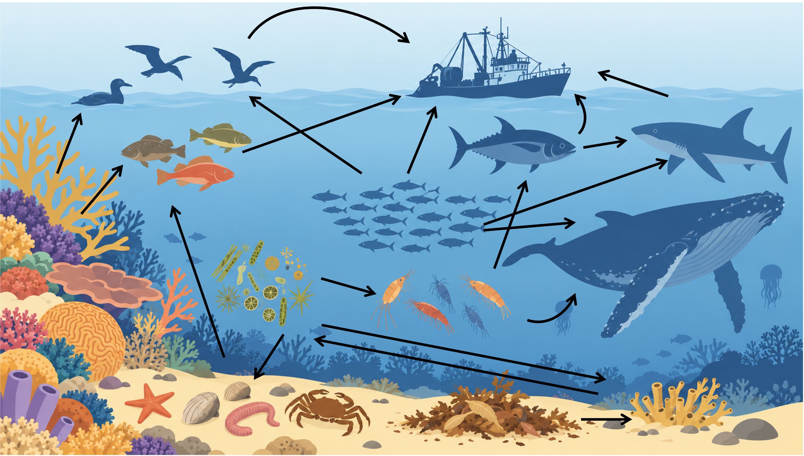
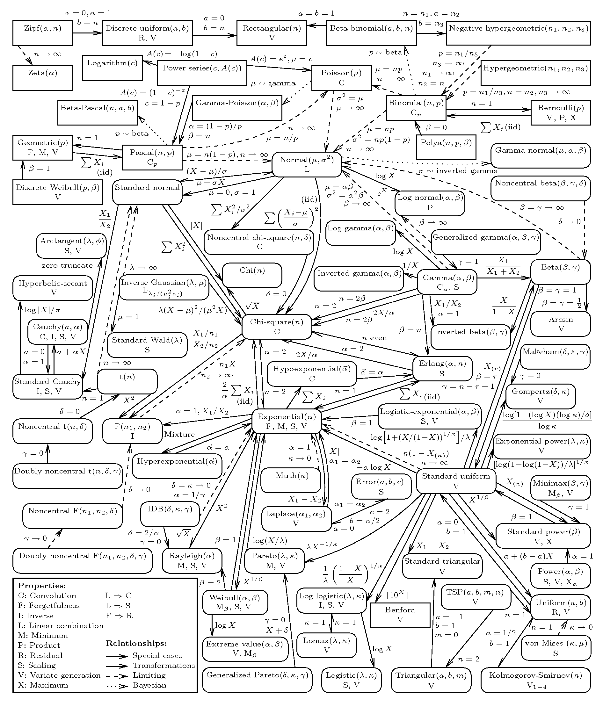

```{r xaringan-themer, include=FALSE, warning=FALSE}


#~~~~~~~~~~~~~~~~~~~~~~
# Default knitr iputs
#~~~~~~~~~~~~~~~~~~~~~~

source("../Scripts/Setup/setup_knitr.R")

#~~~~~~~~~~~~~~~~~~~~~~
# Slide customization
#~~~~~~~~~~~~~~~~~~~~~~
source("../Scripts/Setup/setup_slides.R")


```

class: title-slide
<div class="title-block">
  <h1>`r rmarkdown::metadata$title`</h1>
  <div class="date-text">`r rmarkdown::metadata$date`</div>
</div>

<div class="subtitle-block">
  <h2>`r rmarkdown::metadata$subtitle`</h2>
  <p class="author-name">`r rmarkdown::metadata$author`</p>
  <p class="author-email"><u>`r rmarkdown::metadata$institute`</u></p>
</div>


---
# PPGECO | ECL0072 | out. 2026

<div style="height: 15px;"></div>

De perto, ninguém é Normal....

<div style="height: 7px;"></div>


```{r echo=FALSE, out.width ="90%"}

```


.footnote[.small-text2[Figura criada com IA]]

---
# PPGECO | ECL0072 | out. 2026

<div style="height: 15px;"></div>

A maioria dos processos ecológicos resulta em dados assimétricos, discretos e que violam um ou mais dos pressupostos do modelo linear

<div style="height: 15px;"></div>

  - Modelos lineares generalizados (GLMs) e modelos aditivos generalizados (GAMs) são extensões naturais de LMs<sup>1</sup>, uma vez que permitem acomodar
<div style="height: 20px;"></div>

      - **Natureza dos dados:** a variável resposta $y_i$ segue uma distribuição de probabilidade
      <div style="height: 15px;"></div>

      - **Heterocedasticidade estrutural:** a média $\mu_i$ é descrita em função do parâmetro de sobredispersão $\phi$
      <div style="height: 15px;"></div>

      - **Relações complexas e não-lineares:** via funções suavizadoras não paramétricas (exclusivo de GAMs)


.footnote[<sup>1</sup> *Linear Model*]
---
# PPGECO | ECL0072 | out. 2026
### GLMs

Os modelos lineares generalizados (GLMs) estendem o modelo linear ao permitir que a variável resposta siga distribuições de probabilidade diferentes da Normal (Gaussiana)


<br>
<br>


.pull-left[

.center[**Modelo linear (LM)**]

<br>

$$\large y_i \sim N(\mu_i, \sigma^2)$$


$$\large \mu_i = \beta_0 + \sum_{j=1}^{p} \beta_j x_{ij}$$
]


.pull-right[

.center[**Modelo linear *generalizado* (GLM)**]

<br>


$$\large y_i \sim  {\color{#e07a5f}F}(\mu_i,  {\color{#e07a5f}\phi})$$

$$\large \color{#e07a5f}{g(\mu_i)} = \color{#e07a5f}{\eta_i} = \beta_0 + \sum_{j=1}^{p} \beta_j x_{ij}$$

]


---
# PPGECO | ECL0072 | out. 2026
### GLMs

Os GLMs evitam o velho hábito de transformar os dados

<br>

.pull-left[

<br>
<br>
<br>
<br>


> <font size="6.5"><center> <span style="color: #e07a5f;">If you torture the data long enough, it will confess to anything</center></font></span> 

]


.pull-right[

```{r echo=FALSE, out.width ="60%", fig.align ='center', fig.cap="Ronald Coase (1910-2013)", fig.topcaption=F}
knitr::include_graphics("../Figuras/Ronald_Coase.jpg")
```

]


---
# PPGECO | ECL0072 | out. 2026
### GLMs

Os GLMs são compostos por 3 componentes:

<br>

$$\large y_i \sim  {\color{#e07a5f}F}(\mu_i,  \phi)$$

$$\large \color{#e07a5f}{g(\mu_i)} = \color{#e07a5f}{\eta_i} = \beta_0 + \sum_{j=1}^{p} \beta_j x_{ij}$$

----

<br>

- <u>Distribuição de probabilidade para variável resposta:</u> 
  - $F(\cdot)$ 

<br>

- <u>Preditor linear:</u> 
  - $\eta_i$

<br>

- <u>Função de ligação:</u> 
  - $g(\mu_i)$


---
# PPGECO | ECL0072 | out. 2026
### GLMs | .small-text[<span style="color: #e07a5f;">1º componente</span>]

**Distribuição de probabilidade para variável resposta**


Representa o componente aleatório do modelo estatístico

<br>

$$\large y_i \sim  {\color{#e07a5f}F}(\mu_i,  \phi)$$

<br>


- A função $F(\cdot)$ pertence à família exponencial de distribuições 

<br>

- A variância dos dados $Var(y_i)$ é descrita em função do parâmetro de sobredispersão $\phi$ conforme relação $\text{Var}(y_i) = \phi \text{Var}(\mu_i)$
  - Permite relaxar o pressuposto de homocedasticidade (i.e., a variância pode variar com a média)


---

# PPGECO | ECL0072 | out. 2026
### GLMs | .small-text[<span style="color: #e07a5f;">1º componente</span>]

**Distribuição de probabilidade para variável resposta**


A família exponencial de distribuições cobre uma diversidade de distribuições de probabilidade
- Específicas à natureza da variável resposta $y_i$


<br>

```{r echo=FALSE, out.width ="90%"}
knitr::include_graphics("../Figuras/tipos_de_distribuicoes.png")
```


---
# PPGECO | ECL0072 | out. 2026
### GLMs | .small-text[<span style="color: #e07a5f;">1º componente</span>]

**Distribuição de probabilidade para variável resposta**


 
.pull-left[

.small-text2[
 Há muitas outras distribuições que fazem parte da família exponencial

<br>

  - **Dados contínuos**
      - log-Normal
      - Gama
      - Exponencial
      - Qui-quadrado

      
<br>
  
  - **Dados discretos**
    - Bernoulli / Binomial
    - Poisson
    - Binomial Negativa
    - Multionomial

  ]
]

.pull-right[

```{r echo=FALSE, out.width ="95%"}

```


.center[ .small-text2[[Outros exemplos](https://www.math.wm.edu/~leemis/chart/UDR/UDR.html)
  ]
]


]

<br>

---
# PPGECO | ECL0072 | out. 2026
### GLMs | .small-text[<span style="color: #e07a5f;">2º componente</span>]

**Preditor linear**


Representa o componente *sistemático* do modelo


$$\large \color{#e07a5f}{\eta_i} = \beta_0 + \sum_{j=1}^{p} \beta_j x_{ij}$$

- Modelo que estabelece a relação entre $y \sim x$
  - i.e., relações ecológicas, hipóteses, ...
  

---
# PPGECO | ECL0072 | out. 2026
### GLMs | .small-text[<span style="color: #e07a5f;">3º componente</span>]


**Função de ligação**


Estabelece a ligação entre o preditor linear $\eta_i$ e a média da distribuição $\mu_i$ (variável resposta) 
- liga o *componente aleatório* ao sistemático


$$\large \color{#e07a5f}{g(\mu_i)} = \eta_i \quad \iff \quad \mu_i = g^{-1}(\eta_i)$$
<br>

Garante que os valores de $\eta_i$ estejam dentro dos valores de $\mu_i$

- não há restrições sobre os valores de $\eta_i$: $~~ -\infty < \eta_i < +\infty$

- há restrições sobre os valores de $\mu_i$:
    - $\mu > 0$: contagem de espécies (distribução Poisson)
    - $0 < \mu < 1$: presença/ausência de espécies (distribução Binomial)
    - $\mu > 0$: biomassa (distribuição Gama)


---
# PPGECO | ECL0072 | out. 2026
### GAMs 

Os GAMs estendem os GLMs ao substituir termos lineares por funções suavizadoras não paramétricas ($f$)       
  - Permitem capturar relações ecológicas complexas sem assumir uma forma funcional rígida (i.e., linear)


<br>

.pull-left[

.center[**Modelo linear generalizado (GLM)**]

<br>

$$\large y_i \sim F(\mu_i, \phi)$$

$$\large g(\mu_i) = \beta_0 + \sum_{j=1}^{p} {\color{#e07a5f}{\beta_j x_{ij}}}$$

<br>


]

.pull-right[

.center[**Modelo aditivo generalizado (GAM)**]

<br>

$$\large y_i \sim F(\mu_i, \phi)$$

$$\large g(\mu_i) = \beta_0 + \sum_{j=1}^{p} {\color{#e07a5f}{f_j(x_{ij})}}$$

<br>


]

---
# PPGECO | ECL0072 | out. 2026
### GAMs 

<br>
<br>


.pull-left[
```{r, fig.asp = 0.8}

dados_bio <- readRDS("../Dados/bioluminescence.rds")

dados_bio %>%
  filter(Station %in% c(6,7,8,9,11,16,18,19)) %>% #Filtrando apenas as estações com o mesmo padrão de bioluminescencia
  ggplot(aes(x=SampleDepth, y = Sources)) +
  geom_point(col = '#d5bdaf', pch = 19, alpha =0.5, size = 3) +
  geom_smooth(method = "gam", fill = '#dda3a4', col = "#bc4749") +
  labs(x = "Profundidade (m)",
       y = "Bioluminescência") +
  theme_light(base_size = 14) +
  my_theme

```

]


.pull-right[

```{r,  fig.asp = 0.8}
minha_paleta_8 <- c(
  "#846267", # Muted Rose
  "#588157", # Sage Green
  "#e07a5f", # Terracotta
  "#457b9d", # Steel Blue
  "#f6bd60", # Warm Yellow
  "#b56576", # Muted Teal
  "#936639", # Warm Ochre
  "#6b705c"  # Dark Moss Green
)


dados_bio %>%
    filter(Station %in% c(6, 7, 8, 9, 11, 16, 18, 19)) %>%
    mutate(depth_bin = cut(SampleDepth, 
                           breaks = c(0, 1000, 1500, 2000, 2500, 3000, 3500, 4000, 5000),
                           include.lowest = TRUE)) %>% 
    filter(!is.na(depth_bin)) %>% 
    ggplot(aes(x = SampleDepth, y = Sources)) +
    geom_point(aes(col = depth_bin), pch = 19, alpha = 0.5, size = 3) +
    geom_smooth(aes(group = depth_bin, col = depth_bin), 
                method = "lm", 
                se = FALSE, 
                size = 1.5) +
    # Passando o vetor de 8 cores
    scale_color_manual(values = minha_paleta_8) +
    labs(x = "Profundidade (m)",
         y = "Bioluminescência") +
    theme_light(base_size = 14) +
    my_theme +
    theme(legend.position = "none")
```
]

---
# PPGECO | ECL0072 | out. 2026
### GLMMs / GAMMs 

Unificando a não normalidade, não linearidade e dependência estrutural entre as observações

<br>
<br>

.pull-left[

.center[**GLMM**]

<br>

$$\large y_{ij} \sim F(\mu_{ij}, \phi)$$

$$\large g(\mu_{ij}) = \beta_0 + \sum_{k=1}^{p} \beta_k x_{ijk} + \mathbf{Z}_{ij}\mathbf{b}_j$$

]

.pull-right[

.center[**GAMM**]

<br>

$$\large y_{ij} \sim F(\mu_{ij}, \phi)$$

$$\large g(\mu_{ij}) = \beta_0 + \sum_{k=1}^{p} f_k(x_{ijk}) + \mathbf{Z}_{ij}\mathbf{b}_j$$

]


---
# PPGECO | ECL0072 | out. 2026
### Inferência 

Estimar os parâmetros de modelos mistos requer cuidados adicionais, especialmente na abordagem *frequentista*
<div style="height: 20px;"></div>

- Além dos efeitos fixos ($\boldsymbol{\beta}$), o modelo deve estimar simultaneamente os componentes de variância dos efeitos aleatórios ($\sigma_{\alpha}^2$, $\sigma_{\delta}^2$, ...)

<div style="height: 15px;"></div>


- Como os efeitos aleatórios não são observados, eles precisam ser integrados (marginalizados) durante o processo de estimação da verossimilhança

  - A inegração depende classe de modelos (LMMs vs. GLMMs/GAMMs)


---
# PPGECO | ECL0072 | out. 2026
### Inferência frequentista | .small-text[<span style="color: #e07a5f;">LMMs</span>]

Dado o conjunto de parâmetros $\large \theta = \{ \beta_0, \beta, \sigma^2, \sigma_{\alpha}^2 \}$<sup>1</sup>, objetiva-se $\hat{\theta} := argmin ~ L(\theta)$

<br>
  
.pull-left[

```{r, out.width = "85%"}


# 1. Simulação dos dados
#set.seed(123)
y <- rnorm(1000, mean = 5, sd = 2)

# Grid de parâmetros
mu_seq    <- seq(4.75,  5.25,  length.out = 200)
sigma_seq <- seq(1.85, 2.25, length.out = 200)

# Função de log-verossimilhança
loglik_normal <- function(mu, sigma, y) {
  if (sigma <= 0) return(NA_real_)
  sum(dnorm(y, mean = mu, sd = sigma, log = TRUE))
}

# Construção do Grid de Verossimilhança
grid <- expand.grid(mu = mu_seq, sigma = sigma_seq)
grid$loglik <- mapply(loglik_normal, grid$mu, grid$sigma, MoreArgs = list(y = y))
grid$lik <- exp(grid$loglik - max(grid$loglik, na.rm = TRUE))

# Estimadores de Máxima Verossimilhança (MLE)
mu_hat    <- mean(y)
sigma_hat <- sqrt(mean((y - mu_hat)^2))

# 2. Amostragem do grid proporcional à verossimilhança (para gerar a densidade de hexágonos)
idx_samples <- sample(seq_len(nrow(grid)), size = 15000, replace = TRUE, prob = grid$lik)
df_sim <- grid[idx_samples, c("mu", "sigma")]

# 3. Definição da sua paleta de cores personalizada
minha_paleta <- c( "#457b9d", "#846267", "#e07a5f","#f6bd60")

# 4. Gráfico Base (Hexbin + Ponto MLE)
p <- ggplot(df_sim, aes(x = mu, y = sigma)) +
  geom_hex(bins = 35) +
  geom_point(alpha = 0) + # Compatibilidade técnica com o ggMarginal
  # geom_point(data = data.frame(mu = mu_hat, sigma = sigma_hat), 
  #            aes(x = mu, y = sigma), color = "red", size = 3, shape = 4, stroke = 1.5) + # Ponto indicando o MLE (X vermelho)
  # geom_vline(xintercept = mu_hat, color = "white", size = .4) +
  # geom_hline(yintercept = sigma_hat, color = "white", size = .4) +
  scale_fill_gradientn(colors = minha_paleta) +
  labs(x = expression(mu), y = expression(sigma)) +
  theme_classic(base_size = 14) +
  theme(legend.position = "none",
    axis.line = element_line(color = "#333333"),
    axis.ticks = element_line(color = "#333333"))

# 5. Adição dos histogramas marginais (perfis de verossimilhança)
p_final <- ggMarginal(
  p, 
  type = "histogram", 
  fill = "#d5bdaf", # 
  color = "white",
  linewidth = 1,
  xparams = list(bins = 35, size = 1.2),
  yparams = list(bins = 35, size = 1.2)
)

p_final


```

]


.pull-right[

.small-text2[

No estimador de máxima verossimilhança, todos os parâmetros são estimados conjuntamente
- **Problema:** estimativas enviesadas para os parâmetros de variância ($\sigma^2, \sigma_{\alpha}^2$)


<br>

$$\hat{\sigma}_{MLE}^2 = \frac{\sum_{i=1}^{n} (y_i - \hat{\mu_i})^2}{\color{#e07a5f}{n}}$$
<br>

$$\hat{\sigma}_{OLS}^2 = \frac{\sum_{i=1}^{n} (y_i - \hat{\mu_i})^2}{\color{#e07a5f}{n-p}}$$


  ]
]

.footnote[
<sup>1</sup> Considerando um modelo com intercepto aleatório
]

---
# PPGECO | ECL0072 | out. 2026
### Inferência frequentista | .small-text[<span style="color: #e07a5f;">LMMs</span>]

Dado o conjunto de parâmetros $\large \theta = \{ \beta_0, \beta, \sigma^2, \sigma_{\alpha}^2 \}$<sup>1</sup>, objetiva-se $\hat{\theta} := argmin ~ L(\theta)$

<br>
  
.pull-left[

```{r, out.width = "85%"}
p_final
```

]

.pull-right[

.small-text2[

No estimador de máxima verossimilhança, todos os parâmetros são estimados conjuntamente
- **Problema:** estimativas enviesadas para os parâmetros de variância ($\sigma^2, \sigma_{\alpha}^2$)


<br>

.gray-box-small[
**Consequências**

Erros padrões subestimados
- ICs muito estreitos
  - Aumento do erro tipo I 

]


  ]
]


.footnote[
<sup>1</sup> Considerando um modelo com intercepto aleatório
]


---
# PPGECO | ECL0072 | out. 2026
### Inferência frequentista | .small-text[<span style="color: #e07a5f;">LMMs</span>]

Uma forma de contornar esse problema consiste em aplicar a verossimilhança restrita (REML<sup>1</sup>)

- Separa previamente os efeitos fixos ($\beta_0, \beta$) e efeitos aleatórios ($\sigma^2, \sigma^2_\alpha$) e estima separadamente cada conjunto de parâmetros

<br>

Para isolar os efeitos fixos ($\boldsymbol{\beta}$), o REML multiplica a matriz de design ($\mathbf{X}$) por uma matriz ortogonal ($\mathbf{A}$), tal que $\mathbf{A}^T\mathbf{X} = 0$


<br>

$$\mathbf{Y} = \mathbf{X}\boldsymbol{\beta} + \mathbf{Z}\mathbf{b} + \boldsymbol{\varepsilon}$$

$$\mathbf{\color{#e07a5f}{A^{'}}}\mathbf{Y} = \mathbf{\color{#e07a5f}{A^{'}}}(\mathbf{X}\boldsymbol{\beta} + \mathbf{Z}\mathbf{b} + \boldsymbol{\varepsilon})$$

$$\mathbf{\color{#e07a5f}{A^{'}}}\mathbf{Y} = \underbrace{\mathbf{\color{#e07a5f}{A}}^{'}\mathbf{X}}_{= \mathbf{0}}\boldsymbol{\beta} + \mathbf{\color{#e07a5f}{A^{'}}}\mathbf{Z}\mathbf{b} + \mathbf{\color{#e07a5f}{A^{'}}}\boldsymbol{\varepsilon}$$

$$\mathbf{\color{#e07a5f}{A^{'}}}\mathbf{Y} = \mathbf{\color{#e07a5f}{A^{'}}}\mathbf{Z}\mathbf{b} + \mathbf{\color{#e07a5f}{A^{'}}}\boldsymbol{\varepsilon}$$

.footnote[
<sup>1</sup> *Restricted Maximum Likelihood*; aplicável apenas no contexto de modelos lineares (mistos)
]

---
# PPGECO | ECL0072 | out. 2026
### Inferência frequentista | .small-text[<span style="color: #e07a5f;">LMMs</span>]


Uma vez eliminada a dependência dos efeitos fixos na função de verossimilhança, tem-se a etapa de estimação:

<br>

**1º Passo | Estimação das variâncias (REML):**
- O método REML opera sobre os dados transformados ($\mathbf{A}^T\mathbf{Y} = \mathbf{A}^T\mathbf{Z}\mathbf{b} + \mathbf{A}^T\boldsymbol{\varepsilon}$)
- Estima-se a matriz de covariância $\hat{\mathbf{V}}$ sem a interferência dos efeitos fixos (logo, não enviesado)

<div style="height: 20px;"></div>


----

<div style="height: 20px;"></div>


**2º Passo | Estimação dos efeitos fixos (GLS):**
- Dado a matriz $\hat{\mathbf{V}}$, aplica-se a solução do mínimos quadrados generalizados (GLS) para estimar o vetor $\boldsymbol{\beta}$
  
.center[$$\hat{\boldsymbol{\beta}} = (\mathbf{X}^T \hat{\mathbf{V}}^{-1} \mathbf{X})^{-1} \mathbf{X}^T \hat{\mathbf{V}}^{-1} \mathbf{Y}$$]

---
# PPGECO | ECL0072 | out. 2026
### Inferência frequentista | .small-text[<span style="color: #e07a5f;">LMMs</span>]

<br>

.gray-box-small[**ATENÇÃO:** 

Diante do estimador REML, não se pode comparar modelos com diferentes estruturas de efeitos fixos (via AIC, teste de razão de verossimilhança (LRT), ...).
- A matriz ortogonal $\mathbf{A}$ é construída em função da matriz de design $\mathbf{X}$ ($\mathbf{A}^T\mathbf{X} = \mathbf{0}$)
- Ao alterar os efeitos fixos (logo, $\mathbf{X}$), altera-se também a matriz $\mathbf{A}$
- Portanto, o vetor de dados transformados $\mathbf{A}^T\mathbf{Y}$ torna-se diferente entre os modelos uma vez que isso resulta em funcões de verossimilhanças distintas.

]

---
# PPGECO | ECL0072 | out. 2026
### Inferência frequentista | .small-text[<span style="color: #e07a5f;">GLMMs/GAMMs</span>]


Em GLMMs e GAMMs, como os dados não seguem uma distribuição Normal, a função de verossimilhança inclui uma integral sobre os efeitos aleatórios que não possui solução analítica fechada
<div style="height: 15px;"></div>

  - Ao invés de aplicar o método REML dos LMMs, recorre-se a métodos de aproximação numérica e integração
    - Aproximação de Laplace
    - Quadratura Adaptativa de Gauss-Hermite (AGHQ)
    - PQL-REML (Penalized Quasi-Likelihood REML)


--


<br>

> <span style="color: #e07a5f;">Diante de estruturas complexas, os modelos mistos apresentam frequentemente falhas de convergência </span>


---
# PPGECO | ECL0072 | out. 2026
### Inferência bayesiana | .small-text[<span style="color: #e07a5f;">LMMs/GLMMs/GAMMs</span>]

**Modelos mistos como modelos hierárquicos Bayesianos**


Na abordagem bayesiana, todos os parâmetros do modelo são representados via distribuições de probabilidade, incluindo os dos efeitos aleatórios


<br>


.pull-left[

<br>

.center[

$$\large y_{ij} \sim N(\mu_{ij}, ~\sigma^2)$$
]

<div style="height: 7px;"></div>


.center[
$$\large \mu_{ij} = \beta_0 + \beta_1x_{ij} + \alpha_j$$
]

<div style="height: 7px;"></div>

.center[
$$\large \alpha_j \sim N(0,~ \sigma_\alpha^2)$$
]


<div style="height: 7px;"></div>

.center[
$$\large \beta_0,\beta_1,\sigma,\sigma_\alpha \sim P(\theta)$$
]

]


.pull-right[

.center[**Vantagens**]

<div style="height: 7px;"></div>


.small-text2[

**1 | Representação completa da incerteza**

Distribuições posteriores para efeitos fixos, efeitos aleatórios e componentes de variância

<div style="height: 7px;"></div>

-----

<div style="height: 7px;"></div>

**2 | Regularização através das prioris**

Componentes de variância podem ser difíceis de estimar quando há poucos grupos ou pouca informação em cada grupo
- definir uma priori regularizadora sobre esses parâemtros


]

]


---


# PPGECO | ECL0072 | out. 2026
### Modelo Linear Misto 

**Quando usar modelos mistos?**

<div style="height: 7px;"></div>


--


.small-text2[
- **Dados agrupados/hierárquicos:** observações pertencem a grupos ou unidades amostrais, gerando dependência entre observações do mesmo grupo

]

<div style="height: 7px;"></div>


--

.small-text2[
- **Medidas repetidas:** múltiplas observações são feitas na mesma unidade experimental, indivíduo ou local, ao longo do tempo ou em diferentes condições
]

<div style="height: 7px;"></div>


--

.small-text2[
- **Dados desbalanceados:** grupos apresentam diferentes números de observações
]

<div style="height: 7px;"></div>


--

.small-text2[
- **Generalização populacional:** quando o objetivo é inferir para uma população de grupos/unidades além daqueles especificamente amostrados
  - Ex.: inferir sobre todos os recifes, e não apenas comparar os recifes amostrados
]

<div style="height: 7px;"></div>

--

.small-text2[
- **Interesse na variabilidade:** quando é importante quantificar a variação entre grupos ou permitir que o efeito de uma variável varie entre grupos, além de estimar o efeito médio
]

<div style="height: 7px;"></div>

--

.small-text2[
- **Dados com sobredispersão:** quando a variabilidade dos dados é maior do que a esperada pelo modelo  (comum em dados de contagens contagens ou proporções)
  - A inclusão de um efeito aleatório no nível da observação (*observation-level random effect* - OLRE) absorve a variação extra não explicada
]

---

# PPGECO | ECL0072 | out. 2026

### Estudo dirigido


.small-text3[

**Livros**

- **Cap. 4** - Bolker (2009). Ecological Models and Data in R.

- **Caps. 2, 3, 5 e 9** - Faraway (2016). Extending the Linear Model with R, 2. ed.

- **Caps. 13 e 15** - Gelman et al. (2020). Regression and Other Stories.

- **Caps. 8-10** - Zuur et al. (2009). Mixed effects models and extensions in ecology with R.


----

**Material Extra**

- [Material da disciplina GLM/GAM](https://github.com/mcruf/ECL0072-GLM_GAM)

  -[Lista de vídeos no YouTube](https://youtube.com/playlist?list=PLhfTXDln3k652uTf0jf4EyoBJBTUHiorf&si=Pk23sNq_LLAqaJnc) 


]


