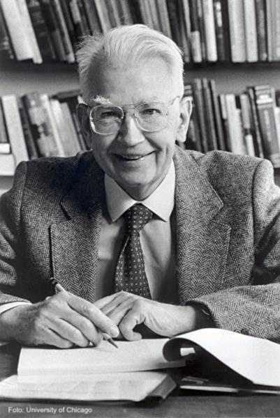
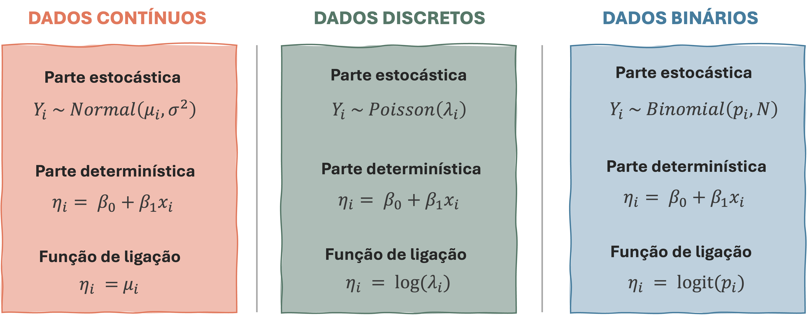

```{r xaringan-themer, include=FALSE, warning=FALSE}


#~~~~~~~~~~~~~~~~~~~~~~
# Default knitr iputs
#~~~~~~~~~~~~~~~~~~~~~~

source("../Scripts/Setup/setup_knitr.R")

#~~~~~~~~~~~~~~~~~~~~~~
# Slide customization
#~~~~~~~~~~~~~~~~~~~~~~
source("../Scripts/Setup/setup_slides.R")


```

class: title-slide
<div class="title-block">
  <h1>`r rmarkdown::metadata$title`</h1>
  <div class="date-text">`r rmarkdown::metadata$date`</div>
</div>

<div class="subtitle-block">
  <h2>`r rmarkdown::metadata$subtitle`</h2>
  <p class="author-name">`r rmarkdown::metadata$author`</p>
  <p class="author-email"><u>`r rmarkdown::metadata$institute`</u></p>
</div>


---
# PPGECO | ECL0072 | out. 2026

### Agenda


- Introdução geral


- Estimando parâmetros em MM
  - ML, REML, Bayesiano...


- Pressupostos & ajuste dos modelos


---

# PPGECO | ECL0072 | out. 2026
### GLMs

De perto, ninguém é normal....


[Mostrar uma imagem de ecosistema marinho e suas interações ecológicas]


---
# PPGECO | ECL0072 | out. 2026
### GLMs

A maioria dos processos ecológicos resulta em dados assimétricos, discretos e que violam um ou mais dos pressupostos do modelo linear
- Os modelos lineares generalizados (GLMs) estendem o modelo linear ao acomodar variáveis de resposta que seguem outras distribuições de probabilidade além da Normal (Gaussiana)


<br>

.pull-left[

.center[**Modelo linear (LM)**]

<br>

$$\large y_i \sim N(\mu_i, \sigma^2)$$


$$\large \mu_i = \beta_0 + \sum_{j=1}^{p} \beta_j x_{ij}$$
]


.pull-right[

.center[**Modelo linear *generalizado* (GLM)**]

<br>


$$\large y_i \sim  {\color{#e07a5f}F}(\mu_i,  {\color{#e07a5f}\phi})$$

$$\large \color{#e07a5f}{g(\mu_i)} = \color{#e07a5f}{\eta_i} = \beta_0 + \sum_{j=1}^{p} \beta_j x_{ij}$$

]


---
# PPGECO | ECL0072 | out. 2026
### GLMs

Os GLMs evitam o velho hábito de transformar os dados

<br>

.pull-left[

<br>
<br>
<br>

> <font size="6.5"><center> <span style="color: #e07a5f;">If you torture the data long enough, it will confess to anything</center></font></span> 

]


.pull-right[

```{r echo=FALSE, out.width ="60%", fig.align ='center', fig.cap="Ronald Coase (1910-2013)", fig.topcaption=T}

```

]


---
# PPGECO | ECL0072 | out. 2026
### GLMs

Os GLMs são compostos por 3 componentes:

<br>

$$\large y_i \sim  {\color{#e07a5f}F}(\mu_i,  \phi)$$

$$\large \color{#e07a5f}{g(\mu_i)} = \color{#e07a5f}{\eta_i} = \beta_0 + \sum_{j=1}^{p} \beta_j x_{ij} + \varepsilon_i$$

----

<br>

- <u>Distribuição de probabilidade para variável resposta:</u> 
  - $F(\cdot)$ 

<br>

- <u>Preditor linear:</u> 
  - $\eta_i$

<br>

- <u>Função de ligação:</u> 
  - $g(\mu_i)$


---
# PPGECO | ECL0072 | out. 2026
### GLMs

**Distribuição de probabilidade para variável resposta (1º componente)**

Representa o componente aleatório do modelo estatístico

<br>

$$\large y_i \sim  {\color{#e07a5f}F}(\mu_i,  \phi)$$

<br>


- A função $F(\cdot)$ pertence à família exponencial de distribuições 

<br>

- A variância dos dados $Var(y_i)$ é descrita em função do parâmetro de sobredispersão $\phi$ conforme relação $\text{Var}(y_i) = \phi \text{Var}(\mu_i)$
  - Permite relaxar o pressuposto de homocedasticidade (i.e., a variância pode variar com a média)


---

# PPGECO | ECL0072 | out. 2026
### GLMs

**Distribuição de probabilidade para variável resposta (1º componente)**

A família exponencial de distribuições cobre uma diversidade de distribuições de probabilidade
- Específicas à natureza da variável resposta $y_i$


<br>

```{r echo=FALSE, out.width ="80%", fig.align ='center'}

```

---


# PPGECO | ECL0072 | out. 2026
### Estimação de parâmetros

Estimar os parâmetros de modelos mistos requer cuidados adicionais


<br>

$$\large
Y =
\underset{
\substack{
\rule{3.8cm}{0.3pt}\\
\color{#81b29a}{\text{Covariáveis ambientais}}\\
\color{#81b29a}{\text{Tratamentos}}
}
}{\text{Efeitos fixos}}
+
\underset{
\substack{
\rule{3.8cm}{0.3pt}\\ 
\\
\color{#e07a5f}{\text{Estrutura aninhada}}\\
\color{#e07a5f}{\text{Correlação temporal}}\\
\color{#e07a5f}{\text{Correlação espacial}}\\
\color{#e07a5f}{\text{Ruído aleatório}}
}
}{\text{Efeitos aleatórios}}$$

<br>


------

.pull-left[

$$\large y_i \sim N(\mu_i, \sigma^2)$$

$$\large \mu_i = \beta_0 + \beta x_i + \alpha_{j[i]}$$

$$\large \alpha_j \sim N(0, \sigma_{\alpha}^2)$$

]

.pull-right[

.small-text2[**Parâmetros a serem estimados**]

$\large \theta = \{ \beta_0, \beta, \sigma^2, \sigma_{\alpha}^2 \}$

]

---
Classical regression and generalized linear models represent a special case of multilevel modeling in which there is no group-level model-in Bayesian terms, no prior information.
- For the classical regression model, $y_i = X_i\beta + \varepsilon_i$ , with independent errors $\varepsilon_i \sim N(0, \sigma^2)$, the corresponding prior distribution is a uniform distribution on the entire range $\infty, -\infty$ for each of the components of $\beta$, and uniform on ($(0, \infty$) for $\sigma^2$ as well.

