```{r xaringan-themer, include=FALSE, warning=FALSE}


#~~~~~~~~~~~~~~~~~~~~~~
# Default knitr iputs
#~~~~~~~~~~~~~~~~~~~~~~

source("../Scripts/Setup/setup_knitr.R")

#~~~~~~~~~~~~~~~~~~~~~~
# Slide customization
#~~~~~~~~~~~~~~~~~~~~~~
source("../Scripts/Setup/setup_slides.R")


```

class: title-slide
<div class="title-block">
  <h1>`r rmarkdown::metadata$title`</h1>
  <div class="date-text">`r rmarkdown::metadata$date`</div>
</div>

<div class="subtitle-block">
  <h2>`r rmarkdown::metadata$subtitle`</h2>
  <p class="author-name">`r rmarkdown::metadata$author`</p>
  <p class="author-email"><u>`r rmarkdown::metadata$institute`</u></p>
</div>


---
# PPGECO | ECL0072 | out. 2026

<br>

### Agenda


---
# PPGECO | ECL0072 | out. 2026

Leitura:
- Cap. 13 - Legendre & Legendre. Numerical ecology

<br>

```{r, out.width ="85%"}
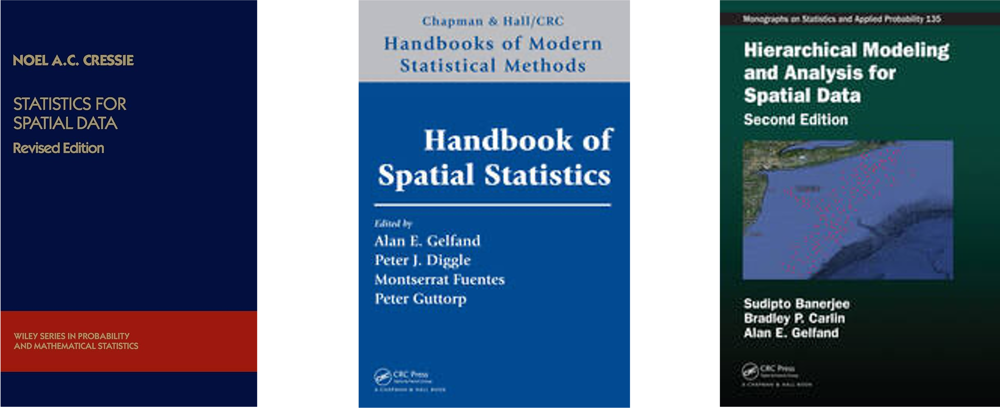
```


---
# PPGECO | ECL0072 | out. 2026

<br>

A maioria dos dados ecológicos apresenta algum grau de estrutura espacial

- .small-text2[**Primeira lei da Geografia:** *Tudo está relacionado a todas as outras coisas, mas coisas próximas estão mais relacionadas do que coisas distantes (Tobler, 1970)*]


```{r, out.width ="100%"}

```

---
# PPGECO | ECL0072 | out. 2026

### Padrões espaciais


.pull-left[

<br>
<br>

Muitos padrões ecológicos podem ser descritos como manchas (*patches*) ou gradientes (lineares ou não)


- Examinar os padrões espaciais de espécies (ou comunidades) permite compreender os mecanismos que controlam suas distribuições
  
  - Determinado por forçantes externos (abióticos) e/ou internos (bióticos) 


]

.pull-right[

```{r, out.width ="85%"}
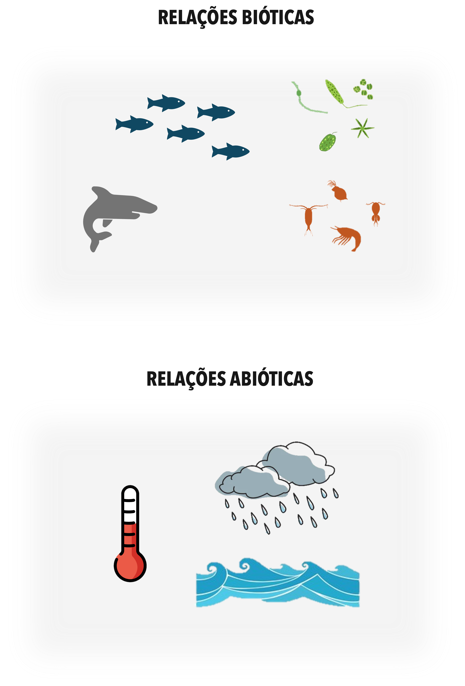
```

]

---
# PPGECO | ECL0072 | out. 2026

### Padrões espaciais | .small-text[<span style="color: #e07a5f;">Escalas</span>]


Padrões espaciais podem ser encontrados em todas as escalas espaciais 

--

<br>

<div style="height: 7px;"></div>


.center[.small-text2[**ESCALA LOCAL**]]


```{r, out.width ="65%"}
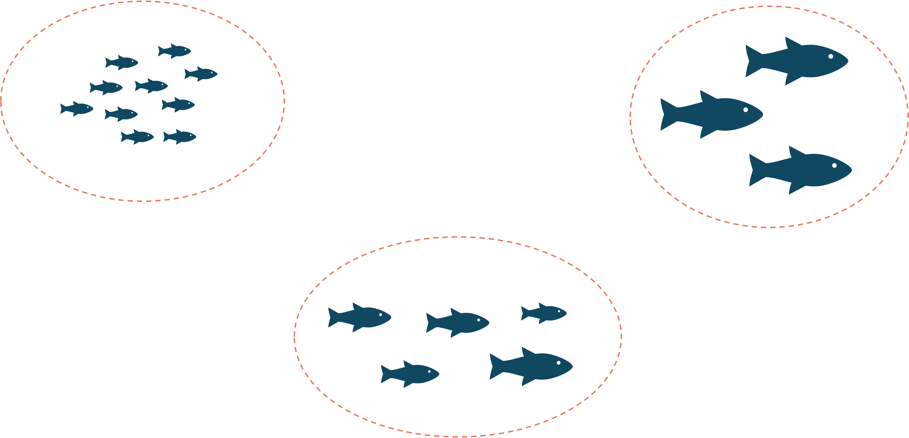
```


---
# PPGECO | ECL0072 | out. 2026

### Padrões espaciais | .small-text[<span style="color: #e07a5f;">Escalas</span>]


Padrões espaciais podem ser encontrados em todas as escalas espaciais 


<br>

<div style="height: 7px;"></div>


.center[.small-text2[**ESCALA REGIONAL**]]


```{r, out.width ="65%"}
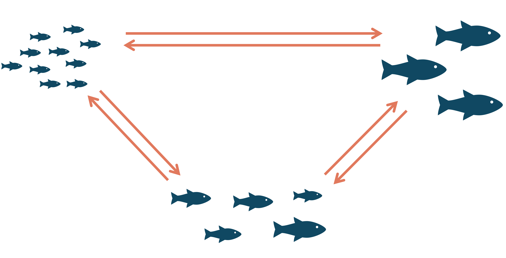
```

---
# PPGECO | ECL0072 | out. 2026

### Padrões espaciais | .small-text[<span style="color: #e07a5f;">Escalas</span>]


Padrões espaciais podem ser encontrados em todas as escalas espaciais 

<br>

<div style="height: 7px;"></div>


.center[.small-text2[**ESCALA GLOBAL**]]


```{r, out.width ="70%"}
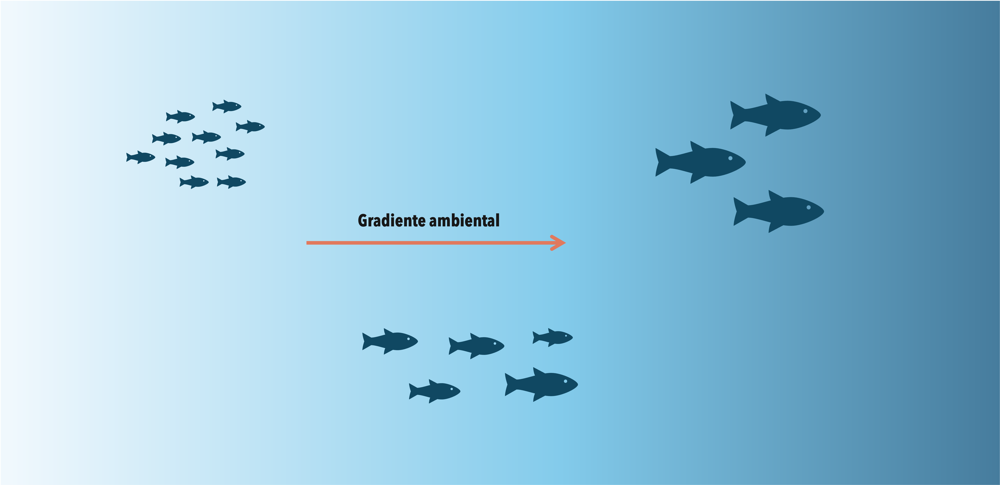
```

---
# PPGECO | ECL0072 | out. 2026

### Padrões espaciais | .small-text[<span style="color: #e07a5f;">Desenho amostral</span>]

A identificação de padrões espaciais também depende fortemente da forma como os dados são coletados, i.e., *desenho amostral*


.pull-left[

<br>

.small-text[

**Extensão (*extent*)**

- Área total coberta pelo estudo
- Deve ser suficientemente grande para abranger o processo ecológico de interesse

  ]
  
----

.small-text[

**Resolução espacial (*grain*)**
- Tamanho da unidade amostral (quadrante, parcela, pixel, transecto, etc.)
- Determina o nível de detalhe observado

]

----

.small-text[
**Intervalo amostral**
- Distância entre unidades amostrais (espacial ou temporal)
- Determina as menores escalas espaciais (ou temporais) que podem ser detectadas

]

  
  
]

.pull-right[

```{r, out.width ="45%"}
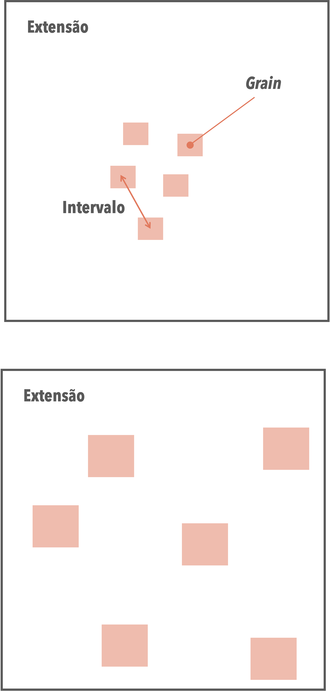
```

]


.footnote[ O tamanho amostral $N$ influencia o poder estatístico e a precisão na estimativa da estrutura de dependência espacial]

---
# PPGECO | ECL0072 | out. 2026

### Padrões espaciais | .small-text[<span style="color: #e07a5f;">Desenho amostral</span>]

<br>


.pull-left[

```{r, out.width ="90%"}
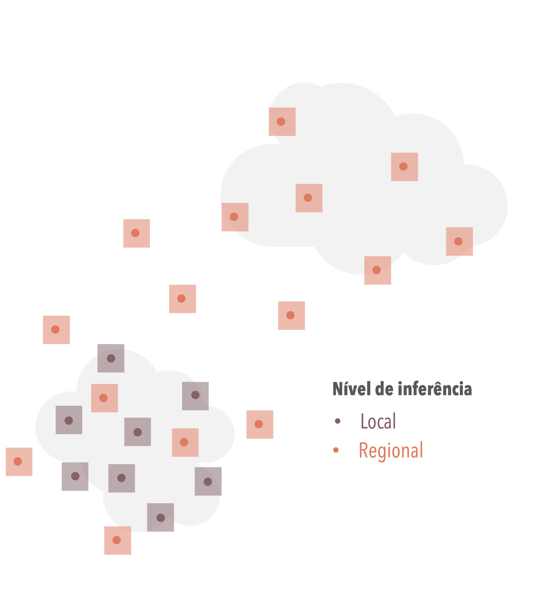
```


]


<br>
<br>

.pull-right[
.gray-box-small[

.center[ **Todo desenho amostral impõe um "filtro" ao processo ecológico** ]

<br>

<div style="text-align: justify;">
A forma como os dados são coletados determina quais padrões poderão ser detectados e, por consequência, quais hipóteses ecológicas poderão ser avaliadas!
</div>

<br>

]

]


---
# PPGECO | ECL0072 | out. 2026

### Padrões espaciais

Dados ecológicos resultam naturalmente de processos espaciais aninhados e mutuamente confundidos

- É necessário desembaraçar as diferentes escalas espaciais que atuam sobre o processo ecológico 
  - **Estatística espacial!**


```{r, out.width ="85%"}
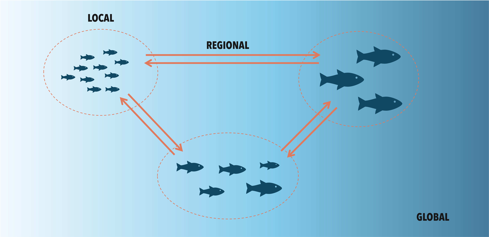
```


---
# PPGECO | ECL0072 | out. 2026

### Autocorrelação espacial

O termo *autocorrelação espacial* é usado para descrever o grau que uma variável está correlacionada consigo mesma ao longo do espaço


<br>
<br>


```{r, out.width ="80%"}
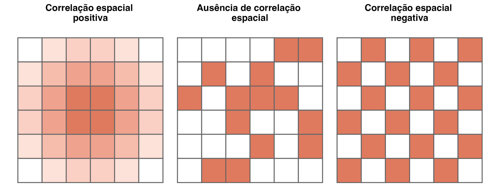
```

--

<br>

> <span style="color: #e07a5f;">Permite avaliar como o processo ecológico está estruturado espacialmente</span>


---
# PPGECO | ECL0072 | out. 2026

### Autocorrelação espacial


- Falar sobre 1a e 2a ordem

- Falar sobre isotropia e anisotropia


---
# PPGECO | ECL0072 | out. 2026

### Autocorrelação espacial

A autocorrelação espacial pode ser avaliada por meio de funções que quantificam a dependência espacial 
  - Correlogramas
  - Variogramas


---
# PPGECO | ECL0072 | out. 2026

### Autocorrelação espacial | .small-text[<span style="color: #e07a5f;">Correlograma</span>]


Um correlograma espacial é um gráfico que descreve como a correlação entre observações varia em função da distância (e, eventualmente, da direção) que as separa

<br>

  - Pode ser calculado para um dado univariado
    - **Índice de Moran I**
    - Índice de Geary C

<br>

  - Também pode ser calculado para dados multivariados
    - Mantel 

--

<br>

> <span style="color: #e07a5f;">Permite identificar a estrutura, intensidade e escala da autocorrelação espacial presente nos dados</span>


---
# PPGECO | ECL0072 | out. 2026

### Autocorrelação espacial | .small-text[<span style="color: #e07a5f;">Correlograma</span>]

#### Global Moran's I

Avalia se locais próximos tendem a apresentar valores semelhantes (ou diferentes) em relação ao que seria esperado ao acaso
- Quantifica o grau de autocorrelação espacial de uma variável

<br>

.gray-box-small[
$$\large I = \frac{n \sum\limits_{i=1}^{n} \sum\limits_{j=1}^{n} w_{ij}(Y_i - \bar Y)(Y_j - \bar Y)}
{(\sum_{i \neq j} w_{ij}) \sum_i (Y_i - \bar Y)^2}$$
]

.small-text[
onde:
- $n$: número de pontos (i.e., amostras)
- $Y_i, Y_j$: valor da variável resposta nos pares de ponto $i$ e $j$
- $\bar Y$: média da variável resposta
- $w_{i,j}$: pesos que quantificam a proximidade espacial entre os pontos $i$ e $j$ 
  - $i,j = 1, ...n$
  - $w_{i,i} = 0$

]
---
# PPGECO | ECL0072 | out. 2026

### Autocorrelação espacial | .small-text[<span style="color: #e07a5f;">Correlograma</span>]

#### Global Moran's I

Avalia se locais próximos tendem a apresentar valores semelhantes (ou diferentes) em relação ao que seria esperado ao acaso
- Quantifica o grau de autocorrelação espacial de uma variável

<br>


.pull-left[

```{r, out.width ="100%", fig.align='right'}
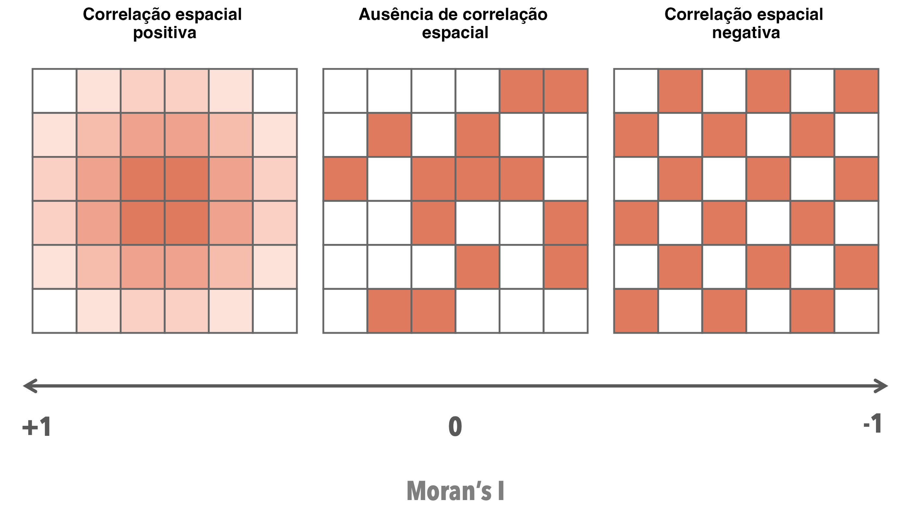
```

]


.pull-right[

<br>


Normalmente, $-1 < \text{Moran's I} < +1$ 

- .small-text[**Autocorrelação positiva:**] $\small I > 0$
- .small-text[**Autocorrelação negativa:**] $\small I < 0$
- .small-text[**Sem autocorrelação:**] $\small I = 0$

]


---
# PPGECO | ECL0072 | out. 2026

### Autocorrelação espacial | .small-text[<span style="color: #e07a5f;">Correlograma</span>]

#### Global Moran's I

Os correlogramas são analisados principalmente pelos seus formatos
  - Indicativo da estrutura espacial dos dados


```{r, out.width= "100%"}
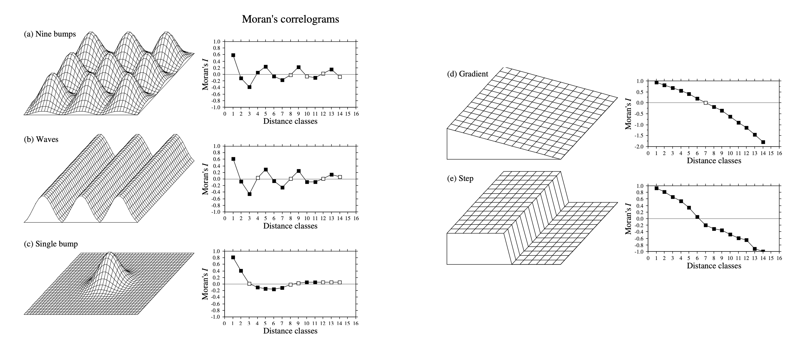
```


.footnote[Figuras: Legendre and Legendre (1998)]

---
# PPGECO | ECL0072 | out. 2026

### Autocorrelação espacial | .small-text[<span style="color: #e07a5f;">Correlograma</span>]

#### Local Moran's I


Representa a decomposição global do Moran's I para cada ponto amostral
- Também conhecido por *Local Indicators of Spatial Association* (LISA)
- Permite mapear aonde a autocorrelação espacial está concentrada
    - Identificar *hotspots* e *coldspots*


<br>

.gray-box-small[
$$\large I_i = \frac{n (Y_i - \bar Y)}{\sum (Y_j - \bar Y)^2} \sum\limits_{j=1}^{n} w_{ij}(Y_j - \bar Y).$$
]

---
# PPGECO | ECL0072 | out. 2026

### Autocorrelação espacial | .small-text[<span style="color: #e07a5f;">Correlograma</span>]

#### Local Moran's I

<br>

```{r, out.width= "100%"}
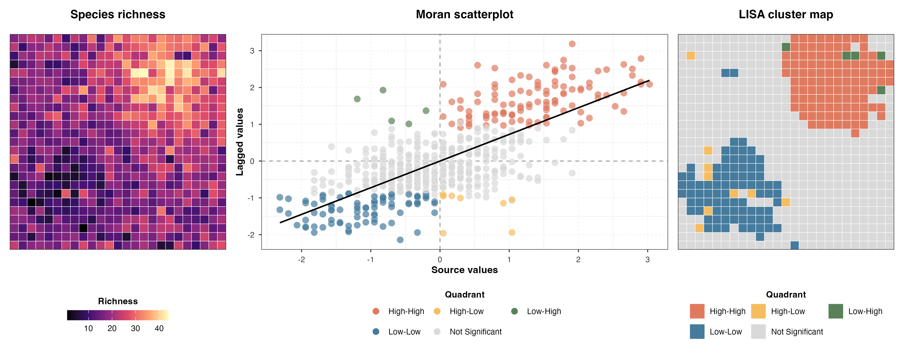
```


---
# PPGECO | ECL0072 | out. 2026

### Autocorrelação espacial | .small-text[<span style="color: #e07a5f;">Variograma</span>]


O variograma é um gráfico que descreve como a diferença entre observações aumenta com a distância espacial
.small-text2[  
- **Correlograma:** mede a *similaridade* entre observações vizinhas
- **Variograma:** mede a *dissimilaridade* entre observações vizinhas
]


.pull-left[

<br>

.gray-box-small[ 
$$\gamma(h) = \frac{1}{2N(h)} \sum\limits_{i=1}^{N(h)} (y_i-y_{i+h})^2$$
]
<br>

.small-text[
onde:
- $h$: distância entre os pares de ponto $(i, ~ i+h)$ (*lag*)
- $N(h)$: número de pares de pontos separados pela distância $h$
- $\gamma(h)$: variância descrita em função da distância
]

]

.pull-right[


```{r, out.width= "100%"}
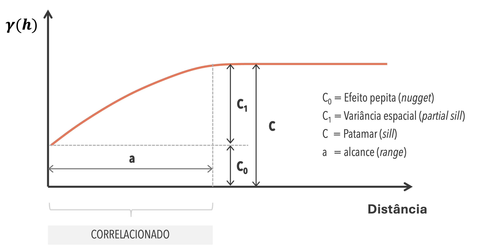
```

.center[<span style="font-size: 50%;">**Modelo esférico**</span>]


$$\scriptsize \gamma(h) = 
\begin{cases} 
C_0 + C \left[ \frac{3}{2}\left(\frac{h}{a}\right) - \frac{1}{2}\left(\frac{h}{a}\right)^3 \right], & \text{se } h \le a \\ 
C_0 + C, & \text{se } h > a 
\end{cases}$$


]


---
# PPGECO | ECL0072 | out. 2026

### Autocorrelação espacial | .small-text[<span style="color: #e07a5f;">Variograma</span>]


A estrutura de dependência espacial dos dados pode ser descrita por diferentes modelos de variograma
- Função é posteriromente incorporada ao modelo estatístico (espacial) 
  - Fornece os pesos estatísticos para a interpolação (i.e., krigagem)


<br>

```{r, out.width="70%"}
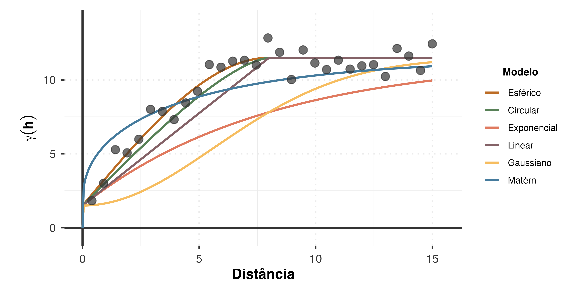
```


---
# PPGECO | ECL0072 | out. 2026

### Estatística espacial 


Dados espaciais são definidos por um *processo estocástico* que é indexado pelo espaço $(s)$, sendo descrito por dois componentes:

.pull-left[

<br>

.small-text2[
.center[**Domínio**:]

Representa a extensão espacial aonde os dados foram coletados ($\mathcal{D}^1$)

]

<div style="height: 7px;"></div>


-------

<div style="height: 7px;"></div>


.small-text2[
.center[**Variável aleatória**:]

Vetor representando a variável resposta coletada em $n$ locais em $s$, conforme ${Y(s_1), Y(s_2), \ldots, Y(s_n)}$  
  
  
  ]
    
]


.pull-right[


```{r, out.width="100%"}
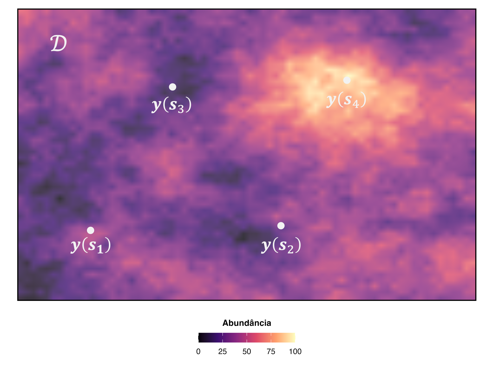
```

]

<br>

.footnote[.small-text2[<sup>1</sup> Campo espacial/latente (*spatial*/*latent field*)]]


--

.small-text2[Diz-se, portanto, que as observações são uma *realização parcial* do campo aleatório, tal que]
$$\{ ~Y(s) : s \in \mathcal{D} \subseteq \mathbb{R}^d~\}$$


---
# PPGECO | ECL0072 | out. 2026

### Estatística espacial | .small-text[<span style="color: #e07a5f;">Tipos de dados</span>]


Dependendo de como $\mathcal{D}$ e $Y(s)$ são definidos, pode-se classificar os dados espaciais em três categorias:


--


.pull-left[

.center[**Dados geoestatísticos**]

<div style="height: 7px;"></div>


.small-text2[

$Y(s)$ consiste em uma variável aleatória coletada ao longo de um conjunto fixo de localizações $s \in \mathbb{R}^2$, em que $s$ varia continuamente sobre  $\mathcal{D}$

- A continuidade refere-se apenas ao domínio $\mathcal{D}$; a variável resposta $Y(s)$ pode ser de natureza qualitativa ou quantitativa (contínua ou discreta).

<div style="height: 7px;"></div>


----
<div style="height: 7px;"></div>

**Foco da análise:** Interpolação espacial (predição de valores em locais não amostrados)

<div style="height: 7px;"></div>

----
<div style="height: 7px;"></div>

**Exemplos:** Dados de presença/ausência, abundância, índices de diversidade, ....


  ]
] 


.pull-right[

```{r, out.width="100%"}
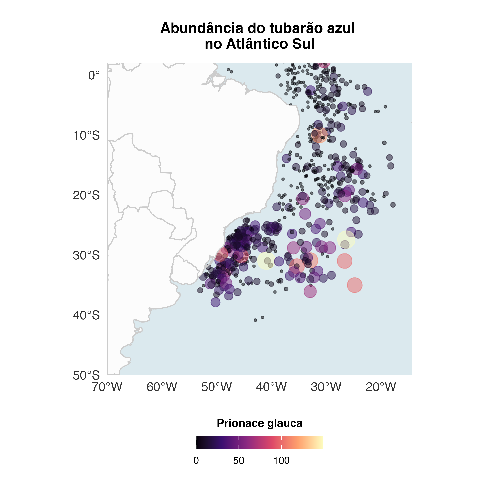
```

]

---

# PPGECO | ECL0072 | out. 2026

### Estatística espacial | .small-text[<span style="color: #e07a5f;">Tipos de dados</span>]


Dependendo de como $\mathcal{D}$ e $Y(s)$ são definidos, pode-se classificar os dados espaciais em três categorias:


.pull-left[

.center[**Dados de área**]

<div style="height: 7px;"></div>


.small-text2[

O domínio $\mathcal{D}$ é fixo (de forma regular ou irregular) e particionado em um número finito de polígonos com limites bem definidos
  - $Y(s)$ consiste em uma variável aleatória cujos valores estão agregados a nível dos polígonos

<div style="height: 7px;"></div>

----
<div style="height: 7px;"></div>

**Foco da análise:** Avaliar padrões espaciais entre áreas vizinhas

<div style="height: 7px;"></div>

----
<div style="height: 7px;"></div>

**Exemplos:** Dados censitários, epidemiológicos,  senoriamento remoto, ...


  ]
] 


.pull-right[

```{r, out.width="100%"}
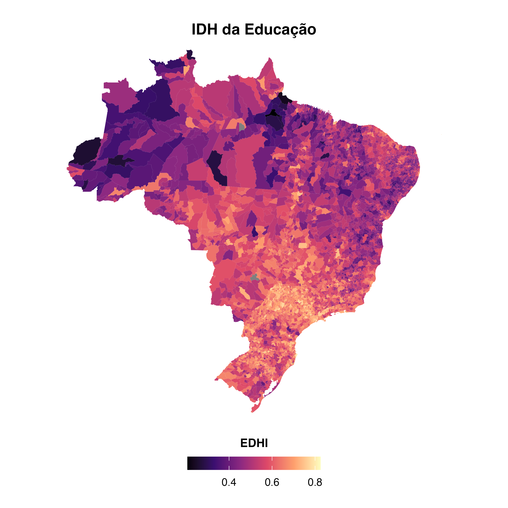
```

]


---
# PPGECO | ECL0072 | out. 2026

### Estatística espacial | .small-text[<span style="color: #e07a5f;">Tipos de dados</span>]


Dependendo de como $\mathcal{D}$ e $Y(s)$ são definidos, pode-se classificar os dados espaciais em três categorias:


.pull-left[

.center[**Dados de processos pontuais**]

<div style="height: 7px;"></div>


.small-text2[

Diferentemente dos dados geoestatísticos e de área, $\mathcal{D}$ é aleatório de modo que a própria localização $s$ da variável resposta é estocástica

<div style="height: 7px;"></div>

----
<div style="height: 7px;"></div>

**Foco da análise:** o interesse principal são as localizações espaciais das observações (os pontos), i.e, no seu padrão de agrupamento

<div style="height: 7px;"></div>

----
<div style="height: 7px;"></div>

**Exemplos:** Locais de encalhe de mamíferos marinhos, distribuição de ninhos, ocorrência de foco de doenças, ...

  ]
] 


.pull-right[

```{r, out.width="100%"}
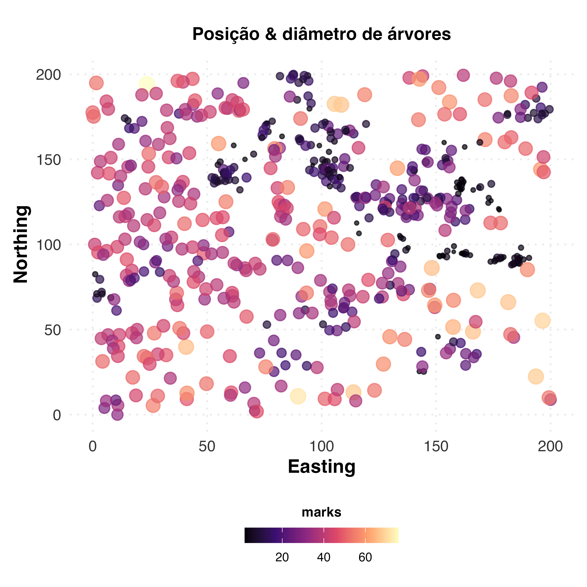
```

]


---

# PPGECO | ECL0072 | out. 2026

### Estatística espacial | .small-text[<span style="color: #e07a5f;">Tipos de dados</span>]


---
# PPGECO | ECL0072 | out. 2026

### Sistema de Informação Geográfica (SIG<sup>1</sup> )

Trabalhar com dados espacializados exige domínio (mínimo) de SIG


<br>


```{r, out.width="55%"}
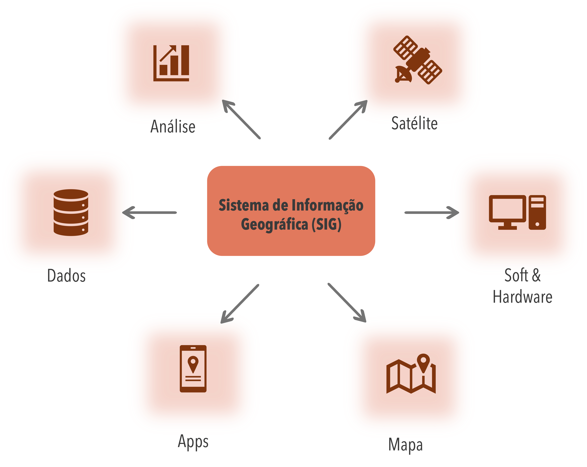
```


.footnote[<sup>1</sup> GIS: *Geographic Information System*]
---

# PPGECO | ECL0072 | out. 2026

### SIG | .small-text[<span style="color: #e07a5f;">*Softwares*</span>]

Há muitos softwares disponíveis para o tratamento e análise de dados espaciais

<br>

```{r, out.width="70%"}

```

<br>
<br>

--

> <span style="color: #e07a5f;">Sempre que possível, deve-se optar por softwares livres!</span>

---

# PPGECO | ECL0072 | out. 2026

### SIG | .small-text[<span style="color: #e07a5f;">Tipos de dados</span>]

Dados espaciais podem ser armazenados como *dados vetoriais* ou *dados matriciais* (i.e., *rasters*)

--

------

#### Dados vetoriais

.small-text2[

Representam dados cuja informação está armazenada em formas geométricas
- **Pontos**: representam pares de coordenadas (x,y)
- **Linhas**: definidas por dois ou mais pontos conectados
- **Polígono**: constituídos por múltiplos pontos conectados por linhas e que formam uma figura fechada 

]


```{r, out.width="90%"}
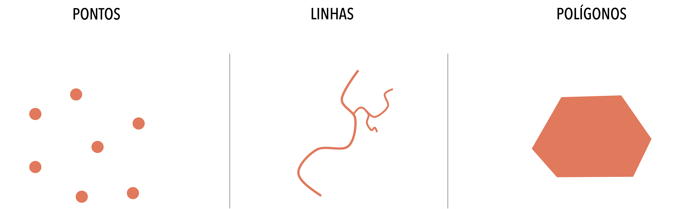
```


---
# PPGECO | ECL0072 | out. 2026

### SIG | .small-text[<span style="color: #e07a5f;">Tipos de dados</span>]

Dados espaciais podem ser armazenados como *dados vetoriais* ou *dados matriciais* (i.e., *rasters*)


------

#### Dados vetoriais

.small-text2[

Armazenados principalmente no formato *shapefile* (shp)
- Compostos por um conjunto de arquivos
  - `.shp:` contém a geometria dos dados  
  - `.dbf:` contém os atributos (informações) associados aos dados
  - `.shx:` índice espacial associada a geometria 
  - `.prj:` contém informação sobre a projeção e sistema de coordenadas 

]

--


.pull-left[

```{r, out.width="45%"}

```

]


.pull-right[

<br>
<br>

.gray-box-small[

O pacote **sf** é o principal pacote para o manuseio de *shapefiles*
]


]

.footnote[https://r-spatial.github.io/sf/]

---
# PPGECO | ECL0072 | out. 2026

### SIG | .small-text[<span style="color: #e07a5f;">Tipos de dados</span>]

Dados espaciais podem ser armazenados como *dados vetoriais* ou *dados matriciais* (i.e., *rasters*)


------
#### *Rasters*


São dados que representam uma área geográfica como uma grade regular de células (i.e., *pixels*)
- Cada pixel pode armazenar um ou mais valores de alguma variável ambiental (e.g., temperatura, batimetria, pluviometria, ...)

---
# PPGECO | ECL0072 | out. 2026

### SIG | .small-text[<span style="color: #e07a5f;">Tipos de dados</span>]

Dados espaciais podem ser armazenados como *dados vetoriais* ou *dados matriciais* (i.e., *rasters*)

-----

#### *Rasters*


```{r, out.width="70%"}
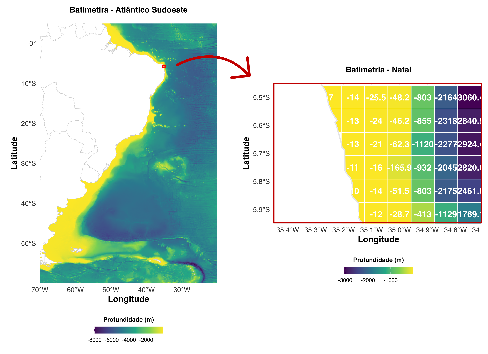
```


---
# PPGECO | ECL0072 | out. 2026

### SIG | .small-text[<span style="color: #e07a5f;">Tipos de dados</span>]

Dados espaciais podem ser armazenados como *dados vetoriais* ou *dados matriciais* (i.e., *rasters*)

-----

#### *Rasters*

<br>

.small-text2[

Armazenados principalmente nos formatos *GeoTIFF* e *NetCDF*


]


.pull-left[

<br>
<br>

.gray-box-small[

O pacote **terra** é o principal pacote para o manuseio de *rasters*
]


]

.pull-right[

```{r, out.width="45%"}

```

]


.footnote[https://rspatial.github.io/terra/]


---
# PPGECO | ECL0072 | out. 2026

### SIG | .small-text[<span style="color: #e07a5f;">Sistema de Coordenadas Geográficas</span>]

O sistema de coordenadas geográficas<sup>1</sup>  define a origem e a unidade das coordenadas espaciais 

- A definição do CRS é muito importante para manipular, analisar e visualisar dados espaciais
  - Especialmente quando dados espaciais de diferentes fontes são usados!

<br>

.footnote[<sup>1</sup>Coordinate Reference System (CRS)]


--

- Os locais na terra podem ser referenciados de acorco com CRS:
  - referenciados
  - não referenciados


---
# PPGECO | ECL0072 | out. 2026

### SIG | .small-text[<span style="color: #e07a5f;">Sistema de Coordenadas Geográficas</span>]

#### CRS não referenciado

Também conhecido por **sistema de coordenada geográfica/angular**

- Define os locais na superfície elipsoidal tridimensional da Terra com base nos valores de latitude/longitude


```{r, out.width="80%"}
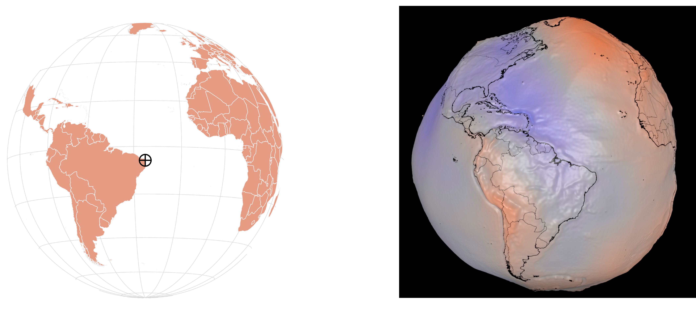
```


.footnote[https://svs.gsfc.nasa.gov/5660/]

---
# PPGECO | ECL0072 | out. 2026

### SIG | .small-text[<span style="color: #e07a5f;">Sistema de Coordenadas Geográficas</span>]

#### CRS não referenciado


.small-text[
- **Latitude:** mede o ângulo ao norte ou ao sul do equador (0 graus) 
  - Varia de -90<sup>∘</sup> (sul) a 90<sup>∘</sup> (norte)


- **Longitude:** mede os ângulos a oeste ou leste do meridiano principal (greenwhich) 
  - Varia de -180<sup>∘</sup> (oeste) a 180<sup>∘</sup> (leste)

]


.pull-left[
```{r, out.width="85%"}
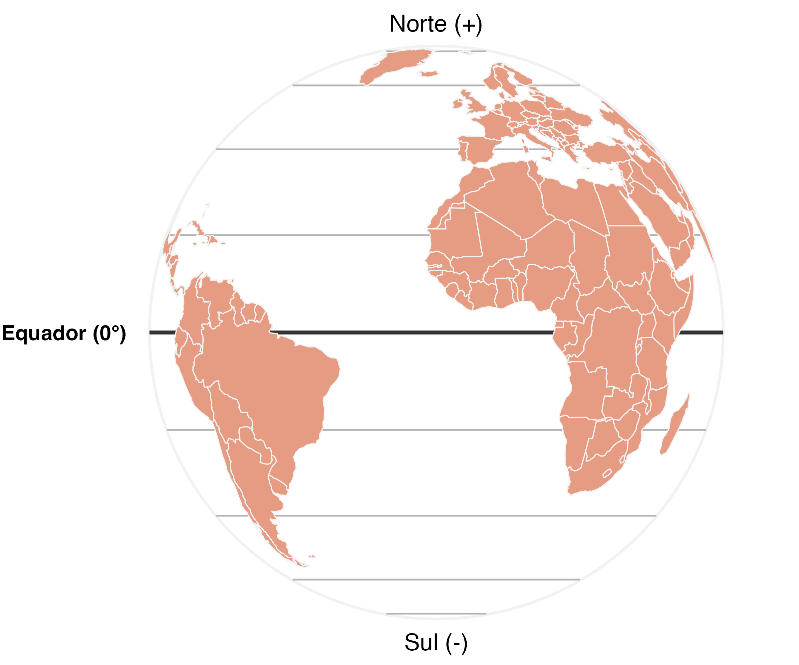
```
]

.pull-right[

```{r, out.width="85%"}
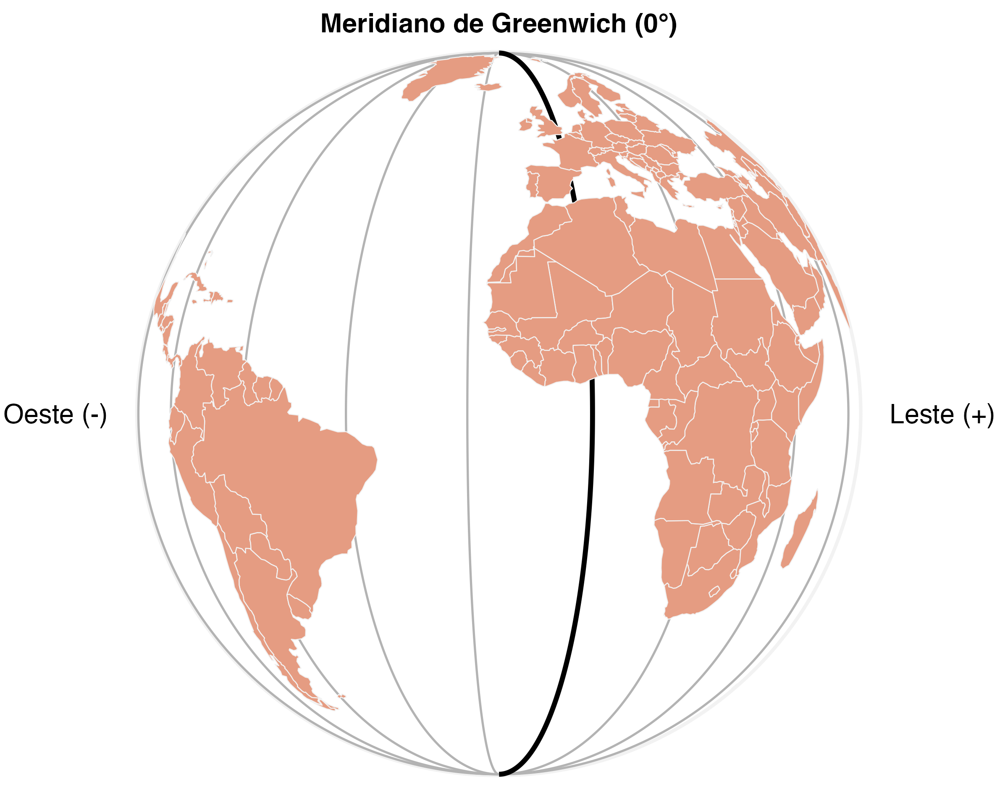
```

]

---
# PPGECO | ECL0072 | out. 2026

### SIG | .small-text[<span style="color: #e07a5f;">Sistema de Coordenadas Geográficas</span>]

#### CRS não referenciado


.pull-left[


As coordenadas precisam ser calculadas em relação a um elipsoide de referência, cuja posição, tamanho e orientação são definidas pelo datum

- **Elipsoide**: modelo matemático da Terra

- **Datum**: posiciona o elipsóide em relação à Terra

<br>
<br>

.small-text2[
.center[**Exemplos:**]
<br>
.gray-box[WGS84, SIGRAS 2000, SAD69, NAD83, ...]

]

]

.pull-right[

```{r, out.width="85%"}
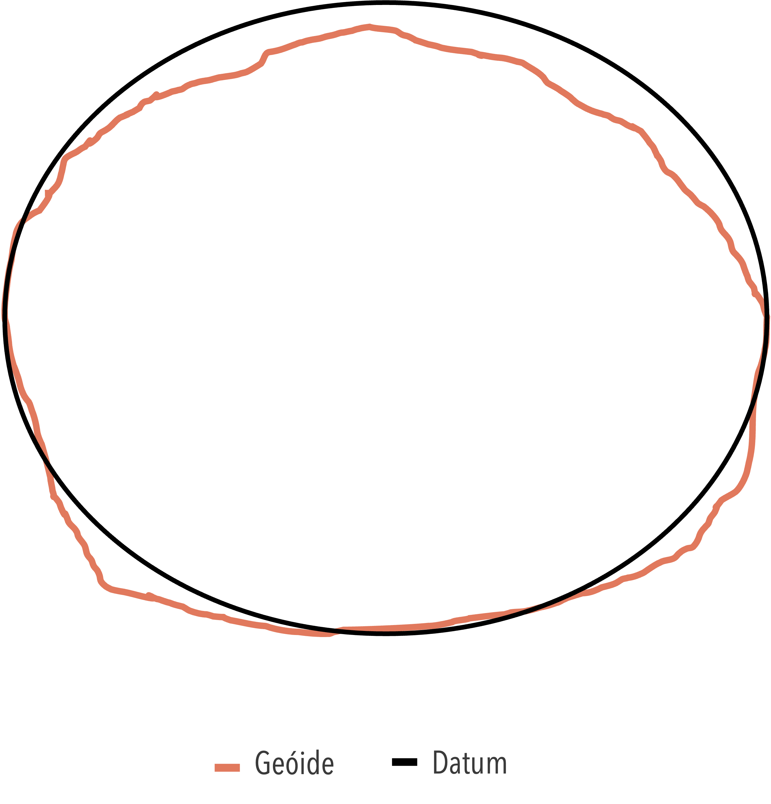
```

]


---


# PPGECO | ECL0072 | out. 2026

### SIG | .small-text[<span style="color: #e07a5f;">Sistema de Coordenadas Geográficas</span>]

#### CRS referenciado

Um *CRS referenciado* usa coordenadas cartesianas para referenciar uma localização em uma representação bidimensional da Terra.

<br>


.pull-left[

```{r, out.width="90%"}
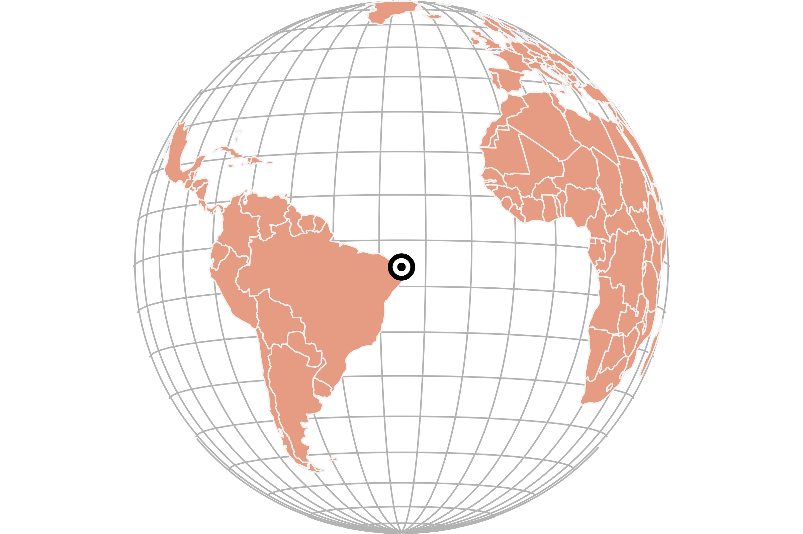
```

]


.pull-right[
```{r, out.width="90%", fig.align='left'}
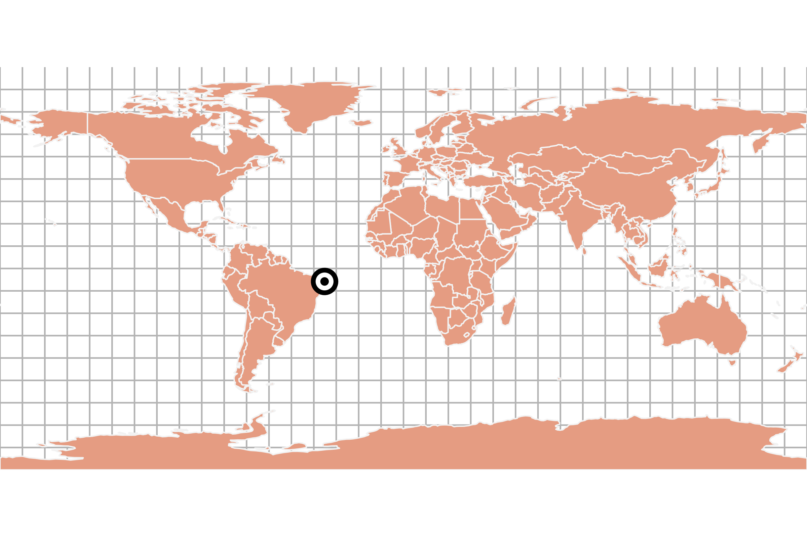
```

]


---
# PPGECO | ECL0072 | out. 2026

### SIG | .small-text[<span style="color: #e07a5f;">Sistema de Coordenadas Geográficas</span>]

#### CRS referenciado

Todas as projeções produzem alguma distorção da superfície terrestre e, por consequência, não podem preservar simultaneamente as propriedades de área, distância ou direção

<div style="height: 7px;"></div>


##### Tipos de projeções

<div style="height: 7px;"></div>


```{r, out.width="70%"}
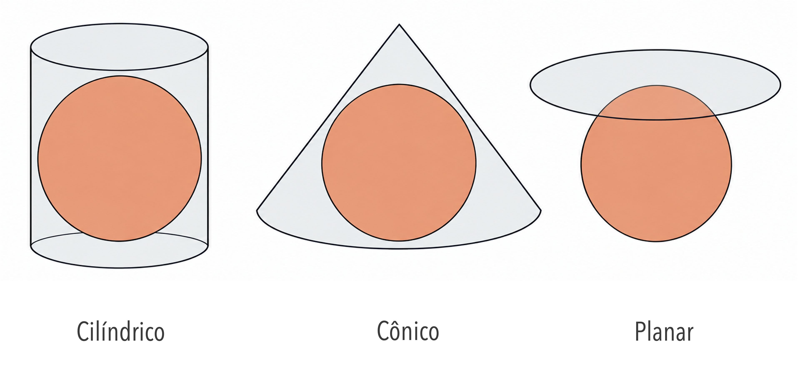
```

---
# PPGECO | ECL0072 | out. 2026

### SIG | .small-text[<span style="color: #e07a5f;">Sistema de Coordenadas Geográficas</span>]

#### CRS referenciado

##### Tipos de projeções | Projeção cilíndrica


.center[**Exemplo: projeção de Mercator**]


```{r, out.width="80%"}
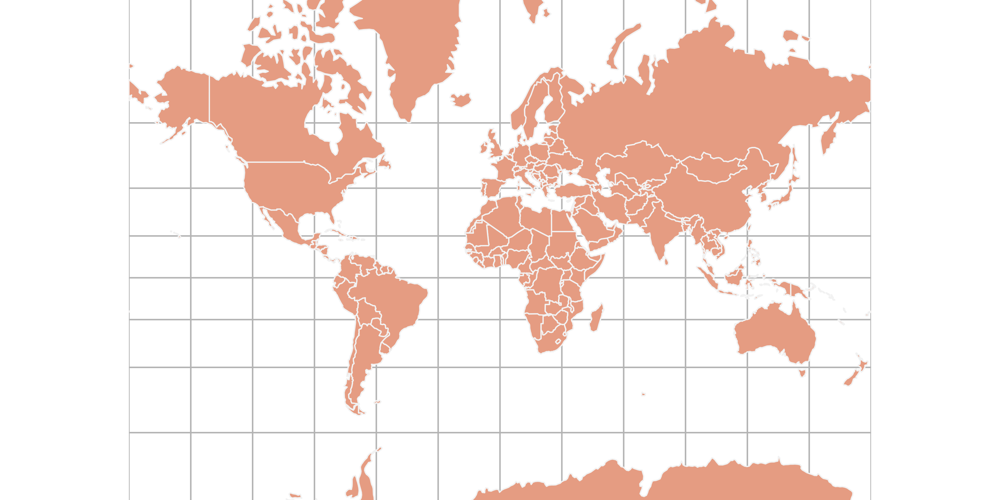
```

---
# PPGECO | ECL0072 | out. 2026

### SIG | .small-text[<span style="color: #e07a5f;">Sistema de Coordenadas Geográficas</span>]

#### CRS referenciado

##### Tipos de projeções | Projeção cilíndrica


.center[**Exemplo: projeção Universal Transversa de Mercator**]


```{r, out.width="80%"}
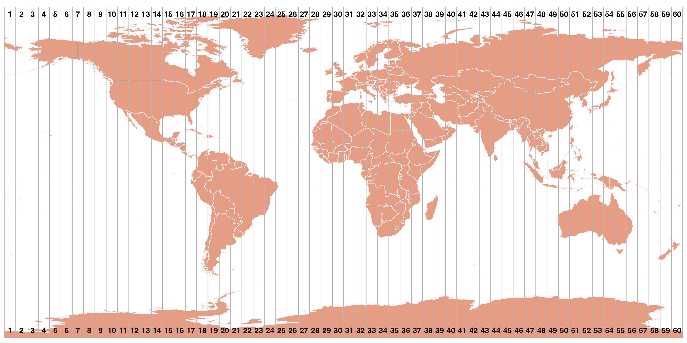
```


---
# PPGECO | ECL0072 | out. 2026

### SIG | .small-text[<span style="color: #e07a5f;">Sistema de Coordenadas Geográficas</span>]

#### CRS referenciado

##### Tipos de projeções | Projeção cônica


.center[**Exemplo: projeção cônica equidistante**]


```{r, out.width="45%"}
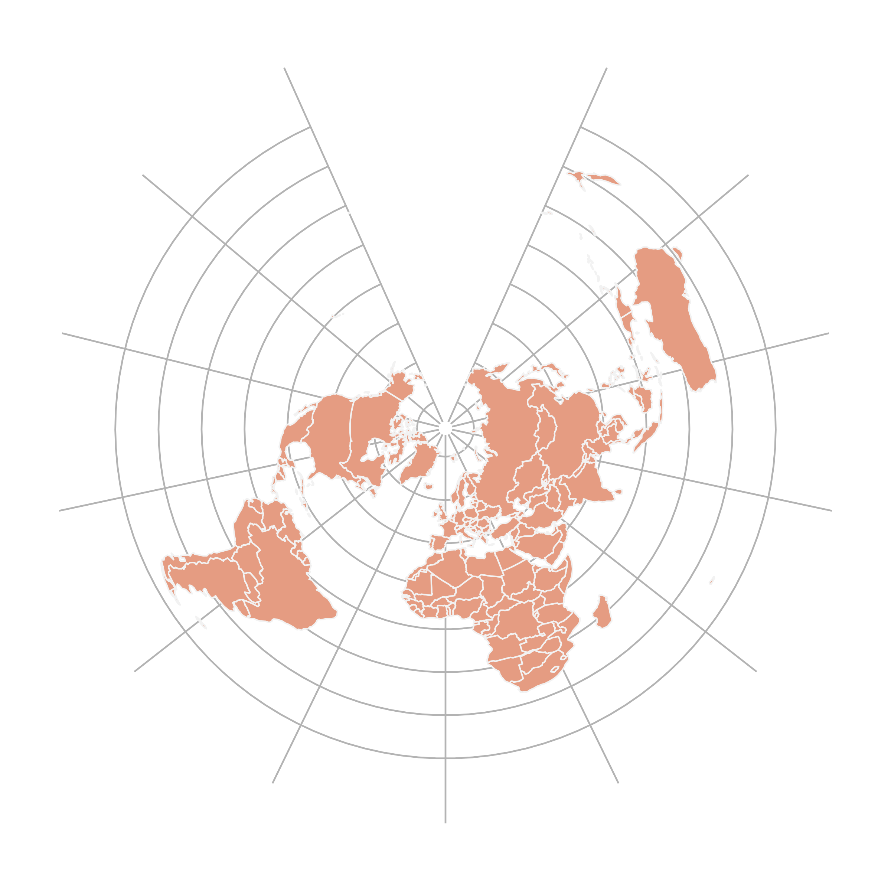
```


---
# PPGECO | ECL0072 | out. 2026

### SIG | .small-text[<span style="color: #e07a5f;">Sistema de Coordenadas Geográficas</span>]

#### CRS referenciado

##### Tipos de projeções | Projeção planar


.center[**Exemplo: projeção Azimutal**]


```{r, out.width="45%"}
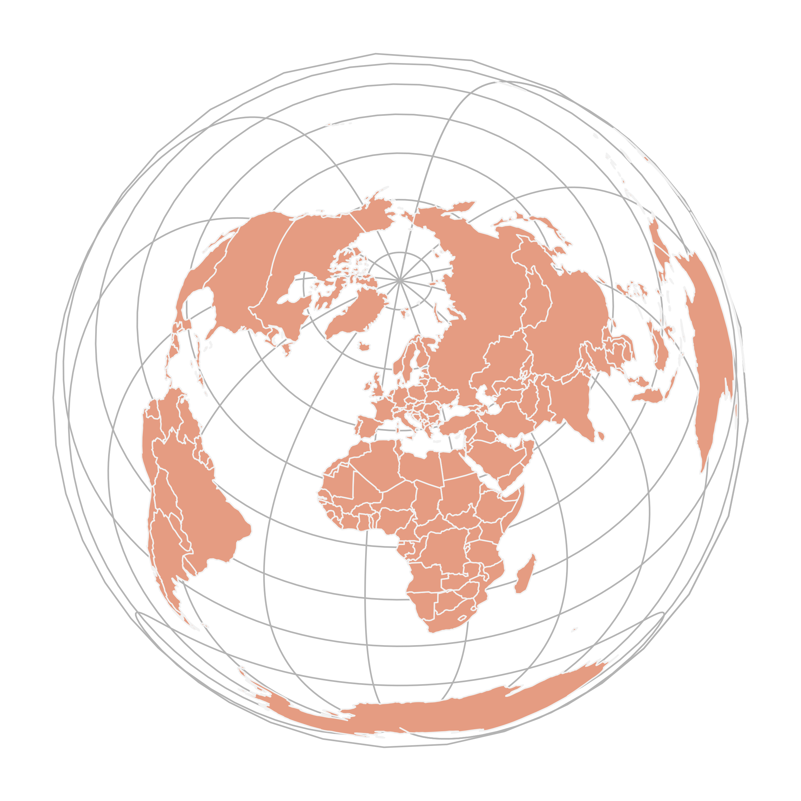
```

---

# PPGECO | ECL0072 | out. 2026

### SIG | .small-text[<span style="color: #e07a5f;">Sistema de Coordenadas Geográficas</span>]

#### Adendo: cartografia é geopolítica!


<br>


```{r, out.width="90%"}
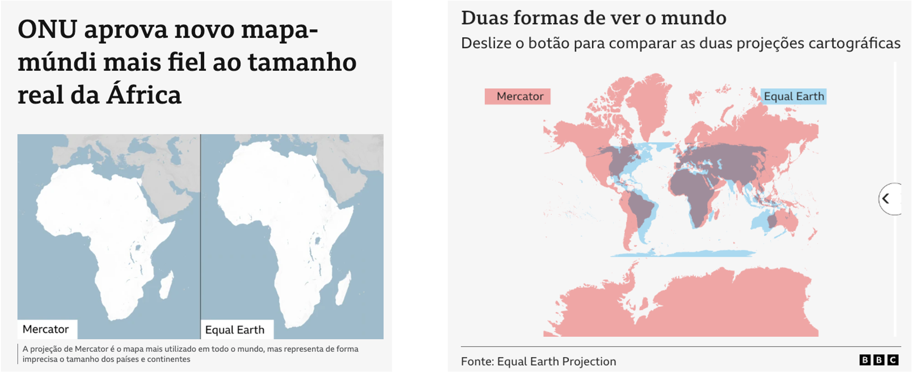
```


.footnote[Fonte: https://www.bbc.com/portuguese/articles/c3058301rl8o]

---

# PPGECO | ECL0072 | out. 2026

### SIG | .small-text[<span style="color: #e07a5f;">Sistema de Coordenadas Geográficas</span>]

#### CRS 

Na prática, a maioria dos CRS podem ser especificados de acordo com o código **EPGS**<sup>1</sup> ou *Proj4* (desuso)

- EPSG é um identificador numérico único que representa o CRS, incluindo o datum, o sistema de coordenadas e, quando aplicável, a projeção cartográfica

  - Exemplos:
    - EPSG 4326 (WGS 84)
    - EPSG 4674 (SIRGAS 2000)
    - [Outros exemplos](https://spatialreference.org/ref/?search=wgs84)


.footnote[<sup>1</sup>*European Petroleum Survey Group*]

---

**Ebooks recomendados**
https://rspatial.org/index.html (cap. 2)
https://bookdown.org/tep/gis/index.html (cap. 4)
https://tmap.geocompx.org/

---
- The analysis of spatial patterns is of prime interest to ecologists because most ecological phenomena investigated by sampling geographic space are structured by forces that have spatial components. 

- The distribution of species result from the combined action of external and internal forces. Both types of forces generate spatial patterns within species or communities.
  - External forces: environmental characteristics
  - Internal forces: population dynamics and/or top-down/bottom-up biotic interactions

---

The absence of significant coefficients in a correlogram must be interpreted with caution, however:
- It may indicate that the surface under study is free of spatial autocorrelation at the study scale. Beware: this conclusion is subject to type II (or β) error. 
- It may indicate that the sampling design is inadequate to detect the spatial autocorrelation that may exist in the system. Are the grain size, extent and sampling interval (Section13.0) adequate to detect the type of autocorrelation one can hypothesize from knowledge about the biological or ecological process under study?

---

Spatial structures are a major source of false correlations, which are not indicative of causal relationships. Spatial autocorrelation may cause correlations to appear between autocorrelated variables, due to spatial structures that are generated by the autocorrelation in the data; examples of such structures are the “false gradients” described in Subsection 13.1.2. The question is the following: is there a significant amount of correlation between the response and explanatory variables, besides some common spatial structure which may be non-causal? The interest here is in fraction [a] of Figs. 10.10 and 13.27, which corresponds to the “explanation” (in the sense of Subsection10.2.1) of the response data (Y) by the explanatory environmental variables (X) after the common spatial structure (fraction [b]) has been controlled for. If the analysis of the spatial structure of Y is also of interest, it should be carried out independently of that of X. If fraction [b] is large, the hypothesis that it indicates false correlations between autocorrelated variables in matrices Y and X is supported if new data, obtained by sampling at a different spatial scale, fail to produce a large fraction[b]. Nested sampling designs, as used for instance in Ecological application 13.1b, are a way of obtaining data sets for modelling at more than one spatial scale.

If both the spatial and non-spatial structures of the explanatory variables are assumed to be causal to the spatial variation of Y, fraction [a + b] (instead of fraction [a] alone, as above) empirically measures the support to the hypothesis of causal relationship between the response and explanatory variables. One may or may not be interested in breaking it down into a purely environmental fraction ([a] in Fig. 10.10 and 13.27) and a spatially-structured environmental effect (fraction [b]). One may be interested, however, in determining whether the response data (Y) have some spatial structure of their own (fraction [c]) which is not explained by the explanatory variables in the model. If such a structure is found, reasons for its existence are worth investigating. It may be caused by environmental variables that have not been included in the analysis, by historical events, or by population or community dynamic processes that may be masked by some dominant environmental effect (Borcard & Legendre, 1994). In this approach, any spatial structure identified in the response data set is considered an indication of the presence of some process generating it. Mapping fraction [c] of the variation may help generate hypotheses about the processes responsible for the observed residual spatial pattern.

```{r, out.width= "100%"}
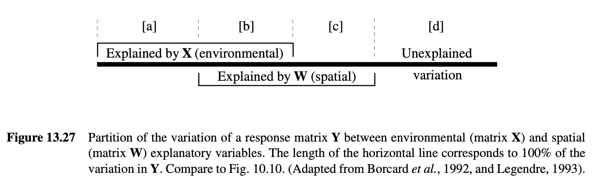
```

---
Estruturas de Dependência nos Dados Ecológicos
│
├── 1. Estrutura Discreta / Hierárquica (Grupos / Níveis)
│   ├── Exemplo: Peixes dentro de Recifes, Plantas dentro de Parcelas.
│   ├── Abordagem: Modelos Misto Padrão (Efeitos Aleatórios por grupo: 1 | grupo).
│   └── A dependência é assumida IGUAL para todos os membros do mesmo grupo.
│
└── 2. Estrutura Contínua (Espaço / Tempo / Filogenia)
    ├── Exemplo: Coordenadas (X, Y) no mar/oceano, Séries temporais de CPUE (anos/meses).
    ├── Abordagem: Matrizes de autocorrelação espacial/temporal (ex: Matern, CAR, AR1, INLA/SPDE).
    └── A dependência diminui conforme a DISTÂNCIA no espaço ou tempo aumenta.


---
