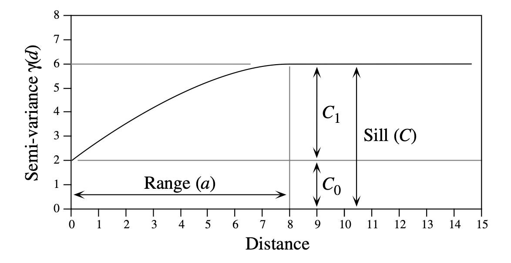

```{r xaringan-themer, include=FALSE, warning=FALSE}


#~~~~~~~~~~~~~~~~~~~~~~
# Default knitr iputs
#~~~~~~~~~~~~~~~~~~~~~~

source("../Scripts/Setup/setup_knitr.R")

#~~~~~~~~~~~~~~~~~~~~~~
# Slide customization
#~~~~~~~~~~~~~~~~~~~~~~
source("../Scripts/Setup/setup_slides.R")


```

class: title-slide
<div class="title-block">
  <h1>`r rmarkdown::metadata$title`</h1>
  <div class="date-text">`r rmarkdown::metadata$date`</div>
</div>

<div class="subtitle-block">
  <h2>`r rmarkdown::metadata$subtitle`</h2>
  <p class="author-name">`r rmarkdown::metadata$author`</p>
  <p class="author-email"><u>`r rmarkdown::metadata$institute`</u></p>
</div>


---
# PPGECO | ECL0072 | out. 2026

<br>

### Agenda


---
# PPGECO | ECL0072 | out. 2026

Leitura:
- Cap. 13 - Legendre & Legendre. Numerical ecology


---
# PPGECO | ECL0072 | out. 2026

<br>

A maioria dos dados ecológicos apresenta algum grau de estrutura espacial

- .small-text2[**Primeira lei da Geografia:** *Tudo está relacionado a todas as outras coisas, mas coisas próximas estão mais relacionadas do que coisas distantes*]


```{r, out.width ="100%"}
knitr::include_graphics("../Figuras/spatial_dependency.png")
```

---
# PPGECO | ECL0072 | out. 2026

### Padrões espaciais

Muitos padrões ecológicos podem ser descritos como manchas (*patches*) ou gradientes (lineares ou não)

- Examinar os padrões espaciais de espécies (ou comunidades) permite compreender os mecanismos que controlam suas distribuições


---
# PPGECO | ECL0072 | out. 2026

### Padrões espaciais

Muitos padrões ecológicos podem ser descritos como manchas (*patches*) ou gradientes (lineares ou não)

- Examinar os padrões espaciais de espécies (ou comunidades) permite compreender os mecanismos que controlam suas distribuições

----

Padrões espaciais podem ser encontrados em todas as escalas espaciais 

--

<div style="height: 7px;"></div>


.center[.small-text2[**ESCALA LOCAL**]]


```{r, out.width ="65%"}
knitr::include_graphics("../Figuras/spatial_dependency_small-scale.png")
```


---
# PPGECO | ECL0072 | out. 2026

### Padrões espaciais

Muitos padrões ecológicos podem ser descritos como manchas (*patches*) ou gradientes (lineares ou não)

- Examinar os padrões espaciais de espécies (ou comunidades) permite compreender os mecanismos que controlam suas distribuições

----

Padrões espaciais podem ser encontrados em todas as escalas espaciais 


<div style="height: 7px;"></div>


.center[.small-text2[**ESCALA REGIONAL**]]


```{r, out.width ="65%"}
knitr::include_graphics("../Figuras/spatial_dependency_regional-scale.png")
```

---
# PPGECO | ECL0072 | out. 2026

### Padrões espaciais

Muitos padrões ecológicos podem ser descritos como manchas (*patches*) ou gradientes (lineares ou não)

- Examinar os padrões espaciais de espécies (ou comunidades) permite compreender os mecanismos que controlam suas distribuições

----

Padrões espaciais podem ser encontrados em todas as escalas espaciais 


<div style="height: 7px;"></div>


.center[.small-text2[**ESCALA GLOBAL**]]


```{r, out.width ="65%"}
knitr::include_graphics("../Figuras/spatial_dependency_large-scale.png")
```

---
# PPGECO | ECL0072 | out. 2026

### Padrões espaciais

Dados ecológicos resultam naturalmente de processos espaciais aninhados e mutuamente confundidos

- É necessário desembaraçar as diferentes escalas espaciais que atuam sobre o processo ecológico 
  - **Estatística espacial!**


```{r, out.width ="85%"}
knitr::include_graphics("../Figuras/spatial_dependency_all-scales.png")
```


---
# PPGECO | ECL0072 | out. 2026

### Padrões espaciais


“Spatial patterns usually result from a mixture of both exogenous (‘induced’) and endogenous (‘inherent’) processes, resulting in spatial dependence among organisms. ”


---

- “Ecological data usually include several spatial scale patterns which are confounded (Figure 1.4): (1) trends at larger scales, (2) patchiness at intermediate and local scales, and (3) random fluctuations or noise at the smallest scale. Therefore, ecological data are the result of embedded and confounded processes; hence, as ecologists, we try to disentangle the spatial scales of these processes using spatial analysis.”

- “The components that affect our ability to identify spatial patterns and their underlying processes accurately are numerous, but they can be organized into three categories (Figure 1.8; Dungan et al. 2002): (1) the extent of spatial expression of the processes themselves; (2) the sampling design used to measure ecological data (sample versus population data; local versus global level); and (3) the statistical tools used to characterize the spatial pattern of either the entire sampling area (i.e. global spatial statistics) or each sampling location (i.e. local spatial statistics).”


Excerpt From
Spatial Analysis: A Guide For Ecologists
Mark R. T. Dale
This material may be protected by copyright.

---

# Sampling design

“determination of the appropriate spatial and temporal domains of the study is one of the most important steps in data analysis from which all subsequent statistical and ecological interpretations will be either meaningful or meaningless. The spatial and temporal scales are therefore important in the definition and testing of ecological hypotheses and we comment about the key components to consider while testing statistically ecological hypotheses given inherent and induced spatial dependency in the data.”

“Any sampling design for studying ecological processes imposes a template, or filter, with its own specific temporal and spatial units. To be efficient, a sampling design needs to be thought out and crafted carefully by a series of steps to obtain meaningful insights about the ecological processes (see Figures 1.1 and 1.4):”
- “(1) define explicitly the spatial and temporal domains of expression of the process(es) under study;
-  (2) determine that the spatial and temporal resolution of the sampling design is able to capture the process under study;
- (3) ensure that the spatial and statistical analyses are appropriate for the data type. These three steps interact with each other and must be considered together before conducting any sampling of ecological data in a spatial context (Fortin et al. 1989; Dungan et al. 2002). In essence, design of an optimal spatial sampling scheme requires a careful balance between samples that are too close to one another, thus not providing enough new information (data highly autocorrelated), and samples that are too sparse, so that processes at other spatial scales introduce too much variability (Haining 1990).”


Excerpt From
Spatial Analysis: A Guide For Ecologists
Mark R. T. Dale
This material may be protected by copyright.

---

# Sampling design

- Sample size: “In any ecological study, the choice of the sample size ‘n’ is one of the most important decisions. In the context of spatial analysis, this choice needs to be guided by the minimum requirement for subsequent spatial statistics and analysis ”

- Spatial resolution: “The detection of spatial pattern is also directly related to the spatial scale at which ecological data are measured (Figures 1.3 and 1.9). Spatial scale has at least two aspects: the size of the study area, or ‘extent’, and the size of the sampling unit used to collect the data, the ‘sampling grain’. The extent is the total area under consideration and aims to capture the domain of the “ecological process under study, while grain refers to the minimum spatial resolution at which information is measured. Several studies have showed that spatial statistics are very sensitive to both of these resolution aspects”


Excerpt From
Spatial Analysis: A Guide For Ecologists
Mark R. T. Dale
This material may be protected by copyright.


---

- The analysis of spatial patterns is of prime interest to ecologists because most ecological phenomena investigated by sampling geographic space are structured by forces that have spatial components. 

- The distribution of species result from the combined action of external and internal forces. Both types of forces generate spatial patterns within species or communities.
  - External forces: environmental characteristics
  - Internal forces: population dynamics and/or top-down/bottom-up biotic interactions


- Scale is a key concept in both sampling design and the analysis of spatial (or temporal) patterns. 
  - In sampling theory (Fig. 13.1), spatial scale encompasses three elements of the sampling design:
    - Grain size is the size of the elementary sampling units. It may be expressed as the diameter, surface or volume of matter supporting the measurements. In time series analysis, it is the duration over which measurements are integrated. The resolution of a study (Schneider, 1994) is equal to the grain size of its sampling design.
    - Sampling interval is the average distance between neighbouring sampling units. It is called lag in time series analysis. For fixed extent, the sampling interval is a function of n, the number of sampling units. In turn, n is determined by the total effort that can be allocated to sampling.
    - Extent is the total length, area or volume included in the study, or the total duration of the time series. It is called range by Schneider (1994) who also defines the scope as the ratio of the extent to the grain size.

- The scale of the sampling design should follow from what is known (e.g. from a pilot study) about the scale of the pattern or process, and from the ecological question being addressed.

- The extent and grain define the observation window in spatial pattern analysis. No structure can be detected which is smaller than the grain or larger than the extent of a study.

---
### Objetivos de mapear a distribuição


---

### Autocorrelação espacial

Spatial structures may be described through structure functions, which allow one to quantify the spatial dependency and partition it amongst distance classes.
- The most commonly used structure functions are correlograms, and variograms

- A correlogram is a graph in which autocorrelation values are plotted, on the ordinate, against distance classes among sites on the abscissa. Correlograms (Cliff & Ord 1981) can be computed for single variables (Moran’s I or Geary’s c autocorrelation coefficients, Subsection1) or for multivariate data (Mantel correlogram, Subsection 5); 

- Similarly, a variogram is a graph in which semi-variance is plotted, on the ordinate, against distance classes among sites on the abscissa (Subsection3). Statistical models may be fitted to variograms (linear, exponential, spherical, Gaussian, etc.); they allow the investigator to relate the observed structure to hypothesized generating processes or to produce interpolated maps by kriging

Because they measure the relationship between pairs of observation points located a certain distance apart, correlograms and variograms may be computed either for preferred geographic directions or, when the phenomenon is assumed to be isotropic in space, in an all-directional way.

---

### Correlogram

- Apresentar o Moran's I statistics

Moran’s I formula is related to Pearson’s correlation coefficient; its numerator is a covariance, comparing the values found at all pairs of points in turn, while its denominator is the maximum-likelihood estimator of the variance (i.e. division by n instead of n – 1); in Pearson’s r, the denominator is the product of the standard deviations of the two variables (eq. 4.7), whereas in Moran’s I there is only one variable involved. Moran’s I mainly differs from Pearson’s r in that the sums in the numerator and denominator of eq. 13.1 do not involve the same number of terms; only the terms corresponding to distances within the given class are considered in the numerator whereas all pairs are taken into account in the denominator. Moran’s I usually takes values in the interval [–1, +1] although values lower than –1 or higher than +1 may occasionally be obtained. Positive autocorrelation in the data translates into positive values of I; negative autocorrelation produces negative values.

Readers who are familiar with correlograms in time series analysis will be reassured to know that, when a problem involves equispaced observations along a single physical dimension, as in Fig. 13.3, calculating Moran’s I for the different distance classes is nearly the same as computing the autocorrelation coefficient of time series analysis (Fig. 12.5, eq. 12.6); a small numeric difference results from the divisions by (n – k – 1) and (n – 1), respectively, in the numerator and denominator of eq. 12.6, whereas division is by (n – k ) and (n ), respectively, in the numerator and denominator of Moran’s I formula (eq. 13.1).


Spatial autocorrelation coefficients can be tested for significance and confidence intervals can be computed. Tests of significance require, however, that certain conditions specified below be fulfilled.


Moran’s I and Geary’s c are sensitive to extreme values and, in general, to asymmetry in the data distributions, as are the related Pearson’s r and Euclidean distance coefficients. Asymmetry increases the variance of the data.
The tests require that the condition of second-order stationarity be satisfied. This rather strong condition states that the expected value (mean) and spatial covariance (numerator of eq. 13.1) of the variable is the same all over the study area, and the variance (denominator of eq. 13.1) is finite. 

---

### Interpretation of all-directional correlograms

When the autocorrelation function is the same for all geographic directions considered, the phenomenon is said to be isotropic. Its opposite is anisotropy. When a variable is isotropic, a single correlogram may be computed over all directions of the study area.


```{r, out.width= "100%"}
knitr::include_graphics("../Figuras/Correlograms.png")
```


---

The absence of significant coefficients in a correlogram must be interpreted with caution, however:
- It may indicate that the surface under study is free of spatial autocorrelation at the study scale. Beware: this conclusion is subject to type II (or β) error. 
- It may indicate that the sampling design is inadequate to detect the spatial autocorrelation that may exist in the system. Are the grain size, extent and sampling interval (Section13.0) adequate to detect the type of autocorrelation one can hypothesize from knowledge about the biological or ecological process under study?

---

### Variograma

Like correlograms, semi-variograms (called variograms for simplicity) decompose the spatial (or temporal) variability of observed variables among distance classes. 
- This provides the sample variogram, which is a plot of the empirical values of variance γ(d) as a function of distance d.


```{r, out.width= "100%"}

```


- Although a sample variogram is a good descriptive summary of the spatial contiguity of a variable, it does not provide all the semi-variance values needed for kriging 

---

Spatial structures are a major source of false correlations, which are not indicative of causal relationships. Spatial autocorrelation may cause correlations to appear between autocorrelated variables, due to spatial structures that are generated by the autocorrelation in the data; examples of such structures are the “false gradients” described in Subsection 13.1.2. The question is the following: is there a significant amount of correlation between the response and explanatory variables, besides some common spatial structure which may be non-causal? The interest here is in fraction [a] of Figs. 10.10 and 13.27, which corresponds to the “explanation” (in the sense of Subsection10.2.1) of the response data (Y) by the explanatory environmental variables (X) after the common spatial structure (fraction [b]) has been controlled for. If the analysis of the spatial structure of Y is also of interest, it should be carried out independently of that of X. If fraction [b] is large, the hypothesis that it indicates false correlations between autocorrelated variables in matrices Y and X is supported if new data, obtained by sampling at a different spatial scale, fail to produce a large fraction[b]. Nested sampling designs, as used for instance in Ecological application 13.1b, are a way of obtaining data sets for modelling at more than one spatial scale.

If both the spatial and non-spatial structures of the explanatory variables are assumed to be causal to the spatial variation of Y, fraction [a + b] (instead of fraction [a] alone, as above) empirically measures the support to the hypothesis of causal relationship between the response and explanatory variables. One may or may not be interested in breaking it down into a purely environmental fraction ([a] in Fig. 10.10 and 13.27) and a spatially-structured environmental effect (fraction [b]). One may be interested, however, in determining whether the response data (Y) have some spatial structure of their own (fraction [c]) which is not explained by the explanatory variables in the model. If such a structure is found, reasons for its existence are worth investigating. It may be caused by environmental variables that have not been included in the analysis, by historical events, or by population or community dynamic processes that may be masked by some dominant environmental effect (Borcard & Legendre, 1994). In this approach, any spatial structure identified in the response data set is considered an indication of the presence of some process generating it. Mapping fraction [c] of the variation may help generate hypotheses about the processes responsible for the observed residual spatial pattern.

```{r, out.width= "100%"}
knitr::include_graphics("../Figuras/Env_vs_spatial_variance.png")
```

---
Estruturas de Dependência nos Dados Ecológicos
│
├── 1. Estrutura Discreta / Hierárquica (Grupos / Níveis)
│   ├── Exemplo: Peixes dentro de Recifes, Plantas dentro de Parcelas.
│   ├── Abordagem: Modelos Misto Padrão (Efeitos Aleatórios por grupo: 1 | grupo).
│   └── A dependência é assumida IGUAL para todos os membros do mesmo grupo.
│
└── 2. Estrutura Contínua (Espaço / Tempo / Filogenia)
    ├── Exemplo: Coordenadas (X, Y) no mar/oceano, Séries temporais de CPUE (anos/meses).
    ├── Abordagem: Matrizes de autocorrelação espacial/temporal (ex: Matern, CAR, AR1, INLA/SPDE).
    └── A dependência diminui conforme a DISTÂNCIA no espaço ou tempo aumenta.


---

# Leitura

- Cap. 13 - Legendre & Legendre (1998). Numerical ecology. 2nd ed.
