```{r xaringan-themer, include=FALSE, warning=FALSE}


#~~~~~~~~~~~~~~~~~~~~~~
# Default knitr iputs
#~~~~~~~~~~~~~~~~~~~~~~

source("../Scripts/Setup/setup_knitr.R")

#~~~~~~~~~~~~~~~~~~~~~~
# Slide customization
#~~~~~~~~~~~~~~~~~~~~~~
source("../Scripts/Setup/setup_slides.R")


```

class: title-slide
<div class="title-block">
  <h1>`r rmarkdown::metadata$title`</h1>
  <div class="date-text">`r rmarkdown::metadata$date`</div>
</div>

<div class="subtitle-block">
  <h2>`r rmarkdown::metadata$subtitle`</h2>
  <p class="author-name">`r rmarkdown::metadata$author`</p>
  <p class="author-email"><u>`r rmarkdown::metadata$institute`</u></p>
</div>


---
# PPGECO | ECL0072 | out. 2026

<br>

### Agenda


---
# PPGECO | ECL0072 | out. 2026
### Recapitulando

Dados espaciais constituem uma realização parcial do **campo aleatório** 
- Conjunto de variáveis aleatórias indexadas pelo espaço (2D)

<br>
<br>


.pull-left[

```{r, out.width="100%"}
knitr::include_graphics("../Figuras/grf2.png")
```


]


.pull-right[

<br>
<br>


$$\large \eta(s_i) =  X(s_i)\beta + W(s_i) + \varepsilon(s_i)$$

$$W(s_i) \sim GRF(0, \Sigma)$$

$$\varepsilon(s_i) \sim N(0, \sigma^2)$$
]


---
# PPGECO | ECL0072 | out. 2026
### Recapitulando


O principal objetivo da estatística espacial está na descrição da dependência espacial entre observações

$$\large W(s) \sim GRF(0, \Sigma)$$

onde a matriz de variância-covariância $\Sigma$ descreve como o campo aleatório espacial é correlacionado
- A construção da matriz depende do tipo de dado espacial<sup>1</sup>
  - A essência é a mesma: correlação entre observações é ditada pela proximidade espacial entre observações 


.footnote[<sup>1</sup> Dados geoestatísticos, de área e de processos pontuais]

--

<br>

.gray-box-big[ .center[**Foco da aula** ]


MODELOS GEOESTATÍSTICOS

]


---
# PPGECO | ECL0072 | out. 2026
### Modelos geoestatísticos

Breve contexto histórico & expor aplicações na ecologia

---
# PPGECO | ECL0072 | out. 2026
### Modelos geoestatísticos

Em abordagens geoestatísticas clássicas, a dependência espacial é especificada por meio da função de semivariograma
- Determina a matriz de variância-covariância do campo aleatório


$$\gamma(h) = \frac{1}{2N(h)} \sum\limits_{i=1}^{N(h)} (y_i-y_{i+h})^2$$
<div style="height: 7px;"></div>


```{r, out.width="60%"}
knitr::include_graphics("../Figuras/variogram_models.png")
```

---
# PPGECO | ECL0072 | out. 2026
### Modelos geoestatísticos


O gargalo da geoestatística clássica consiste na fatoração de $\Sigma$ quando o número de observações ($n$) é grande 
- $\Sigma$ é uma matriz de dimensão $n ~\text{x}~ n$
  - Número de operações cresce na ordem de $n^3$ ($\mathcal{O}(n^3)$)
    - *Big 'n' problem* [(Lindren et al., 2011)](https://academic.oup.com/jrsssb/article-abstract/73/4/423/7034732?redirectedFrom=fulltext)

--

<br>

Uma solução é tornar a matriz esparsa $\Sigma^{-1} = Q$ 


---
# PPGECO | ECL0072 | out. 2026
### Modelos geoestatísticos

Para obter a matriz de precisão esparsa $\mathbf{Q}$, recorre-se Equação Diferencial Parcial Estocástica (SPDE; *Stochastic Partial Differential Equations*)
  - Aproxima o campo aleatório Gaussiano (GRF) contínuo, com covariância de Matérn, em um Campo Aleatório Gaussiano Markoviano (GMRF) discreto, definido sobre os nós de uma malha (*mesh*)

<br>


```{r, out.width="75%"}
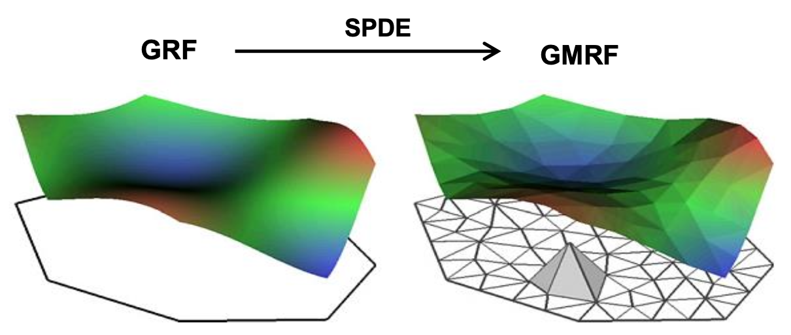
```


.footnote[Figura adaptada de [Simpson et al., 2012](https://www.sciencedirect.com/science/article/abs/pii/S2211675312000048?via%3Dihub)]

---
# PPGECO | ECL0072 | out. 2026
### Modelos geoestatísticos


**O que significa a propriedade Markoviana na prática?**

Um ponto $s_i$ depende apenas de seus vizinhos imediatos (independência condicional)
- Se $s_i$ e $s_j$ não são vizinhos diretos -> $Q_{ij} = 0$
  - A matriz $\mathbf{Q}$ torna-se esparsa, i.e., cheia de zeros

<div style="height: 7px;"></div>


```{r, out.width="70%"}
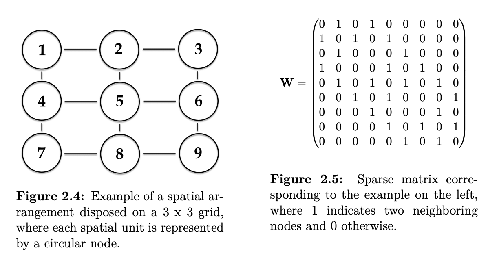
```

<br>


.footnote[Figura: [Rufener, 2020](https://backend.orbit.dtu.dk/ws/portalfiles/portal/239528217/Marie_Christine_Rufener_thesis.pdf)]
---
# PPGECO | ECL0072 | out. 2026
### Modelos geoestatísticos

**E por que é usada a função de covariância de Matérn?**

<div style="height: 7px;"></div>


$$\mbox{Cov}(Y(\boldsymbol{s}_i), Y(\boldsymbol{s}_j))=\frac{\sigma^2}{2^{\nu-1}\Gamma(\nu)}(\kappa ||\boldsymbol{s}_i - \boldsymbol{s}_j ||)^\nu K_\nu(\kappa ||\boldsymbol{s}_i - \boldsymbol{s}_j ||)$$

<div style="height: 4px;"></div>


```{r, out.width="90%"}
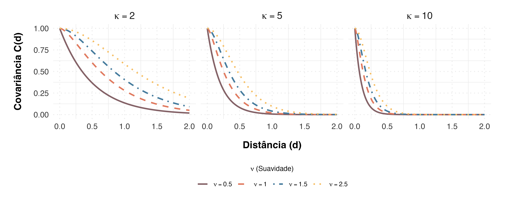
```

.small-text[
onde:
- $\kappa:$ controla a taxa de decaimento da covariância em função da distância
- $\nu:$ controla a suavidade do campo aleatório espacial
]


---
# PPGECO | ECL0072 | out. 2026
### Modelos geoestatísticos 


.pull-left[

```{r, out.width="85%"}
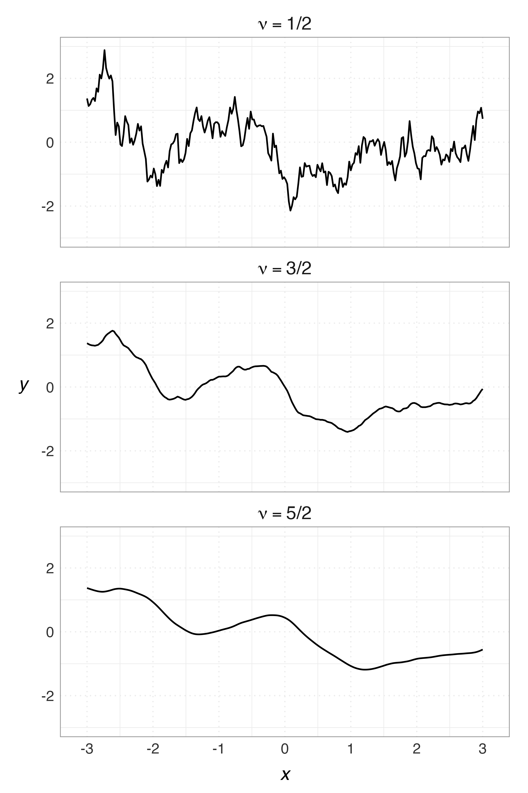
```

]


.pull-right[

<br>
<br>
<br>
<br>
<br>
<br>
<br>
<br>

.center[A função de Matérn é suficientemente flexível para representar diferentes padrões de dependência espacial]

]

---
# PPGECO | ECL0072 | out. 2026
### Modelos geoestatísticos | .small-text[<span style="color: #e07a5f;">Influência do desenho amostral</span>]

.small-text2[

As predições em locais não amostrados são obtidas a partir da estrutura de correlação espacial inferida pelos dados
- A qualidade das predições depende diretamente do método de amostragem

]

<div style="height: 5px;"></div>


```{r, out.width="65%"}
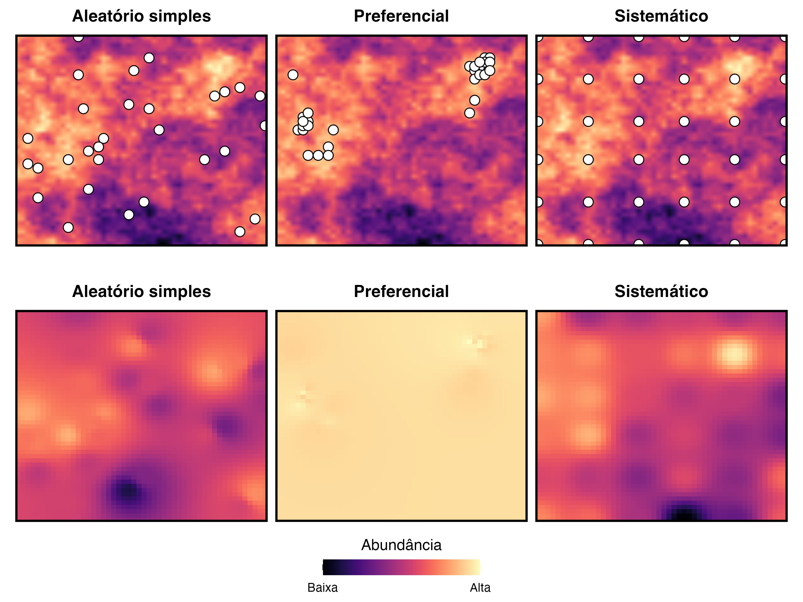
```

---
# PPGECO | ECL0072 | out. 2026
### Modelos geoestatísticos 

Um modelo geoestatístico é, por definição, um modelo hierárquico

<br>

.pull-left[
.center[<span style="color: #e07a5f;">**Processo observacional**</span>]
$$\large \mathbf{Y} ~|~ \mathbf{\beta},\mathbf{W}, \phi ~\sim ~ F(\mathbf{X}\beta + W, ~ \phi)$$

<br>

.center[<span style="color: #e07a5f;">**Processo latente**</span>]
$$\large \mathbf{W}~|~ \mathbf{\theta} ~\sim ~ N(\mathbf{0}, ~ \Sigma(\theta))$$

<br>


.center[<span style="color: #e07a5f;">**Hiperparâmetros**</span>]
$$\large \{\mathbf{\beta}, \phi, \mathbf{\theta} \}$$

]


.pull-right[

<br>
<br>

.gray-box-small[

.center[**Curiosidade**]

<div style="height: 7px;"></div>

<div style="text-align: justify;">
.small-text2[
Os modelos geoestatísticospodem ser formulados como Modelos Gaussianos Latentes (LGMs), uma classe de modelos hierárquicos que engloba grande parte dos Modelos de Regressão Estruturada Aditiva (STAR) 

]
]
</div>
]

--

<br>

.small-text2[Quando se atribui distribuições de probabilidade para] $\{\mathbf{\beta}, \phi, \mathbf{\theta} \}$.small-text2[, tem-se um modelo bayesiano!]

---
# PPGECO | ECL0072 | out. 2026
### Modelos geoestatísticos 


A estrutura de um modelo STAR pode ser expressa genericamente conforme a relação 

<br>

$$\eta_i = \alpha + \sum_{j=1}^{n_\beta} \beta_j z_{ji} +
\sum_{k=1}^{n_f} f^{(k)}(u_{ki})+\varepsilon_i$$

<br>

.small-text[
onde:
- $\mathbf{\eta_i :}$ preditor linear para $\scriptsize i ~\text{ésima}$ observação ($\scriptsize i=1,\ldots,n$)
- $\mathbf{\alpha :}$ intercepto 
- $\mathbf{\beta_j :}$ coeficientes das covariáveis $\scriptsize \{\mathbf{z}_j\}_{j=1}^{n_{\beta}}$
- $\mathbf{\mathcal{f}^{(k)} :}$ funções que definem $\scriptsize n_f$ efeitos aleatórios sobre um conjunto de covariáveis $\scriptsize \{\mathbf{u}_k\}_{k=1}^{n_f}$ 
- $\mathbf{\varepsilon_i :}$ erro (residual) do modelo

]


---
# PPGECO | ECL0072 | out. 2026
### Modelos geoestatísticos 

Os parâmetros de modelos espaciais (e temporais) podem ser estimados tanto via abordagem *frequentista* quanto *bayesiana*


<div style="height: 7px;"></div>


.pull-left[

.center[**Abordagem frequentista**]


.center[.small-text2[<span style="color: #e07a5f;">**TMB**</span>]]


```{r, out.width="80%"}

```

.center[[Kristensen et al., 2016](https://www.jstatsoft.org/article/view/v070i05)]


]


.pull-right[

.center[**Abordagem bayesiana**]


.center[.small-text2[<span style="color: #e07a5f;">**INLA**</span>]]

```{r, out.width="80%"}

```

.center[[Rue et al., 2009](https://rss.onlinelibrary.wiley.com/doi/10.1111/j.1467-9868.2008.00700.x)]


]


---
# PPGECO | ECL0072 | out. 2026
### Modelos geoestatísticos 

Os parâmetros de modelos espaciais (e temporais) podem ser estimados tanto via abordagem *frequentista* quanto *bayesiana*


<div style="height: 7px;"></div>


.pull-left[

.center[**Abordagem frequentista**]


.center[.small-text2[<span style="color: #e07a5f;">**TMB**</span>]]


```{r, out.width="80%"}

```

.center[[Kristensen et al., 2016](https://www.jstatsoft.org/article/view/v070i05)]


.small-text3[

**Pacotes**

- `TMB`
- `sdmTMB`
- `VAST`
- `tinyVAST`

]

]


.pull-right[

.center[**Abordagem bayesiana**]


.center[.small-text2[<span style="color: #e07a5f;">**INLA**</span>]]

```{r, out.width="80%"}

```

.center[[Rue et al., 2009](https://rss.onlinelibrary.wiley.com/doi/10.1111/j.1467-9868.2008.00700.x)]


.small-text3[

**Pacotes**

- `INLA`
- `inlabru`
- `INLAspacetime`
- `brms`

]

]

---
# PPGECO | ECL0072 | out. 2026
### Modelos de distribuição de espécies (SDMs)

O que determina a distribuição das espécies, comunidades e ecosistemas? 
- Como essa interação varia no espaço e no tempo?

--

O ambiente e a relações com outras espécies são fatores-chave na determinação do espaço que uma espécie pode ocupar

<br>

```{r, out.width="70%"}
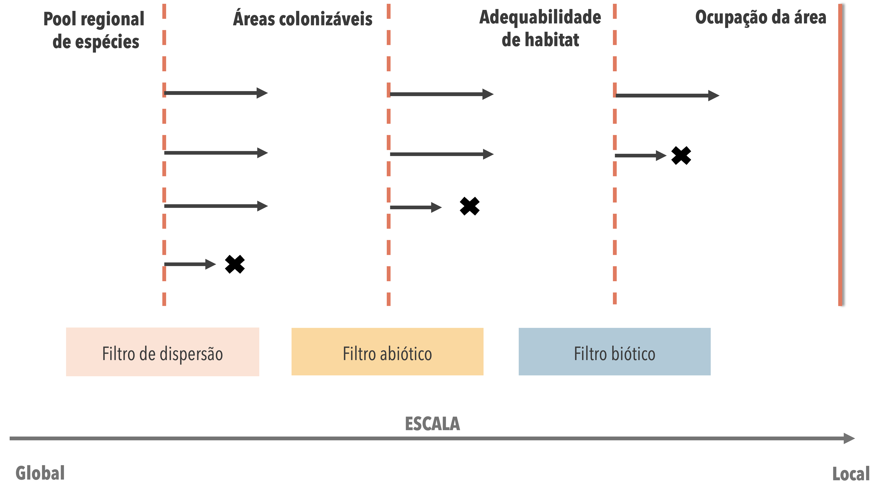
```


.footnote[.small-text[Figura adaptada de Guisan et al., 2017]]

---
# PPGECO | ECL0072 | out. 2026
### Modelos de distribuição de espécies (SDMs)

A distribuição das espécies é determinada principalmente pela interação entre as condições ambientais, interações bióticas e a capacidade de dispersão dos organismos

<div style="height: 7px;"></div>


.pull-left[

<br>

```{r, out.width="100%"}
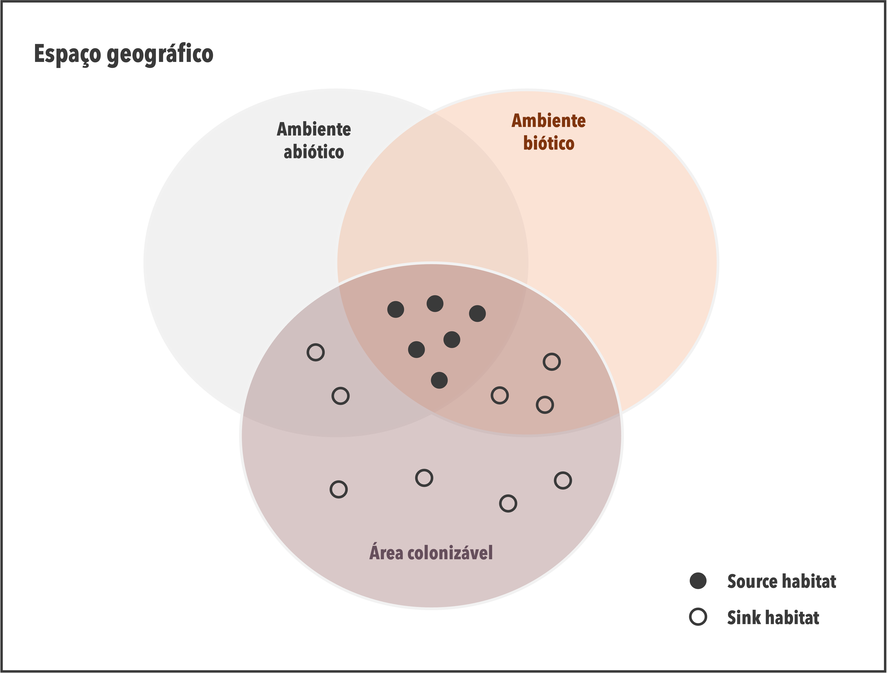
```

]


.pull-right[

<br>
<br>
<br>

.gray-box-small[

.center[**Atenção!**]

<div style="height: 7px;"></div>

<div style="text-align: justify;">

.small-text2[
Uma espécie pode estar ausente uma área por ação antrópica ou estocasticidade populacional intrínseca, que podem levar a flutuações no tamanho populacional ao longo do tempo e do espaço, com possíveis extinções locais e temporárias em algumas áreas
]

<div style="height: 7px;"></div>

]
</div>
]


.footnote[.small-text[Figura adaptada de Soberón et al., 2007]]

---
# PPGECO | ECL0072 | out. 2026
### Modelos de distribuição de espécies (SDMs)


Embora processos estocásticos influenciem a dinâmica das espécies, sua distribuição é, em grande parte, determinada pelas condições ambientais locais 

<div style="height: 7px;"></div>


```{r, out.width="70%"}

```


.footnote[Imagem: [Smithsonian Magazine](https://www.smithsonianmag.com/history/pioneering-maps-alexander-von-humboldt-180973342/)]

---
# PPGECO | ECL0072 | out. 2026
### Modelos de distribuição de espécies (SDMs)

Embora processos estocásticos influenciem a dinâmica das espécies, sua distribuição é, em grande parte, determinada pelas condições ambientais locais 

- Portanto, a quantificação do nicho ecológico permite predizer sua distribuição no espaço geográfico
  - I.e., quantificar a relação espécie-ambiente


<br>


.pull-left[

.gray-box-small[

.small-text2[.center[**Modelos de distribuição de espécies<sup>1</sup>**]]

<div style="height: 7px;"></div>

<div style="text-align: justify;">

.small-text2[

Constituem um conjunto de ferramentas estatísticas que relacionam a ocorrência ou abundância de espécies às condições ambientais
- Consideram o ***nicho realizado***
]

<div style="height: 7px;"></div>

]
</div>
]


.pull-right[

```{r, out.width="100%"}
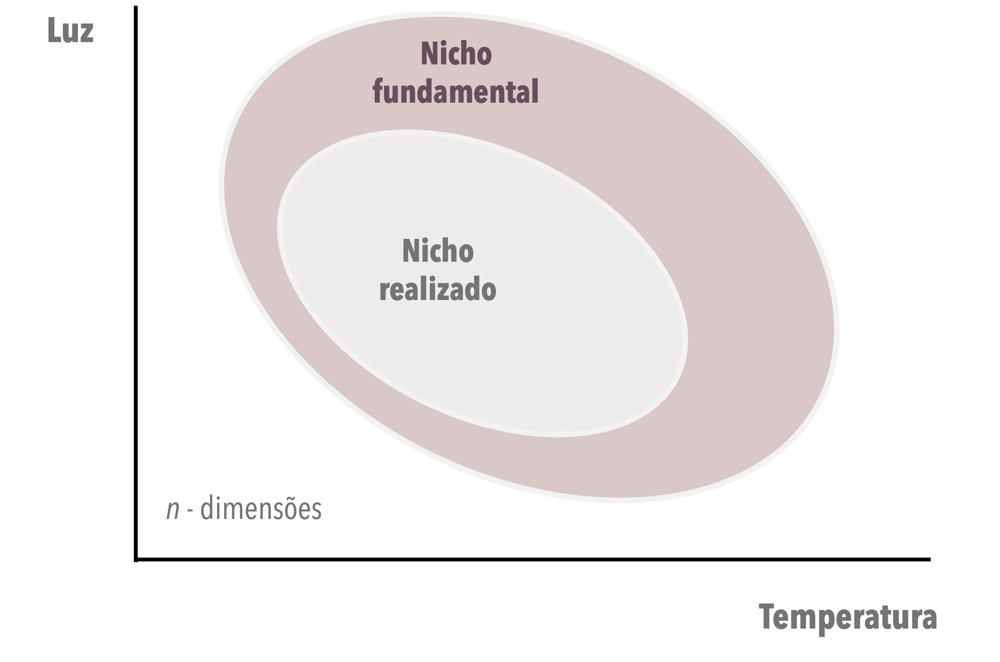
```

]


.footnote[<sup>1</sup> *Species Distribution Models*, SDMs]

---
# PPGECO | ECL0072 | out. 2026
### Modelos de distribuição de espécies (SDMs)

Os SDMs são conhecidos por muitos nomes....


.pull-left[

<br>
<br>
<br>

```{r, out.width="90%"}
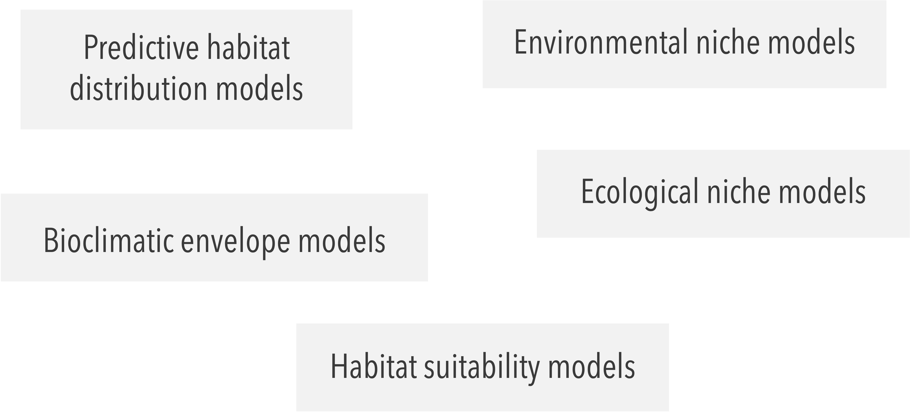
```

]

.pull-right[

<br>


.center[**SDMs permitem:**]

<br>

.small-text2[
- Compreender e quantificar os fatores que determinam a distribuição de uma espécie
- Predizer sua ocorrência em áreas não amostradas

  ]
]

---
# PPGECO | ECL0072 | out. 2026
### Modelos de distribuição de espécies (SDMs)

**Para que são usados os SDMs?**

ATUALIZAR FIGURA


```{r, out.width="40%"}
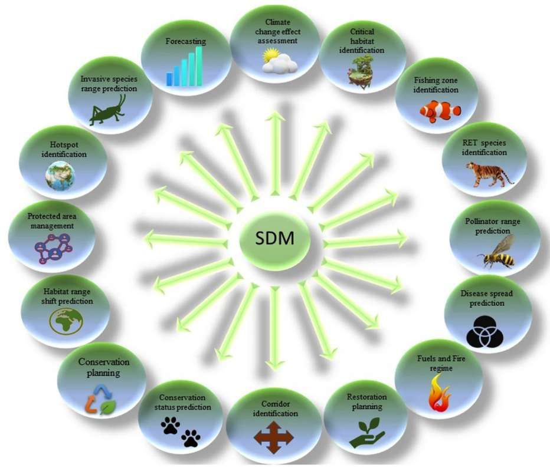
```


https://link.springer.com/article/10.1007/s10531-023-02648-1/figures/1

---
# PPGECO | ECL0072 | out. 2026
### Modelos de distribuição de espécies (SDMs)


#### Como funcionam os SDMs?


ATUALIZAR A FIGURA!

```{r, out.width="70%"}
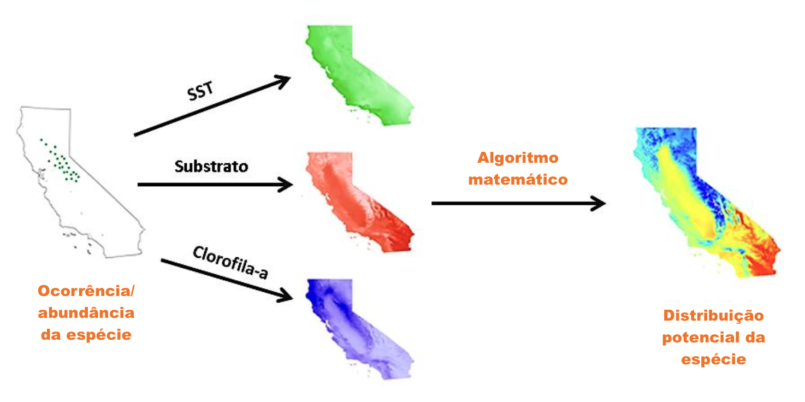
```


---
# PPGECO | ECL0072 | out. 2026
### Modelos de distribuição de espécies (SDMs)


Há vários algoritmos disponíveis:

<div style="height: 7px;"></div>


.pull-left[

.center[.small-text2[**Modelos estatísticos**]]

<div style="height: 7px;"></div>


.small-text[
- Climatic Envelopes (e.g., BIOCLIM)
- Maximum Entropy (e.g., MAXENT)
- Modelos de regressão (e.g., GLM, GAM, GL(A)MM)

]

]


.pull-right[

.center[.small-text2[**Modelos de aprendizado de máquina**]]

<div style="height: 7px;"></div>

.small-text[
- Artificial Neural Networks
- Random Forests
- Convolutional Neural Networks
- Suport Vector Machines

]

]

--

-----

<div style="height: 7px;"></div>

Os algoritmos diferem principalmente quanto:

.small-text[
- Tipo de variável-resposta (ocorrência, presenç-ausência, abundância, ...)

- Forma como modelam a relação espécie-ambiente (linear, não linear, árvores de decisão, redes neurais, ...)

]

<div style="height: 7px;"></div>

--


.gray-box-small[
.small-text2[
.center[**Limitações da maioria dos algoritmos tradicionais:**]

1. Assumem independência espacial das observações (i.e., ignoram a autocorrelação espacial)
2. Não propagam adequadamente as incertezas nos parâmetros para as predições finais espaciais

]

]


---
# PPGECO | ECL0072 | out. 2026
### Modelos de distribuição de espécies (SDMs) 


Modelos geoestatísticos bayesianos constituem uma escolha natural para conduzir estudos de SDMs, uma vez que permitem:

.small-text2[

- Modelar a dependência espacial (e temporal) dos dados 

]

--

.small-text2[

- Quantificar, probabilisticamente, a incerteza associada às predições

]

--

.small-text2[
- Obter mapas de distribuição com incerteza explícita
]


--

.small-text2[
- Incorporar informação de diferentes bancos de dados
]


--

.small-text2[

- Modelar várias espécies simultaneamente

]

--


.small-text2[

- Considerar fatores bióticos e antrópicos

]


```{r, out.width="100%"}
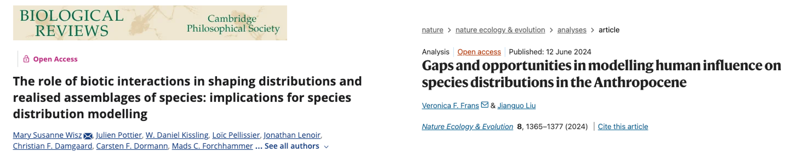
```

---
# PPGECO | ECL0072 | out. 2026
### Modelos de distribuição de espécies (SDMs) 

Modelos geoestatísticos bayesianos constituem uma escolha natural para conduzir estudos de SDMs, uma vez que permitem:

.small-text2[
- Modelar a dependência espacial (e temporal) dos dados 

- Quantificar, probabilisticamente, a incerteza associada às predições

- Obter mapas de distribuição com incerteza explícita

- Incorporar informação de diferentes bancos de dados

- Modelar várias espécies simultaneamente

- Considerar fatores bióticos e antrópicos

]

<br>


.pull-left[

```{r, out.width="90%", fig.align='left'}

```

  
]

.pull-right[

```{r, out.width="60%"}
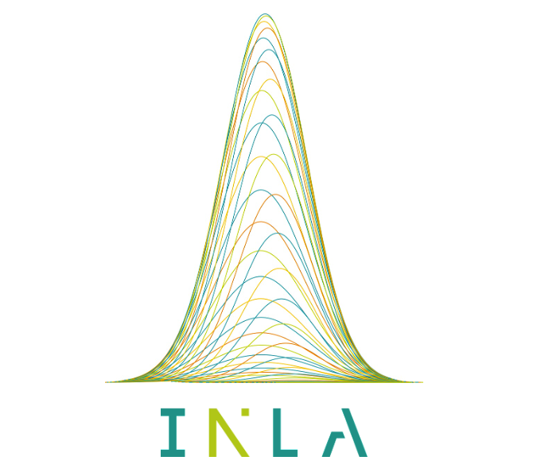
```

.center[.small-text[[https://www.r-inla.org/](https://www.r-inla.org/)]]

]


---
# PPGECO | ECL0072 | out. 2026
### INLA 


O [INLA](https://www.r-inla.org/)<sup>1</sup> é um método de inferência bayesiana para estimar parâmetros de LGMs


- No contexto bayesiano, o INLA consiste em uma alternativa ao método Monte Carlo via Cadeias de Markov (MCMC)

--


.footnote[<sup>1</sup>*Integrated Nested Laplace Approximations*]

<br>

------

<br>


.pull-left[

.small-text2[

.center[**MCMC**]

<div style="height: 7px;"></div>

- **Abordagem:** Amostragem estocástica via simulação
- **Vantagem:** Suporta praticamente qualquer distribuição ou estrutura não linear
- **Desvantagem:** Computacionalmente lento (horas/dias em modelos espaciais)
- **Diagnóstico:** Exige checagem de convergência das cadeias

]

]

.pull-right[

.small-text2[

.center[**INLA**]

<div style="height: 7px;"></div>

- **Abordagem:** Solução analítica baseada em aproximações de Laplace
- **Vantagem:** Extremamente rápido e otimizado para dados espaciais
- **Desvantagem:** Restrito à classe dos LGMs
- **Diagnóstico:** Sem necessidade de avaliar cadeias de amostragem

]

]


---
# PPGECO | ECL0072 | out. 2026
### INLA | .small-text[<span style="color: #e07a5f;">Ajustando modelos</span>]


A sintaxe para ajustar modelos no `INLA` é similar a outros pacotes de ajuste de modelos

-  **1.** Definir preditor linear ($\eta$) via objeto *formula* 
  
-  **2.** Ajustar o modelo via função `inla()`

--

-----

##### 1. Especificando o preditor linear 

.code-bg[
```{r, eval=F, echo=T}

f1 <- y ~ x1 + x2 + f(x3, model = "")
```
]


- .small-text2[O argumento model na função `f()` acomoda todos os tipos de efeitos aletórios (estruturados e não estruturados), bem como efeitos suavizadores (GAM).]

--

- .small-text2[Podemos acessar os efeitos aleatórios disponíveis via:]

```{r}
library(INLA)
```

.code-bg[
```{r, eval=T, echo=T}

## Expondo apenas os 20 primeiros modelos (+50)
names(inla.models()$latent)[1:20]
```
]

---
# PPGECO | ECL0072 | out. 2026
### INLA | .small-text[<span style="color: #e07a5f;">Ajustando modelos</span>]


A sintaxe para ajustar modelos no `INLA` é similar a outros pacotes de ajuste de modelos

-  **1.** Definir preditor linear ($\eta$) via objeto *formula* 
  
-  **2.** Ajustar o modelo via função `inla()`

-----

##### 1. Especificando o preditor linear 


.small-text2[Algumas estruturas de modelos *latentes* úteis:]


.code-bg[
```{r, echo=T, eval = F}

# GAM
f1 <- y ~ x1 + x2 + f(x3, model = "rw1")  #rw2


# GLMM (efeito aleatório não estruturado)
f2 <- y ~ x1 + x2 + f(x3, model = "iid") 


# Temporal (efeito aleatório estruturado)
f3 <- y ~ x1 + x2 + f(x3, model = "ar1")  #seasonal,....


# Espacial (efeito aleatório estruturado)
f4 <- y ~ x1 + x2 + f(x3, model = "spde") #bym, besag, matern2d

```

]


---
# PPGECO | ECL0072 | out. 2026
### INLA | .small-text[<span style="color: #e07a5f;">Ajustando modelos</span>]


A sintaxe para ajustar modelos no `INLA` é similar a outros pacotes de ajuste de modelos

-  **1.** Definir preditor linear ($\eta$) via objeto *formula* 
  
-  **2.** Ajustar o modelo via função `inla()`

-----

##### 2. Ajuste do modelo via `inla()` 

.small-text2[

Função usada para ajustar o modelo: 
- Composta por vários argumentos
]


.code-bg[
```{r, eval = F, echo=T}

mod1 <- inla(formula = f1,
             family = "poisson",
             data = dados,
             control.compute = list(dic = T, waic = T, cpo = T)), # Retorna quais métricas de ajustes são retornadas
             control.predictor = list(compute = TRUE, link = 1), # Controla o cálculo do preditor linear 
             control.fixed = list(expand.factor.strategy = 'inla'), # Útil na presença de variáveis categóricas (maior estabilização)
            ...)
```

]

---
# PPGECO | ECL0072 | out. 2026
### INLA | .small-text[<span style="color: #e07a5f;">Ajustando modelos</span>]


A sintaxe para ajustar modelos no `INLA` é similar a outros pacotes de ajuste de modelos

-  **1.** Definir preditor linear ($\eta$) via objeto *formula* 
  
-  **2.** Ajustar o modelo via função `inla()`

-----

##### 2. Ajuste do modelo via `inla()` 

.small-text2[O INLA possui uma ampla seleção de modelos probabilísticos para definir no argumento `family`:]

.code-bg[
```{r, echo=T, eval=T}

## Expondo apenas os 50 primeiros modelos probabilísticos (+100)
names(inla.models()$likelihood)[1:50]

```

]


---
# PPGECO | ECL0072 | out. 2026
### INLA | .small-text[<span style="color: #e07a5f;">Ajustando modelos</span>]


Como padrão, o INLA usa *prioris* não-informativas para definir todos os parâmetros do modelo

.pull-left[

**Efeitos fixos**

```{r, echo=T, eval = T}
inla.set.control.fixed.default()[c("mean.intercept", "prec.intercept", "mean", "prec")]
```

]


.pull-right[


```{r, echo = T, eval = F}

prior.fixed <- list(mean.intercept = <>, prec.intercept = <>,
                    mean = <>, prec = <>)
res <- inla(formula,
  data = d,
  control.fixed = prior.fixed
)

```

]

.footnote[Uma lista completa de prioris pode ser accesada via `r names(inla.models()$prior)`]

---


Autocorrelação Espacial "Aparente" (Induzida): Ocorre quando a variável de resposta apresenta padrão espacial simplesmente porque segue uma covariável que também é estruturada no espaço. Se você inclui essa covariável no modelo, a dependência nos resíduos desaparece.

Autocorrelação Espacial Residual (Verdadeira): É o que sobra nos resíduos depois de controlar pelas covariáveis. É aqui que entra o campo aleatório espacial (efeito aleatório espacial, como nos modelos INLA / SPDE ou GAMs com splines espaciais), para modelar essa dependência estocástica latente.

---

It is now clear that three main conditions need to be met for a species to occupy a site and maintain populations
(i) the species has to reach the site, i.e. to access the region (Barve et al., 2011) and disperse there; 
  - this is a matter of dispersal
(ii) the abiotic environmental conditions must be ecophysiologically suitable for the species;
  - this is a matter of habitat suitability
    - this is the core of habitat suitability models!
(iii) the biotic environment (interactions) must be suitable for the species.
 - this is a matter of biotic interactions
 
 - Figura 3.1 pode ser interessante
 
 This triple influence – dispersal, niche, and biotic – shaping species distributions, and their interactions, can be viewed schematically as sepa- rate ensembles defined by specific boundary conditions (Soberón, 2007). Suitable conditions for a species according to all three factors are found at the intersection of the three ensembles (Figure 3.2, case 1).
 # Do livro habitat suitability and distribution models - Guisan & Zimmermann


---

ebooks

https://becarioprecario.bitbucket.io/inla-gitbook/index.html


- https://www.annualreviews.org/content/journals/10.1146/annurev-statistics-060116-054045


- caps. 3-5 (Guisan - Habitat suitability modeling)
- cap. 3 (Franklin, 2010)


---


Retomar deifinição sobre o que é um modelo geoestatístico
- Mostrar a equação de um modelo de regressão com efeito espacial
- Mostrar como se traduz, matematicamente, o efeito espacial (matrizes de distância)

- Falar sobre a importância do método de amostragem!!

- Fazer o link em relação ao número de parâmetros (todos aleatórios, já que estaão no contexto bayesiano) e problema de MCMC - > uso do INLA
- Apresentar brevemente o INLA (teoricamente)


- Modelos de distribuição de espécies (introdução breve)
- enfatizar que não está restrito à dados de presença (e ausência)

