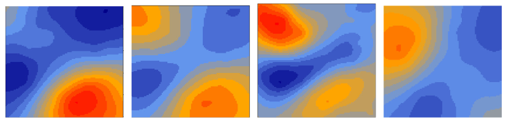

```{r xaringan-themer, include=FALSE, warning=FALSE}


#~~~~~~~~~~~~~~~~~~~~~~
# Default knitr iputs
#~~~~~~~~~~~~~~~~~~~~~~

source("../Scripts/Setup/setup_knitr.R")

#~~~~~~~~~~~~~~~~~~~~~~
# Slide customization
#~~~~~~~~~~~~~~~~~~~~~~
source("../Scripts/Setup/setup_slides.R")


```

class: title-slide
<div class="title-block">
  <h1>`r rmarkdown::metadata$title`</h1>
  <div class="date-text">`r rmarkdown::metadata$date`</div>
</div>

<div class="subtitle-block">
  <h2>`r rmarkdown::metadata$subtitle`</h2>
  <p class="author-name">`r rmarkdown::metadata$author`</p>
  <p class="author-email"><u>`r rmarkdown::metadata$institute`</u></p>
</div>


---
# PPGECO | ECL0072 | out. 2026

Processos ecológico são dinâmicos no espaço e no tempo


<br>

.small-text2[.center[**Dinâmica espaço-temporal do bacalhau (*Gadus morhua*)**]]


```{r, out.width="90%"}
knitr::include_graphics("../Figuras/wbs_cod.gif")
```


---
# PPGECO | ECL0072 | out. 2026

### Estrutura genérica de um modelo espaço-temporal

<br>
<br>
<br>
<br>

$$\LARGE \eta(s,t) = \mathbf{X}(s,t)\mathbf{\beta} +
\mathbf{U}(s,t)$$

<br>
<br>
<br>

Diferentes estruturas para o termo $\large \mathbf{U}(s,t)$


.footnote[Baseado em [Paradinas et al. (2017)](https://www.sciencedirect.com/science/article/abs/pii/S2211675316300872)]
---
# PPGECO | ECL0072 | out. 2026

### Distribuição persistente aleatória

Adequado para casos cuja intensidade do processo (ecológico) varia de forma aleatória entre as unidades temporais
- As realizações espaciais do campo latente são similares entre as unidades temporais, porém sem relação entre os anos


$$\large U(s,t) = W(s) + V_t$$
$$\large W(s) \sim N(O, Q(\kappa, \tau))$$
$$\large V_t \overset{\text{iid}}{\sim} N(0, \sigma_t^2)$$

<div style="height: 7px;"></div>


```{r, out.width="60%"}
knitr::include_graphics("../Figuras/persistent_iid.png")
```

<br>

.small-text2[**Exemplo:** Áreas de berçário são as mesmas todos os anos, porém sua extensão pode flutuar entre os anos como reflexo de períodos de alto ou baixo recrutamento]


---
# PPGECO | ECL0072 | out. 2026

### Distribuição persistente com tendência temporal de intensidade

A intensidade do processo (ecológico) segue uma tendência sistemática (crescimento ou declínio) ao longo do tempo


$$\large U(s,t) = W(s) + g(t)$$
$$\large W(s) \sim N(0, Q(\kappa, \tau))$$
- $\large g(t):$ descrito por uma função linear ou não-linear ()

<div style="height: 7px;"></div>


```{r, out.width="60%"}
knitr::include_graphics("../Figuras/persistent_trend.png")
```

<br>

.small-text2[**Exemplo:** Declínio de uma população sobreexplorada, expansão de espécies invasoras, ...]


---

# PPGECO | ECL0072 | out. 2026

### Distribuição oportunista

Cada período $t$ tem uma realização espacial diferente e independente, mas todas compartilham os mesmos hiperparâmetros do campo espacial ($\kappa, \tau$)
- Não há continuidade do processo ecológico entre períodos
  - Uma região cuja intensidade é elevada em $t$ não necessariamente será a mesma em $t+1$

$$\large U(s,t) = W_t(s)$$
$$\large W_t \overset{\text{iid}}{\sim} N(0, Q(\kappa, \tau))$$

<div style="height: 7px;"></div>


```{r, out.width="60%"}
knitr::include_graphics("../Figuras/oportunistic.png")
```

<br>

.small-text2[**Exemplo:** Agregaçõesde animais marinhos em regiões de ressurgência]

---
# PPGECO | ECL0072 | out. 2026

### Distribuição espaço-temporal com progressão

A intensidade do processo ecológico muda de um período ($t$) para outro ($t+1$), com correlação entre os campos espaciais
- O padrão espacial muda ao longo do tempo, porém de forma gradual e estruturado temporalmente

$$\large U(s,t) = W_t(s) + \sum_{k=1}^{K}\rho_kU(s, t-k)$$
$$\large W_t \sim N(0, Q(\kappa, \tau))$$

<div style="height: 7px;"></div>


```{r, out.width="60%"}

```


<br>

.small-text2[**Exemplo:** Migração sazonal de espécies, deslocamento gradual de espécies devido às mudanças climáticas]