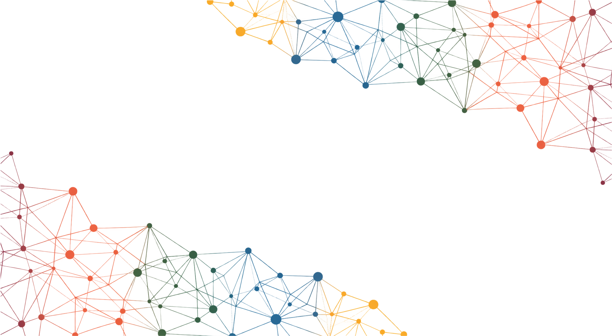

# ECL0072 (2026-2)
## Tópicos Especiais em Ecologia - Modelos Espaço-Temporais para Dados Ecológicos

<p align="center">

</p>


Este repositório contém todo o material da disciplina e os arquivos necessários para gerar a página da disciplina.


### Acessando o material da disciplina

A página da disciplina foi toda construída usando apenas o [R Markdown][] e, por isso, o código fonte pode ser acessado nos arquivos `Rmd`. Para gerar o site você precisará instalar (ou atualizar) os pacotes `rmarkdown` e `knitr`.

Para acessar o material da disciplina, siga as intruções abaixo:

1. Copie (ou fork) esse repositório
2. Apague o diretório `site_libs/`
3. Abra o R nesse diretório, carregue os pacotes e renderize o site com
   `render_site()`, conforme indicado abaixo
4. Clique no arquivo *index.html* e abra-o com a opção *browser*

<br>

```r

# Compilando o site da disciplina
#~~~~~~~~~~~~~~~~~~~~~~~~~~~~~~~~~
library(knitr)
library(rmarkdown)
render_site()


```

### Licença

O conteúdo deste repositório, das páginas, e do material da disciplina está está disponível por meio da [Licença Creative Commons 4.0][] (Atribuição/NãoComercial/PartilhaIgual).


[Licença Creative Commons 4.0]: https://creativecommons.org/licenses/by-nc-sa/4.0/deed.pt_BR
[R Markdown]: http://rmarkdown.rstudio.com
